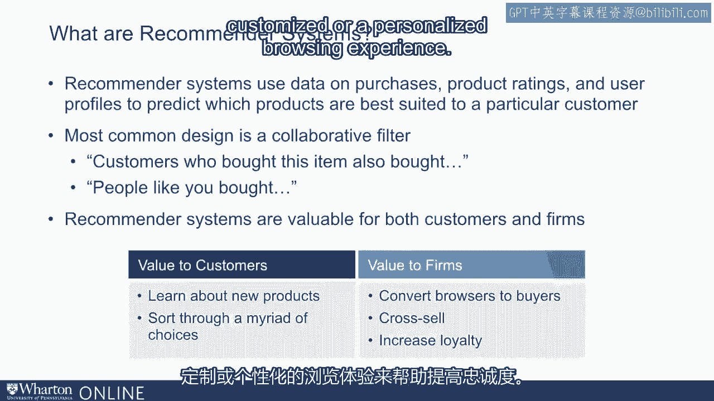
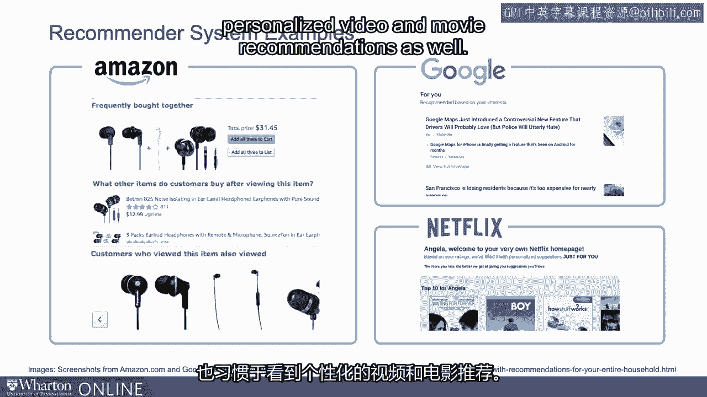
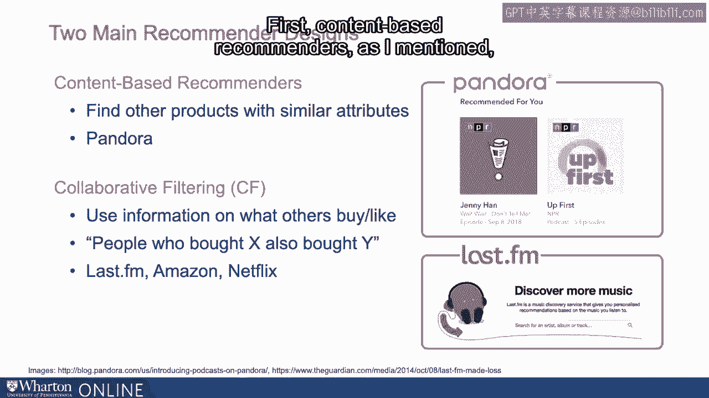
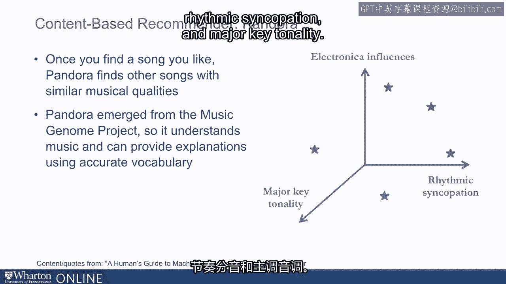
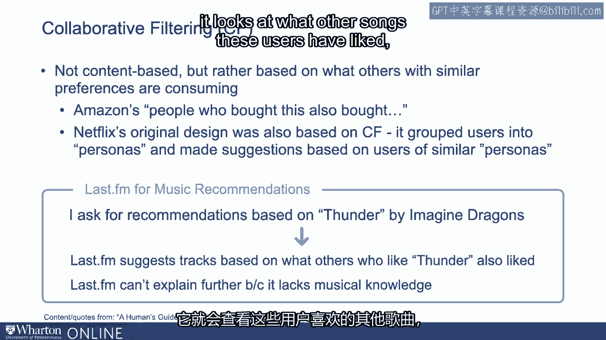
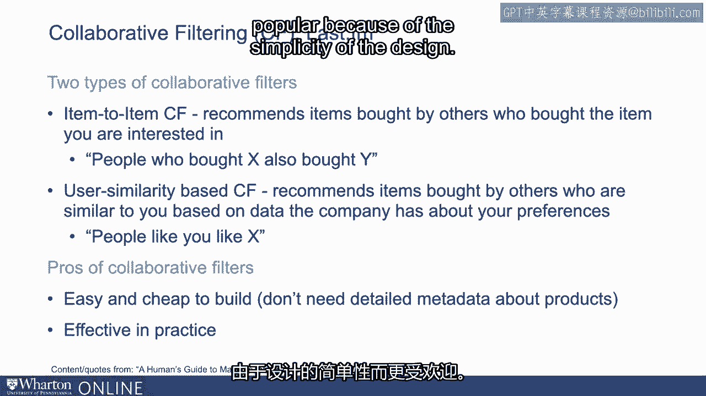
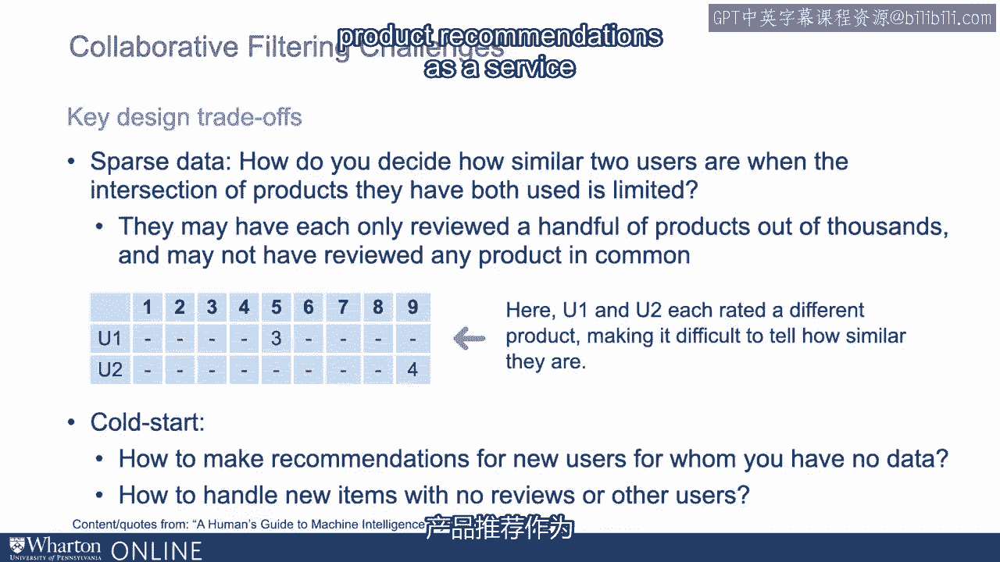

# 课程P42：个性化推荐系统 🎯

在本节课中，我们将学习个性化推荐系统。我们将从网络个性化的概念引入，并深入探讨推荐系统的核心原理、主要类型、应用实例以及面临的挑战。

---

## 什么是推荐系统？ 🤔

上一节我们介绍了网络个性化，本节中我们来看看推荐系统的具体定义。

推荐系统，有时也被称为推荐引擎，其目标是预测用户可能感兴趣的项目、产品或内容。这些预测基于用户的一些信息，例如他们的个人资料、过去的购买记录或评分行为。

最常见的推荐系统例子是协同过滤。这类系统使用诸如“购买此商品的顾客也购买了…”或“看过此视频的人也看了…”等标签或短语来生成推荐。

推荐系统之所以独特，是因为它们能为用户和公司双方创造价值。

*   对于消费者，它们帮助发现新产品，并在海量选项中筛选出最相关、最合适的选择。
*   对于公司，它们有助于将浏览者转化为购买者，促进交叉销售，并通过提供定制化的浏览体验来提高客户忠诚度。

---

## 推荐系统的应用实例 📱

以下是推荐系统在现实世界中的一些常见应用，你可能已经非常熟悉。

*   在电商网站（如亚马逊）上，你会看到“购买此商品的顾客也购买了…”的提示。
*   在Google新闻上，你会看到根据你兴趣定制的个性化新闻推荐。
*   在YouTube或Netflix上，你会看到为你推荐的个性化视频和电影。

---

## 推荐系统的两种主要设计 🏗️

从高层次看，业界主要采用两种推荐系统设计。上一节我们看到了推荐系统的广泛应用，本节中我们来详细解析这两种核心设计。

### 1. 基于内容的推荐系统

正如其名，这类系统关注内容或产品本身的属性。它们试图通过分析用户喜欢的产品属性，来寻找具有相似属性的其他产品。

一个典型例子是Pandora在线音乐服务。Pandora源于“音乐基因组计划”，在该项目中，专家对数百万首歌曲从数百个音乐属性（如“电子影响力”、“节奏切分音”、“大调音色”等）进行评分。

**其工作原理可概括为：**
1.  用户表明喜欢某首歌曲（例如，Imagine Dragons的《Thunder》）。
2.  系统在数据库中查找具有相似音乐属性（如特定的dub制作、雷鬼元素、原声钢琴节奏等）的其他歌曲。
3.  系统推荐这些歌曲（例如，推荐21 Pilots的《Ride》）。

这种设计高度依赖对产品内容的深入元数据。系统可以通过用户反馈（如“不喜欢”）进行实时学习和调整。

### 2. 协同过滤推荐系统

协同过滤不深入分析产品属性，而是基于其他用户的行为数据进行推荐。它试图找到品味相似的用户，然后推荐这些用户喜欢的内容。

例如，亚马逊的“购买此商品的顾客也购买了…”就是基于协同过滤。Netflix早期的流媒体推荐和Last.fm的音乐推荐也采用此方法。

协同过滤主要有两种变体：

以下是两种主要的协同过滤方法：

*   **基于物品的协同过滤**：输入是用户喜欢的特定物品（如歌曲《Thunder》），系统会寻找其他也被喜欢该物品的用户所喜爱的物品进行推荐。公式可简化为：`推荐物品 = 与目标物品相似度最高的物品集合`。
*   **基于用户的协同过滤**：输入是用户的历史行为（如所有评分记录），系统会寻找与该用户历史偏好相似的其他用户，然后推荐这些相似用户喜欢的物品。公式可简化为：`推荐物品 = 相似用户喜欢而目标用户未接触过的物品集合`。

协同过滤的优势在于不需要产品的详细元数据，构建相对简单且成本较低，同时效果非常显著，因此在实践中极为流行。

---

## 构建推荐系统的挑战 ⚠️

上一节我们了解了两种主流设计，本节中我们来看看在构建这些系统时会遇到哪些挑战。

无论是构建基于内容的系统还是协同过滤系统，都面临一些共同挑战：

*   **数据稀疏性**：用户通常只对海量商品中的极少数进行评分或互动，导致用户-物品矩阵非常稀疏，难以计算可靠的相似度。
*   **冷启动问题**：这包含两个方面：
    1.  **新用户问题**：如何为新用户（没有历史行为数据）做出推荐。
    2.  **新物品问题**：如何推荐刚加入系统、尚未有任何用户行为记录的新物品。

数据科学家需要花费大量精力解决这些设计挑战。幸运的是，这是一个相当成熟的领域，已有许多有效的解决方案。如今，构建推荐系统并不十分复杂，公司甚至可以选择集成第三方提供的推荐服务。

---

## 总结 📝

本节课中，我们一起学习了推荐系统的核心知识。

我们了解到，推荐系统通过预测用户兴趣来为用户和公司创造价值。最流行的两种设计是**基于内容的推荐**和**协同过滤推荐**。前者依赖于产品的深度属性信息，后者则利用用户群体的行为模式。两者在实践中效果显著，但各有权衡，并共同面临数据稀疏性和冷启动等挑战。在实际应用中，需要根据业务需求和数据情况选择合适的方案。