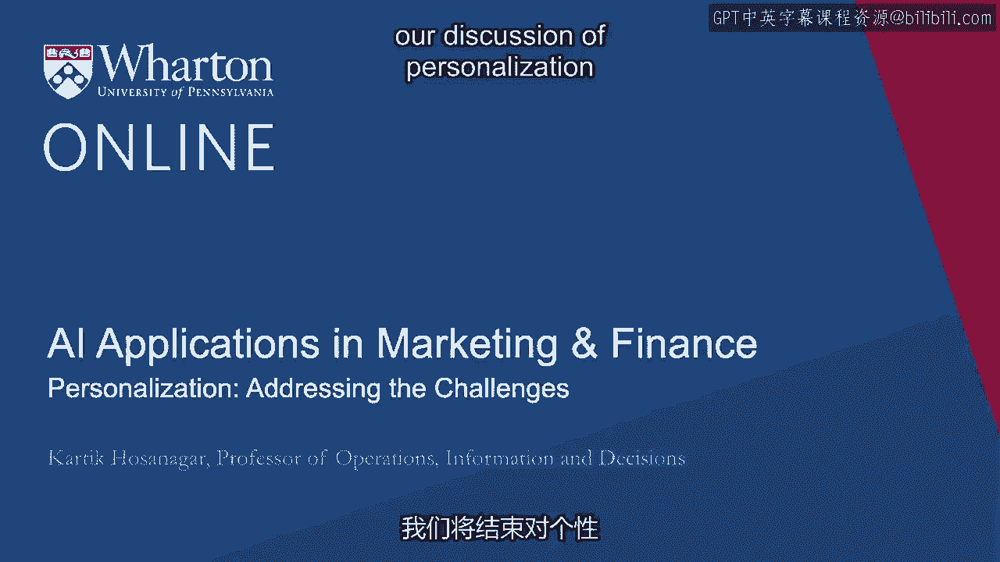
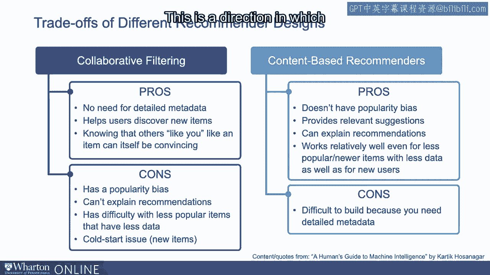
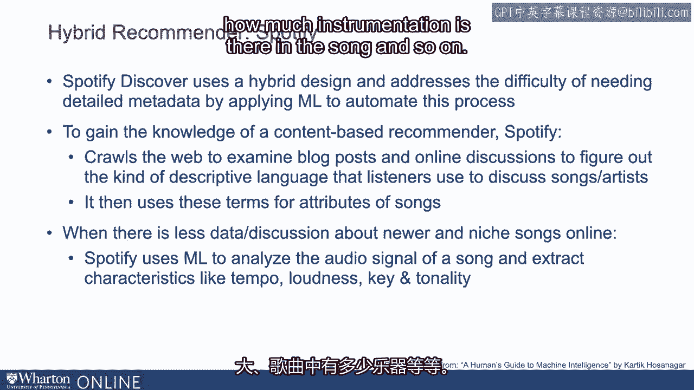
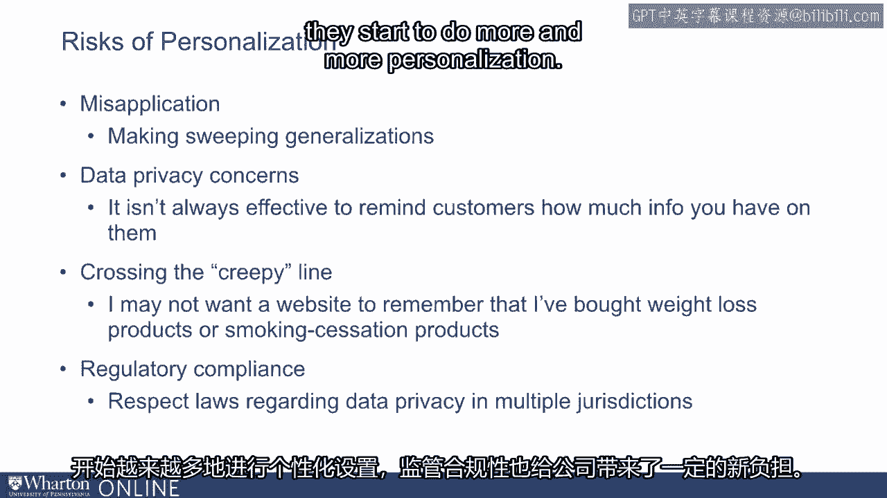

# 课程 P44：个性化与推荐系统的挑战与融合 🧩

在本节课中，我们将结束关于个性化与推荐系统的讨论，重点探讨其面临的挑战以及如何通过融合不同方法来解决这些问题。

---

## 系统回顾与挑战权衡

上一节我们介绍了推荐系统的基本类型。本节中，我们来看看这些系统设计中的核心挑战与权衡。

回想上次讲座，我们讨论了与推荐设计相关的某些挑战或权衡。

协作过滤的主要优势之一是它不需要关于所推荐产品的深度元数据，因此它非常容易构建。与此同时，它相当有效，并已证明有助于消费者发现新产品。这具有良好的社交吸引力，例如，知道其他人像我一样喜欢或消费某些歌曲，会增加我对那首歌的兴趣。

然而，这种设计也有一些缺点。我们讨论了协作过滤设计的受欢迎程度偏差挑战，尤其是如果作为零售商你想让客户接触你的旧目录。还有，因为这些系统对所推荐的产品没有深入的了解，它们无法解释为什么某些产品被推荐给用户。最后，它们也往往面临新用户和新产品的挑战。

相对而言，基于内容的推荐系统实际上没有受欢迎程度偏差。它们也非常有效，并且对所推荐的产品有深刻的了解。它们可以向消费者解释推荐背后的理由。但建立起来相当昂贵，因为你需要关于被推荐产品的详细元数据。

因此，出现的问题是：是否有办法实际上结合这两者，这样你就能获得两者的好处。这是许多公司近年来所走的方向。

---

## 融合实践：以Spotify为例 🎵

一个例子是 Spotify。对于那些习惯使用 Spotify 的用户，你可能对 Spotify 的 Discover Weekly 推荐非常熟悉，Spotify 为你策划了一系列歌曲供你收听。

现在 Spotify 的 Discover Weekly 最初是基于协作过滤设计的。所以最初 Spotify 的推荐系统纯粹基于协作过滤。但随着时间的推移，它也结合了基于内容的推荐设计原则。

为了做基于内容的推荐，需要关于歌曲质量的非常丰富的元数据。如果你打算按照 Pandora 最初启动其服务的方式去收集，这会很昂贵，意味着让艺术家听歌曲并对这些歌曲进行评分。

所以一个替代方案是使用机器学习自动提取歌曲的属性。Spotify 通过两种方式做到这一点：

以下是Spotify提取歌曲属性的两种方法：
1.  **网络爬取与文本分析**：Spotify 爬取网络，查看关于歌曲的博客帖子或任何在线讨论，并查看人们在讨论或描述歌曲时使用的描述性语言。它使用那些描述性词语作为歌曲的属性。这对已经存在一段时间并受到讨论的歌曲非常有用。
2.  **音频信号分析**：新歌或小众歌曲代表着一个挑战，因为它们在网上讨论得不多。为了解决这个问题，Spotify使用机器学习分析每首歌曲的音频信号。现在它能够提取许多音乐特征，例如歌曲的节奏、歌曲是否具有大调音调、歌曲有多响、乐器使用多少、歌曲中存在的内容等等。

最终，Spotify可以使用所有这些通过机器学习提取的内容属性，并结合协作过滤类型的功能（查看其他人正在消费什么），因此结合了这两种世界的优点。

这是Netflix以及许多主要在线媒体公司发展的方向，即结合这两种不同推荐设计的优势。

---

## 超越产品推荐：全方位的个性化体验

当然，我们花了很多时间讨论产品推荐，主要是因为它们非常普遍，并且对零售商或消费者都有显著价值。但重要的是要承认，个性化不仅仅是产品推荐。

它还涉及跨不同渠道定制客户体验，与可能在你的网站上、可能在移动应用上、通过电子邮件或可能是在商店的客户互动。这是实际弄清楚如何提供整体集成体验的能力，这就是个性化的核心。

例如，如今，公司甚至在个性化电子邮件。因此，电子邮件发送到客户数据库，但电子邮件中的某些内容可能会在客户打开电子邮件时，实时填充信息。

以下是电子邮件个性化的一个技术示例：
*   电子邮件可能以HTML格式发送，意味着与网页格式相同。
*   当客户打开电子邮件时，可能会调用某个JavaScript脚本。
*   该脚本可以查看客户打开电子邮件时的位置，并据此定制图像。

例如，如果电子邮件是关于夹克促销的，当客户在一个当前下雨的地方打开时，可能会看到一件雨衣的图像；如果在下雪，他们可能会看到一张雪衣的图像。这种个性化是在客户打开电子邮件时，根据运行的脚本和客户的过去数据实现的。

---

## 个性化的风险与考量 ⚠️

说到这些，个性化为消费者和企业都增添了很多价值，但也带来了某些风险。

以下是几个主要的风险与考量：
1.  **误用与糟糕推荐**：当你的推荐或个性化算法对客户做出笼统的概括，并做出非常糟糕的推荐时，这最终会使客户对个性化产生反感。
2.  **数据隐私**：消费者对隐私的敏感性显著增加，尤其是考虑到企业对客户的了解信息量之大，以及由于某些公司对客户数据的肆意滥用。因此企业在使用数据及其呈现个性化结果的方式时必须非常谨慎，因为很容易越界，对消费者而言显得有些“ creepy ”。
3.  **监管与合规**：基于非常敏感的消费者数据的过度个性化还有另一个风险，即监管者可能会介入。实际上在许多管辖区，监管者正在介入，发布了多项不同的数据隐私法规，因此合规性也成为一个问题。随着企业越来越多地进行个性化，这给它们带来了新的负担。

---

## 总结

本节课中我们一起学习了推荐系统面临的挑战，特别是协作过滤的流行度偏差和冷启动问题，以及基于内容推荐的元数据成本问题。我们探讨了通过融合两种方法（如Spotify所做）来取长补短的解决方案。此外，我们认识到个性化远不止产品推荐，它涵盖了跨渠道的定制化客户体验。最后，我们讨论了伴随个性化而来的数据隐私、算法误用和监管合规等重要风险。接下来，我们将讨论机器学习在金融服务中的应用。