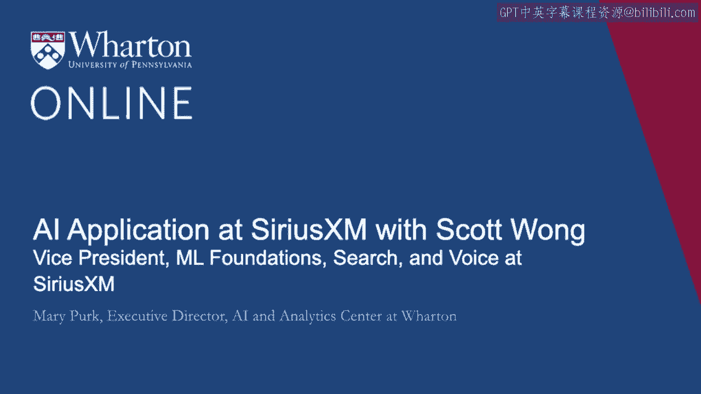
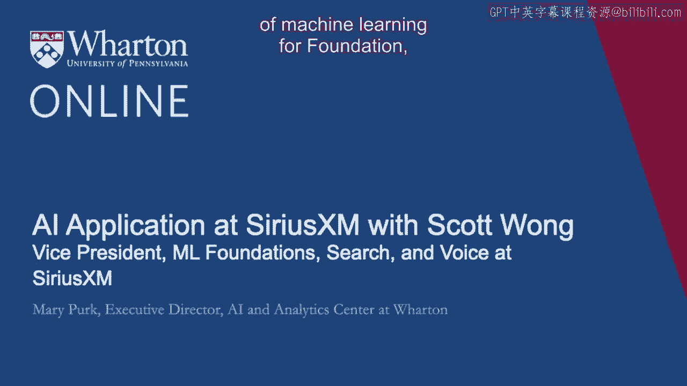

# 课程 P45：Pandora 推荐系统与机器学习应用 🎵





在本节课中，我们将跟随 SiriusXM 机器学习副总裁斯科特·王的访谈，学习 Pandora 推荐系统背后的核心原理、机器学习如何驱动个性化体验，以及数据、模型和测试在其中的关键作用。

---

## 1. 背景介绍：斯科特·王与 Pandora

斯科特·王是 SiriusXM 基础搜索与语音科学的机器学习副总裁。他的团队负责构建可重用的机器学习系统，为 SiriusXM 旗下包括 Pandora 在内的产品提供推荐和发现功能。

上一节我们介绍了课程背景，本节中我们来看看 Pandora 的起源。

## 2. 起源：音乐基因项目 🧬

Pandora 起源于约 20 年前的“音乐基因项目”。这是一个由专业音乐家团队参与的倡议，他们每天聆听音乐曲目，并为每首曲目标注超过 450 种不同的属性。

以下是这些属性的例子：
*   **节拍**：音乐的节奏和速度。
*   **和声**：音符的组合方式。
*   **声乐**：人声的类型和特点（例如，鼻音、男性声乐）。
*   **流派与时期**：音乐的风格和所属年代。
*   **乐器与语言**：使用的乐器和歌词的语言。

这个项目的核心思想是：如果你理解了构成音乐的这些“基因”元素，你就能识别出相似的曲目和艺术家。这成为了推荐系统中“基于内容的推荐策略”的基础。

**核心概念公式**：
`相似度(曲目A, 曲目B) = f(基因属性A, 基因属性B)`

这种策略在“冷启动”场景中特别有效，即当系统对新用户一无所知，需要快速提供初始推荐时。音乐基因项目为 Pandora 的成功起步奠定了基础，并且至今仍是其宝贵的数据资产。

## 3. 推荐系统的演进：从反馈到飞轮 🔄

基于内容的推荐让 Pandora 起步，但真正的个性化始于用户互动。当听众使用“点赞”（赞成）和“点踩”（反对）功能时，一个持续的反馈循环就建立了。

我的团队利用这个反馈循环，结合多种策略来驱动推荐系统。

以下是几种主要的推荐策略：
1.  **基于内容的策略**：利用音乐基因等元数据，推荐属性相似的曲目。
2.  **基于用户的策略**：分析用户行为，发现“和你相似的人也喜欢……”的模式。
3.  **协同过滤策略**：同时分析哪些听众相似、哪些内容相似，发现隐藏的关联。

这个“反馈-学习-推荐”的循环就像一个强大的飞轮。点赞数据形成了有标签的训练集，让机器学习模型能够学习哪些曲目在特定情境下更受欢迎。

此外，为了处理海量曲目，我们开发了“机器监听系统”。模型直接分析音频，利用从音乐基因项目获得的标签数据，来预测新歌曲的属性，实现了“人类提供质量，机器服务规模”。

## 4. 机器学习为多方利益相关者服务 🎯

机器学习不仅服务于听众，也服务于其他利益相关者。上一节我们了解了推荐系统的核心，本节中我们来看看它如何满足不同角色的需求。

以下是三个主要利益相关者及其对应的机器学习应用：
*   **市场营销与广告商**：
    *   **智能转换**：模型分析用户行为，预测增销订阅的最佳时机和对象。
    *   **个性化营销**：在推送和邮件中，推荐最合适的内容或艺术家。
    *   **广告效果衡量**：利用系统工具建模，评估广告在不同场景下的有效性。
*   **创作者（音乐人/播客主）**：
    *   **受众发现**：帮助新创作者找到最可能对其内容感兴趣的听众。
*   **听众**：
    *   **广播**：决定“下一首播放”的歌曲。
    *   **主页发现**：推荐新的音乐、播客和节目。
    *   **搜索与语音**：通过自然语言处理理解用户意图，提供精准结果。

## 5. 数据的核心：显式与隐式信号 📊

构建有效的模型离不开高质量的数据。数据主要分为显式信号和隐式信号。

**显式信号**是用户明确表达喜好的行为，例如：
*   对电台或歌曲的“点赞”或“点踩”。
*   将内容添加到个人收藏夹。

**隐式信号**则间接反映了用户的兴趣和意图，例如：
*   是否完整听完一首曲目。
*   在某个电台收听的时长。
*   是否点击了推荐并阅读了艺术家介绍。

**核心概念代码（伪代码）**：
```python
# 收集信号示例
user_signals = {
    “explicit”: [“thumbs_up”, “added_to_favorites”],
    “implicit”: [“track_completed”, “listen_duration_seconds”, “clicked_recommendation”]
}
```

在训练模型时，关键在于将正确的数据与正确的模型结合，以解决正确的业务问题。例如，点赞数据可以作为监督学习模型的标签，用来预测用户未来可能喜欢的内容。

## 6. 模型的权衡：准确性与可解释性 ⚖️

选择模型时，需要在准确性和可解释性之间做出权衡。这并非一成不变，而是取决于具体任务。

以下是考量的关键因素：
*   **任务风险**：出错的成本有多高？例如，金融预测模型对准确性要求极高。
*   **用户信任**：模型的消费者是谁？他们需要多大程度的解释？
    *   对于面向听众的“为你推荐”页面，模型需要一定的可解释性（例如，“因为你喜欢A，所以我们推荐B”），以建立信任并促进探索。
    *   对于内部数据科学家，他们更关注模型性能，可以接受更复杂、更难对外解释的模型（如深度神经网络），事后再分析推荐原因。

## 7. 验证与测试：确保模型有效 ✅

开发出模型后，必须通过测试验证其有效性。A/B测试是衡量因果效应的黄金标准。

**A/B测试**：将用户随机分为两组（A组和B组），让他们体验产品的不同版本，从而将指标变化归因于特定的改动。

为了更高效地进行测试，我们还会采用**多臂老虎机**框架。在这个框架中，系统可以同时测试多个版本（A/B/C/D...），并动态调整流量分配，在“探索”（尝试新选项）和“利用”（聚焦表现好的选项）之间取得平衡，从而更快地找到最佳方案。

人工智能本身也可以帮助优化测试过程，例如通过离线分析预先筛选出成功概率更高的实验参数，避免让用户接触到可能很差的体验。

## 8. 搜索、语音与未来的整合 🔍

搜索和语音请求是宝贵的实时信号。例如，突然激增的搜索关键词可以作为一个趋势信号，提前输入推荐算法。

语音交互则推动了新的产品用例。当用户提出“播放90年代R&B女声”这类主题化请求时，这不仅是一个搜索查询，更启示我们需要构建能够满足这种灵活需求的电台或推荐逻辑。

展望未来，SiriusXM与Pandora的结合带来了独特优势。SiriusXM拥有成熟的广播网络和车载场景，而Pandora擅长个性化的数字流媒体。两者的整合意味着：
*   跨平台的内容共享与听众体验融合。
*   更强大的订阅套餐和营销能力。
*   利用Pandora的反馈数据来个性化传统的广播体验，例如在新型号汽车中开始收集收听指标，为车内个性化铺平道路。

---

## 总结 📝

本节课中我们一起学习了：
1.  Pandora 推荐系统始于**音乐基因项目**，它通过标注数百个音乐属性来定义歌曲的“DNA”。
2.  系统通过收集用户的**显式**（点赞/点踩）和**隐式**（收听时长）**信号**，驱动了基于内容、基于用户和协同过滤等多种推荐策略的“飞轮”。
3.  机器学习服务于**听众、创作者和广告商**等多方利益相关者，实现个性化推荐、受众发现和效果优化。
4.  在模型选择上，需要在**准确性与可解释性**之间根据任务风险和用户信任进行权衡。
5.  **A/B测试**和**多臂老虎机**是验证模型效果和高效实验的关键方法。
6.  **搜索和语音**数据不仅用于直接满足请求，也为推荐系统提供了趋势信号和创新灵感。
7.  SiriusXM与Pandora的结合，正在推动个性化音频体验从数字端向传统广播和车载场景的扩展。