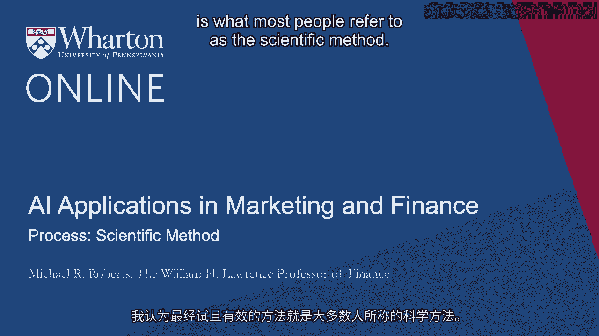
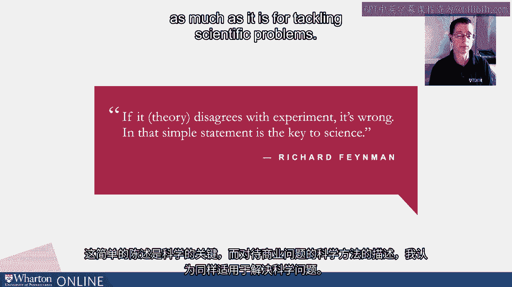
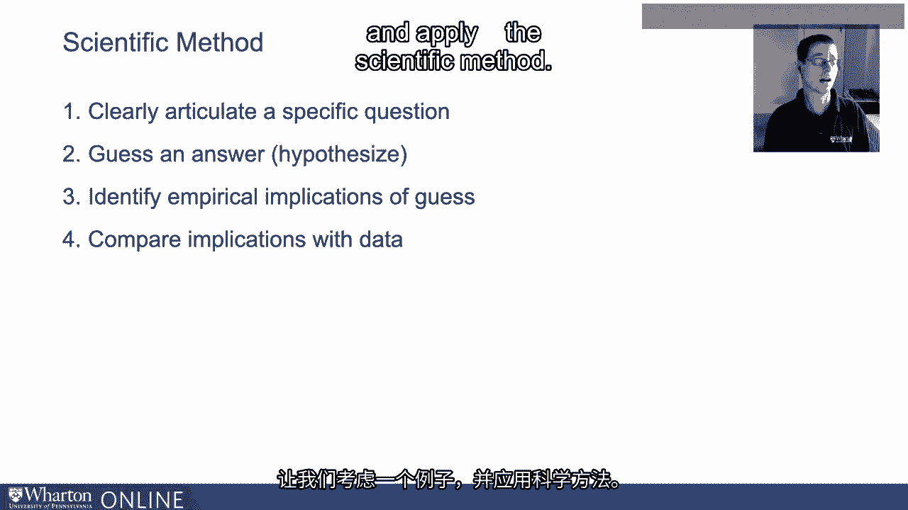
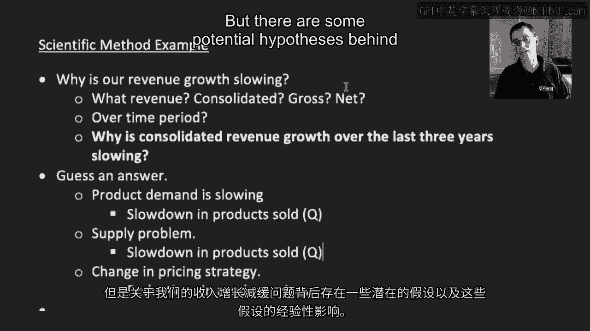
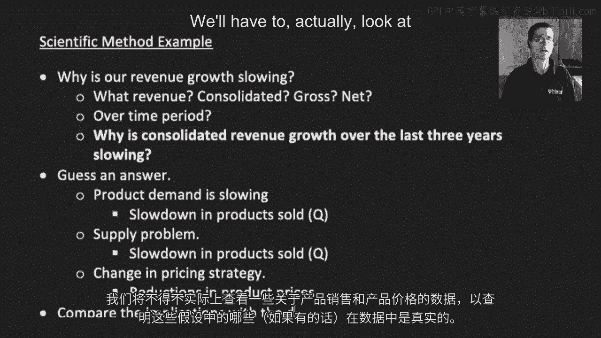
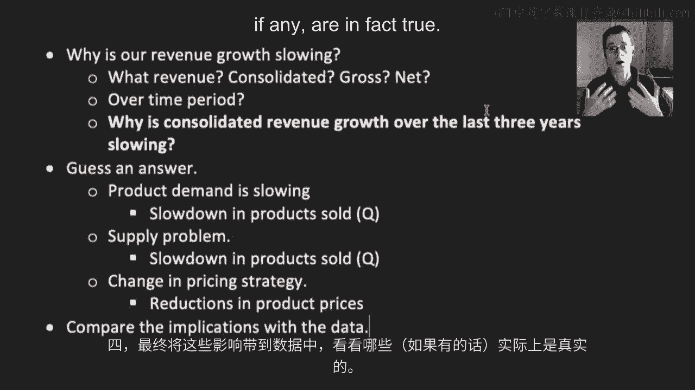

# 课程 P47：科学方法在数据分析中的应用 📘

在本节课中，我们将学习如何运用科学方法来解决商业和数据分析问题。科学方法是一种经过时间检验的、系统化的解决问题流程，它能帮助我们清晰地定义问题、提出假设、验证猜想，并最终基于数据得出结论。

---

## 🔍 什么是科学方法？

上一节我们提到了科学方法的重要性，本节中我们来看看它的具体定义。科学方法是一种逻辑严谨的探究过程。物理学家理查德·费曼曾精辟地总结道：“**无论你的理论多么美妙，只要它与实验不符，那就是错误的。**” 这句话简洁而优雅地揭示了科学的核心。

对于解决商业问题而言，这种基于假设和验证的科学方法同样极为有效。

---

## 📝 科学方法的四个步骤

科学方法可以通过多种方式描述，以下是一种非常实用的四步框架：

1.  **清晰地表述具体问题**
    首先，你需要明确你想要解决什么问题。一个模糊的问题无法进行有效的数据分析。

2.  **猜测一个答案（提出假设）**
    针对问题，提出一个或多个可能的答案或解决方案。在统计学中，这被称为建立假设。

3.  **识别假设的经验含义**
    思考并明确：如果你的假设是正确的，那么在实际数据中我们应该观察到什么现象？

4.  **将预测与数据进行比较**
    最后，收集并分析实际数据，将观察到的结果与第三步中的预测进行对比，以验证或推翻你的假设。

---

## 💡 应用实例：分析收入增长放缓

让我们通过一个具体的商业案例来应用上述科学方法。

### 第一步：明确具体问题

初始问题：“为什么我们的收入增长在放缓？” 这个问题看似明确，实则模糊。我们需要将其具体化，例如：
> **为什么过去三年公司的合并收入增长放缓了？**

### 第二步：提出潜在假设

针对这个具体问题，我们可以提出几种可能的解释（假设）。以下是几种常见的猜想：
*   **假设A：市场需求放缓**。消费者对我们的产品需求下降了。
*   **假设B：供应链出现问题**。市场需求旺盛，但我们无法生产或供应足够的产品。
*   **假设C：定价策略变化**。我们降低了产品售价，影响了总收入。

**核心概念**：收入的基本公式为 `收入 = 价格 × 销量`。因此，收入增长放缓可能通过价格或销量（或两者）的渠道实现。

### 第三步：推导经验含义

接下来，我们需要明确，如果上述假设成立，在数据中应该看到什么迹象：
*   如果 **假设A（需求放缓）** 成立，我们应该观察到产品**销量**的下降。
*   如果 **假设B（供应问题）** 成立，我们同样会观察到产品**销量**的下降（因为供不应求）。
*   如果 **假设C（定价变化）** 成立，我们应该观察到产品**平均售价**的下降。

### 第四步：用数据验证

最后，我们需要收集关于产品销量和价格的历史数据，并进行分析：
*   检查销量数据是否呈现下降趋势。
*   检查价格数据是否呈现下降趋势。
*   结合两者，判断哪个假设更符合数据所揭示的事实。

---

## ✅ 总结

本节课中，我们一起学习了如何将科学方法系统地应用于数据分析。我们首先需要**清晰地定义问题**，然后**提出合理的假设**，接着**推导出可验证的数据预测**，最后**通过实际数据来检验这些预测**。这个过程能帮助我们从杂乱的数据中提炼出有价值的商业洞察，做出更明智的决策。掌握这一流程，是进行任何有效机器学习、人工智能或财务分析工作的坚实基础。