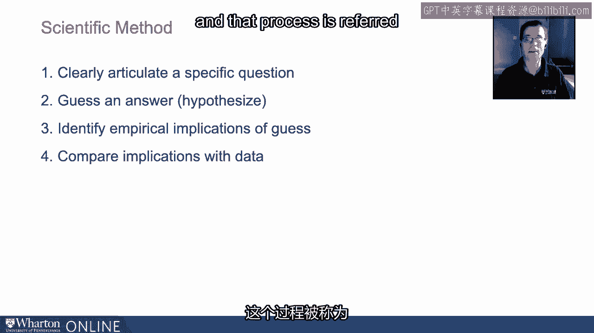
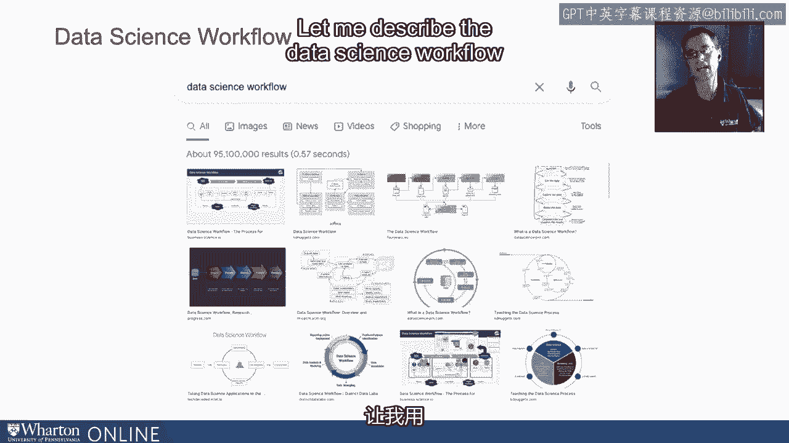
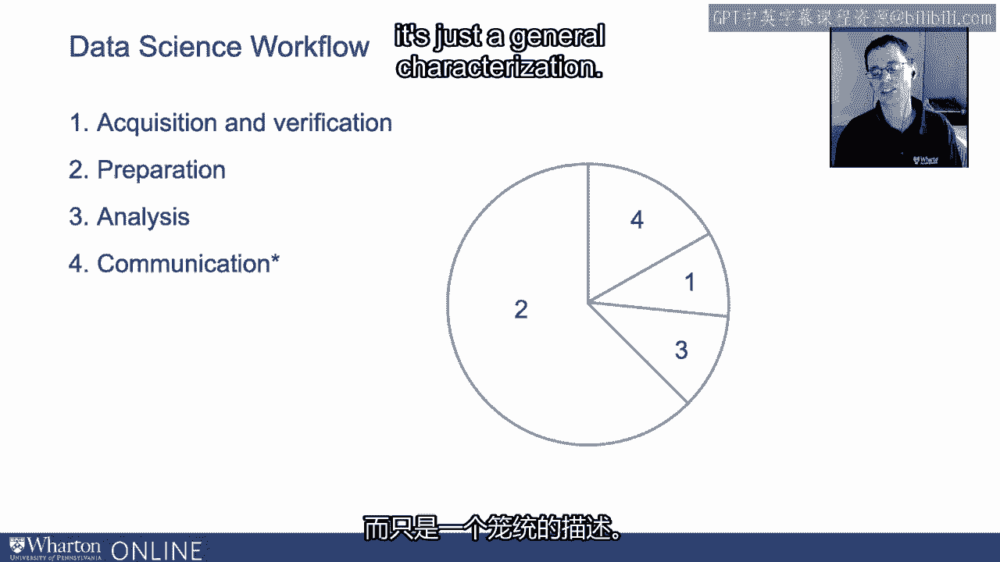

# 课程 P48：数据科学工作流程 🧭

在本节课中，我们将要学习数据科学工作流程。这是一个将科学方法应用于数据，以解决问题并得出结论的系统性过程。

上一节我们介绍了科学方法，它是一个包含提出问题、提出假设、识别经验影响并与数据比较的四步过程。本节中我们来看看如何具体执行最后一步——将假设的影响与实际数据进行比较。这个过程被称为数据科学工作流程。

## 概述：什么是数据科学工作流程？

数据科学工作流程是一个结构化的过程，用于将原始数据转化为可操作的见解。它确保分析工作系统、可重复且可靠。

## 工作流程的四个核心步骤

虽然存在多种描述方式，但一个直观且通用的数据科学工作流程可以概括为以下四个步骤。

### 第一步：获取与验证 📥

首先，你需要获取数据。数据来源多种多样，可能包括：
*   从本地文件（如电子表格）加载。
*   从组织内部的不同系统集成。
*   通过外部API接口下载。
*   从互联网上抓取（网络爬虫）。
*   购买专有的商业数据集。

获取数据后，**验证**步骤至关重要。永远不要盲目相信数据附带的文档或假设。必须通过实际查看和初步探索数据来确认其内容、格式和质量符合预期。

### 第二步：准备与探索 🧹

这是工作流程中**最耗时**的环节。本步骤的目标是将原始数据整理成适合分析的格式。

以下是准备数据时常见的任务：
*   **数据整理**：将数据从多种原始格式（如宽表、长表、JSON）转换为统一、整洁的结构。
*   **数据清洗**：处理缺失值、纠正错误、去除重复项、格式化不一致的数据（例如日期格式）。
*   **探索性数据分析**：通过计算统计量（如均值 `mean(data)`、标准差 `std(data)`）和绘制图表来深入理解数据的分布、关系和潜在问题。

这个过程通常是迭代的，你可能需要返回第一步获取更多数据，或者基于新的发现调整清洗策略。

### 第三步：分析与建模 🤖

当数据准备就绪后，便可以进行分析。这个阶段的复杂性跨度很大：
*   **简单分析**：计算描述性统计、进行假设检验。
*   **复杂分析**：构建机器学习或人工智能模型。这通常涉及：
    1.  选择合适的算法（如线性回归 `y = β₀ + β₁x + ε`）。
    2.  将数据划分为训练集和测试集。
    3.  训练模型并调整参数。
    4.  评估模型性能，并可能进行多轮迭代以选择最佳模型。

### 第四步：沟通与呈现 📢

这是将分析价值转化为实际影响的关键一步。你需要清晰、有说服力地向决策者（他们可能不具备技术背景）传达你的发现。

有效的沟通包括：
*   用简洁的语言解释复杂的结果。
*   使用可视化图表（如图表、仪表盘）来支持你的论点。
*   明确指出基于数据的建议或结论。

许多数据分析项目失败，正是因为技术专家与决策者之间的沟通存在脱节。

## 时间与精力分配 ⏳

根据普遍经验，数据科学工作流程中各步骤的时间分配大致如下（以一个饼图示意）：
1.  **获取与验证**：约占5-10%。
2.  **准备与探索**：约占**60-80%**。
3.  **分析与建模**：约占10-20%。
4.  **沟通与呈现**：约占5-10%。

可以看到，**数据准备**占据了绝大部分时间和精力。确保输入模型的数据干净、可靠，远比运行一个复杂的模型更重要。

## 总结

本节课中我们一起学习了数据科学工作流程。我们将其分解为四个核心步骤：**获取与验证**、**准备与探索**、**分析与建模**以及**沟通与呈现**。记住，这是一个非线性的、迭代的过程，尤其是数据准备阶段，需要投入最多的耐心和细致工作。掌握这个工作流程，能帮助你更有条理、更高效地从数据中挖掘价值。