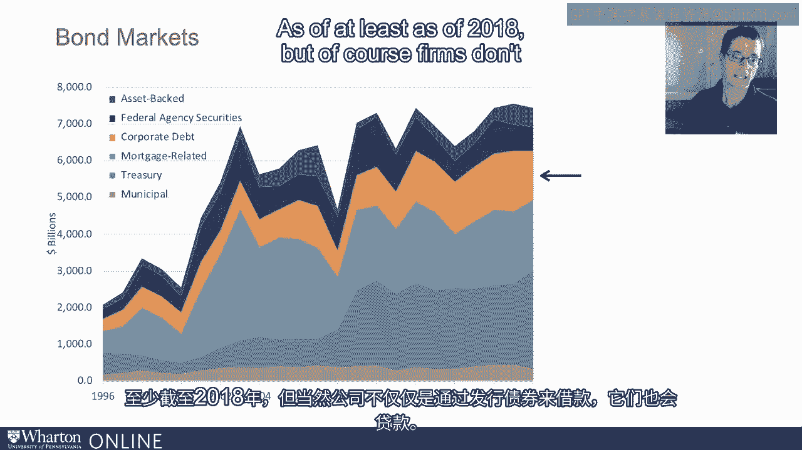
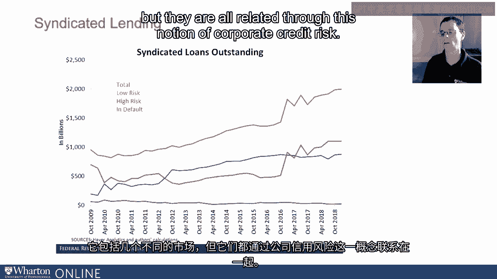
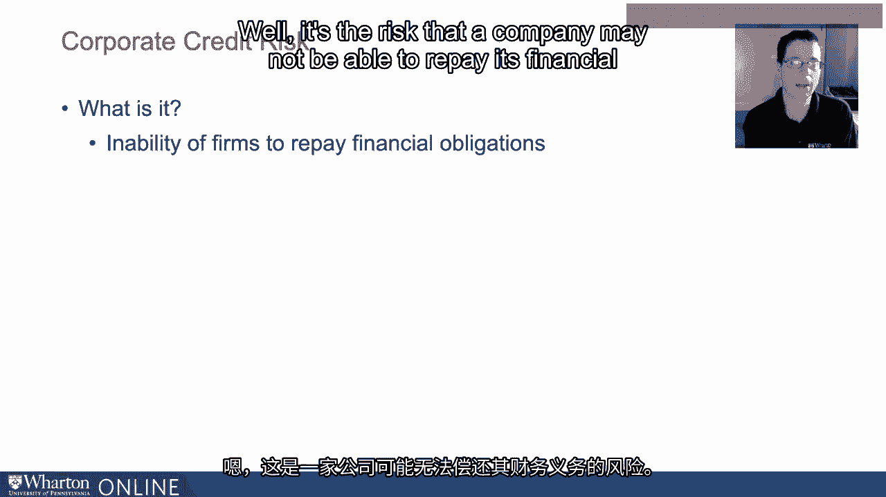
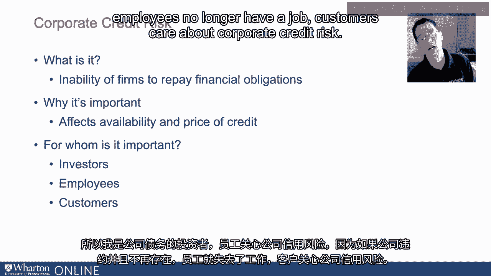
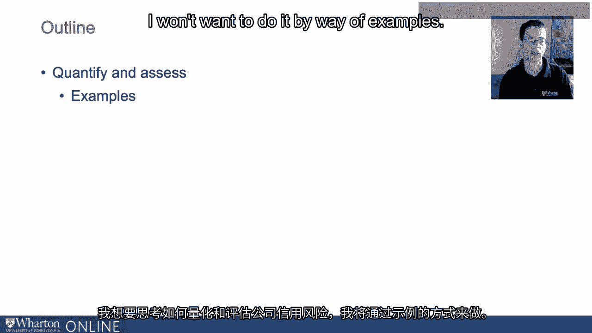
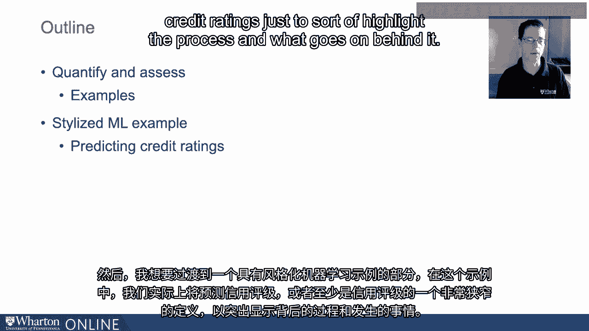
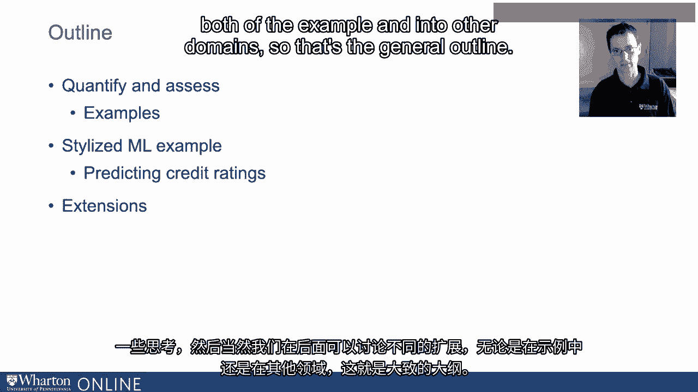

# 课程 P49：企业信用风险入门 🏢💰

在本节课中，我们将学习企业信用风险的基本概念、其重要性以及如何对其进行量化评估。我们将通过一个简化的机器学习示例来演示预测信用评级的过程，并探讨其背后的逻辑。

---

## 企业信用风险概述 📊

企业信用风险是指一家公司可能无法偿还其财务义务的风险。这包括无法按时支付债券利息、偿还贷款本金等。

上一节我们介绍了企业信用风险的定义，本节中我们来看看它在经济中的规模与重要性。

## 企业债务市场规模 📈

企业通过发行债券和申请贷款进行融资。在美国经济中，企业债券发行规模巨大。

以下是截至2018年，美国不同发行者债券发行的构成情况图示：

*   **资产支持证券**（棕色部分）
*   **联邦机构证券**（海军蓝色部分）
*   **企业债务**（橙色部分）
*   **抵押贷款相关债券**
*   **国债**（联邦政府发行的债务）
*   **政府和市政债券**（绿色部分，由各州和市政当局发行）

我们将重点关注**企业债券**（图示中的橙色部分）。其规模达到数万亿美元。

除了债券，公司还通过贷款市场借款。例如，**银团贷款**（由多家金融机构共同持有的贷款）的未偿还金额也超过两万亿美元。

这些数据表明，企业债务和贷款市场是一个规模巨大的市场，其核心关联点就是**企业信用风险**。

## 企业信用风险为何重要？🤔

企业信用风险之所以重要，是因为它涉及巨额资金，并影响到广泛的利益相关者。

以下是受企业信用风险影响的主要群体：

*   **投资者**：例如持有企业债券或债券共同基金的个人或机构。公司违约将直接导致其投资损失。
*   **员工**：如果公司因违约而倒闭，员工将面临失业风险。
*   **客户**：客户可能不愿从濒临破产的公司购买产品或服务，因为未来的保修、服务等可能无法保障。（例如2008年金融危机中的汽车制造商）
*   **供应商**：供应商可能不愿意向信用风险高、有违约可能的采购方提供商品或服务。
*   **纳税人**：在系统性风险发生时（如2008年金融危机），政府可能动用公共资金救助金融机构，最终风险由纳税人承担。

因此，准确评估和管理企业信用风险对金融稳定和经济发展至关重要。

## 课程大纲与机器学习应用示例 🧠

在接下来的内容中，我们将探讨如何量化和评估企业信用风险。

我们将通过一个**风格化的机器学习示例**来进行说明。这个示例的核心任务是：**预测企业的信用评级**。

信用评级是衡量企业信用风险的一个常用且重要的指标。通过这个简化的预测任务，我们可以清晰地展示数据处理、模型构建和评估的完整流程。

**核心任务公式化描述**：
我们的目标是构建一个模型 `f`，它能够根据企业的各项特征 `X`（如财务比率、规模、行业等），预测其信用评级 `y`。
`y = f(X)`

在后续章节中，我们将详细拆解这个示例，并讨论可能的扩展与应用。

---

## 总结 📝

本节课我们一起学习了企业信用风险的基础知识。我们明确了企业信用风险是指公司无法履行财务义务的风险。通过数据，我们了解到企业债务市场（包括债券和贷款）规模巨大，涉及数万亿美元。同时，企业信用风险影响着投资者、员工、客户、供应商乃至纳税人等多个群体。最后，我们介绍了本课程将使用机器学习方法来预测信用评级，以此作为量化评估信用风险的一个实践切入点。