# 课程 P50：信用风险关键绩效指标 (KPIs) 📊

在本节课中，我们将学习如何评估公司的信用风险。信用风险是指公司无法按时偿还其债务的可能性。我们将通过分析公司的财务报表，并计算一系列关键绩效指标来量化这种风险。课程将以英特尔和AMD两家公司为例，对比说明不同财务状况下的信用风险差异。

## 概述与数据准备

首先，我们来看一些基础数据。下图展示了英特尔公司2014财年的损益表和资产负债表。这些历史数据将帮助我们理解后续要讨论的概念。

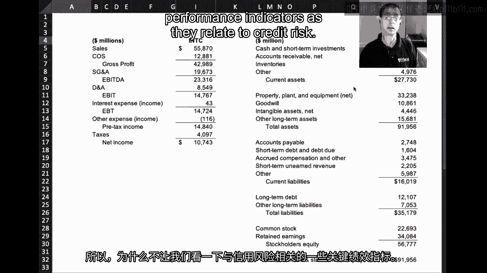

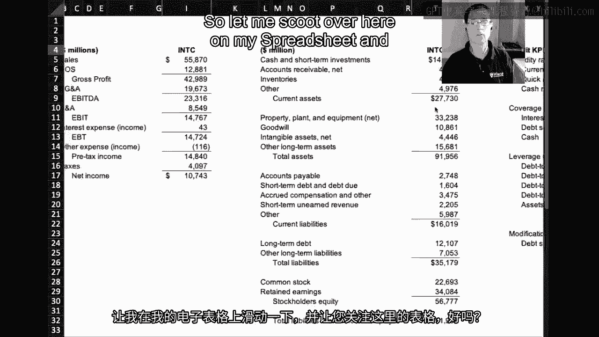

观察英特尔的损益表，其收入超过550亿美元，营业收入超过140亿美元，净收入约为100亿美元。仅从损益表看，这是一家盈利的公司，但这并不能直接说明其偿还债务的能力。

为了评估偿债能力，我们需要查看其资产负债表，特别是财务义务部分。英特尔的短期债务约为60亿美元，长期债务约为120亿美元，总财务债务超过137亿美元。同时，公司持有约140亿美元的现金及短期投资。从表面上看，英特尔似乎拥有充足的现金和盈利来覆盖其债务。

然而，这种判断过于粗略。接下来，我们将引入更正式的分析工具——信用风险关键绩效指标。

## 流动性比率分析

上一节我们查看了公司的整体财务数据，本节中我们来看看用于捕捉公司短期偿债能力的流动性比率。大多数偿付能力问题最初都表现为流动性问题，因此分析流动性至关重要。

以下是三种常用的流动性比率及其对英特尔的分析：

*   **流动比率**：该比率衡量公司用一年内可变现的资产偿还一年内到期债务的能力。
    *   **公式**：`流动比率 = 流动资产 / 流动负债`
    *   英特尔的比率为 **1.73**，意味着每1美元流动负债，有1.73美元的流动资产作为支撑。
*   **速动比率**：该比率在流动比率的基础上，排除了变现能力相对较差的存货，能更严格地反映短期偿债能力。
    *   **公式**：`速动比率 = (流动资产 - 存货) / 流动负债`
    *   英特尔的比率降至 **1.15**。
*   **现金比率**：这是最保守的流动性比率，只考虑现金及现金等价物与流动负债的关系。
    *   **公式**：`现金比率 = 现金及现金等价物 / 流动负债`
    *   英特尔的比率为 **0.88**。

这些比率从宽松到严格，提供了不同层面的流动性信息。对于英特尔而言，无论使用哪个指标，其短期偿债能力看起来都较为充足。

## 偿债保障比率分析

了解了短期流动性后，我们进一步分析公司用经营收益覆盖其财务成本的能力，即偿债保障比率。

以下是两个关键的偿债保障比率：

*   **利息保障倍数**：该比率衡量公司用经营利润支付利息费用的能力，是贷款协议中常见的约束条款。
    *   **公式**：`利息保障倍数 = 息税前利润 / 利息费用`
    *   英特尔的比率为 **343.42**，表明其营业利润足以轻松覆盖利息支出。
*   **债务偿还保障倍数**：该比率不仅考虑利息，还将到期本金纳入考量，能更全面地反映偿债压力。
    *   **公式**：`债务偿还保障倍数 = 息税前利润 / (利息费用 + 到期债务本金)`
    *   英特尔的比率降至 **8.96**，意味着其营业利润仍能覆盖近9倍的年度本息偿付额。

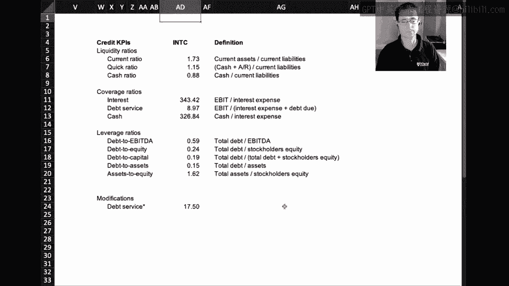

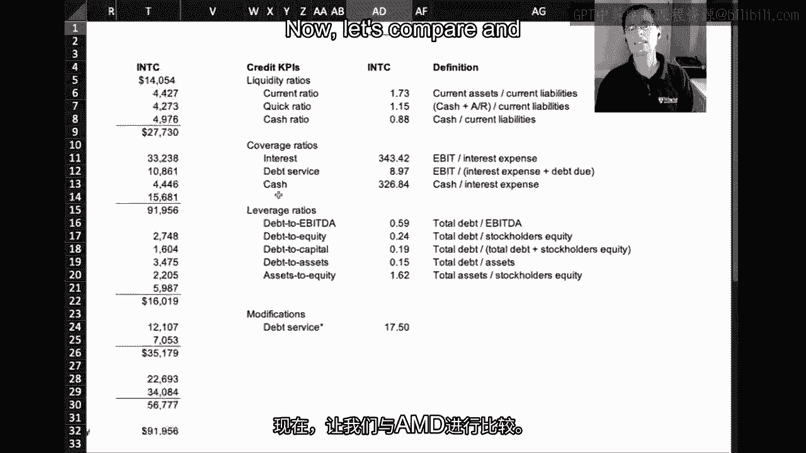

此外，**现金利息保障倍数**（现金资产/利息费用）对于现金充裕的英特尔来说也非常高。这些指标共同表明，英特尔通过经营活动产生的收益足以应对其当前的财务义务。

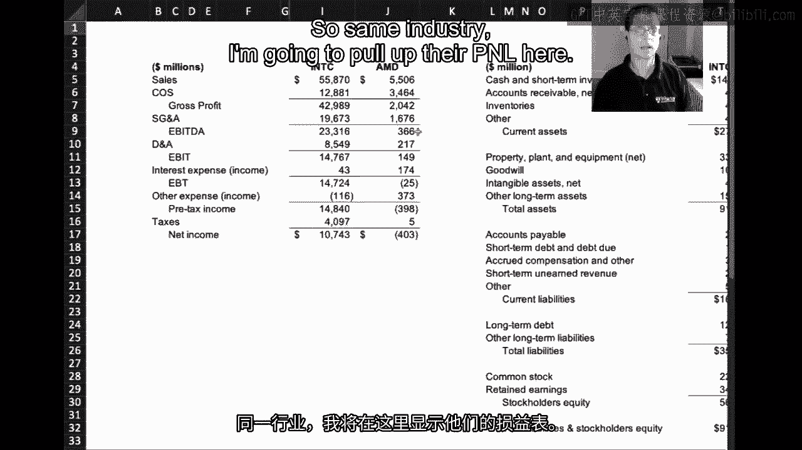

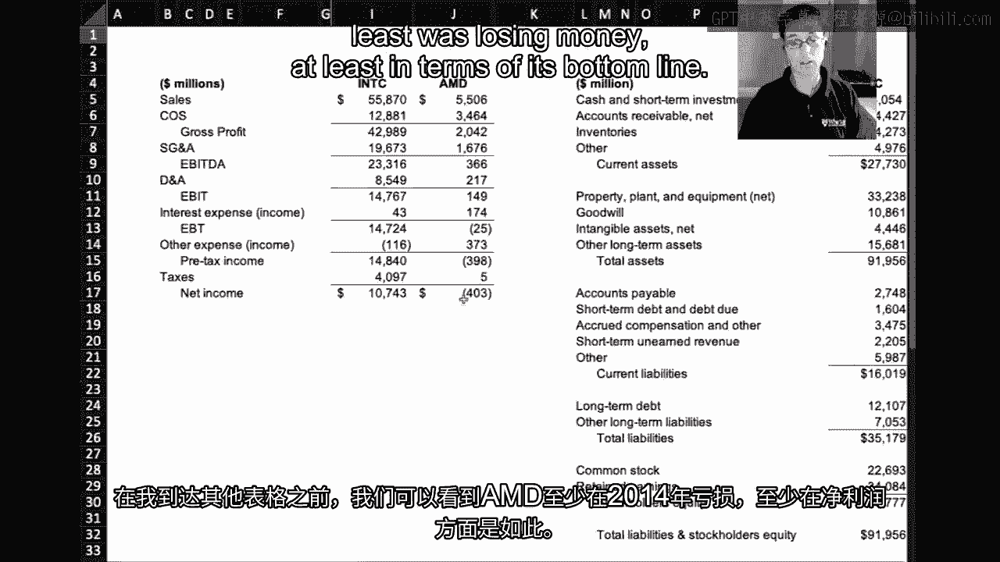

## 杠杆比率分析

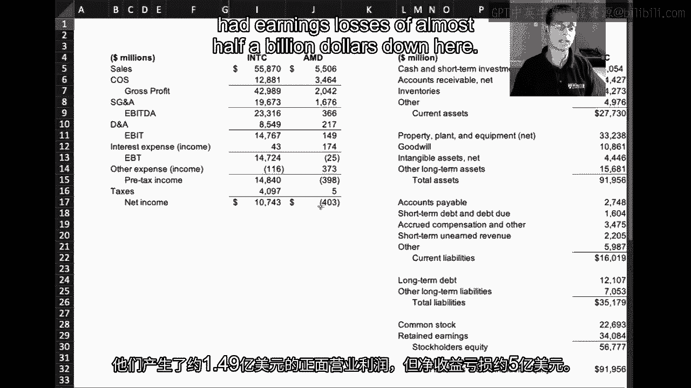

最后，我们转向杠杆比率，这些比率从资本结构的角度审视公司的财务风险，即公司如何通过债务和股权来为其运营融资。

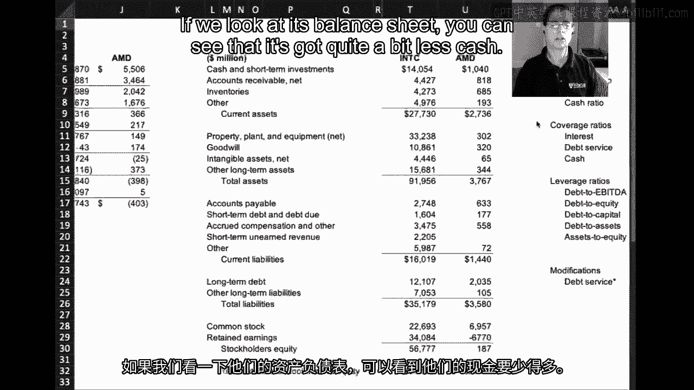

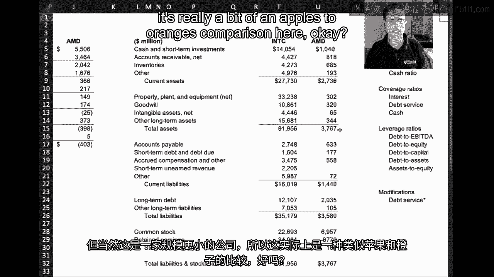

以下是几个重要的杠杆比率：

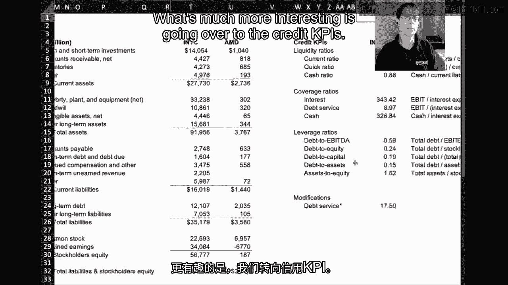

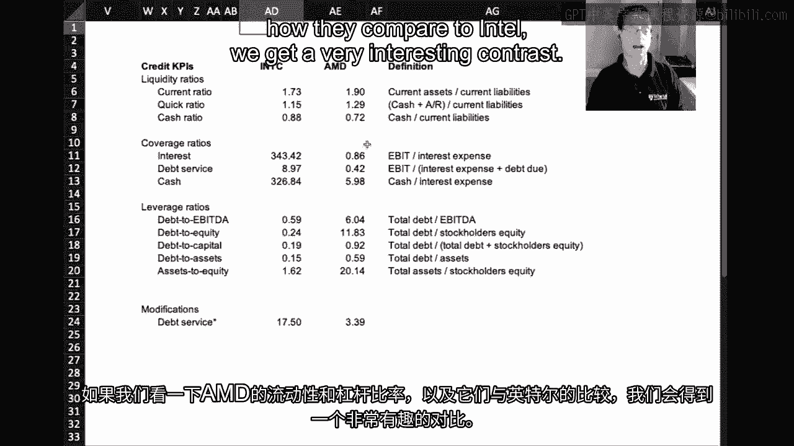

*   **债务/EBITDA比率**：该比率衡量公司总债务相对于其核心经营盈利的规模，也是贷款契约中的常见指标。
    *   **公式**：`债务/EBITDA比率 = 总债务 / 息税折旧摊销前利润`
    *   英特尔的比率为 **0.59倍**，表明其债务规模小于年度经营利润。
*   **债务/权益比率**：该比率直接反映债务融资与股权融资的比例关系。
*   **债务/资产比率**：该比率显示公司总资产中有多少比例是通过债务融资的。
    *   **公式**：`债务/资产比率 = 总债务 / 总资产`
    *   英特尔的比率为 **0.15**，意味着其资产仅有15%由债务融资，85%由股权融资。

这些杠杆比率一致表明，英特尔并非一家高杠杆公司，财务结构相对稳健。

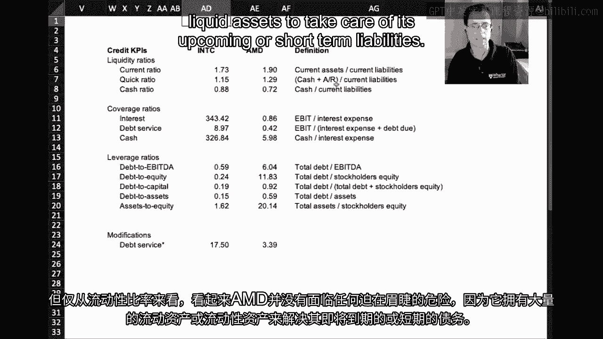

## 案例对比：英特尔 vs. AMD

为了更深刻地理解这些KPI如何揭示信用风险差异，我们将同一行业的AMD公司作为对比案例。

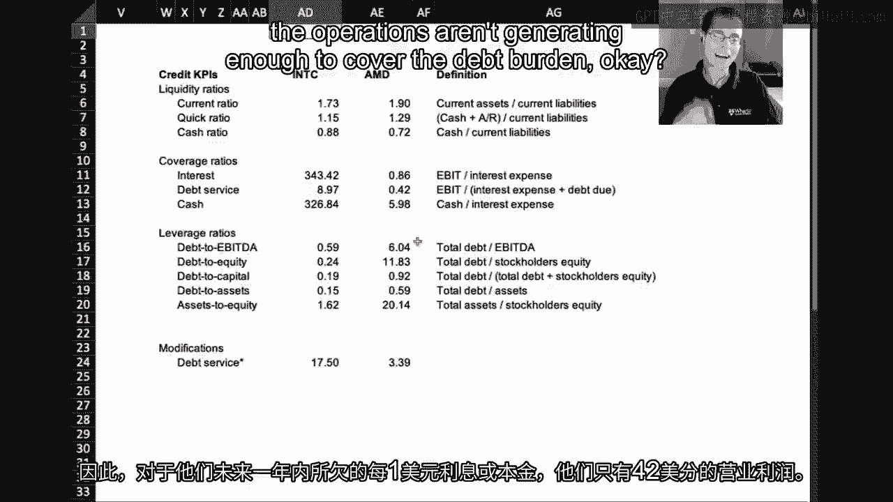

首先观察AMD的损益表，其在2014年处于亏损状态。其资产负债表显示现金持有量远少于英特尔。

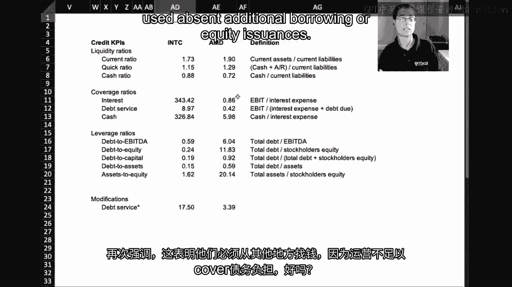

更有趣的是对比两者的信用风险KPI：

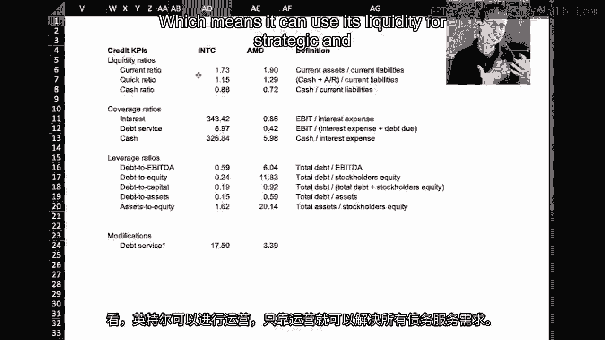

*   **流动性比率**：AMD的流动比率和速动比率甚至略高于英特尔，仅现金比率稍低。单看流动性，AMD似乎也没有迫在眉睫的危机。
*   **偿债保障比率**：此处差异显著。
    *   AMD的**利息保障倍数**为 **0.86**，意味着其营业利润不足以支付利息，需要动用其他资金。
    *   其**债务偿还保障倍数**更是低至 **0.42**，营业利润连一半的本息都无法覆盖，严重依赖流动资产或其他融资来偿债。
*   **杠杆比率**：AMD的**债务/EBITDA比率**高达 **6.0倍**，**债务/资产比率**约为 **0.60**，表明其资产近60%由债务融资，杠杆水平远高于英特尔。

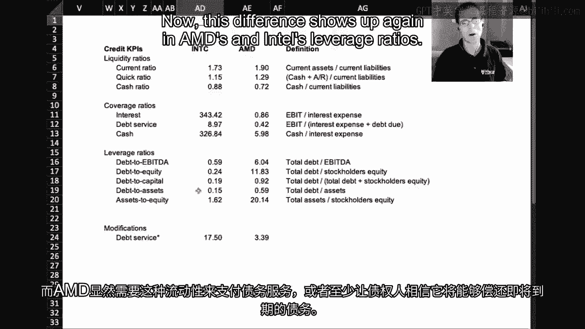

通过对比可以清晰看出：
*   **英特尔**：经营收益足以覆盖债务本息，流动性资产可用于战略运营。
*   **AMD**：经营收益无法覆盖债务本息，必须依赖持有的现金缓冲或其他融资来偿债，财务压力更大。

因此，从信用风险角度看，AMD是一家风险显著更高的公司。

## 总结

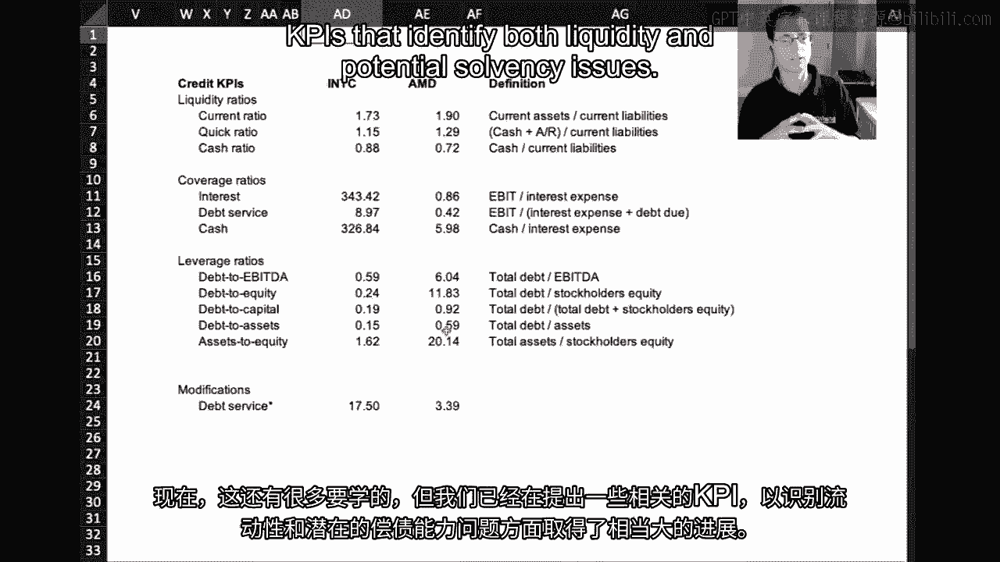

本节课中，我们一起学习了信用风险分析的基础知识。我们通过英特尔和AMD的实例，探讨了三大类关键绩效指标：
1.  **流动性比率**（如流动比率、速动比率）：评估公司短期偿债能力。
2.  **偿债保障比率**（如利息保障倍数、债务偿还保障倍数）：评估公司经营收益覆盖财务成本的能力。
3.  **杠杆比率**（如债务/EBITDA比率、债务/资产比率）：评估公司的资本结构和长期财务风险。

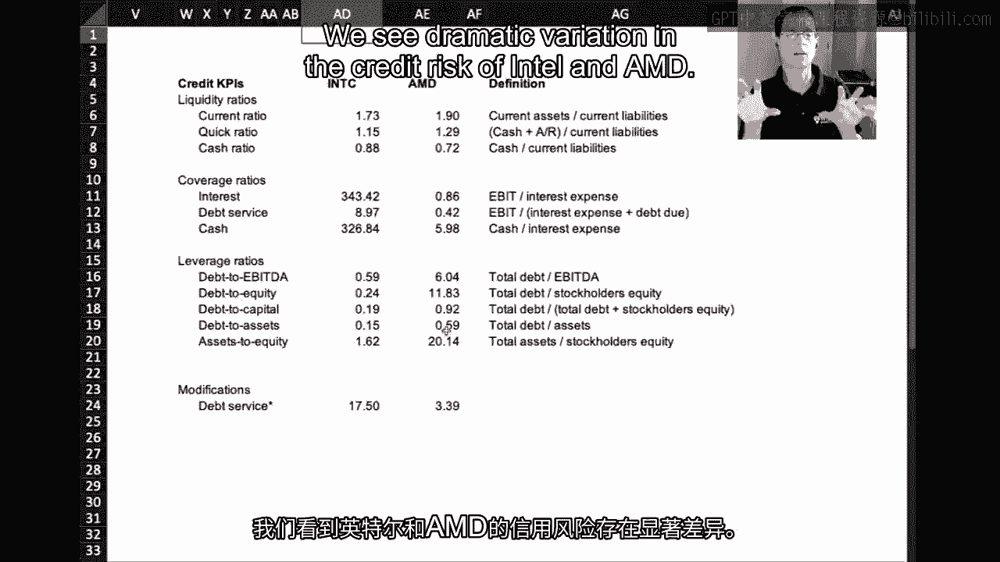

这些KPI能够有效地识别公司在流动性和偿付能力方面可能存在的问题。即使在同行业（如芯片制造）内，不同公司的这些指标也可能表现出巨大差异，从而清晰地反映出它们信用风险的高低。掌握这些工具，是进行初步信用风险判断的重要一步。