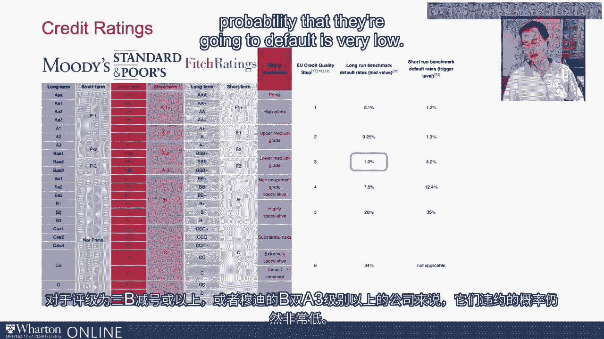
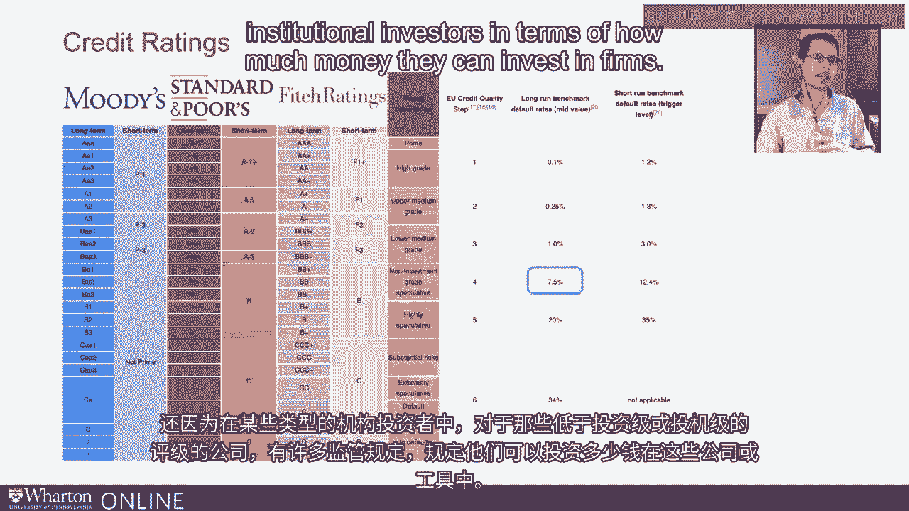
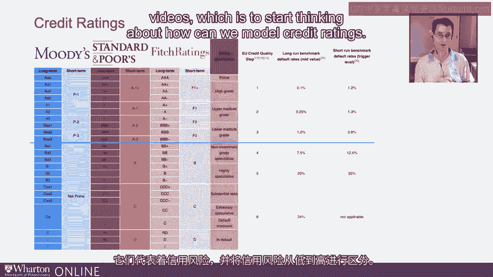

# 课程P51：信用风险与信用评级入门 🏦

在本节课中，我们将学习信用风险的一个重要概念——信用评级。我们将了解主要的评级机构、评级等级的含义，以及评级如何与企业的违约概率相关联。

***

上一节我们介绍了企业信用风险的基本概念。本节中，我们来看看如何通过信用评级来量化和表征这种风险。

信用评级的核心理念是，对不同公司和金融工具的信用风险进行相对排序和表征。这就像我们之前比较英特尔和AMD的风险时，需要一个更具体的衡量标准。信用评级正是提供了这样一种“风险标尺”。

以下是全球最主要的三家信用评级机构：
*   **穆迪**
*   **标准普尔**
*   **惠誉**

它们的评级体系虽然字母标记略有不同，但逻辑相似，都从最高信用等级开始，逐步下降到高风险等级。

***

现在，让我们具体看看评级等级是如何划分的。评级机构通常使用字母组合（如AAA、BB+）来表示信用质量。

随着评级从最高级（如AAA）向最低级（如C）下降，意味着公司的信用风险在逐步增加。评级为AAA的公司被认为信用风险极低，而评级为C的公司则意味着已接近或处于违约状态。

以下是三大机构长期评级等级的简要对比（以高信用等级到低信用等级为序）：

| 风险水平 | 穆迪 | 标准普尔 | 惠誉 |
| :--- | :--- | :--- | :--- |
| **最高信用质量** | Aaa | AAA | AAA |
| **高信用质量** | Aa1 | AA+ | AA+ |
| **中上信用质量** | A1 | A+ | A+ |
| **中等信用质量** | Baa1 | BBB+ | BBB+ |
| **投机级别** | Ba1 | BB+ | BB+ |
| **高风险** | C | C | C |

***

理解了评级等级后，一个关键问题是：这些字母等级到底对应多大的实际违约风险？信用评级与违约概率（PD）密切相关。

每个具体的评级等级都对应着一个历史平均违约概率。例如，根据公开数据：
*   评级为**AA或以上**的公司，其违约概率极低，大约在 **0.1%** （即10个基点）左右。
*   评级为**BBB**级的公司，违约概率仍然较低，大约在 **1%** 左右。
*   然而，一旦评级降至**BB+**（标普/惠誉）或**Ba1**（穆迪）及以下，违约概率会显著跃升，例如可能达到 **7.5%** 或更高。

这个从BBB-到BB+（或Baa3到Ba1）的界限非常重要，它区分了**投资级**和**投机级**（或非投资级）。这个区别不仅意味着违约概率的跃升，也影响着许多机构投资者的投资决策，因为法规常限制他们投资于投机级债券的比例。

***

那么，我们如何形象地理解信用评级呢？你可以把它想象成学生获得的**成绩**。

*   获得**A**（对应AAA/AA）意味着表现优异，是一家非常安全、信用风险极低的公司。
*   获得**B**（对应A/BBB）意味着表现良好，是一家相对安全、违约概率较低的公司。
*   评级越低，就像成绩越差，对应的违约概率也越高。

因此，信用评级是信用风险的一种有用且流行的描述工具。尽管在全部公司中，拥有信用评级的公司只占一部分（例如，可能只占上市公司的30%-40%），但这些公司通常规模巨大，在经济活动中举足轻重，使得信用评级备受关注。

***

本节课中，我们一起学习了信用评级的基础知识。我们了解到信用评级是衡量企业信用风险的重要标尺，由穆迪、标准普尔和惠誉等主要机构发布。评级等级从AAA（风险最低）到C（风险最高），并且与违约概率紧密相关，其中**投资级（BBB-及以上）** 和**投机级（BB+及以下）** 的划分是一个关键界限。

信用评级为我们提供了一种相对风险评估的框架。在接下来的课程中，我们将以此为基础，探讨如何对信用评级的变化进行建模和预测。