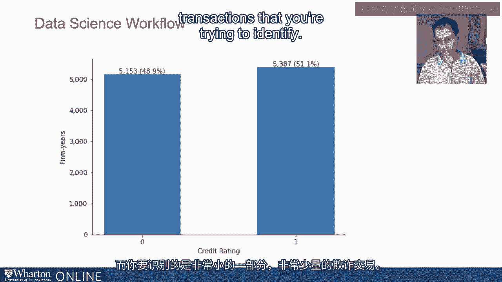

# 课程 P53：信用风险数据探索 🏦

在本节课中，我们将学习用于信用风险分类模型的数据集。我们将了解数据的来源、结构，并通过探索性数据分析来观察投资级与投机级公司在关键财务指标上的差异。

---

## 数据来源与准备

上一节我们介绍了分类模型的背景，本节中我们来看看我们将要使用的具体数据。

一切始于科学过程：明确问题、提出假设，然后用数据进行测试。我们现在正处于用数据测试假设的阶段。这是数据科学工作流的开始，包括数据获取和验证。

数据来源于一个标准开放的CompuSAT数据库，其中包含了美国大多数上市公司以及部分私有公司的信用评级和财务信息。我们对原始数据进行了筛选和清理，最终得到了一个包含10540个观测值的样本。

该样本涉及1400家公司从1995年至2016年的数据，因此每个观测值代表一个“公司-年份”。

---

## 评级分布探索

在查看了数据的基本情况后，我们接下来对评级分布进行探索性数据分析。

为了简化呈现，已将标准普尔评级合并为字母评级桶。例如，“AA”桶包含了“AA-”、“AA”和“AA+”。评级分布大致呈钟形，但并非正态分布，部分原因是数据本身是离散的。

以下是样本中评级分布的观察：
*   大部分观测值集中在区分投资级（右侧）和投机级（左侧）的虚线附近。
*   数据主要集中在B级到A级公司之间。
*   “AAA”评级仅有93个观测值，“CC”级评级则更少。

我们的目标变量并非具体的评级字母，而是一个二元分类：区分公司属于投资级还是投机级。

---

## 投资级与投机级样本概览

了解了整体评级分布后，我们聚焦于目标变量本身。

在我们的数据集中，投资级（标记为1）与投机级（标记为0）的分布几乎各占一半：51.1%为投资级，48.9%为投机级。这种均衡的分布使我们的建模工作更容易，因为两类公司都有很好的代表性。这与欺诈检测等类别极度不平衡的数据集形成对比。

---

## 关键财务指标对比分析

现在，我们将样本按投资级和投机级分组，并计算各组在之前讨论过的信用风险关键绩效指标上的平均值，然后进行配对t检验。

以下是分组后主要财务指标的平均值及t检验结果：

**流动性比率**
*   **流动比率**：投机级公司平均为 `1.78`，投资级公司平均为 `1.64`。投机级公司的流动性反而更高，t统计量为 `-3.29`，差异显著。
*   **速动比率**与**现金比率**也呈现类似模式。这可能是因为投资级公司现金流充裕，无需持有过多流动性资产。

**偿债能力比率**
*   **利息覆盖率**：投资级公司平均为 `13.0`，投机级公司平均为 `5.38`。投资级公司的偿债能力远强于投机级公司，差异显著。
*   **债务偿还覆盖率**：投资级公司平均为 `6.27`，投机级公司平均为 `3.55`。同样显示投资级公司偿债能力更强。

**杠杆比率**
*   **债务/EBITDA**：投机级公司平均为 `4.25`，投资级公司平均为 `1.97`。投机级公司杠杆率明显更高。
*   **债务/总资产**：投机级公司平均为 `0.45`，投资级公司平均为 `0.26`。表明投机级公司资产中债务融资的比例更高。

所有杠杆比率在两组间的差异都具有高度统计显著性。

---

## 总结

本节课中，我们一起学习了用于信用风险建模的数据集。

我们首先了解了数据的来源和基本结构。接着，通过探索性数据分析，我们观察了信用评级的分布以及投资级与投机级公司的样本平衡性。最后，我们重点对比分析了两类公司在流动性、偿债能力和杠杆水平等关键财务指标上的显著差异。

这些分析表明，我们所选取的财务指标在投资级与投机级公司之间存在系统性差异，这为后续构建一个有效的分类模型提供了良好的基础。在下一节课中，我们将利用这些特征开始构建分类模型。