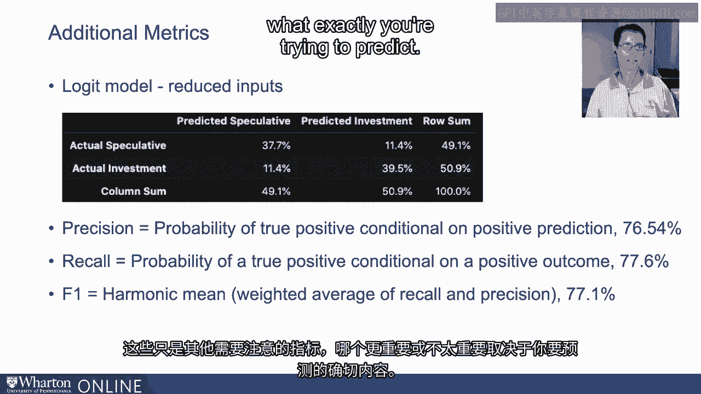
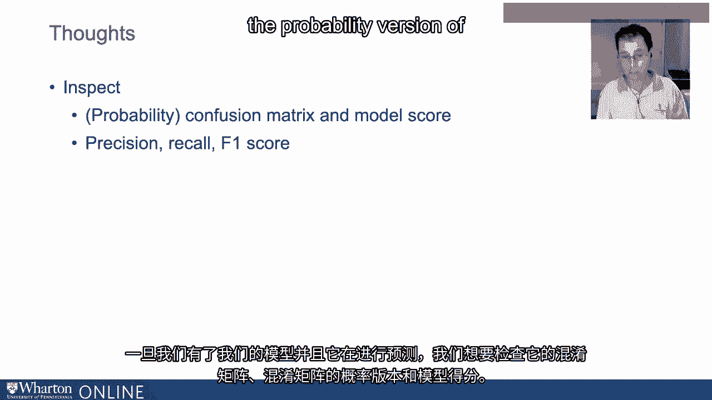
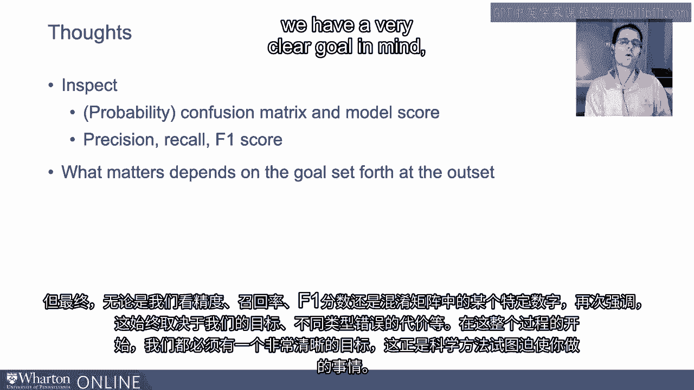
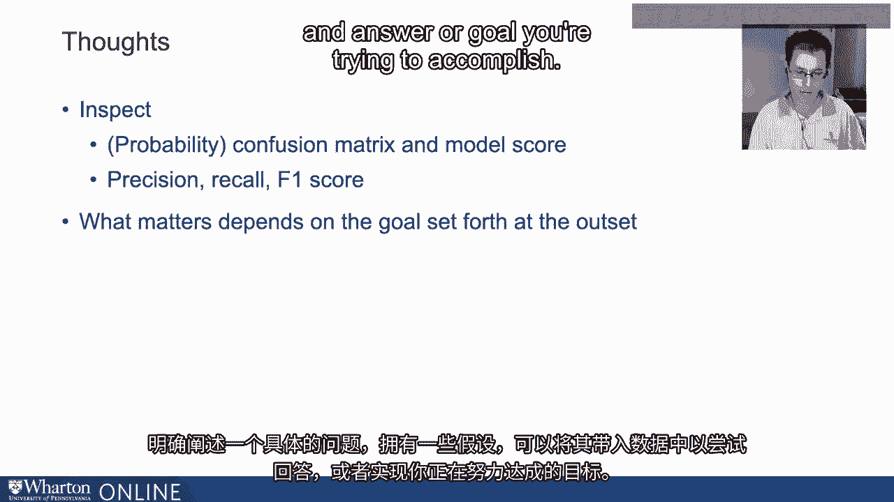

# 课程 P55：信用风险模型训练 🧠

在本节课中，我们将学习如何训练一个基础的信用风险模型，评估其在训练数据上的表现，并通过简化模型和引入新指标来优化分析过程。

---

## 模型训练与初步评估

现在开始训练我们的模型。首先，我们使用一个基础的 **Logit 模型**来预测训练数据中的公司信用级别（投机级或投资级）。训练样本总数为 **8,432** 个观察值。

以下是模型在训练数据上的预测结果，以混淆矩阵的形式呈现：

在混淆矩阵中，**行**代表实际的观察结果，**列**代表模型的预测结果。准确的预测位于矩阵的对角线上。

*   当公司实际为投机级，模型也预测为投机级时，正确次数为 **3,181**。
*   当公司实际为投资级，模型也预测为投资级时，正确次数为 **3,330**。

模型出错的次数略低于 **2,000** 次：
*   当公司实际为投资级，但模型预测为投机级的次数为 **959**。
*   当公司实际为投机级，但模型预测为投资级的次数为 **962**。

为了更直观地理解，我们将这些数字转换为概率。将每个数值除以总观察数 **8432**，并重新计算行列总和。

转换后的概率矩阵显示：
*   正确预测投机级公司的概率为 **37.7%**。
*   正确预测投资级公司的概率为 **39.0%**。

因此，模型的整体准确率（模型评分）为 **77.2%**。这意味着模型正确分类了超过四分之三的观察结果。与随机猜测（鉴于数据中投机级和投资级各占约一半，准确率约50%）相比，这个表现要好得多。然而，**22.8%** 的错误率仍然不容忽视，其重要性取决于实际应用中不同类型错误所带来的成本。

---

## 模型简化与比较

上一节我们评估了包含11个预测变量的完整模型。本节中，我们来看看如果简化模型，只保留核心变量，表现会如何变化。

我们尝试删除7个变量，仅保留以下4个关键财务指标作为输入：
1.  流动比率
2.  利息保障倍数
3.  债务/EBITDA 比率
4.  债务/资产比率

这个简约模型在训练数据上的准确率为 **76.5%**，仅比完整模型（77.2%）低 **0.7%**。

这个差异可能具有实际意义（例如，在大型投资组合中，0.7%的差异可能意味着巨大的成本），但也带来了好处：
*   **模型更简约、紧凑**。
*   **可能更不容易过拟合训练数据**，从而在样本外预测时表现更稳健。

这种简化之所以可行，且性能下降不大，是因为在每个信用关键绩效指标组（如流动性覆盖率、杠杆比率）内部，变量之间存在高度相关性，因此保留一个代表性变量往往就足够了。

---

## 引入额外评估指标

除了整体准确率，在二元分类问题中，我们还可以使用其他指标来更细致地评估模型性能。以下是几个常用指标：

*   **精确率**：在所有被模型预测为“正面”（例如投资级）的案例中，实际也是“正面”的比例。它衡量的是**预测的准确性**。
    *   `精确率 = 真正例 / (真正例 + 假正例)`
*   **召回率**：在所有实际为“正面”的案例中，被模型正确预测出来的比例。它衡量的是**模型的查全能力**。
    *   `召回率 = 真正例 / (真正例 + 假反例)`
*   **F1分数**：精确率和召回率的**调和平均数**，用于在两者之间寻求平衡。
    *   `F1分数 = 2 * (精确率 * 召回率) / (精确率 + 召回率)`

在我们的简约模型中：
*   精确率约为 **76.5%**。
*   召回率约为 **77.6%**。
*   F1分数约为 **77.1%**。

精确率和召回率通常存在此消彼长的关系。哪个指标更重要，完全取决于具体的业务目标和对不同类型错误的容忍成本。

---

## 总结与核心思想

本节课中，我们一起学习了信用风险模型训练与评估的全过程。

首先，我们训练了一个Logit模型，并通过**混淆矩阵**和**准确率**评估了其表现。接着，我们通过简化模型变量探讨了在模型复杂度与性能之间的权衡。最后，我们引入了**精确率**、**召回率**和**F1分数**等更细致的评估指标。

整个过程的核心思想是：模型评估不能只看单一数字。

*（检查模型的混淆矩阵或概率版本）*

*（审视模型评分及其他指标）*

最终，无论是关注整体准确率、精确率、召回率，还是混淆矩阵中的某个特定单元格，都取决于我们最初设定的**明确目标**以及不同预测错误所带来的**相对成本**。

因此，在整个建模流程中，最关键的一步是像科学方法要求的那样，**清晰、具体地定义你要解决的问题**，并基于此选择数据和评估标准。

*（明确目标与假设是成功的起点）*

[BLANK_AUDIO]

