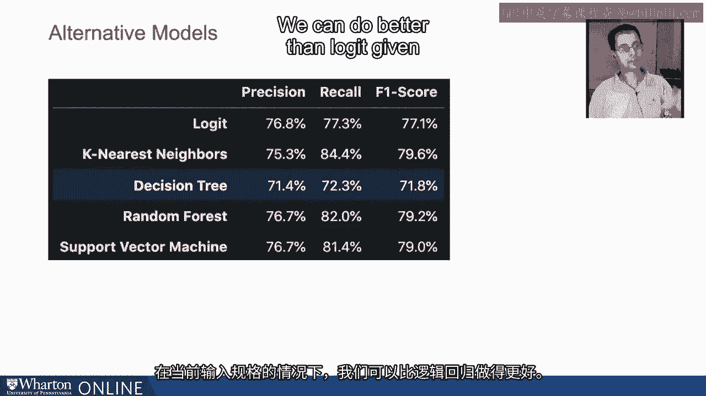
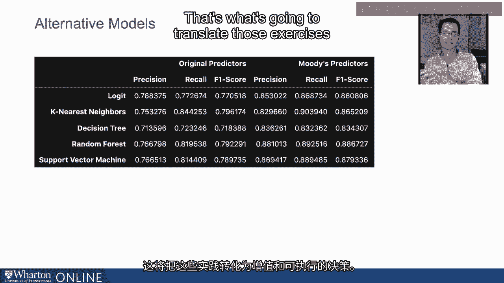

# 课程 P56：信用风险模型与数据 📊

在本节课中，我们将学习信用风险建模中模型与数据的关系。我们将回顾之前建立的Logit模型，并比较不同机器学习模型（如K最近邻、决策树、随机森林和支持向量机）在预测公司信用评级（投资级或投机级）上的表现。更重要的是，我们将探讨使用不同的预测变量（数据）对模型性能的影响，并理解在机器学习实践中，数据质量往往比模型选择更为关键。

---

## 回顾已建立的Logit模型 📈

上一节我们介绍了如何使用Logit模型来预测公司的信用评级。现在，让我们回顾一下该模型基于11个信用风险关键绩效指标（KPI）的表现。

该模型的评估结果如下：
*   **精确度**：76.8%。这表示当模型预测一个公司为“投资级”时，有76.8%的概率是正确的。
*   **召回率**：77.3%。这表示在所有实际为“投资级”的公司中，模型成功识别出了77.3%。
*   **F1分数**：约77.1%。这是精确度和召回率的调和平均值，用于综合评估模型性能。

## 探索替代机器学习模型 🤖

在建立了基准Logit模型后，本节中我们来看看其他几种机器学习模型的表现。为了确保结论的稳健性，我们对所有模型都进行了交叉验证，以避免过拟合。

以下是使用相同11个预测变量时，各模型的性能比较（重点关注F1分数）：
*   **K最近邻 (K-Nearest Neighbors)**：表现优异，召回率高达84%，整体F1分数为79.6%。
*   **决策树 (Decision Tree)**：在所有评估指标上表现均不如其他模型。
*   **随机森林 (Random Forest)**：表现良好，F1分数与K最近邻模型接近。
*   **支持向量机 (Support Vector Machine)**：表现与Logit模型相似。

通过比较可以发现，**K最近邻和随机森林模型**的预测准确性略优于最初的Logit模型。这表明，在现有数据规格下，我们可以通过选择不同的模型来获得性能提升。

## 数据 vs. 模型：何者更重要？⚖️

我们已经看到更换模型能带来一些改进。现在，我们想探讨一个更根本的问题：是改进模型更重要，还是改进输入数据更重要？

为此，我们引入了一套新的预测变量，这些变量来源于穆迪（Moody‘s）信用评级研究报告中使用过的指标。然后，我们用相同的五个模型，分别基于**原始11个KPI**和**穆迪预测因子**进行训练和评估。

以下是核心发现对比（以F1分数为例）：

| 模型 | 使用原始预测因子的F1分数 | 使用穆迪预测因子的F1分数 |
| :--- | :--- | :--- |
| Logit | 77.1% | 86.2% |
| K最近邻 | 79.6% | 88.1% |
| 决策树 | 71.0% | 82.4% |
| 随机森林 | 78.8% | **88.6%** |
| 支持向量机 | 77.0% | 87.5% |

从表格中可以清晰地看到，**当使用更具信息量的“穆迪预测因子”时，所有模型的性能都获得了飞跃性的提升**。这种提升的幅度（例如，随机森林F1分数从78.8%升至88.6%）远远超过了通过更换模型所获得的微幅改进。

这个对比实验传递了一个关键信息：**在机器学习实践中，高质量、相关性强的数据往往比模型算法的选择更能驱动项目的成功**。这并不是说模型不重要，而是强调在资源有限的情况下，优先投资于数据理解和数据质量提升，通常能获得更高的回报，并真正将机器学习转化为商业价值。

---

## 总结 🎯

本节课中我们一起学习了信用风险建模中模型与数据的核心关系。我们首先回顾了Logit基准模型，然后比较了多种机器学习模型的性能。最关键的是，我们通过对比实验发现，**改进输入数据所带来的模型性能提升，远大于更换模型算法本身**。这深刻启示我们，在追求更精准的预测模型时，首要任务应是获取和理解高质量的数据。