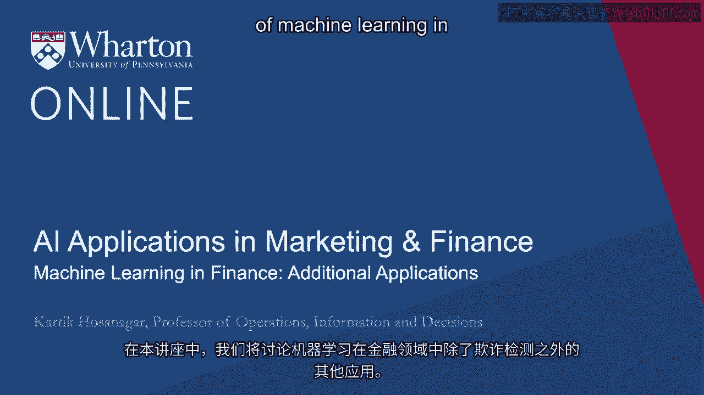
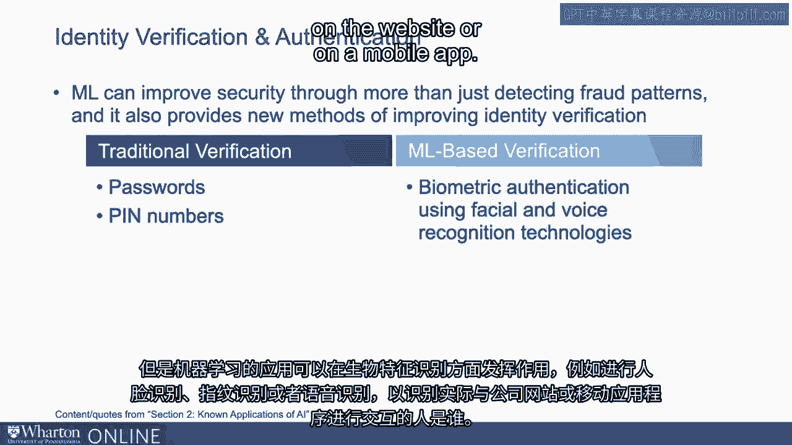
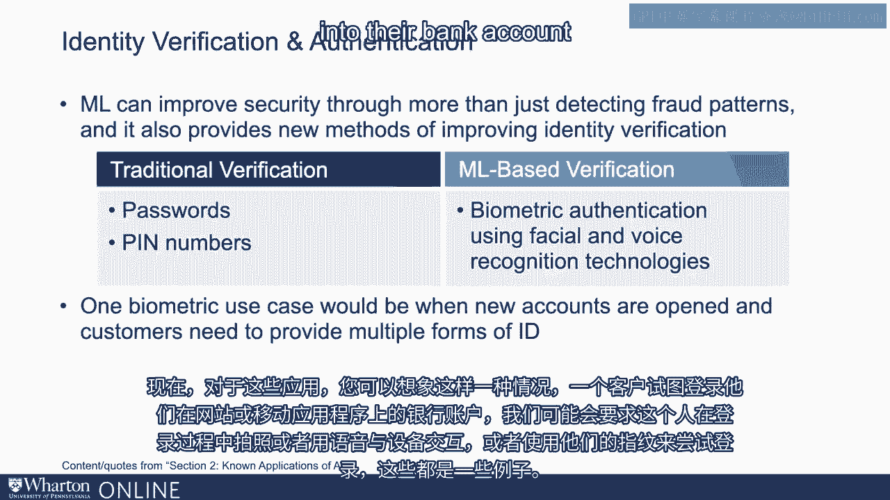
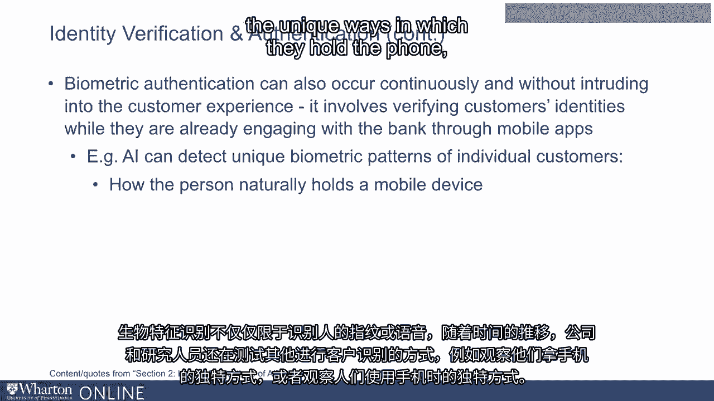
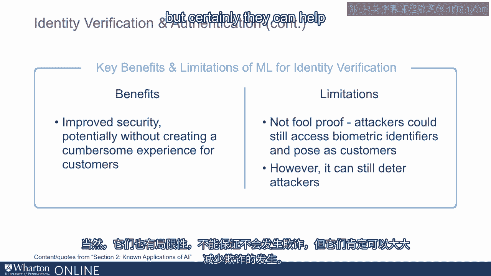
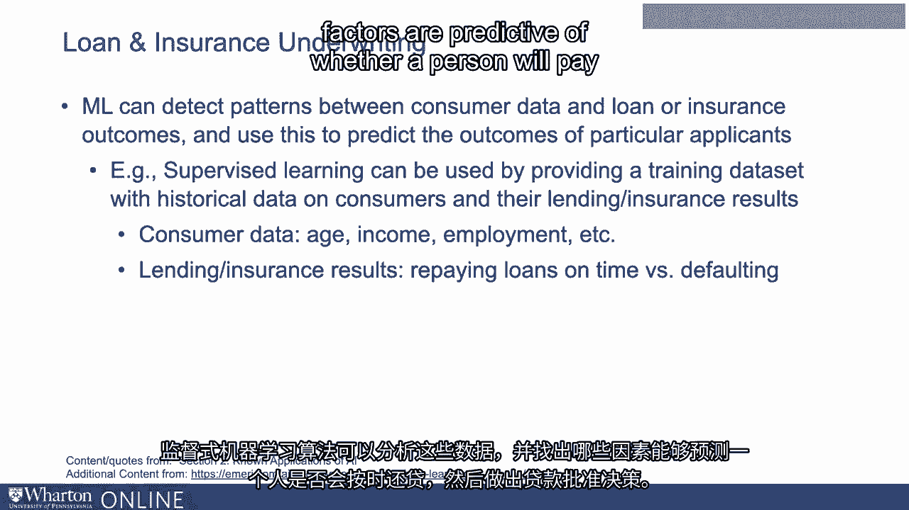
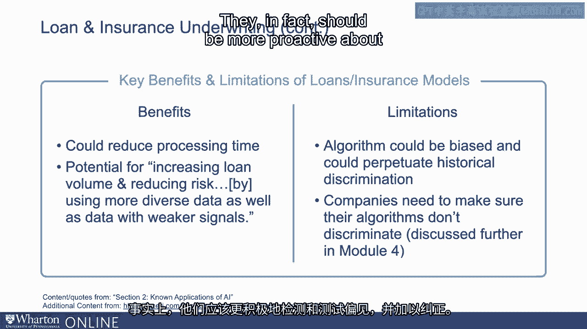
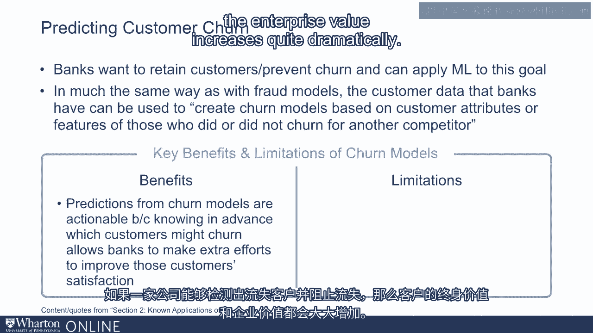
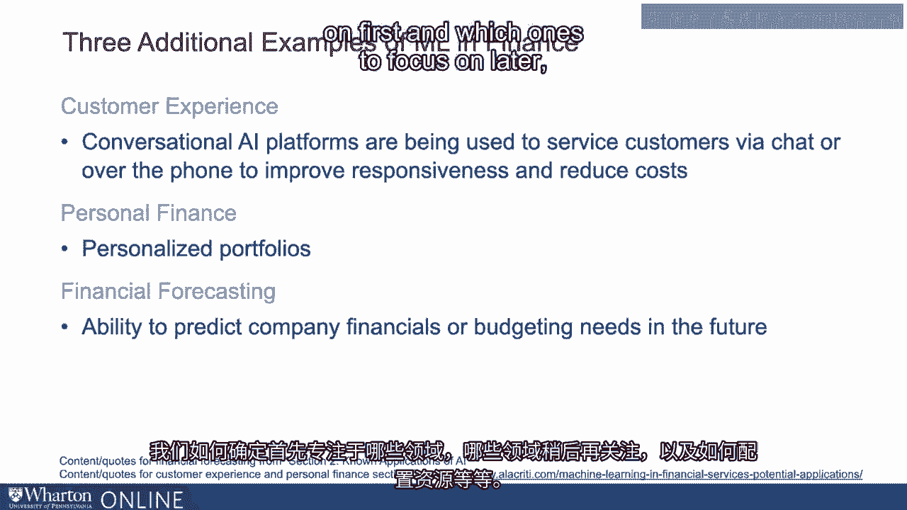

# 课程 P61：机器学习在金融中的其他应用 🏦

在本节课中，我们将探讨机器学习在金融领域除欺诈检测之外的其他重要应用。我们将了解这些技术如何提升金融服务的安全性、效率和决策质量。

## 概述

金融服务中存在多种需求，机器学习技术正被应用于满足这些需求。本节我们将重点讨论两个关键应用：身份验证与身份确认，以及贷款与保险的承保。

## 身份验证与身份确认 🔐

上一节我们介绍了课程的整体框架，本节中我们来看看身份验证与身份确认。这在金融服务中极其重要。当允许消费者进行交易或转账时，必须确保实际操作的人是他或她声称的那个人。因此，需要进行身份验证。

传统的身份验证方法是使用密码或PIN码。而在数字领域，机器学习的应用体现在生物识别技术上。

以下是生物识别技术的几个例子：
*   进行人脸识别。
*   进行指纹识别。
*   进行语音识别。

这些技术用于确定谁实际上在与公司的网站或移动应用程序互动。例如，顾客在登录银行账户时，可能会被要求拍摄照片、朗读一段话或使用指纹。

事实上，在中国的银行中，ATM使用人脸识别并不少见。当顾客走到ATM前时，摄像头可以识别客户并完成身份验证，从而允许其使用ATM。这项技术目前正在中国的多家银行中使用。

生物识别识别不必仅仅关注指纹或声音。企业和研究人员也在测试其他客户识别方法。

以下是其他可能的生物识别方式：
*   观察用户握持手机的独特方式。
*   分析用户轻触手机屏幕的独特模式。

不过，这类技术尚不够成熟，目前尚不清楚是否会在实践中被广泛使用。如今，生物识别在身份识别方面有多种用途，所有这些用途都倾向于依赖机器学习算法进行模式识别。

这些技术的优势在于，生物识别提供了相对于密码等传统方式更高的安全性。当然，其限制在于它们并非万无一失，不能保证完全杜绝欺诈，但可以显著减少欺诈的发生。

## 贷款与保险的承保 📊

上一节我们讨论了身份验证，本节中我们来看看机器学习在贷款和保险承保中的应用。在传统的贷款审批决策中，今天是由贷款官员根据一些客户信息做出判断。

但是，越来越多的人对应用机器学习算法来指导或自主做出贷款决策表示出兴趣。这些算法通常是监督式机器学习算法。

监督式机器学习算法需要一个训练数据集。该数据集将包含多个特征（或称协变量、X变量）以及一个干净的标记结果变量（Y变量）。

以下是训练数据集通常包含的内容：
*   **特征（X变量）**：包括客户数据，如年龄、收入、就业状况、信用历史等。
*   **结果变量（Y变量）**：例如客户过去的信用评分、按时还款的历史记录，或是否发生过违约。

用一个简单的公式表示，模型的目标是学习一个函数 **f**，使得：
**Y ≈ f(X1, X2, ..., Xn)**
其中，Y 是预测目标（如违约概率），X1 到 Xn 是客户特征。

模型在历史数据上训练完成后，就可以用于对新客户的贷款申请进行风险评估，预测其违约的可能性，从而辅助或自动化承保决策。

## 总结

本节课中，我们一起学习了机器学习在金融领域的两个重要扩展应用。

首先，我们探讨了**身份验证与身份确认**，了解了如何利用人脸识别、指纹识别等生物识别技术，结合机器学习，提升金融交易的安全性。

接着，我们分析了**贷款与保险的承保**，看到了监督式机器学习如何利用客户的历史数据特征来预测信用风险，从而优化承保决策流程。

这些应用展示了机器学习技术正在深刻改变金融服务的运作方式，使其变得更智能、更高效。