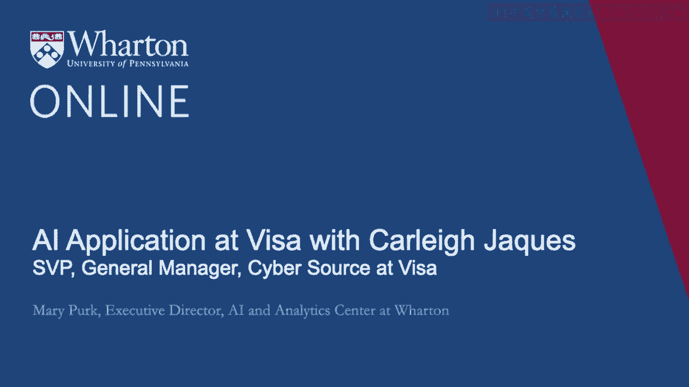
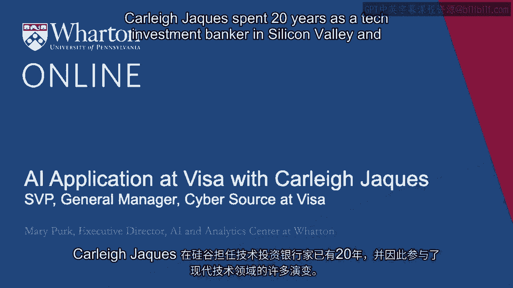

# 课程P62：Visa与CyberSource中的AI应用 🏦🤖

在本节课中，我们将通过Visa战略与企业发展和CyberSource总经理Carli Jake的访谈，了解人工智能和机器学习在支付与反欺诈领域的实际应用。我们将探讨AI如何解决复杂的商业问题，以及数据、模型和商业背景在其中的关键作用。

***

## 背景介绍：Carli Jake与CyberSource

Carli Jake在硅谷担任了20年的科技投资银行家，之后加入了Visa，负责战略和企业发展。四年前，她开始担任CyberSource的总经理。CyberSource是Visa旗下的全球商户和收单平台，本质上是一个数字支付管理平台。

上一节我们介绍了Carli的背景，本节中我们来看看她所负责的业务。

CyberSource是传统实体店支付体验的数字版本。无论是购买咖啡、交通票、停车费、毛衣，还是从自动售货机购买零食，这些数字交易很可能都由CyberSource提供支持。2020年，该平台处理了约210亿笔交易，总价值约6000亿美元。

***

## AI在支付领域的核心应用：反欺诈

考虑到如此庞大的交易量，Visa及其业务单元（如CyberSource）的核心价值驱动因素之一，就是利用AI和机器学习来解决问题，特别是欺诈问题。

在数字支付世界中，商家需要为不良交易（欺诈交易）承担责任，因此他们对反欺诈工具极为关注。CyberSource积极开发欺诈检测工具来支持商家。去年，该平台在反欺诈方面处理了约2000亿美元的支付金额，涉及约二十亿笔交易。

以下是CyberSource反欺诈工作的几个关键点：
*   **数据整合**：系统会审视全球范围内的交易，并考虑来自超过250个不同来源的欺诈信号。
*   **应对挑战**：在COVID-19疫情期间，电子商务流量激增，欺诈活动也大幅增加。
*   **灵活应用**：商家不仅以传统方式部署反欺诈能力，还与CyberSource合作创造新的用例。

一个具体的例子是，在疫情初期出现了囤积行为。某客户利用CyberSource的技术，在商品层面进行精细调整，通过观察购买模式来限制个人可购买的消毒剂数量，从而保障更广泛社区的供应。这展示了技术如何被灵活地适应于特定场景。

***

## 工作方法的演变：从“由内而外”到“以客户为中心”

COVID-19的例子表明，Visa和CyberSource接触AI的方式与五年前相比已经加速并发生变化。这种变化的核心在于工作方法变得更加迭代和灵活。

过去，在技术复杂、生态系统错综的支付行业，构建解决方案通常采用“由内而外”的视角，即从内部技术流程出发。而现在，团队更侧重于思考客户体验和“客户旅程”，专注于解决具体的商业问题。

这种转变彻底改变了产品体验。以下是实现这种转变的关键实践：
*   **联合应用开发会议**：与客户、技术团队、产品团队和数据科学家一起协作。
*   **数据科学家的关键角色**：数据科学家是这些会议中不可或缺的一部分，因为欺诈模式具有高度的行业特异性。
*   **理解商业背景**：除非深刻理解客户的商业环境，否则即使拥有卓越的技术，也可能无法优化出期望的结果。

***

## 理解商业背景：模型成功的基石

当我们谈论商业背景时，其重要性怎么强调都不为过。框定正确的商业问题是构建有效AI解决方案的第一步。

欺诈检测的商业背景因行业而异。例如，数字商品利润率极高，单笔欺诈交易对业务影响不大；而利润微薄的行业，每一笔欺诈交易都会对底线产生巨大冲击。因此，模型需要根据不同的商业成本进行优化。

商业背景还是动态变化的。以航空业为例，疫情期间出现了大量国际单程机票。通常这可能是欺诈信号，但当时很多人只是为了回家。模型必须根据变化的商业环境进行调整，才能避免误判合法的交易。

***

## 数据的核心地位：模型的“秘密配方”

构建良好模型的关键要素之一就是数据。模型的质量完全取决于其训练数据的质量。

在支付行业，数据有其特殊性。例如，一笔信用卡不良交易需要由消费者或商家向银行报告，裁决过程可能长达90天。这意味着有90天的时间无法确认某笔交易的真实性质。

以下是关于数据质量的几个关键考量：
*   **渠道差异**：移动支付、电子商务和面对面交易可能有不同的欺诈模式，需要分别理解。
*   **模型成熟度**：需要持续监控模型表现，理解其成熟度，并评估新数据或新洞察带来的提升。
*   **数据标准化与治理**：Visa和CyberSource非常重视数据治理、隐私和标准化。支付交易有至少20种不同的影响方式，各有不同属性。如果不同数据源之间的映射不正确，或者吸收新数据源时基准不统一，就会扭曲分析结果。
*   **数据增强**：可以通过引入设备属性、IP地址、用户行为模式（区分真人与机器人）等数据来增强模型。但这一切都建立在清晰、一致的数据定义之上。

***

## 总结

本节课中，我们一起学习了AI和机器学习在Visa及CyberSource支付生态系统中的实际应用。我们了解到：
1.  **反欺诈**是AI在支付领域的核心应用场景，需要处理海量交易和复杂的欺诈信号。
2.  **工作方法**已从技术导向转变为以客户旅程和商业问题为中心，强调迭代和协作。
3.  **商业背景**是框定问题和优化模型的关键，不同行业、不同时期的需求差异巨大。
4.  **数据质量**是模型的基石，需要严格的数据治理、标准化以及对数据特殊性的深刻理解（如90天的裁决周期）。

通过这次学习，我们看到了在看似简单的信用卡交易背后，一个由AI驱动的复杂、动态且高度依赖数据的智能系统在持续工作，以保障交易的安全与效率。