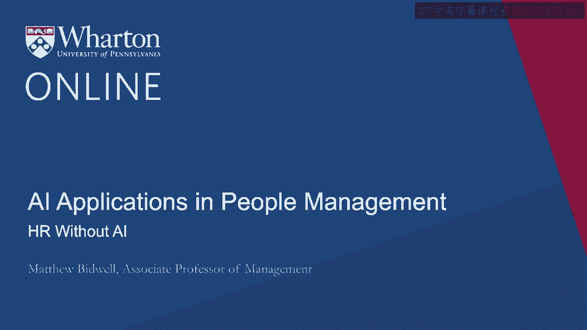
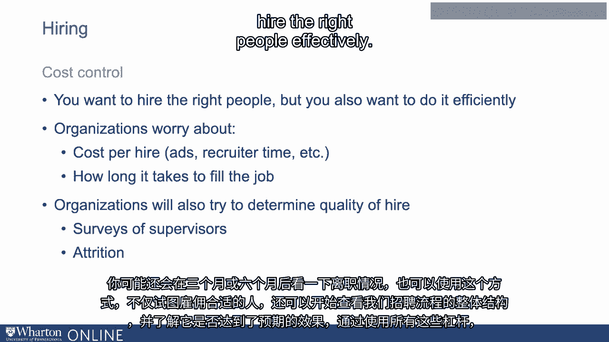
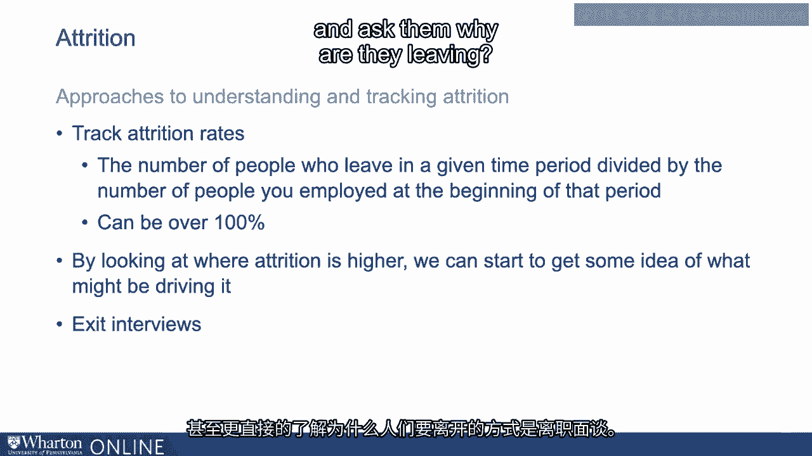
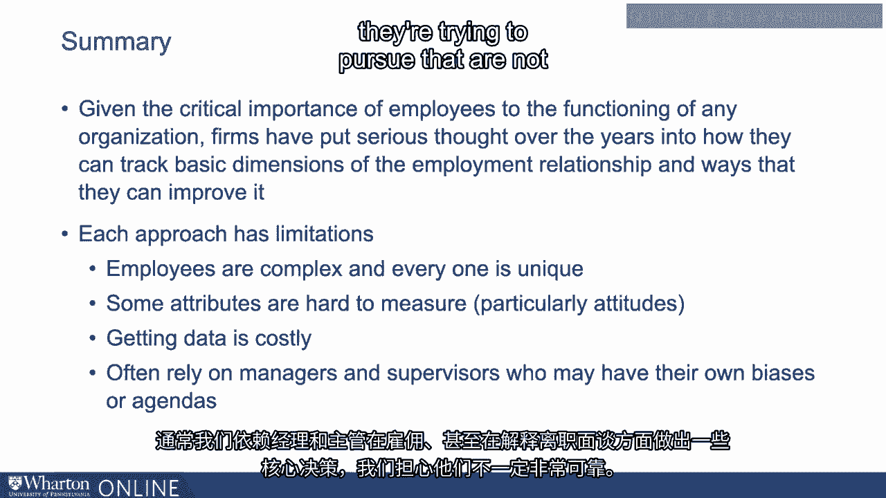
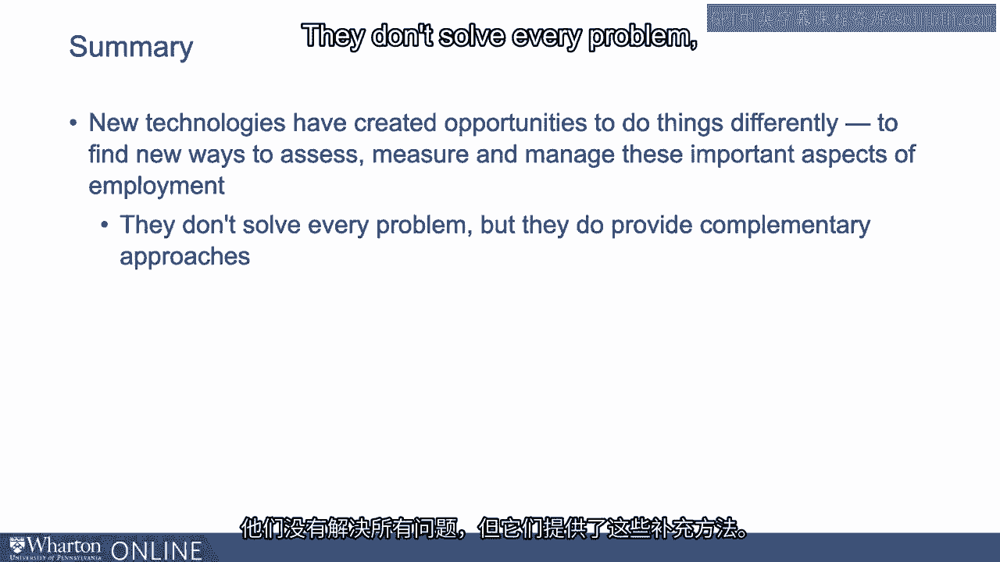
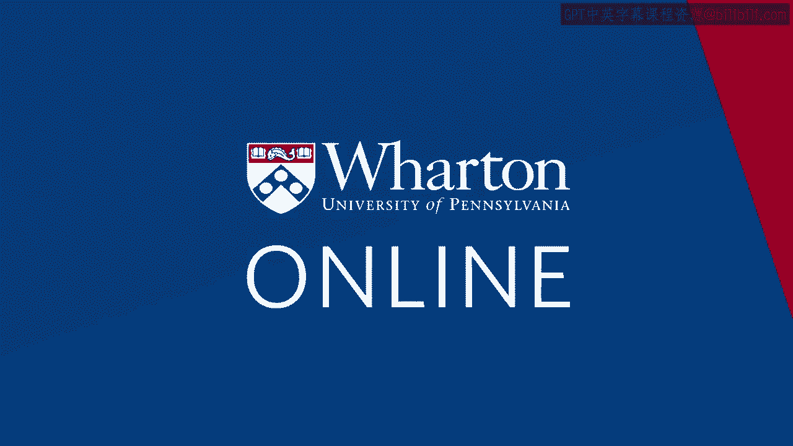

# 课程 P65：人工智能时代前的人力资源管理 👥

在本节课中，我们将学习在人工智能技术广泛应用之前，组织是如何应对招聘、员工敬业度和员工流失这三大核心人力资源管理挑战的。我们将了解传统方法的运作逻辑及其固有的局限性。

## 概述：传统人力资源管理的三大支柱

管理人是复杂的，因为员工拥有自由意志。组织不仅需要雇佣员工，还需要激励他们，并说服他们完成工作。恰当的人员管理是组织成功的关键。在深入探讨人工智能带来的新机会之前，我们先回顾组织在没有这些先进技术时，是如何思考和解决人员管理问题的。本节将重点介绍三个核心领域：招聘、员工敬业度管理和员工流失控制。

## 第一节：传统招聘——结构化流程与管理自主权的拉锯战 🎯

招聘是人员管理的基础流程。雇佣合适的人能减少后续培训的担忧，并提高工作绩效和敬业度；雇佣错误的人则可能导致糟糕的工作环境或人员快速离职，迫使组织重新招聘。因此，成功的招聘方式对组织至关重要。

在人工智能介入之前，传统的招聘方式可以被描述为一场“拉锯战”，即在采用高度结构化的流程以识别高潜力候选人，与赋予管理层招聘自主权以控制成本之间寻求平衡。以下是这一过程的三个关键方面：

### 1. 结构化流程：测量候选人的潜力
招聘的核心是一个测量问题：我们如何评估申请者，并预测他们成为员工后的表现？过去一个世纪，心理学家对此进行了大量研究，催生了一系列最佳实践。以下三种方法被证明在预测工作表现方面相当有效：
*   **结构化面试**：组织首先明确完成工作所需的关键属性，然后设计一系列标准化问题来评估候选人是否具备这些属性，并预先定义好每个问题的评分标准（如差、中、好）。
*   **认知能力与知识测试**：针对广泛职位进行的认知能力测试和专业知识测试，能有效评估候选人是否具备完成工作的必要能力。
*   **个性测试**：有证据表明，某些个性测试也能有效预测工作表现。

人力资源部门会尝试利用这些方法进行结构化评估，以找出最具潜力的候选人。同时，他们会尽量避免已知效果不佳的方法，例如非结构化面试（即仅凭面试官个人喜好进行自由提问和互动）。

### 2. 管理层的自主权：流程落地的挑战
尽管人力资源部门可以建立完善的结构化流程，但在大多数组织中，实际的招聘决策往往由一线经理（即“招聘经理”）做出。这意味着，结构化流程能否被应用，取决于经理们是否愿意使用它们。然而，经理们常常抵制这些流程，原因包括：
*   认为流程过于僵化和正式，更喜欢与人进行顺畅、自然的互动。
*   过度相信自己对人的判断力，倾向于迅速形成对候选人的看法，并在后续面试中寻找证据来支持这一判断。

因此，许多经理可能更倾向于绕过结构化流程，采用自己习惯的、非正式的方式（例如询问“你的精神动物是什么？”）来评估候选人。

### 3. 成本控制：效率与质量的权衡
在结构化流程与管理自主权之外，招聘还涉及成本控制。组织需要平衡“雇佣合适的人”与“高效地完成雇佣”。他们关注：
*   **雇佣成本**：包括外部广告、招聘费用以及内部在招聘上花费的时间和资源。
*   **岗位填补时间**：职位空缺时间越长，对业务造成的干扰越大。
*   **招聘质量**：一些组织会尝试在员工入职3到6个月后，通过询问主管“你是否会再次雇佣此人？”或追踪早期离职率等方式，来评估招聘流程的整体效果。

通过操控这些杠杆，组织努力确保自己既能雇佣到合适的人，又能控制成本。

## 第二节：衡量员工敬业度——年度调查的得与失 📊

上一节我们介绍了组织如何通过招聘引入人才。本节中，我们来看看组织如何激励和管理已入职的员工。由于员工拥有自由意志，激励他们为组织成功而努力至关重要。影响动机的杠杆很多，包括工作设计、组织文化和领导方式。

理解员工敬业度的关键在于首先了解员工的真实感受。因此，组织会投入时间和精力来测量员工的敬业度。传统上，标准方法是进行**员工敬业度调查**。

### 员工敬业度调查的运作与价值
许多公司每年会向全体员工发送一份冗长的问卷，询问他们对工作、经理、薪酬、福利和公司文化等方面的感受。这些问题集通常由心理学家开发，旨在精确获取员工在特定维度的意见。
*   **价值**：这种方法能帮助组织了解整体敬业度水平，通过逐年对比观察趋势（是在进步还是退步）。更重要的是，它可以识别出组织中敬业度较高或较低的特定群体或部门，从而为针对性改进提供方向。

### 员工敬业度调查的局限性
尽管相对有效，但员工敬业度调查也存在明显问题：
*   **回答的真实性**：员工的回答可能与真实想法存在差距。他们可能出于策略性目的（如希望改善现状）而给出不乐观的答案，也可能因担心报复（如批评经理）而不愿说实话。
*   **成本与频率**：让公司全员填写问卷需要投入大量人力资源和协调努力。为了避免高昂成本，许多组织选择每年只进行一次调查。然而，如果组织希望获得问题的早期预警信号，一年的等待时间可能过长，尤其是在环境快速变化时（例如疫情期间）。

因此，在获取员工敬业度洞察时，传统方法在时效性和成本之间存在显著的权衡。

## 第三节：应对员工流失——追踪率与离职面谈 🔄

我们讨论了如何引入人才（招聘）和激励现有员工（敬业度）。本节我们将关注人员管理的另一个核心挑战：员工流失。员工离职率对组织而言是一项主要成本，不仅涉及重新招聘的费用，还包括知识流失、团队关系中断和新员工适应期带来的效率损失。

组织有多种杠杆可以尝试降低流失率，例如调整招聘标准、薪酬方案或改善驱动敬业度的因素。但首先，他们需要弄清楚“应该操控哪一个杠杆？”以及“人们为什么离开？”。传统上，组织主要采用两种方法来理解流失问题。

### 1. 追踪流失率
组织会计算并跟踪**流失率**，其基本公式为：
`流失率 = (给定时期内离职人数) / (时期开始时在职人数)`
通过观察流失率随时间的变化趋势，以及比较不同部门或职位的流失率，组织可以识别问题区域并推测可能的原因。

### 2. 进行离职面谈
更直接的方法是进行**离职面谈**，即与即将离职的员工交谈，询问其离职原因。通过系统分析这些原因（例如，更多人提到高薪、职业发展或通勤时间），组织可以了解需要改进的方面。

### 传统方法的局限性
然而，这两种方法都有其缺陷：
*   **流失率**：只是一个结果指标，无法直接揭示深层原因。
*   **离职面谈**：
    *   **覆盖不全**：并非所有离职者都会接受面谈（例如突然离职者）。
    *   **信息失真**：离职者可能不愿透露真实原因（如糟糕的管理），而倾向于提供更安全、更表面的理由（如薪酬），因为他们可能考虑未来重返公司或避免冲突。

因此，尽管离职面谈能提供一些见解，但对其答案的可靠性和深度需要保持审慎态度。

## 总结与展望：传统方法的局限与新技术的契机

本节课我们一起学习了在人工智能时代之前，组织在招聘、员工敬业度管理和员工流失控制这三个核心领域所采用的传统方法及其面临的挑战。

总结来说，传统人力资源管理方法存在几个普遍局限：
1.  **人的复杂性**：每个员工都是独特的，其态度和动机难以精确衡量。
2.  **数据获取的成本与时效性**：如年度敬业度调查，成本高昂且频率低，难以及时反映问题。
3.  **对人的判断的依赖与偏差**：在招聘和离职面谈等环节，过度依赖管理者或员工的主观判断，这些判断可能不可靠、带有偏见或受个人议程影响。

认识到这些局限后，我们希望指出，人工智能和机器学习的进步并不能解决人员管理中的所有固有难题。然而，这些新技术确实创造了新的可能性。它们提供了不同的做事方法和新的机会，例如以新的方式评估候选人潜力，或寻找更实时、更客观的途径来洞察员工敬业度。

在接下来的课程中，我们将开始解释这些新工具（如**机器学习**）如何运作，并探索它们如何应用于人员管理领域，为我们今天所讨论的诸多挑战开发更有效的解决方案。