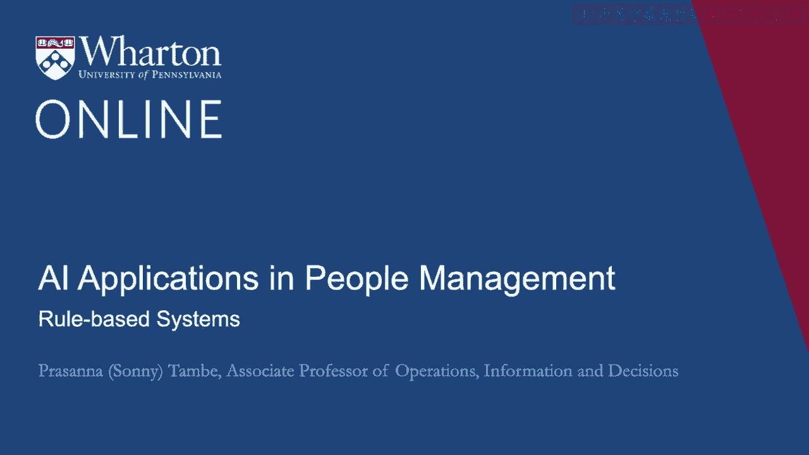
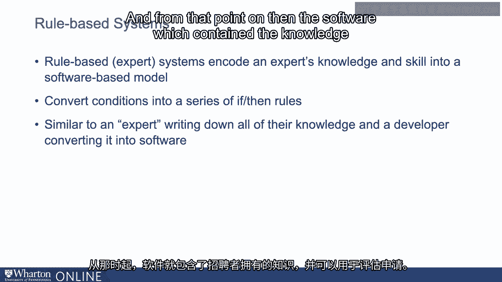
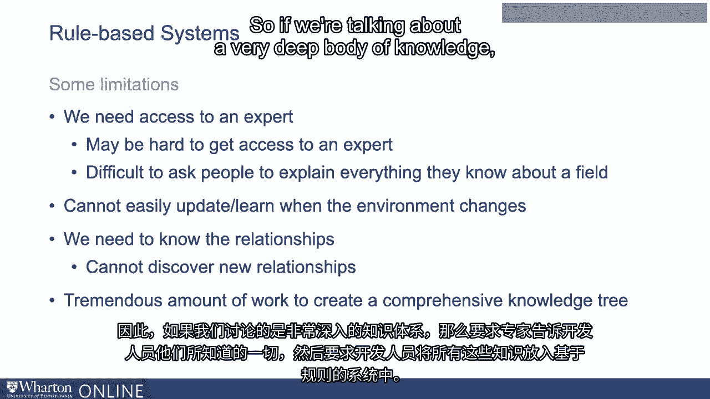

# 课程 P67：基于规则的系统 🧠

在本节课中，我们将学习人工智能在人力资源流程中的一个早期重要应用——基于规则的系统。我们将了解其工作原理、应用示例以及它的主要优缺点。

---

## 概述

基于规则的系统，也称为专家系统，是将人类专家的知识和决策过程编码成一系列软件可执行的规则。在人力资源领域，这通常意味着将招聘专家的经验转化为自动化的候选人筛选工具。

---

## 什么是基于规则的系统？

在我们探讨机器学习和人工智能如何在HR流程中使用的旅程中，停留在基于规则的系统或专家系统是很有用的。

这种方法的核心是**利用人类对这个过程的了解**。所有关于招聘和选拔的专业知识，都可以被转化为软件。

所以，基于规则的系统基本上是将专家的知识和技能编码到一个基于软件的模型中。这些系统所做的就是将招聘条件转换成一系列规则。

对于那些可能熟悉编程的人，你可以将这些看作是 **`if-then`** 规则。这很像是一个专家（在这种情况下是领域专家、HR或招聘者）把他们关于如何招聘、以及关于什么类型候选人适合该组织的所有知识都写下来。然后，开发者可能会将这些规则转换为软件。从那时起，包含招聘者知识的软件就诞生了。

---

## 基于规则系统的工作原理

上一节我们介绍了基于规则系统的核心概念，本节中我们来看看它在招聘中的具体应用。

想象一下你有一组用于评估候选人的条件。当我提到条件时，我指的是用来评估候选人以适应你们组织的因素。

以下是可能被编码的条件示例：
*   这可能包括**毕业院校**。
*   这可能包括**GPA（平均绩点）**。
*   这可能包括**之前的雇主**。
*   或者在面试中捕捉到的信号、他们回答问题的方式等。

这些内容中的一些可以被编码。你可以从简历开始，并且可以创建相应的度量。面试数据也是如此。例如，之前雇主的经验可以被编码为“该雇主是他们曾为之工作的公司”。

一旦你掌握了这些信息，软件开发人员就可以使用这些数据或其基于规则的系统来评估或推荐候选人是否应该被公司面试。

这里需要知道的关键是：**你不需要大量的历史数据来构建这个系统**。这将使它与后来的机器学习有所区别。在这种情况下，我们使用的是人类的专业知识。一名开发者与招聘人员合作，将招聘人员的知识和专业技能进行了编码。我们现在还不需要数据来构建这种类型的系统。

---

## 基于规则系统的局限性

像这样的、通过与专家交谈而创建的决策树系统有一些局限性。

以下是其主要缺点：

1.  **需要接触到专家**：获取专家的帮助可能很困难。例如在一些非常专业的领域（如**专业外科手术**），可能难以接触到专家。即使你能接触到，要求人们解释他们所知道的某个领域的所有内容也非常困难。人们有时凭直觉工作，拥有大量的隐性知识，但让他们将其变成明确的规则有时比听起来要困难得多。

2.  **难以适应环境变化**：如果你基于这些规则构建一个系统，然后申请者群体的性质开始发生变化，你必须回去手动更新系统或建立一个新系统。它无法自动适应这些变化。

3.  **无法发现新关系**：我们的决策完全基于一位专家的现有知识。我们需要预先了解所有决策所基于的关系，并从这里开始构建系统。我们无法在这个自动化过程中发现新的、未知的关系。

4.  **创建和维护工作量大**：创建一个全面的知识规则库需要大量的工作。我们讨论的是一个非常深奥的知识体系。考虑请专家告诉开发者他们所知道的一切，然后要求开发人员将所有这些知识纳入基于规则的系统中，所有这些加在一起是相当庞大的工作量。

---

## 总结

本节课中，我们一起学习了基于规则的系统（专家系统）。我们了解到，这种系统通过将人类专家的知识编码成 **`if-then`** 规则来实现自动化决策，例如在招聘中筛选简历。它的优点在于无需大量数据即可构建，并且能直接应用专家经验。然而，它也存在依赖专家、难以更新、无法发现新知识以及构建工作量大的显著局限性。

我们将在下一个视频中讨论，机器学习如何避开了许多这些问题。