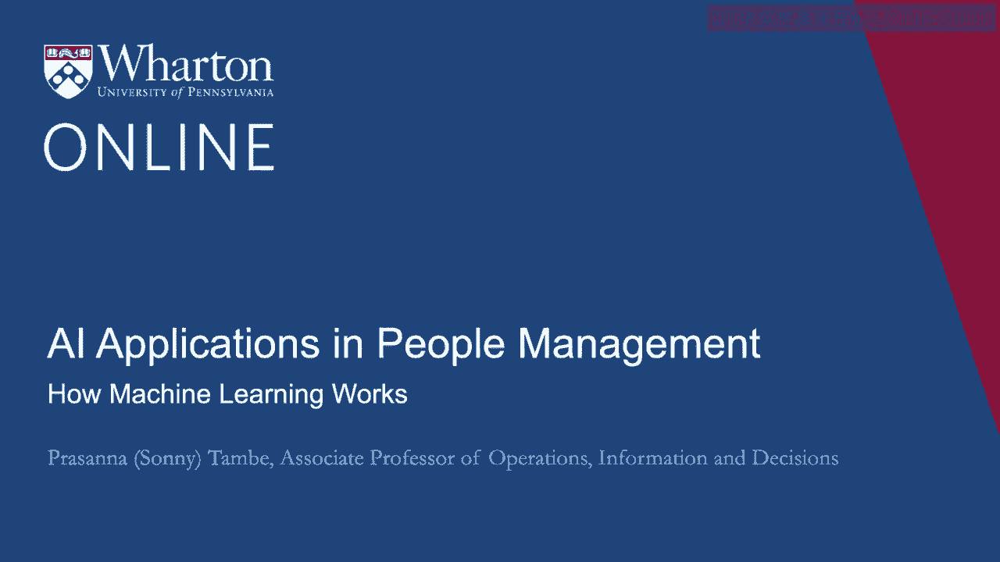
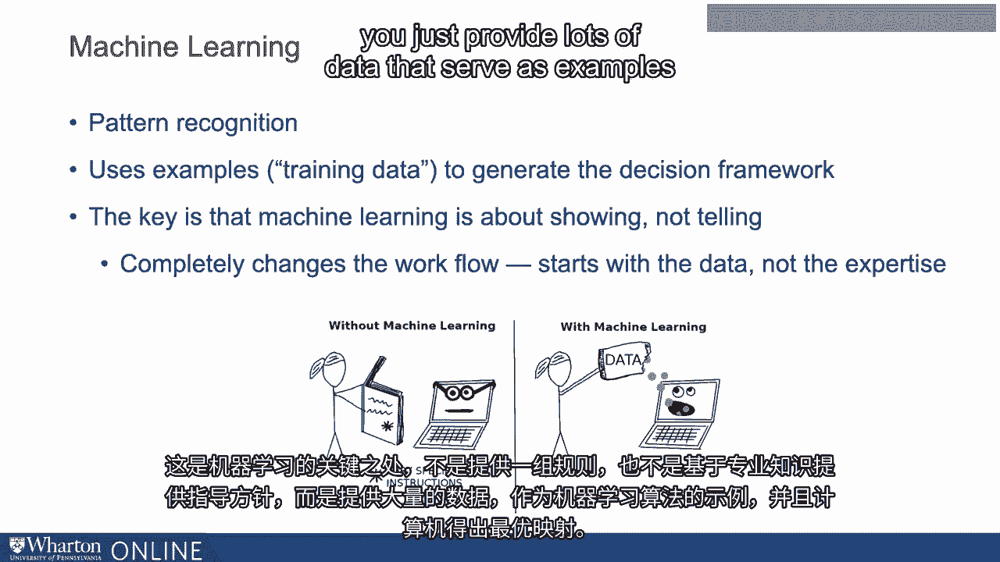
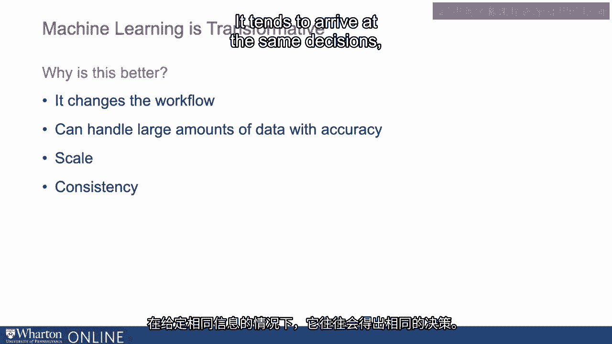

# 课程 P68：机器学习的工作原理 🧠

在本节课中，我们将要学习机器学习的基本工作原理，了解它与传统基于规则的系统有何不同，并探讨其变革性的优势。

---

## 从规则到模式：范式的转变

上一节我们讨论了人类决策和基于规则的系统，在这些系统中，软件开发者可以将某人的专业知识直接编码到软件里。

机器学习在一定程度上改变了这一范式。它的本质是**模式识别**。机器学习的作用在于它使用示例，我们称这些示例为**训练数据**，来生成决策框架。关键在于，机器学习实际上是关于“展示”而不是“讲述”。与其让一个人解释他们是如何做某件事，不如提供大量大量的例子，让机器自己学习如何构建决策框架。这完全改变了工作流程：它从数据开始，而不是从对专业知识的编码开始。

---

## 核心机制：用数据代替规则

机器学习的关键在于，它不依赖于基于专业知识提供的一套规则。你只需提供大量数据，这些数据作为机器学习算法的示例。

计算机通过分析这些数据，最终会达到一个**最优**的映射。例如，假设我们有很多关于申请某公司的候选人的信息。传统方法需要专家解释该组织重视候选人的哪些方面，以及如何权衡不同因素。

以下是机器学习方法的步骤：
1.  提供大量关于申请者的历史数据。
2.  这些数据包含申请者资料的不同部分（即变量或特征）。
3.  数据中也包含了关于候选人的最终决定（例如，是否被邀请面试）。

当我们拥有这些数据时，机器学习算法可以仅通过观察数据来学习应该如何思考，或者应该如何考虑申请人作品集中的不同部分。它自己会判断是否应该优先考虑以往雇主的经验、特定技能等。你从来不需要明确告诉它。人类专家也无需准确告知它对特定组织来说什么是重要的。从展示的示例数据中，算法可以自己学习该做什么。

这就是机器学习与之前基于规则的系统之间的核心区别。

---

## 为何具有变革性？🚀

为什么我们认为这种使用示例的方式以及机器学习系统本身是具有变革性的呢？

首先，它改变了工作流程。基于规则的系统需要接触专家，获取人类专业知识。这可能非常昂贵，尤其是涉及高技能专家时。获得并编码这样的专业知识也很困难。

在机器学习的案例中，我不再需要专家本人，我需要的是专家生成的数据。例如，我可以去医院获取从业者之前做出的医疗决策数据。拥有这些数据后，我就不再需要实际专家的持续帮助。

其次，在某些情况下，数据量如此庞大，变量如此之多，人类专家根本无法有效地综合所有信息。在许多机器学习应用场景中，你可能面临成千上万个影响预测的变量。

以下是机器学习在此类场景中的优势：
*   **处理海量变量**：在金融、广告或环境领域，常有成千上万的变量。期望人类专家一次性考虑所有信息来做出预测是不现实的，但机器学习算法可以做得很好。
*   **超越人类极限**：如果提供两千个变量和相应的结果示例，算法通常能比人类做得更好，因为人类可能觉得一次性综合所有这些信息极其困难甚至不可能。

第三，一旦算法建立，它可以大规模运行。无论是查看十份简历还是一千万份简历，其扩展性非常好，边际成本很低。

第四，它非常**一致**。作为一个算法，在给定相同信息的情况下，它倾向于做出相同的决策。它不会疲倦，也不会在特定日子犯错，这保证了决策的稳定性。

在某些对一致性要求高的场景中，这一点至关重要。

---

## 总结与核心

本节课中，我们一起学习了机器学习的工作原理。其核心在于，它通过分析大量的**训练数据**（示例）来自动学习决策模式，而非依赖人工编写的明确规则。

所有这一切的关键在于**训练数据**。你输入系统的这些示例，是构建强大机器学习系统并实现其诸多好处的基石。这也正是我们将在下一个视频中深入讨论的内容。

