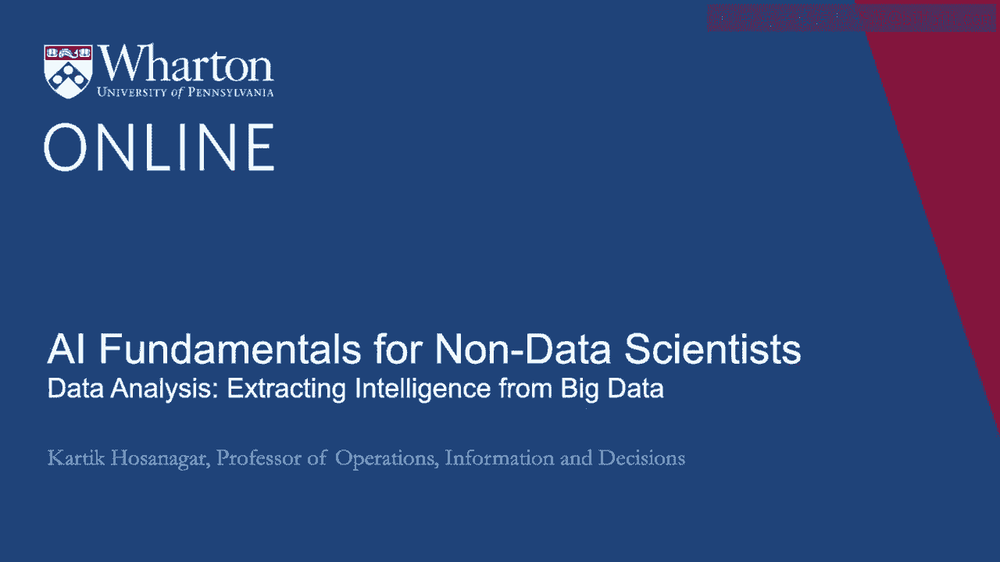
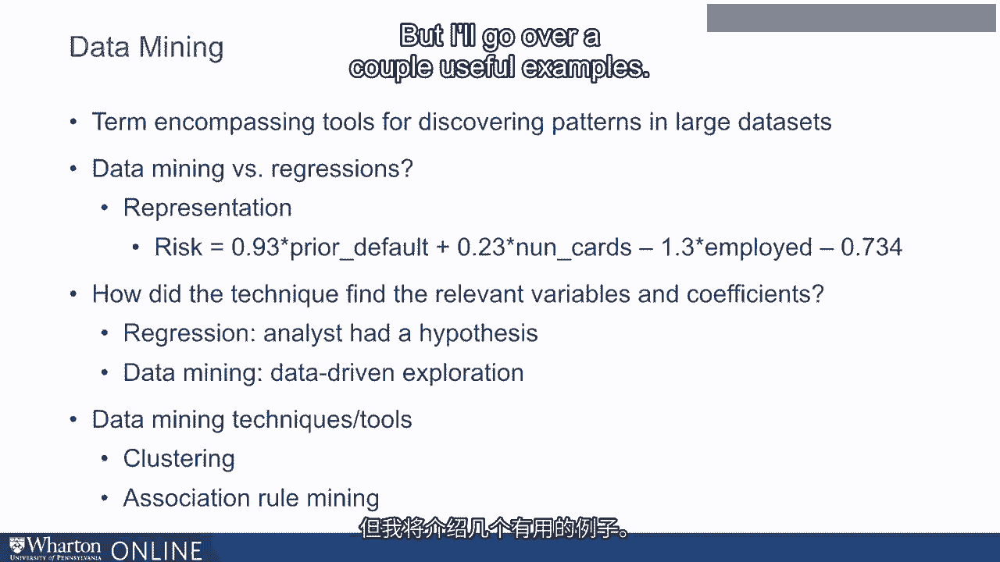
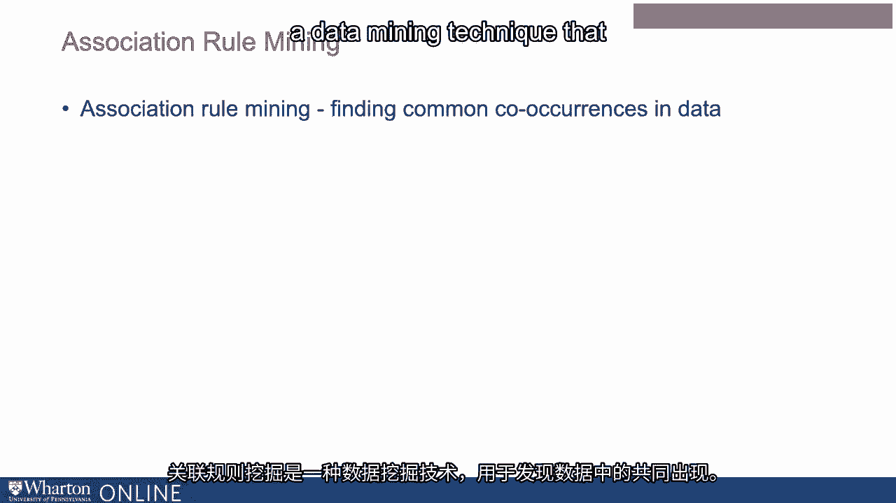
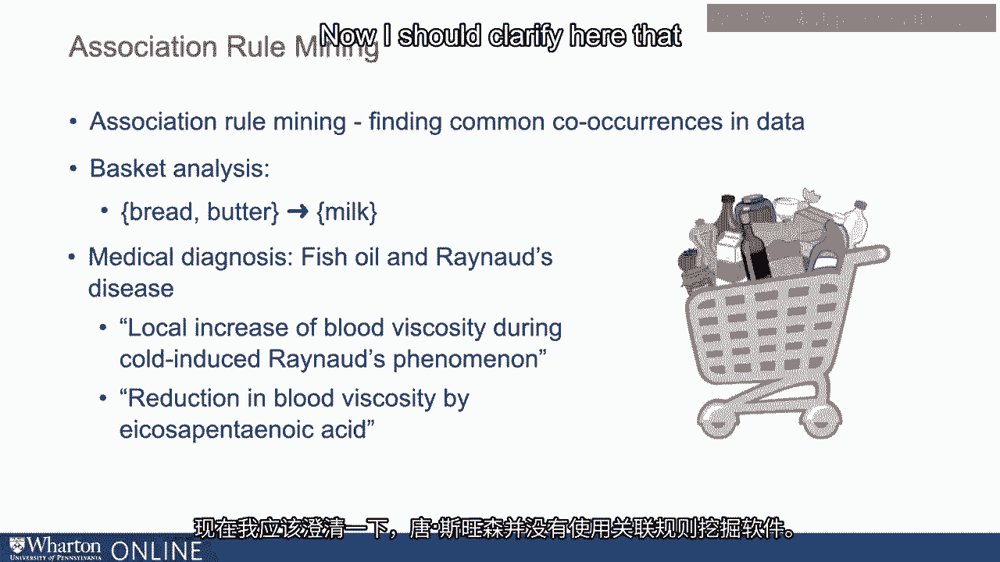
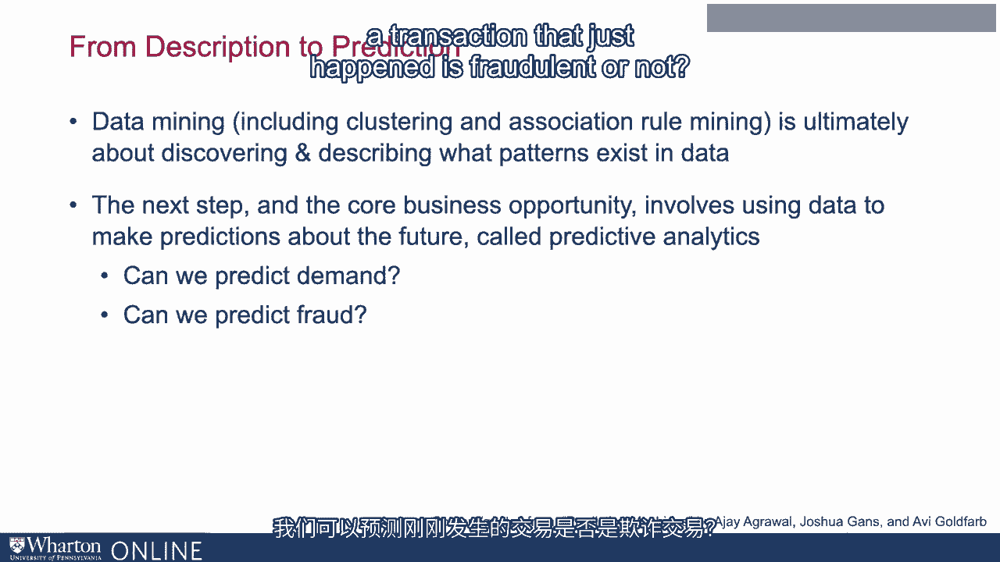
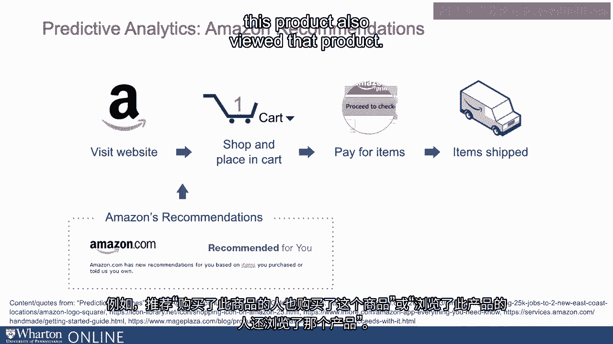
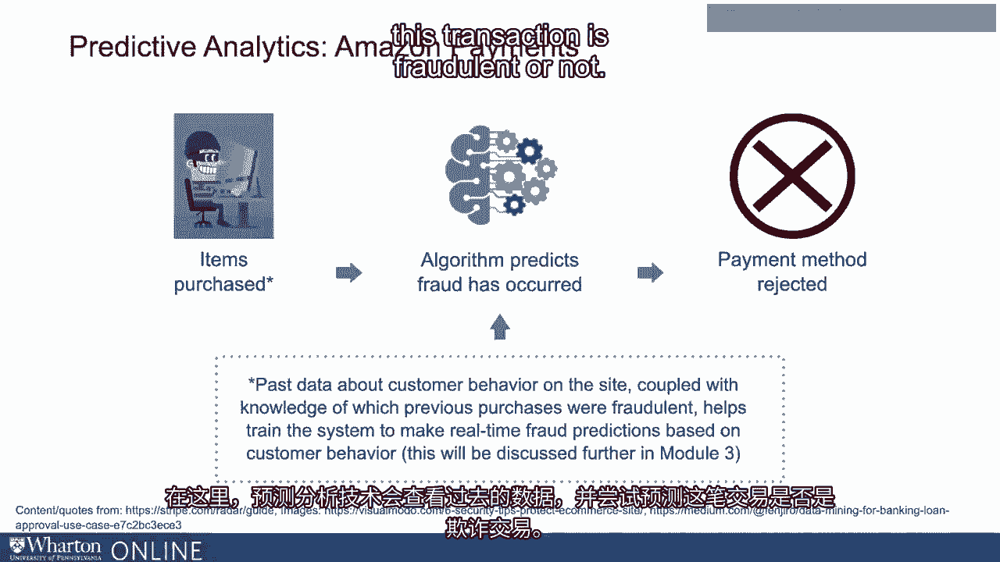

# 课程P7：数据分析入门 🧠



在本节课中，我们将学习数据分析的核心概念，特别是数据挖掘和预测分析。我们将了解如何从海量数据中发现模式，并利用这些模式进行预测和决策。

---

## 从假设检验到数据驱动

上一节我们介绍了数据分析的总体目标。本节中，我们来看看数据分析的两种主要思路：传统的假设检验与数据驱动的探索。

传统的数据分析，如回归分析，通常从一个明确的假设开始。

例如，我们试图预测客户是否会信用卡违约。我们可能提出以下假设：
*   违约风险取决于客户过去是否有违约记录。
*   违约风险与客户持有的信用卡数量有关。
*   违约风险与客户是否有工作有关。

回归分析的目标就是检验这些假设。我们基于历史数据运行回归模型，来测试一个人的违约风险是否真的取决于这些因素。回归结果不仅能告诉我们这些因素是否重要，还能通过**回归系数**（例如 `0.93`）告诉我们它们的影响程度有多大。

请注意，所有这些重要的变量都来源于分析师的**先验假设**。这就是传统数据分析的核心。

相比之下，**数据挖掘**更侧重于**数据驱动的探索**。它可能不会以明确的假设开始，而是让数据自己“说话”，从中发现意想不到的模式和关系。



---

## 数据挖掘技术示例

数据挖掘涵盖多种技术。以下是几种常见且有用的技术：

### 1. 聚类分析 👥

聚类是一种用于对数据进行自动分组的数据挖掘技术。

聚类算法本质上会将我们的数据集分割成多个更小的组或“簇”，使得**同一个簇内的数据点彼此相似**，而**不同簇之间的数据点彼此不同**。

聚类的一个经典应用是确定顾客细分。
*   **传统方法**：市场经理可能凭经验直觉地说“我们有三种顾客细分”，并用人口统计数据描述，例如“四口之家的足球妈妈，住在郊区”。
*   **聚类方法**：我们试图以数据驱动的方式，不依赖先验假设，从顾客行为数据中自动发现细分群体。聚类结果可能验证经理的直觉，也可能揭示出全新的、更有效的细分方式。



### 2. 关联规则挖掘 🔗

关联规则挖掘是一种用于发现数据中常见共现模式的数据挖掘技术。

例如，我们分析超市的购物篮数据。关联规则挖掘软件可能会发现如下模式：
```
如果 {面包， 黄油} 则 {牛奶}
```
这意味着购买面包和黄油的顾客，在同一笔交易中也倾向于购买牛奶。

发现这种模式后，我们可以采取相应行动：
*   实体超市可以将面包、黄油和牛奶陈列在相近位置。
*   在线超市可以在顾客将面包和黄油加入购物车时，系统自动推荐牛奶。

关联规则挖掘技术有广泛的应用。一个著名的例子是在医疗领域。信息科学家唐·斯旺森通过分析大量医学文献，发现“雷诺氏病”、“血液粘稠度”和“二十碳五烯酸（EPA，鱼油主要成分）”这些概念经常共同出现。基于此，他提出了“鱼油可能有助于治疗雷诺氏病”的假设，后来的临床试验证实了这一点。虽然斯旺森当时是手动分析，但其核心思想与关联规则挖掘完全一致。

---

## 从发现模式到预测未来

上一节我们介绍了如何通过数据挖掘发现数据中隐藏的模式。本节中我们来看看如何利用这些模式预测未来并采取行动。

数据挖掘技术（如聚类和关联规则挖掘）的最终目的是在数据中寻找模式。而更进一步的目标是利用这些模式**预测未来**。例如：
*   我们能否预测未来产品的需求，从而优化生产计划？
*   我们能否实时判断一笔刚发生的交易是否为欺诈？

这就进入了**预测分析**的领域。

---

## 预测分析的应用



让我们看一些预测分析的具体示例：

### 1. 个性化推荐 🛍️

以亚马逊这样的大型零售商为例。客户访问网站，浏览商品，最终下单购买。

零售商的目标是说服客户购买更多商品。为此，像亚马逊这样的平台会向消费者展示个性化推荐，例如“购买此商品的顾客也购买了…”或“浏览此产品的顾客也查看了…”。



这些推荐的核心，就是**预测分析模型在尝试找出客户可能对哪些产品感兴趣**，从而提升购买转化率。

### 2. 欺诈检测 🛡️

当客户准备结账时，他们会输入信用卡信息并点击“购买”。此时，零售商网站的算法需要实时判断这是否为一笔合法交易，信用卡是否被盗用。



在这里，**预测分析技术通过分析历史交易数据，构建模型来实时预测当前交易是否存在欺诈风险**。这是预测分析在金融风控领域的典型应用。

实际上，预测分析的应用非常广泛。在下一个模块中，我们将深入探讨实现这些预测的核心工具——**机器学习**，学习如何利用它来构建可操作的预测模型。

---

## 总结



本节课中，我们一起学习了：
1.  **传统数据分析**（如回归分析）通常始于明确的假设，并进行检验。
2.  **数据挖掘**侧重于数据驱动的探索，让数据揭示模式，主要技术包括：
    *   **聚类分析**：用于自动分组相似的数据点。
    *   **关联规则挖掘**：用于发现数据项之间的频繁共现关系。
3.  **预测分析**是在发现模式的基础上，构建模型以预测未来结果，其应用包括个性化推荐和欺诈检测等。

通过理解这些概念，我们掌握了从大数据中提取有价值情报的基本思路和方法。