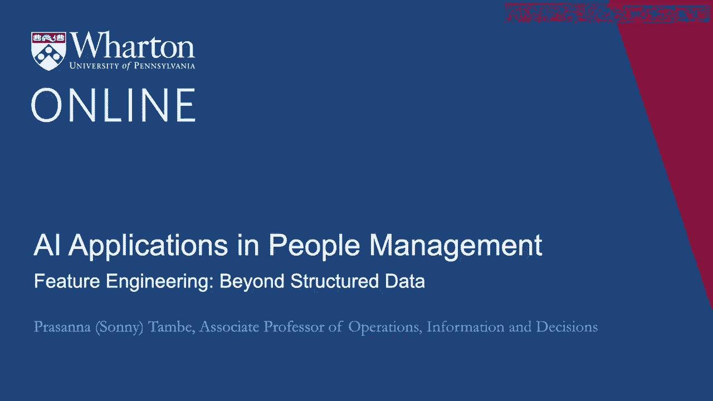
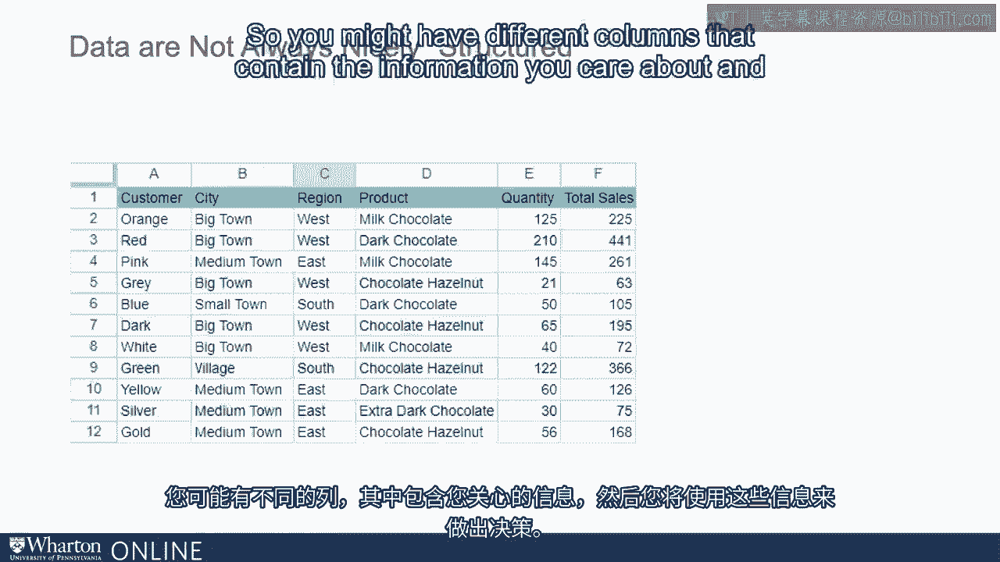
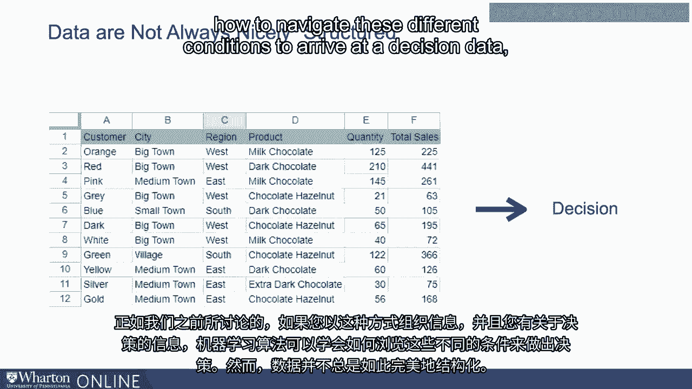
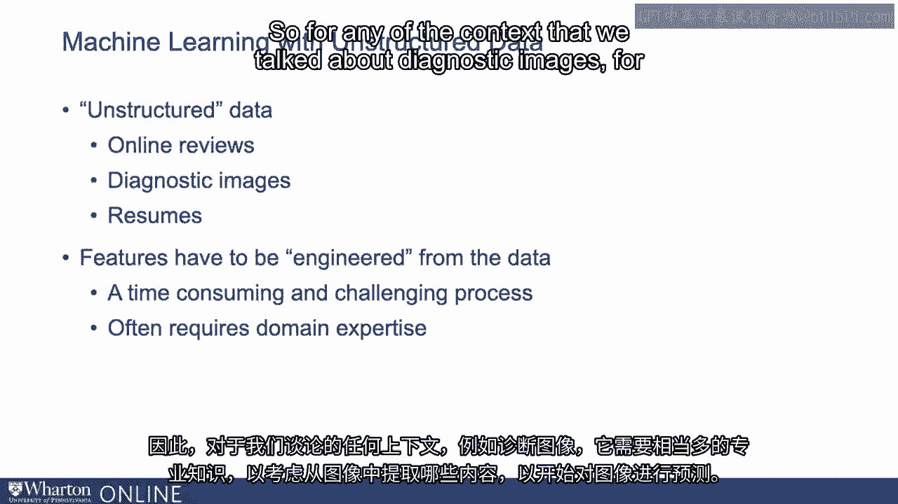
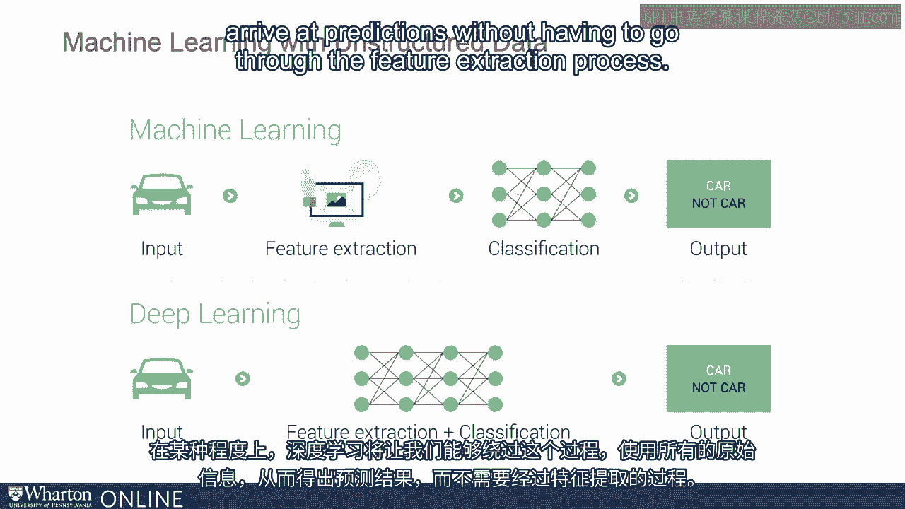

# 课程 P70：结构化数据之外的特征工程 🧠

在本节课中，我们将要学习机器学习中一个至关重要的概念——特征工程，尤其是在处理非结构化数据时的应用。我们将探讨如何将原始、非结构化的信息（如文本、图像或音频）转化为机器学习算法能够理解的格式。

---

我们之前讨论的机器学习示例，通常假设数据格式清晰明确。

这种格式使我们能够轻松评估不同的数据条件。因此，我们之前讨论或隐含地假设，您遇到的数据是以电子表格的形式组织的。您可以考虑多个列，每一列都包含关于申请者的特定信息。然后，您将利用这些信息来做出决策。

正如我们之前讨论的，如果您以这种方式组织信息，并且拥有关于决策结果的数据，机器学习算法就可以学习如何在不同的条件下做出决定。

然而，数据并不总是如此结构化。机器学习中一个重要的领域，就是研究如何在非结构化数据上应用机器学习。这些数据不容易放入电子表格的列中。

例如，您可能需要：
*   使用在线评价来预测餐厅的某些情况。
*   使用诊断图像来预测患者的健康状况。
*   在人力资源场景中，使用原始简历文本来预测申请者的信息。

在这些情况下，数据需要经历一个**特征工程**的过程。这是从原始非结构化数据中提取特征，并将其转换为可用于机器学习算法的格式的过程。

本质上，这就是将原始数据提取并转换成一种可以看作带有列的电子表格的格式。例如，如果您有原始简历数据，您需要决定将简历中的哪些部分提取出来，作为机器学习预测算法的输入特征。

这是一个耗时且具有挑战性的过程，通常还需要相当多的领域专业知识。例如，在处理诊断图像时，您需要专业知识来思考图像中的哪些内容需要被提取出来，以用于预测。

了解特征工程是连接非结构化数据集与机器学习过程的关键。这个概念意味着，您可以处理未经整理的原始非结构化数据（这些数据不容易被组织到列中），并利用它们来进行预测。

在人力资源领域，这一点变得越来越重要。越来越多的公司，尤其是科技公司，正在探索使用其他信号进行预测，例如从面试中获取的音频或视频，来预测员工的未来表现。

您可能听说过一些工具，它们允许您录制申请人的面试，分析申请人对问题的声音回应，并从中获取关于申请者的信息。为了成功实现这一点，这些音频或视频信号必须经过特征工程过程，从中提取出可用于预测的信息。

我之前提到，这个概念听起来可能不像一个大问题。其中一个重要原因是**深度学习**的出现。

深度学习在这里开始展现其优势。它能够帮助绕过繁琐的手工特征工程过程。深度学习的一个真正优势在于，它能够直接处理这种原始的非结构化数据并进行预测。

这样，我们就不必再费心猜测：对于一段视频，到底是人的手势、面部表情还是声音语调最重要？深度学习让我们能够利用所有原始信息进行预测，而不必经过人工特征提取的“弯路”。

---

在本节课中，我们一起学习了特征工程在处理非结构化数据中的核心作用。我们了解到，传统方法需要人工从原始数据（如文本、图像、音频）中提取特征，这是一个需要专业知识的复杂过程。而深度学习的出现，提供了直接处理原始数据并自动学习有效特征的能力，从而简化了这一流程。理解这两条路径，对于在实际项目中应用机器学习至关重要。