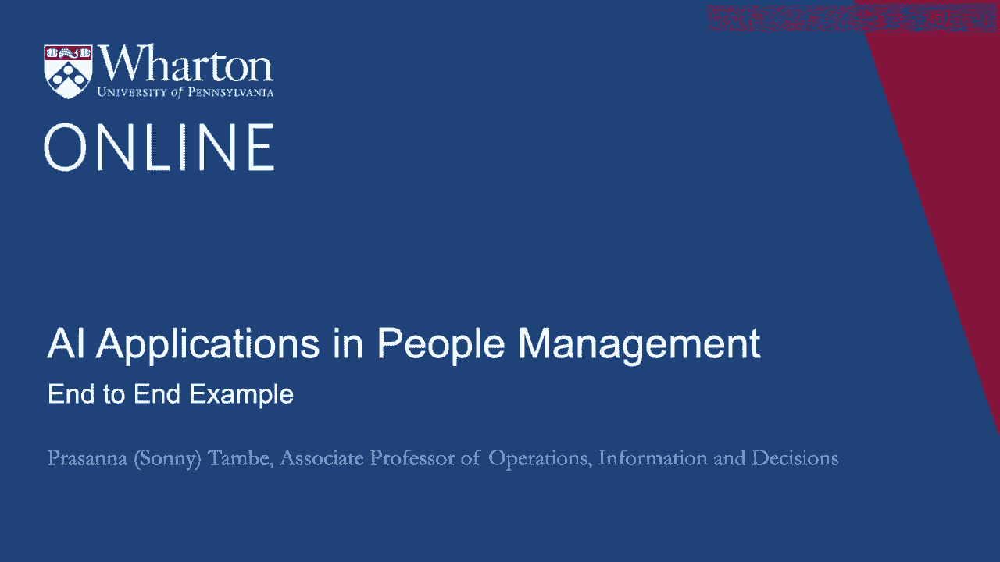
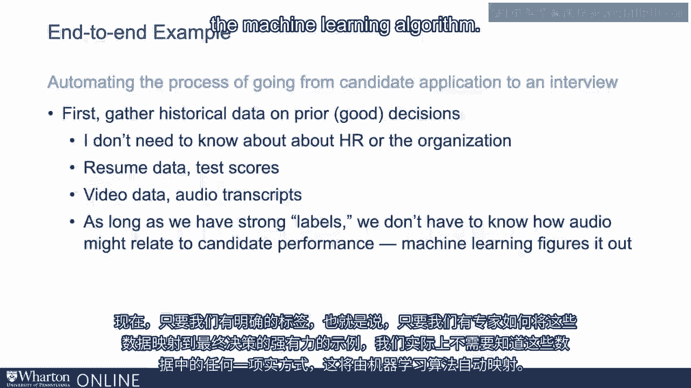
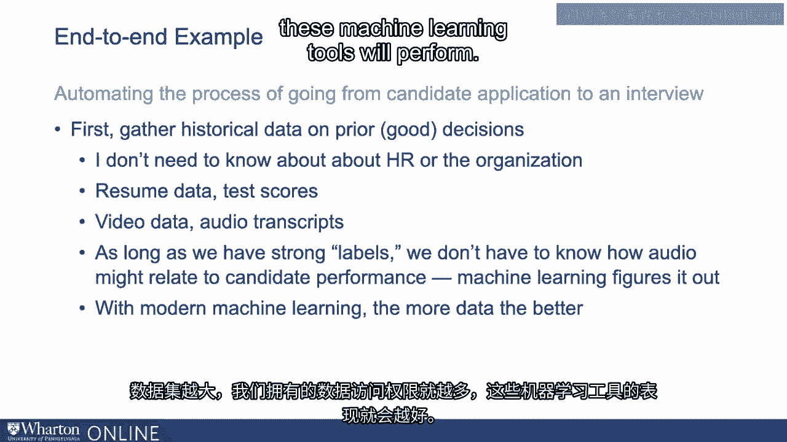
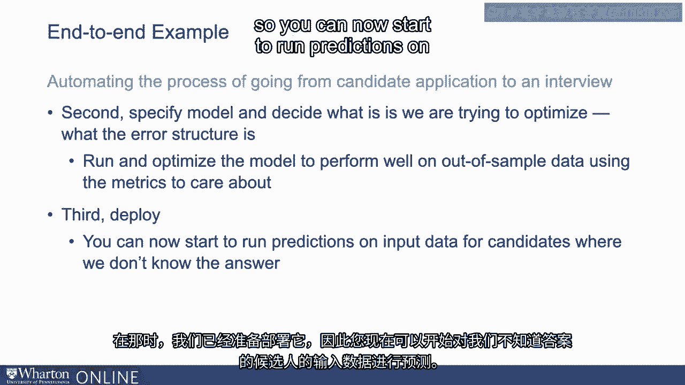
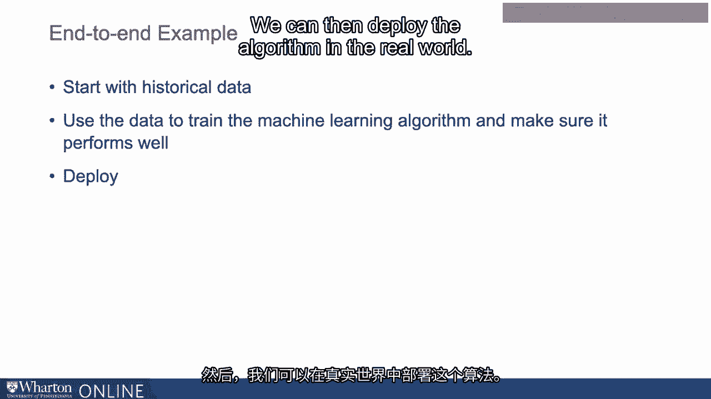

# 机器学习课程 P72：端到端机器学习工作流示例 🚀

在本节课中，我们将通过一个“申请人筛选”的实例，完整地梳理机器学习项目从数据到部署的端到端工作流程。我们将重点关注每个核心步骤及其背后的逻辑。

---

上一节我们提到了机器学习的一些基本概念，本节中我们来看看这些概念如何在一个具体项目中结合与应用。

整个工作流程始于数据的收集。我们需要获取由领域专家做出的、可靠的历史决策数据。

以下是数据收集阶段的关键点：
*   数据来源可以是历史档案，也可以是为任务专门生成的数据。
*   在申请人筛选举例中，数据可能包括简历、测试分数、面试视频或音频转录文本等。
*   数据必须带有“强标签”，即明确的、由专家给出的最终决策结果（如“录用”或“不录用”）。
*   我们无需事先理解数据中每个特征（如音频语调）与结果的具体关系，机器学习算法会自行学习这些关联。
*   通常，数据集的规模越大、质量越高，机器学习模型的潜在表现就越好。

---

在获得数据之后，下一步是构建和优化模型。我们将指定模型类型，并定义我们所要优化的目标（即最小化的错误类型）。

模型训练完成后，评估其泛化能力至关重要。我们不能只满足于模型在训练数据上表现良好。

以下是模型训练与评估的核心步骤：
1.  **训练模型**：使用收集到的历史数据（训练集）来构建模型。
2.  **评估性能**：在一个独立的、未参与模型训练的**保留样本**（或称为测试集）上测试模型。
3.  **目的**：确保模型在面对新数据时依然表现稳健，而不仅仅是“记住”了训练数据。
4.  **达到标准**：经过多次测试和调整，当模型在关心的错误指标上达到**最佳性能**后，方可进入下一阶段。

---

当我们对模型的性能感到满意后，工作流程就进入了部署阶段。此时，模型将开始处理真实的、我们不知道答案的新数据。

简而言之，端到端流程可以概括为：
1.  以高质量的**历史数据**为起点。
2.  使用数据**训练**机器学习算法。
3.  在**测试集**上验证算法性能，并确保其可靠性。
4.  将训练好的算法**部署**到现实世界中进行预测。

---

本节课中，我们一起学习了机器学习项目的完整生命周期。我们从收集带标签的历史数据开始，经历了模型训练、在独立数据集上的性能验证，最终将可靠的模型部署到实际应用中。这个“数据 -> 模型 -> 评估 -> 部署”的框架是绝大多数机器学习项目的核心路径。