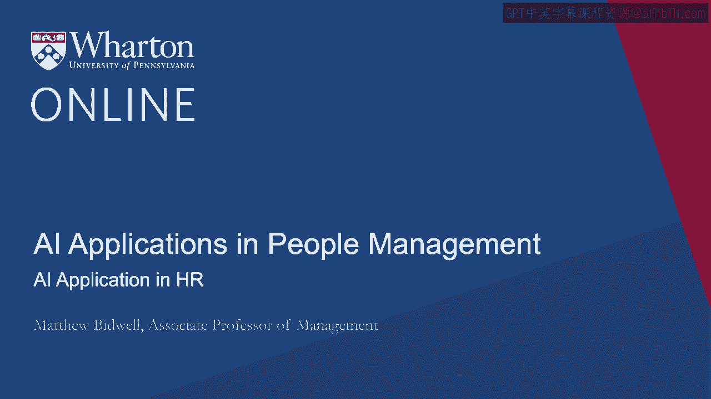
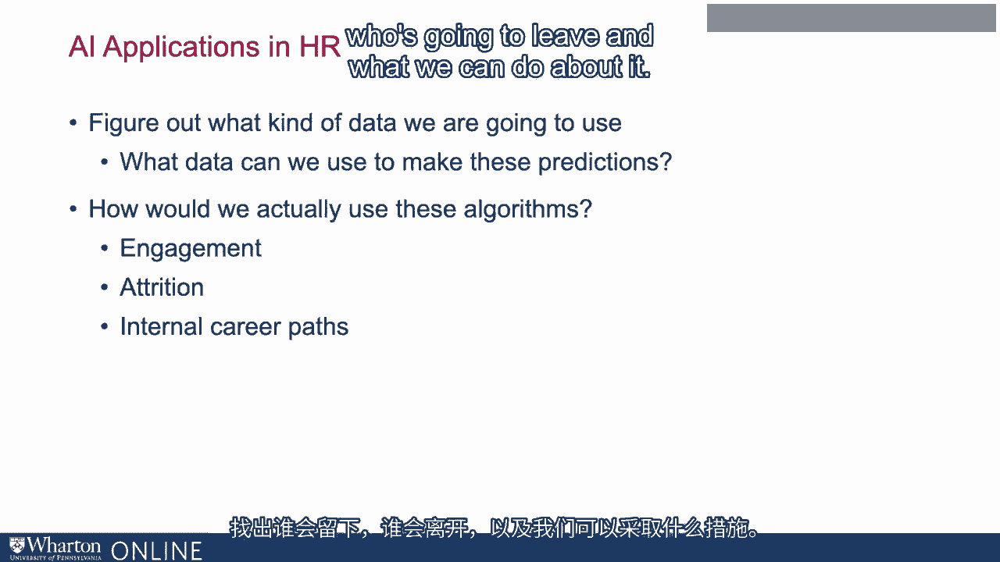

# 课程P73：人力资源中的AI应用 👥🤖

在本节课中，我们将学习如何将机器学习算法应用于人力资源管理中的具体挑战。我们将探讨如何利用数据预测员工行为，并基于这些预测采取行动，从而改善员工参与度、降低流失率并规划职业发展路径。

到目前为止，我们已经讨论了两方面的内容。

首先，我们讨论了在独特挑战中管理人员的问题，包括这些挑战的成因以及组织通常的应对方式。其次，我们介绍了机器学习的强大能力，这些新技术和工具能够赋能组织，构建更强大的算法，对我们过去广泛关注的事物做出更好的预测。

现在，我们迎来了一个绝佳的时机，可以将这些算法真正应用到之前提到的人员管理问题中。我们需要思考机器学习有哪些不同的方法可以用来改善我们管理人的方式。

在这样做的时候，我想强调一个关键点：索尼描述的这些算法是**通用目的技术**。它们是一套可以应用于任何问题的技巧，无论是模式识别（如训练计算机识别图片中的猫），还是解决生产流程中的问题。

那么，当我们将这些技术应用于员工管理时，不同之处在哪里呢？主要有两点需要考虑。

第一点是弄清楚我们将使用什么样的数据。这些算法真正擅长的是处理大量的输入数据和对应的输出结果，并找出输入数据中的哪些信号最能预测我们关心的结果。例如，在预测员工流失时，我们需要找出哪些与员工行为相关的信号最能预测谁会离职。因此，关键在于识别出哪种数据对预测工作最有效。

我们常常思考可以使用哪些数据来进行预测。数据越丰富、越智能，预测结果就越好。

我们在应用这些算法时，另一个必须认真考虑的事情是：我们该如何实际使用这些算法得出的预测？算法本身只提供预测，但预测本身如果没有后续行动是毫无用处的。那么，基于预测应该采取什么行动呢？

接下来，我将讨论这些算法在人员管理三个不同领域的应用。

首先，关注**员工参与度**，追踪员工的积极性和满意度。其次，关注**员工流失率**，预测谁会留下、谁会离开，以及我们可以为此做些什么。第三，在组织内部建立**职业发展路径**。

这并不是机器学习在人员管理方面应用方式的详尽列表。实际上，要建立一个详尽的列表非常困难。特别值得一提的是，机器学习正在显著影响的另一个巨大领域是招聘。不过，我将略过这一点，因为彼得会在后续课程中花大量时间讨论它。

本节课，我们将集中讨论**参与度**、**流失率**和**职业发展路径**这三个主题。现在，让我们从员工参与度开始。

---

在本节课中，我们一起学习了如何将机器学习作为通用工具应用于人力资源管理的核心领域。我们明确了应用的关键在于选择合适的预测数据，并将算法预测转化为有效的管理行动。通过关注员工参与度、流失率预测和职业发展路径规划，组织可以更科学、更前瞻性地进行人员管理。记住，技术是手段，改善人的体验和组织的效能才是最终目的。