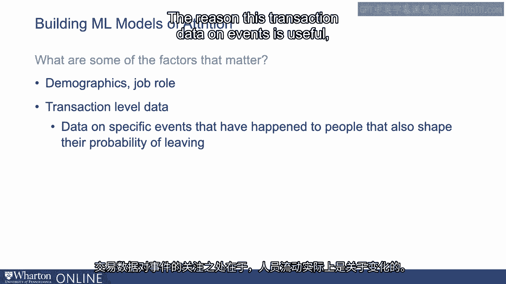
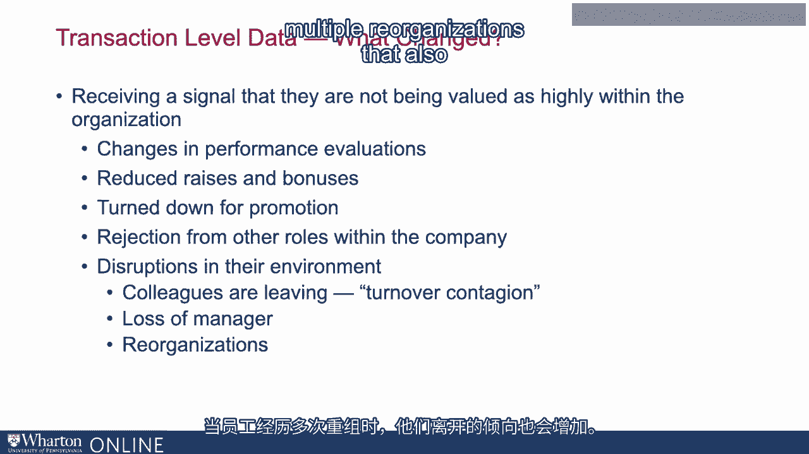
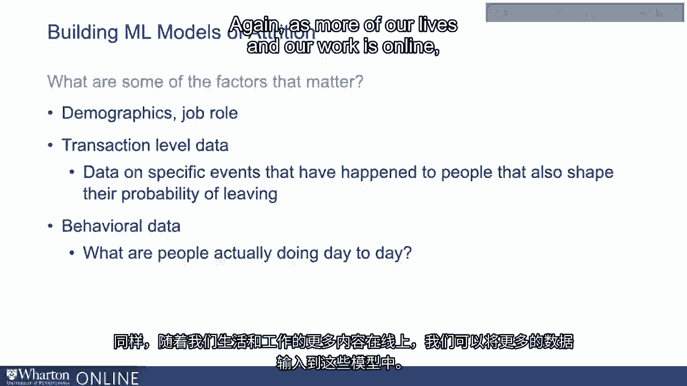
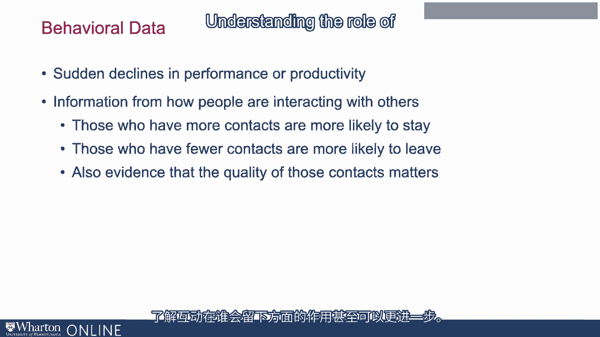
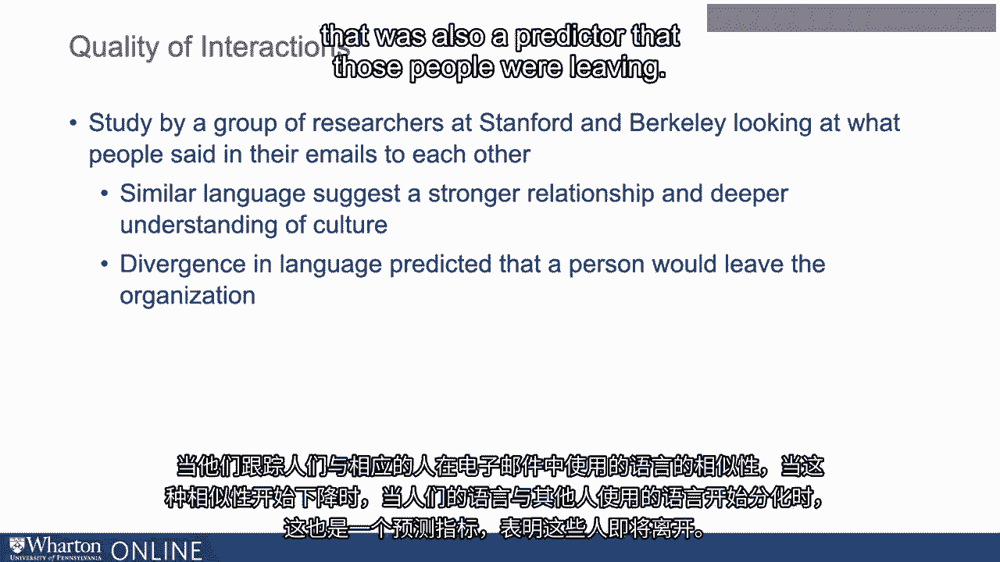
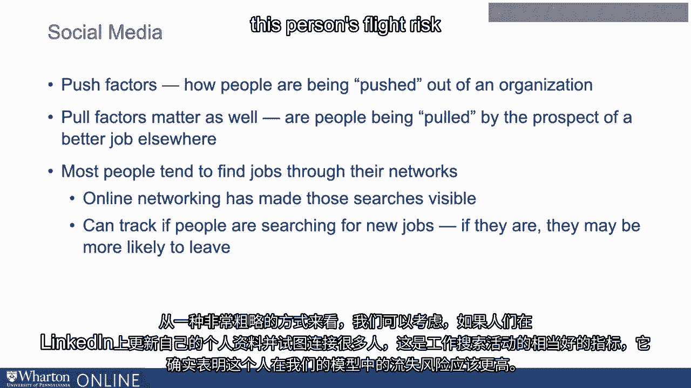

# 课程 P77：构建流失机器学习模型 📊

在本节课中，我们将学习如何构建一个预测员工流失的机器学习模型。我们将探讨哪些类型的数据对预测至关重要，并理解员工决定离开背后的关键因素。

## 概述

构建流失预测模型的核心，并非模型算法本身有多么复杂，而在于**弄清楚应该放入什么类型的数据**。随着在线工作方式的普及，我们拥有越来越多的数据来帮助我们更准确地估计谁将离开。本节将介绍可用于构建模型的关键数据维度。

## 数据维度一：人口统计与事务数据

上一节我们提到了数据的重要性，本节中我们来看看具体有哪些数据可以放入模型。

首先，**人口统计信息**（如职位类型）对于理解谁可能离开非常有用。其次，**事务级数据**（记录特定事件的数据）也至关重要，因为人员流失往往与变化相关。

以下是可能影响流失的关键事务信号：

*   **绩效评估变化**：如果员工的绩效评估结果下降，这可能表明他们意识到自己与岗位不匹配，从而增加离职倾向。
*   **薪酬与奖励**：未能获得预期的加薪或奖金，对员工而言是一个负面信号，暗示其在组织内的表现未达预期，这通常是一个离职预警。
*   **晋升申请结果**：员工申请晋升或组织内部的其他职位但被拒绝，会显著增加其离职的可能性。这既是一种明确的拒绝，也可能表明他们已开始寻求外部机会。

## 数据维度二：环境与关系变化

除了个人事务，周围环境的变化也是预测流失的重要指标。员工的工作环境，特别是人际关系网络的变化，会深刻影响其去留决定。

以下是环境变化带来的风险因素：

*   **同事或经理离职**：当关系密切的同事或优秀的经理离开时，会造成工作乐趣减少、团队动荡，并可能让员工意识到外部机会的存在，从而增加其离职风险。这种现象常被称为“人员流动传染”。
*   **组织重组**：频繁或重大的组织重组会给员工带来不安全感与压力，增加其离开的倾向。

通过分析人力资源系统中的这些变化数据，我们可以为流失模型获取有价值的输入，以更好地预测员工可能离开的时机。

## 数据维度三：行为与互动数据

接下来，我们看看如何利用员工的行为数据来理解其离职倾向。随着工作日益在线化，我们能够获取更多此类数据。

员工考虑离职时，其行为模式常会发生改变。例如，工作效率可能下降。更重要的是，他们在组织内的**社交互动模式**能提供关键洞察。

*   **社交嵌入度**：通常，在组织内拥有更多联系、花更多时间与他人互动的员工，能获得更多支持并享受工作关系，因而更可能留下。反之，处于社交网络边缘的员工则离职风险更高。
*   **联系质量**：不仅联系人数量重要，与更高职位或影响力人物的联系质量也同样关键。

研究甚至发现，通过分析工作邮件，可以测量**语言风格适配度**。当员工邮件语言与同事的相似度降低时，表明其可能正在心理上疏离组织文化，这也是一个有效的预测指标。

## 数据维度四：外部信号与社交媒体

最后，我们探讨来自外部的吸引因素。离职决策是“推力”（内部不满）和“拉力”（外部机会）共同作用的结果。社交媒体活动能有效反映员工对外部机会的探索程度。

通过观察员工的社交媒体行为，可以追踪其求职活跃度。例如：

*   **更新个人资料**：在LinkedIn等平台频繁更新简历或个人资料。
*   **拓展人脉**：积极与公司外部或行业内的新联系人建立连接。

这些行为都是强烈的求职信号，表明该员工在模型中的“潜逃风险”应该被调高。一些初创公司已专门利用此类数据来构建离职风险模型。

## 总结

本节课我们一起学习了构建员工流失预测机器学习模型所需的多维度数据。我们从**内部事务数据**（如绩效、薪酬变化）和**环境变化数据**（如同事离职、重组）入手，分析了内部的“推力”因素。接着，我们探讨了**行为与互动数据**（如社交网络、沟通语言），这些能揭示员工的心理状态。最后，我们引入了**外部信号数据**（如社交媒体活动），以捕捉外部的“拉力”因素。有效整合这些数据，是构建一个精准、有洞察力的流失预测模型的关键。