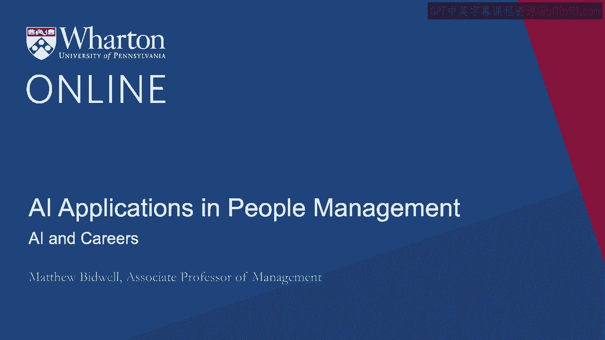
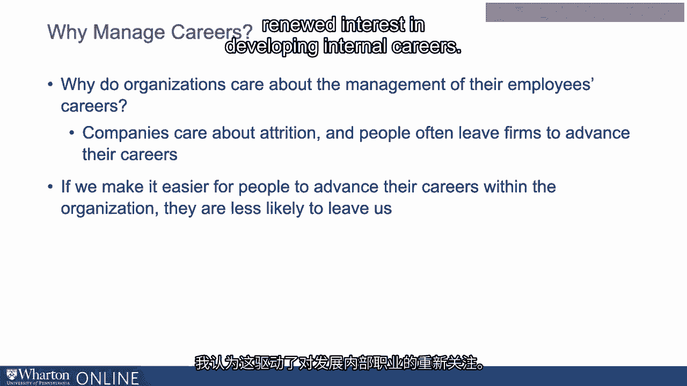
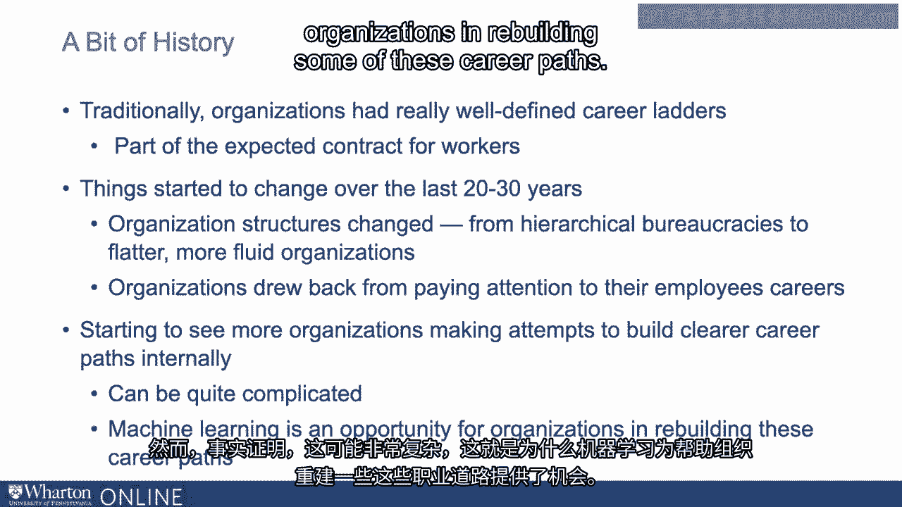
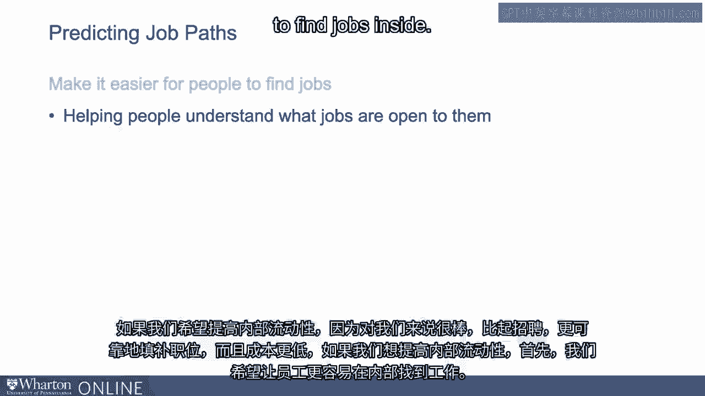
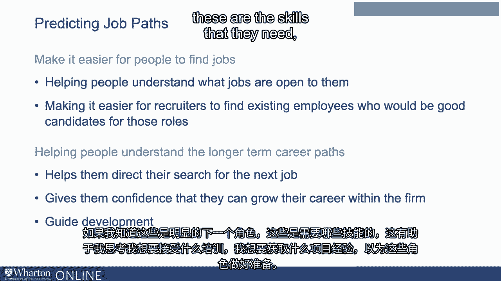
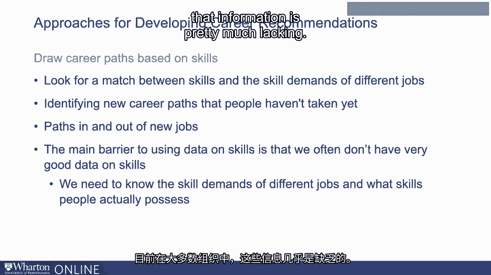

# 课程P79：AI与职业生涯 🧭

在本节课中，我们将探讨机器学习在组织内部管理，特别是员工职业生涯发展中的应用。我们将了解为什么公司越来越关注内部职业路径，以及机器学习如何帮助重建这些路径，从而降低员工流失率并提升组织效率。

---

上一节我们介绍了机器学习在职业生涯管理中的重要性。本节中，我们来看看为什么组织开始重新关注员工的内部职业发展。

传统上，组织拥有明确的职业阶梯。员工以特定级别入职，并沿着预设的层级晋升。这是一种预期的契约。

然而，在过去20到30年间，情况发生了变化。

以下是两个主要变化：

1.  **组织结构扁平化**：组织从层级官僚制转向更扁平、灵活、基于网络和项目的结构。这提升了组织的灵活性、创新性和协作性，但同时也使得清晰的职业晋升路径变得模糊。
2.  **责任转移**：组织一度将职业发展的责任完全推给员工，明确表示“你的职业是你自己的问题”。这种策略的局限性逐渐显现，因为它可能导致员工为寻求发展而离职。

组织逐渐认识到，用内部员工填补职位比外部招聘更经济、更可靠。因此，帮助员工在内部建立清晰的职业路径，对于留住人才至关重要。

---

上一节我们讨论了组织为何需要重建职业路径。本节中，我们来看看机器学习如何具体帮助员工规划内部职业发展。

机器学习的主要作用是帮助员工理解潜在的发展路径，从而增强内部流动性。这不仅能帮助员工找到下一个合适的职位，也能让招聘人员更容易地发现内部候选人。

更广泛地说，清晰的职业路径能：
*   为员工的长期发展提供指引。
*   帮助员工有针对性地进行社交和寻找机会。
*   向员工传递“可以在本公司内成长”的积极信号。
*   指导员工的技能发展，让他们了解目标职位所需的技能，从而规划培训与项目经验。

---

上一节我们了解了机器学习在职业规划中的目标。本节中，我们来看看实现这些目标的具体技术方法。

以下是两种常见的利用机器学习绘制职业路径的方法：

1.  **基于历史职业轨迹的分析**：这是最简单的方法。通过分析拥有相似职位员工的过往晋升或转岗数据，来预测可能的下一步。例如，分析“市场分析师”通常转岗到哪些职位。
    *   **公式/逻辑**：`推荐职位 = 历史数据中，从当前职位A转移到其他职位B的频率排名`
    *   **局限性**：适用于常见职位；对于新兴或罕见职位数据不足；反映的是过去，可能不适用于快速变化的未来。

2.  **基于技能匹配的分析**：这是一种更稳健但更复杂的方法。核心思想是：员工能否胜任一份工作，取决于其技能与职位要求的匹配度。
    *   **公式/逻辑**：`职位匹配度 = f(员工技能集合 ∩ 职位要求技能集合)`
    *   **优势**：能发现前所未有的、基于技能相似性的新职业道路，不依赖于历史转换数据。
    *   **核心挑战**：需要高质量的技能数据。组织往往缺乏对“员工拥有什么技能”和“职位需要什么技能”的系统化记录。

早期的一个著名应用是**IBM Watson的职业教练**工具。员工输入职业偏好，系统会结合对组织内职位的认知，提供个性化的职业发展建议。

---

本节课中，我们一起学习了机器学习在职业生涯管理中的应用。我们了解到，由于组织结构的演变，清晰的内部职业路径被破坏，导致员工流失风险增加。机器学习提供了两种主要方法来重建这些路径：分析历史职业轨迹和进行技能匹配。虽然技能匹配法更具前瞻性，但其成功依赖于组织对技能数据的有效管理。通过应用这些技术，组织可以更好地帮助员工规划发展，从而提升留任率与内部流动性。