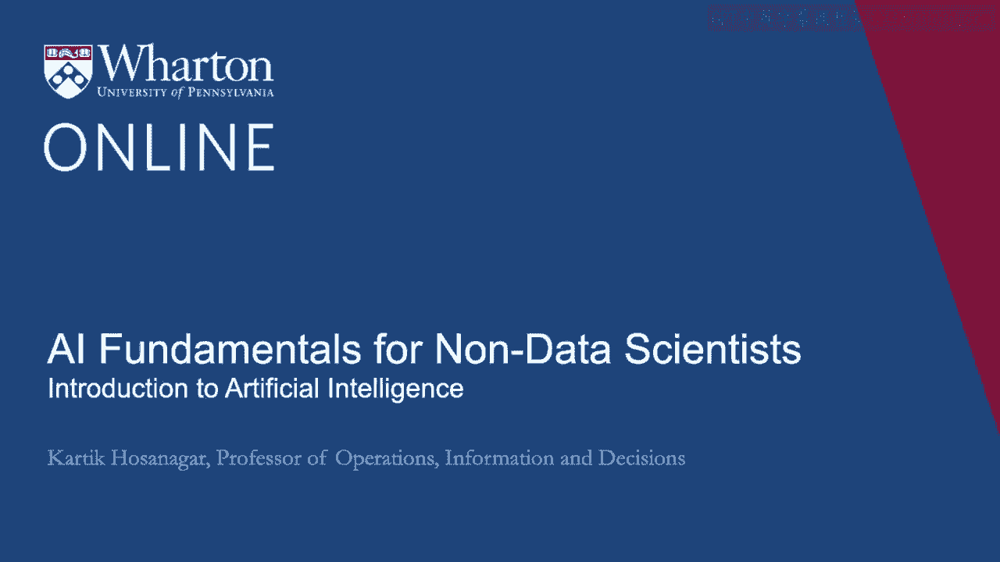
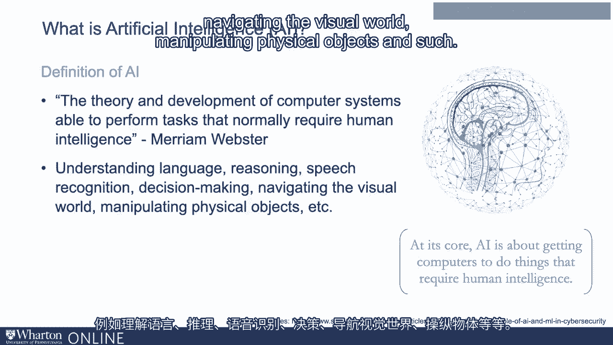
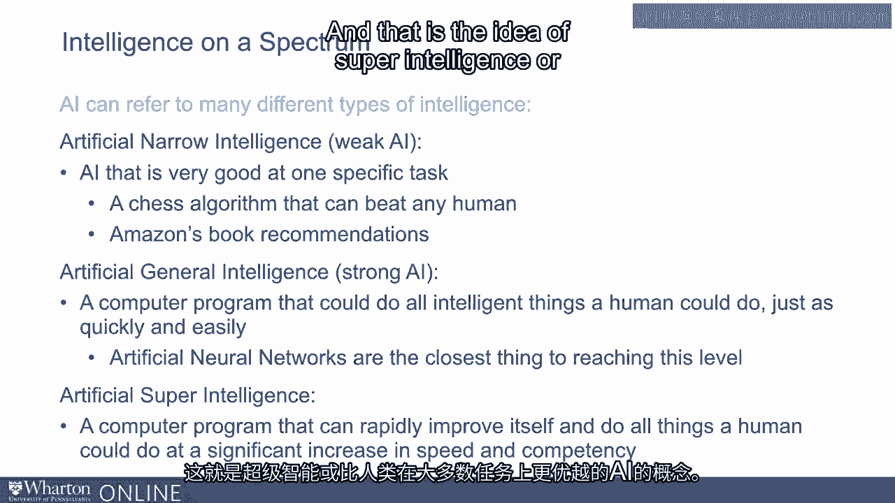
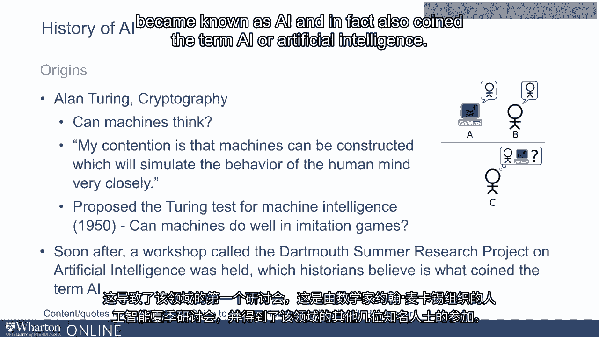
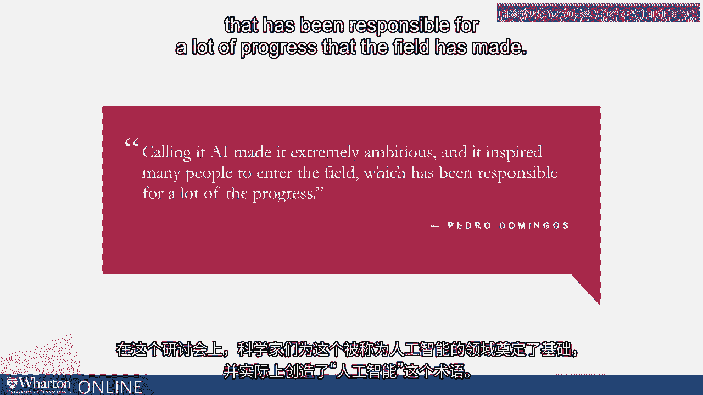
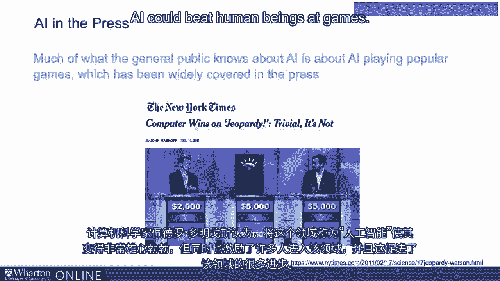
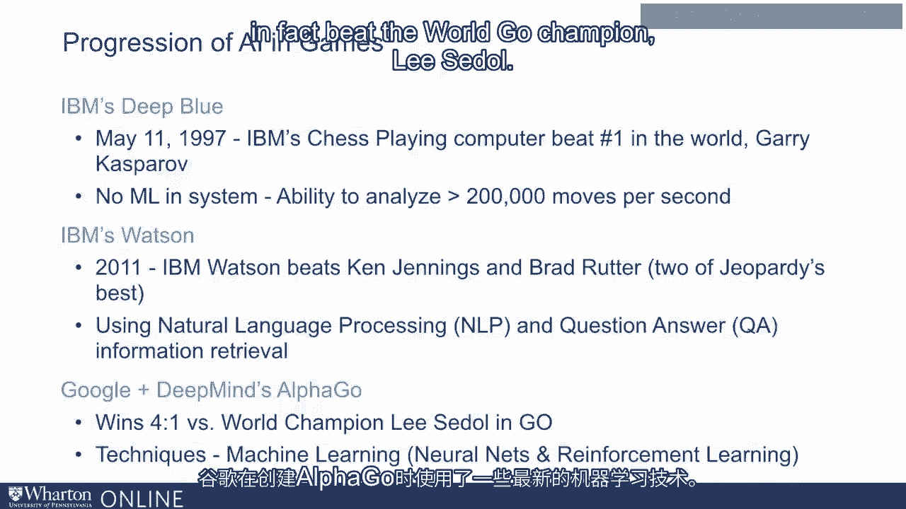
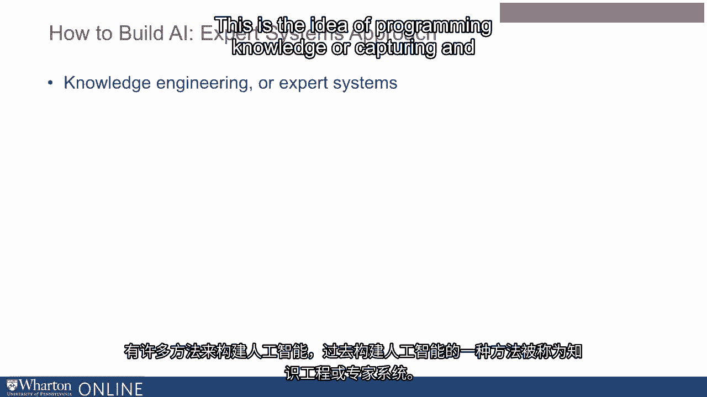
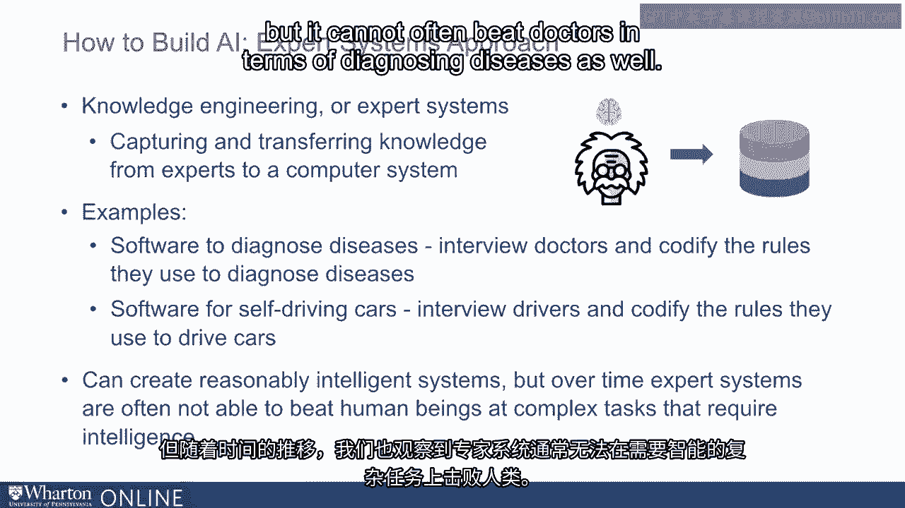
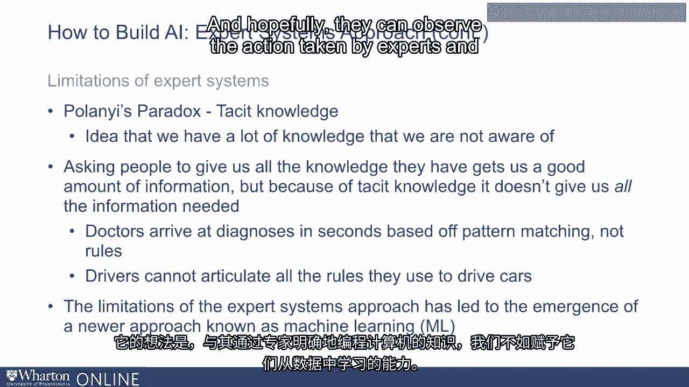

# 课程 P8：人工智能简介 🧠

在本节课中，我们将学习人工智能的基本概念。我们将从人工智能的概述开始，然后探讨其核心子领域——机器学习，并了解构建人工智能的不同方法。

## 什么是人工智能？

人工智能，通常简称为 AI，是一个广义术语，指代那些能够执行通常需要人类智能才能完成的任务的计算机系统。这些任务包括理解语言、逻辑推理、语音识别、决策制定、视觉感知以及操控物理对象等。

## 人工智能的类型

上一节我们介绍了人工智能的定义，本节中我们来看看人工智能的不同类型。

以下是三种主要的人工智能分类：

*   **弱人工智能**：也称为**人工狭义智能**。这类 AI 擅长执行非常特定的单一任务。例如，一个下棋的 AI 可能能击败世界冠军，但它无法与我们对话或识别图像。我们周围的大多数 AI 都属于弱人工智能。
*   **强人工智能**：也称为**人工通用智能**。这是指一个计算机程序能够完成所有人类能做的智能工作，其能力范围接近人类。
*   **人工超智能**：这是一个强人工智能系统，它不仅在许多任务上能与人类匹敌，还能利用其强大的计算能力存储更多数据、更快地分析并做出决策，从而在大多数任务上超越人类。

## 人工智能简史

了解了人工智能的类型后，我们来看看这个领域的起源与发展。

人工智能的历史相对短暂。其起源可以追溯到数学家艾伦·图灵的一篇论文，他在文中提出了“机器能否思考？”的问题。他提出了一个著名的测试——**图灵测试**，用于判断机器是否具有智能。

在测试中，一名人类评审通过终端与两个对象（一个由计算机控制，另一个由人类控制）进行对话。如果评审无法区分哪一个是计算机，那么该计算机系统就被认为通过了图灵测试。

图灵的工作激发了该领域的兴趣，并促成了1956年达特茅斯会议的召开。正是在这次会议上，科学家们为这个新领域奠定了基础，并正式创造了“人工智能”这个术语。

## 人工智能的里程碑

人工智能领域早期的一个关注点是 AI 能否在游戏中击败人类。以下是几个关键里程碑：

*   **1997年，IBM“深蓝”**：这台国际象棋计算机击败了世界冠军加里·卡斯帕罗夫。它主要依靠强大的计算能力（每秒分析超过20万步棋）来寻找最佳走法，本身不具备学习能力。
*   **2011年，IBM“沃森”**：这个系统在智力竞赛节目《危险边缘》中击败了两位人类冠军。沃森内置了机器学习能力，能够理解语言、分析问题并从海量数据库中检索信息并作答。
*   **2016年，谷歌“AlphaGo”**：这个软件在围棋比赛中击败了世界冠军。围棋比国际象棋复杂得多，仅靠计算力无法取胜。AlphaGo 的成功得益于其先进的**机器学习**技术，使其具备了学习和进化的能力。

## 构建人工智能的方法

我们已经看到 AI 在游戏中的成就，那么 AI 是如何被构建出来的呢？主要有两种方法。

### 方法一：知识工程（专家系统）

这是一种传统方法，其核心思想是：将人类专家的知识和规则编程到计算机系统中。

例如，要构建一个疾病诊断系统，开发者会采访医生，将他们诊断疾病的规则（如“如果患者发烧超过一周并伴有身体疼痛和寒战，则考虑使用抗生素”）整理并编写成程序。

同样，要构建自动驾驶系统，开发者会收集成千上万名司机的驾驶规则（如“当前车减速时踩刹车”）。

虽然专家系统可以表现得相当不错，但它们往往难以在复杂的智力任务上超越人类专家。

### 方法二：机器学习

专家系统的局限性催生了一种替代方法——机器学习。

波兰尼悖论指出，人类拥有大量自己并未意识到的“隐性知识”。例如，司机无法完全说清自己驾驶时所运用的所有规则和判断。因此，通过采访专家来穷尽所有知识是困难的。

机器学习的核心理念是：不再显式地为计算机编程所有规则，而是赋予它从数据中学习的能力。计算机通过观察专家的行为数据（例如，司机的驾驶录像和操作记录），在一段时间内模仿并学习其中的模式，从而掌握完成任务的能力。

## 总结

本节课中，我们一起学习了人工智能的基础知识。我们了解了 AI 是能够执行人类智能任务的计算机系统，并区分了弱 AI、强 AI 和超 AI 的概念。我们回顾了从图灵测试到 AlphaGo 的 AI 发展简史。最后，我们探讨了构建 AI 的两种主要方法：传统的**知识工程（专家系统）**和更现代的**机器学习**，并理解了后者通过让机器从数据中学习，有望克服隐性知识带来的挑战。在接下来的课程中，我们将深入探讨机器学习的具体内容。