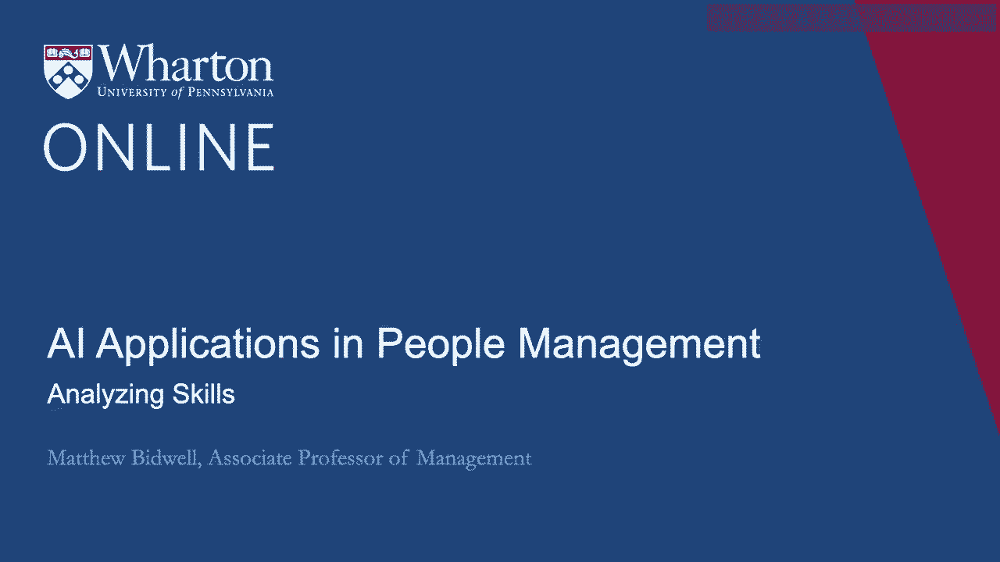
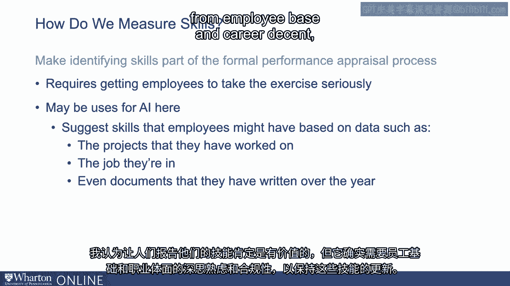
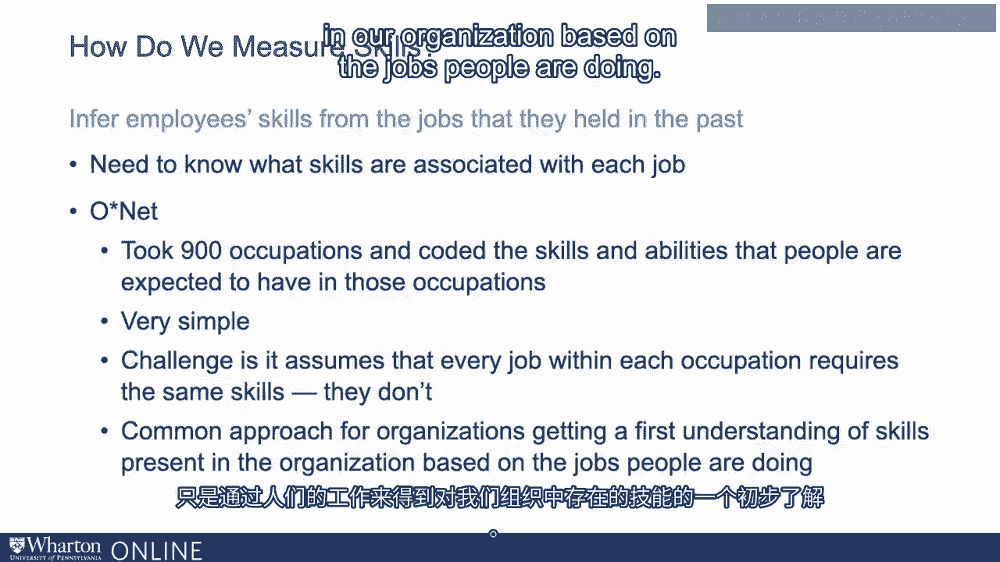
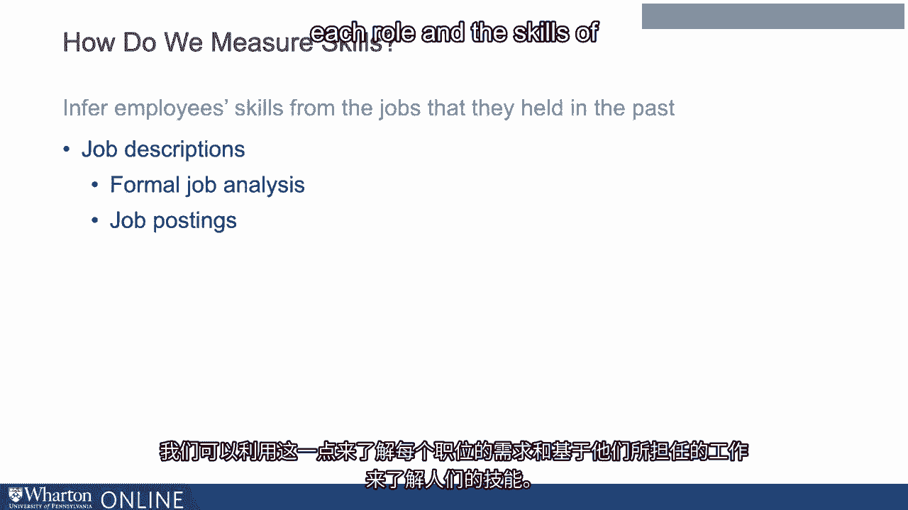
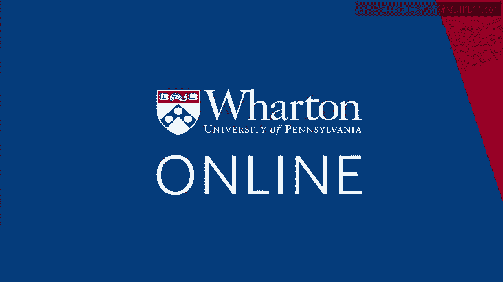

# 课程 P80：技能分析 🧠

在本节课中，我们将学习组织如何衡量和分析员工的技能。我们将探讨几种主要的方法，包括员工自报、基于职位分析以及利用人工智能技术，并分析每种方法的优缺点。

---

## 概述

许多组织正致力于建立能够真正理解员工技能的应用程序。这些系统的核心目标是准确衡量员工的技能，并将此作为员工转岗或职业发展的输入数据。总体而言，衡量技能有几种主要途径。

---

## 方法一：员工自我报告 📝

上一节我们介绍了技能分析的整体目标，本节中我们来看看第一种方法：直接询问员工。

确定员工技能的一种直接方法是让他们自己报告。组织希望员工列出所拥有的所有技能，并在学习新技能时持续更新这份档案。

这种方法面临的主要挑战是，如何确保员工认真填写并长期维护档案的时效性。

以下是组织为维护这些技能档案所采取的几种策略：

*   **创造激励**：一些组织尝试创造强烈激励，促使员工报告技能。例如，他们观察到外部平台（如领英）拥有更优质的员工技能数据，因此考虑建立内部的“领英”式档案系统，尤其在内部求职时要求填写。
*   **纳入绩效评估**：另一种方法是将技能识别作为正式绩效评估流程的一部分。员工在设定年度目标或总结时，需要报告已掌握和新增的技能。

然而，这些努力的效果参差不齐。内部系统可能面临“鸡与蛋”的问题：员工愿意填写是因为招聘者会看，招聘者愿意看是因为员工填好了，但如果双方都不先行动，系统就难以启动。在绩效评估中，也可能流于形式。

人工智能在这里可以发挥作用。一些组织尝试用AI来**建议**员工可能拥有的技能，例如：
*   基于他们参与过的项目。
*   基于他们担任过的职位及该职位通常所需的技能。
*   甚至分析他们多年来撰写的文档和资料，从中推断可能使用的技能。

其核心逻辑是：`AI建议技能 -> 员工确认或忽略`。这能否提高准确性和参与度，仍是一个开放的问题。虽然员工自报有其价值，但它确实依赖于员工群体持续、认真的投入。

---

## 方法二：基于职位分析 🏢

如果我们无法有效依赖员工自我报告，还有什么方法呢？接下来，我们看看第二种思路：通过分析员工担任过的职位来推断其技能。

一个有效的简化策略是：技能不仅决定人们现在能做什么工作，也决定了他们过去能做什么工作。因此，可以假设，任何人从事过某个职位，就意味着他/她大概率具备该职位所需的技能。通过分析一个人的工作经历序列，就能对其技能有一个不错的了解。

显然，这需要我们知道**每个职位具体需要哪些技能**。以下是几种弄清职位技能要求的方法：

*   **使用外部数据库**：最常见的是 **O*NET** 数据库。这是一个政府数据库，涵盖了约900种职业，并为每种职业编制了预期的技能和能力代码。通过将组织内的职位与O*NET职业对应，就能推断员工技能。这种方法的好处是简单、数据现成。挑战在于它假设同一职业内所有工作的技能完全相同，这会导致较大的测量误差。
*   **分析职位描述**：更准确的方法是分析组织内部的职位描述。有些组织会进行正式的职位分析，但这通常是一个官僚且可能很快过时的过程。
*   **分析招聘启事**：一个更可靠的实时数据来源是发布的招聘要求。公司在招聘时，会明确规范该职位需要做什么、需要什么技能。因此，职位发布是理解技能需求的优质数据源。

有许多公司（如 Burning Glass）开发了复杂算法来分析职位发布，并识别其中所需的所有技能。公式可以简化为：`职位技能要求 = 算法分析(职位描述文本)`。这种方法不仅用于分析外部劳动力市场，同样可以应用于组织内部。通过分析内部所有职位发布，我们可以了解：
1.  各个角色的技能要求。
2.  对在职人员的技能期望。
3.  从而推断曾担任该角色的人员应具备的技能。

---

## 总结与展望

本节课中我们一起学习了衡量员工技能的两种核心方法：**员工自我报告**和**基于职位分析**。自我报告直接但依赖员工参与；职位分析间接但能利用现有数据。随着组织变得日益复杂，帮助员工理解职业可能性和发展路径变得更加困难。

这正是人工智能工具大显身手的地方。AI可以帮助组织：
*   理解不同职位之间的关系。
*   洞察组织内部的技能分布状况。
*   为员工构建清晰、可行的职业发展路径。

通过结合多种数据源和分析方法，组织可以更全面、动态地理解并管理其人才技能，为员工的成长和组织的成功提供支持。