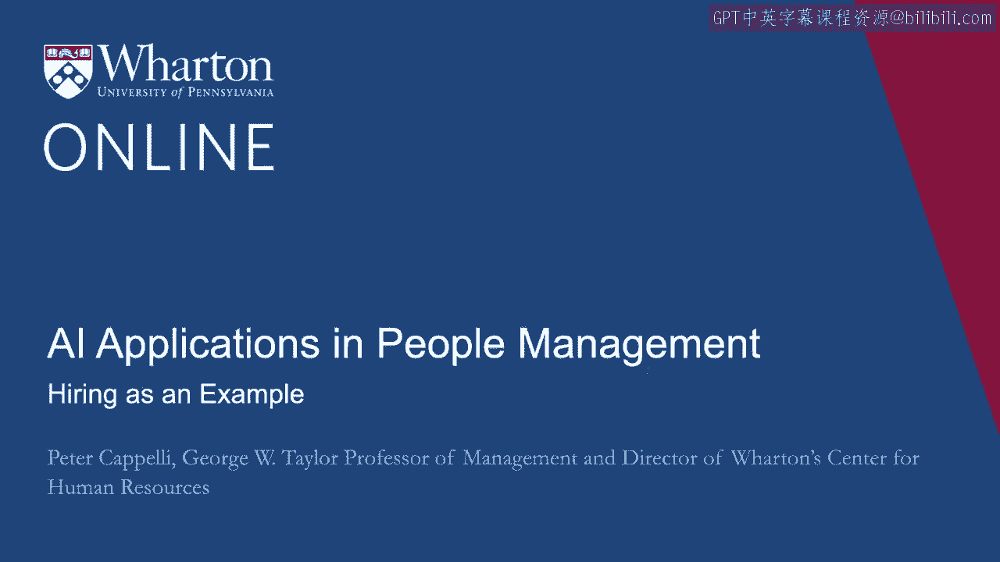
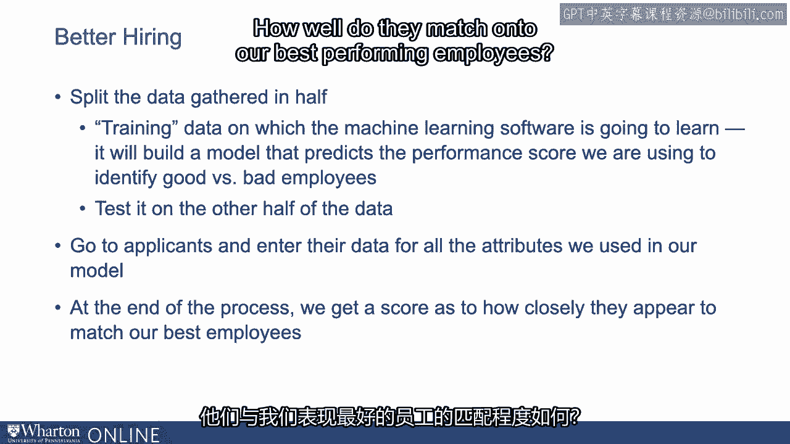
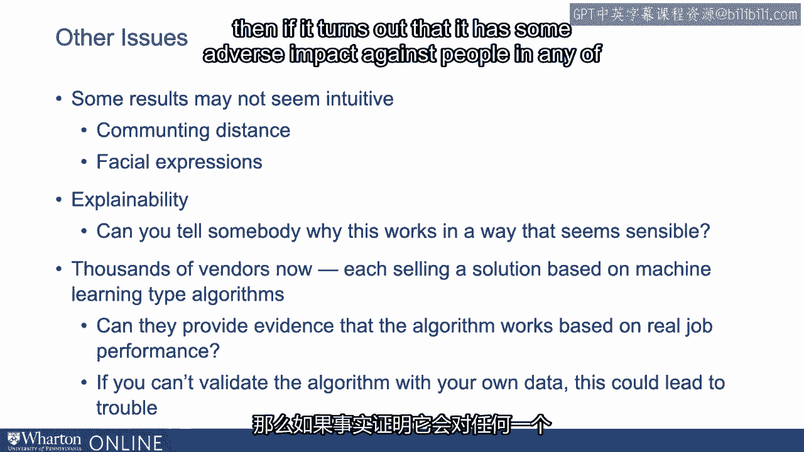

# 课程P81：招聘中的数据科学应用 🎯



在本节课中，我们将探讨数据科学如何应用于一个非常实际且重要的人力资源管理问题——招聘。我们将了解传统招聘流程的演变，以及数据科学和机器学习如何改变我们筛选和选择候选人的方式。

---

## 概述：招聘的现实与挑战

招聘是人力资源管理中最重要且成本最高的环节之一。更换一名员工的行政成本很高，即使是基层员工也可能花费约4000美元。如果考虑到人员流动的总体成本，例如因招聘失误导致员工离职，其代价可能高达该职位两年的薪水。整个招聘行业规模庞大，旨在帮助企业填补职位空缺。

然而，传统的招聘教科书流程与现实操作存在巨大差异。此外，大多数公司在评估招聘效果时，往往只关注填补职位的“速度”和“成本”，而忽略了“招聘质量”这一核心指标。接下来，我们将深入探讨这些现实情况。

---

## 传统招聘流程与现实差距 📖

教科书中的招聘流程通常始于职位描述，随后发布广告、收集申请、筛选简历形成短名单，最后通过面试和测试做出决策。

但现实情况截然不同。数据显示，大多数更换雇主的人并非主动求职者，而是被“挖角”或说服后转换工作的。如今，创建短名单的过程已高度自动化，普遍采用申请人跟踪系统（ATS）进行基于关键词的初步筛选，这甚至算不上真正的数据科学应用。

许多公司将招聘流程外包。例如，一家名为PeopleScout的招聘流程外包公司，每年为其他公司招募约30万人，其规模甚至超过了美国军队的年招募人数。

目前，招聘工作的重点之一是寻找“被动候选人”，即吸引那些并未主动申请职位的人才。大多数组织的策略是吸引海量申请者，然后通过层层筛选漏斗进行淘汰。数据显示，通过在线渠道提交申请的候选人，最终获得录用的概率仅为2%左右。

---

## 招聘效果的衡量偏差 📊

当公司评估其招聘工作时，他们通常追踪以下指标：
*   填补一个职位所需的时间。
*   填补一个职位所花费的成本。

然而，只有约四分之一的公司会尝试评估招聘的质量。这就好比只用“快速”和“便宜”来评价餐厅，而完全忽略了食物的美味程度。在招聘中，我们常常测量了错误的指标。

---

## 数据科学如何改进招聘 🔍



认识到传统流程的局限后，我们来看看如何利用数据科学做得更好。数据科学主要应用于招聘的两个环节：
1.  **寻找候选人**：投入精力识别那些可能适合但未主动申请的“被动候选人”。
2.  **筛选候选人**：这是更受关注的领域，即预测哪些申请人应该获得工作机会。

### 从定义“优秀”开始

应用数据科学的第一步与传统方法类似：我们需要定义什么是“优秀的员工”。我们可以使用一个指标，例如**绩效评估分数**，来区分优秀与不优秀的员工。

### 构建预测模型

与传统方法依赖心理学家或专家选定的几个测试分数（如性格测试、智商测试）不同，数据科学方法会收集员工的所有可用信息作为“特征”。

**公式/概念**：
*   **特征**：员工的各项属性，如毕业院校、培训经历、测试分数、过往工作经历等。
*   **目标变量**：员工是否“优秀”（基于绩效评估等）。

我们利用这些数据构建一个机器学习模型。具体步骤如下：
1.  **分割数据**：将现有员工数据分为两部分：训练集和测试集。
2.  **训练模型**：使用训练集让机器学习算法找出哪些特征组合最能预测“优秀”员工。
3.  **测试模型**：使用测试集验证模型的预测效果。
4.  **应用模型**：对新的申请人收集相同的特征数据，输入模型，从而为每位候选人生成一个**单一的预测分数**。这个分数反映了该候选人与公司现有优秀员工的匹配程度。

**代码/流程示意**：
```python
# 伪代码示意
from sklearn.model_selection import train_test_split
from sklearn.ensemble import RandomForestClassifier

# 1. 准备数据
X = employee_data[['school', 'test_score', 'past_jobs', ...]] # 特征
y = employee_data['is_top_performer'] # 目标变量（是否优秀）

# 2. 分割数据
X_train, X_test, y_train, y_test = train_test_split(X, y, test_size=0.5)

# 3. 训练模型
model = RandomForestClassifier()
model.fit(X_train, y_train)

# 4. 评估模型
accuracy = model.score(X_test, y_test)

# 5. 应用于新候选人
candidate_score = model.predict_proba(new_candidate_data)[:, 1] # 获得预测分数
```

---

## 机器学习招聘的优势与挑战 ⚖️

### 优势：一致性与潜在的高效
*   **一致性**：算法对每位候选人都使用同一套标准，避免了人类招聘官可能存在的无意识偏见。
*   **高效**：模型可以快速处理大量申请，并输出一个易于比较的单一分数。

### 挑战：偏见与“黑箱”
*   **偏见继承**：如果用于训练模型的**历史数据本身存在偏见**（例如，过去男性员工普遍获得更高的绩效评分），那么算法也会学会并延续这种偏见。亚马逊的招聘算法案例就是一个著名例子，该算法因为历史数据中男性占主导且评分更高，导致对女性候选人系统性打分偏低。
*   **可解释性**：复杂的机器学习模型有时是“黑箱”，难以解释为什么某个候选人得分高或低。例如，如果模型发现“居住地邮政编码”是预测客服岗位稳定性的重要因素（实际反映通勤距离），这虽然有效但可能不直观。更极端的例子是基于“面部表情”匹配的招聘工具，即使其预测可能有效，也引发了巨大的伦理和法律争议。
*   **数据需求**：构建有效的模型需要大量的数据（成千上万的样本），这对中小型企业来说是个挑战。
*   **验证困难**：企业不能完全依赖供应商的承诺。必须使用**自己的数据**来验证任何采购的招聘算法是否真的有效，并且不会对受保护群体（如女性、少数族裔）产生不公正的不利影响。在法律诉讼中，企业需要为自己使用的工具负责。

---



## 总结与核心要点 🎓

本节课我们一起学习了数据科学在招聘领域的应用：
1.  **现实洞察**：传统招聘流程已高度自动化但未必智能，且公司常错误地衡量招聘效果。
2.  **方法革新**：数据科学通过定义“优秀”、收集多维特征、构建预测模型的方式，将招聘筛选从依赖多重主观判断，转变为基于单一预测分数的客观决策。
3.  **优势**：这种方法具有一致性和高效性的潜力。
4.  **核心挑战**：我们必须警惕算法对历史数据中**偏见的继承**问题，并关注模型的**可解释性**。企业有责任验证所用工具的有效性和公平性。


将数据科学应用于招聘，其目标不是用机器完全取代人类，而是提供一个更强大、更一致的工具来辅助决策，同时我们必须以审慎和负责任的态度来使用它。