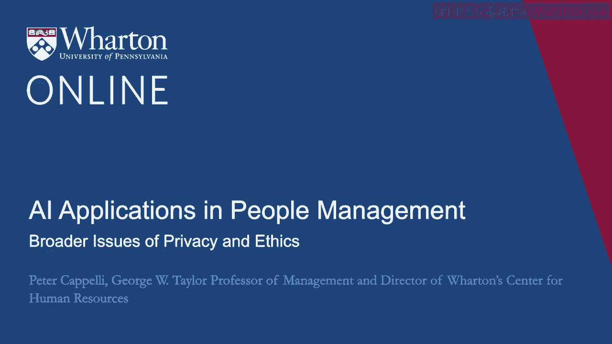
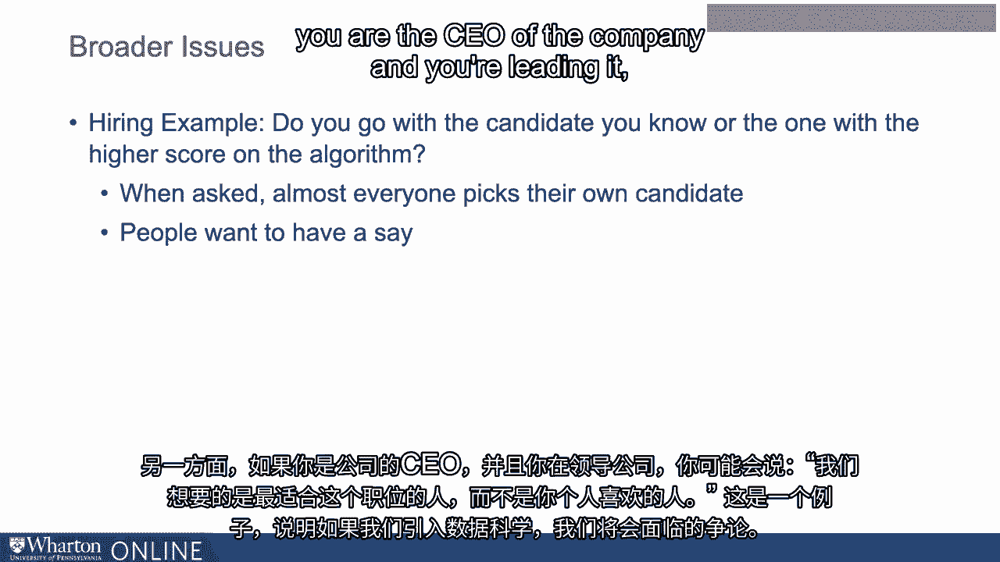
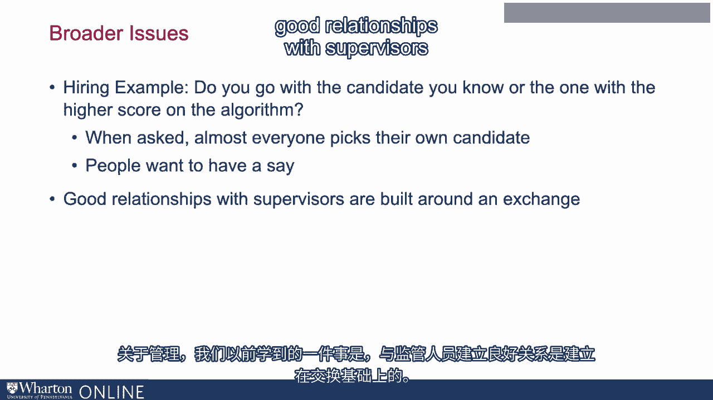
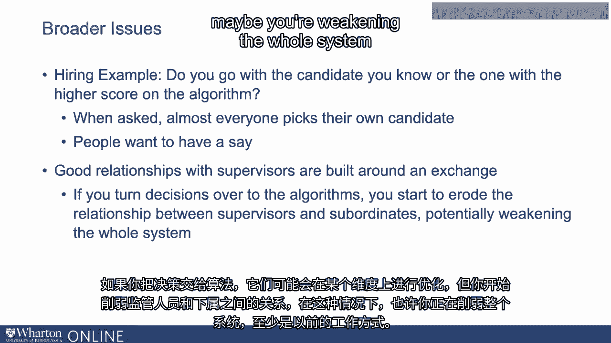
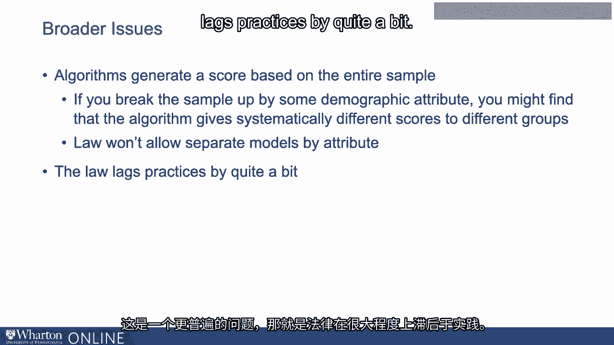
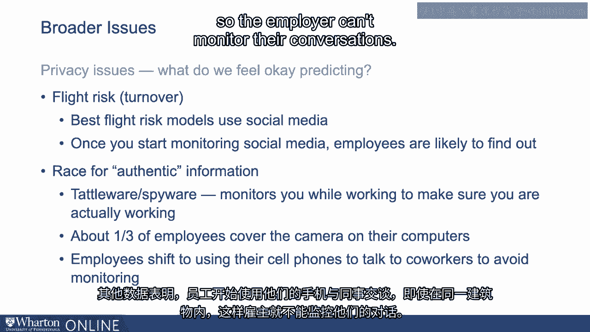
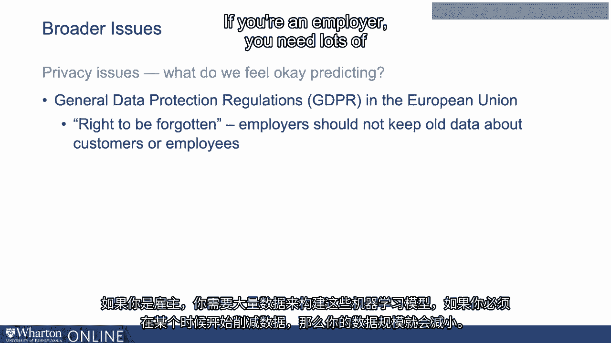

# 课程 P82：数据科学与人工智能中的隐私与伦理问题 🛡️



在本节课中，我们将探讨数据科学与人工智能在职场应用时引发的更广泛的隐私和伦理问题。我们将通过具体例子，了解算法决策如何影响招聘、晋升等环节，并讨论隐私保护与法律合规性带来的挑战。

---

## 算法决策与职场人际关系

上一节我们介绍了数据科学的基本应用，本节中我们来看看算法如何介入传统的人际决策过程，以及由此引发的矛盾。

假设你在组织内负责招聘决策。你有一位熟悉的内部候选人，你对他有较好的印象。同时，人力资源部门推荐了另一位你不熟悉、但经验相似的候选人。此时，人力资源部门提供了一个算法预测结果：你熟悉的候选人匹配度为82%，而另一位候选人的匹配度为92%。

**核心问题**：你会选择哪位候选人？



在多次询问中，绝大多数人倾向于选择自己熟悉的候选人，即使算法显示另一位候选人更匹配。即使将算法匹配度调整为80%对95%，甚至100%对某个较低值，人们的决定依然不变。这个例子揭示了人们倾向于信任自己的人际判断，即使存在看似更“客观”的数据。

**核心概念**：这种偏好反映了 **`人际偏见`** 与 **`算法建议`** 之间的冲突。



---

## 算法对管理关系的侵蚀



在传统的职场管理中，主管与下属的关系常建立在某种互惠交换基础上。例如，主管可能会说：“如果你帮我解决这个问题，我会在晋升或加薪时考虑你。”

然而，如果将晋升、排班等决策完全交由算法，算法可能会在某些维度上优化结果，但同时可能侵蚀主管与下属之间的人际关系。这种做法可能削弱原有的管理体系，至少在传统工作方式下是如此。

**核心概念**：算法决策可能破坏 **`管理交换关系`**，其公式可表示为：
**`主管支持 = f(下属绩效, 人际互动)`**
当算法介入，人际互动变量可能被削弱。

---



## 算法公平性与法律挑战

算法决策可能引发公平性问题。例如，假释决策算法在分析再犯率时，可能对不同种族群体给出系统性的不同分数。

**核心问题**：能否为不同群体建立独立的模型以修正这种偏差？

答案通常是否定的。因为法律禁止基于种族等因素区别对待个人。法律在实践上常常滞后于技术发展，导致许多算法应用处于法律灰色地带。

以下是算法公平性面临的主要挑战：

*   **群体偏差**：算法训练数据可能包含历史偏见，导致结果不公。
*   **法律滞后**：现有法律体系可能尚未对新型算法决策做出明确规定。
*   **合规风险**：企业应用算法时，可能面临违反公平就业等法规的风险。

---

## 隐私问题：数据收集与员工监控

为了应用数据科学，我们需要大量数据，这直接引发了隐私问题。例如，“离职风险”模型可以通过分析员工的社交媒体动态、电子邮件内容甚至情绪来预测其离职可能性。

**核心概念**：离职风险模型可能利用多种数据源，其预测逻辑可以用以下伪代码表示：
```python
def predict_turnover_risk(employee_data):
    risk_score = 0
    if linkedin_profile_updated(employee_data):
        risk_score += 20
    if negative_sentiment_in_email(employee_data):
        risk_score += 30
    if social_media_posts_about_job_search(employee_data):
        risk_score += 50
    return risk_score
```

许多员工认为这类监控令人不安。因此，雇主与员工之间常围绕隐私展开“博弈”：
*   雇主可能使用“监控软件”追踪员工活动（如击键次数、摄像头画面）。
*   员工则可能采取反制措施，如遮挡摄像头、使用私人手机沟通。

---

## 法律与法规：GDPR 与“被遗忘权”



隐私问题已催生相关法律法规，其中最著名的是欧盟的《通用数据保护条例》（GDPR）。GDPR 赋予员工一系列权利，对跨国企业处理员工数据提出了严格要求。

**核心概念**：**`被遗忘权`** 是 GDPR 中的一项重要权利，它要求组织不应无限期保留个人数据，特别是旧数据。这对需要大量历史数据训练机器学习模型的企业构成了挑战。

美国各州也陆续推出类似法规，例如加利福尼亚州的《消费者隐私法案》（CCPA）。这些法规使得数据科学在劳动力领域的应用变得更加复杂。



---

## 总结


本节课中我们一起学习了数据科学与人工智能在职场中引发的关键伦理与隐私问题。我们探讨了算法决策如何与人类判断产生冲突，可能侵蚀管理关系，并面临公平性质疑。同时，我们深入分析了大规模数据收集引发的隐私担忧，以及GDPR等法律法规带来的合规挑战。理解这些问题对于负责任地开发和应用数据科学至关重要。