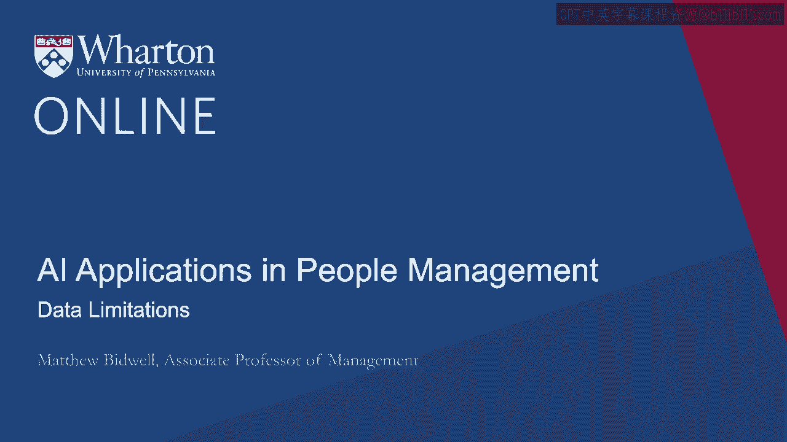
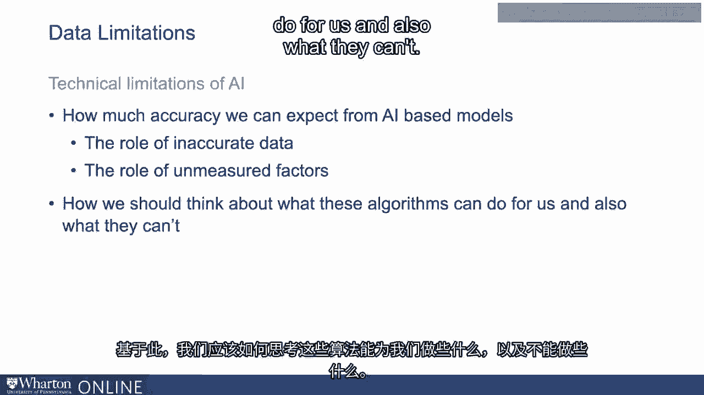
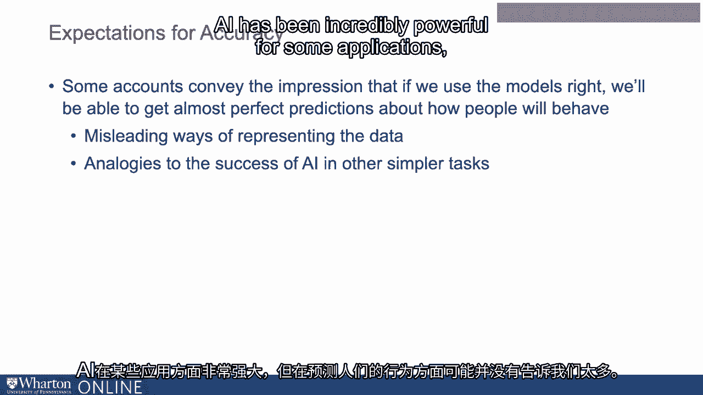
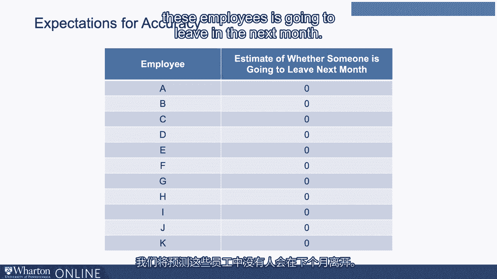
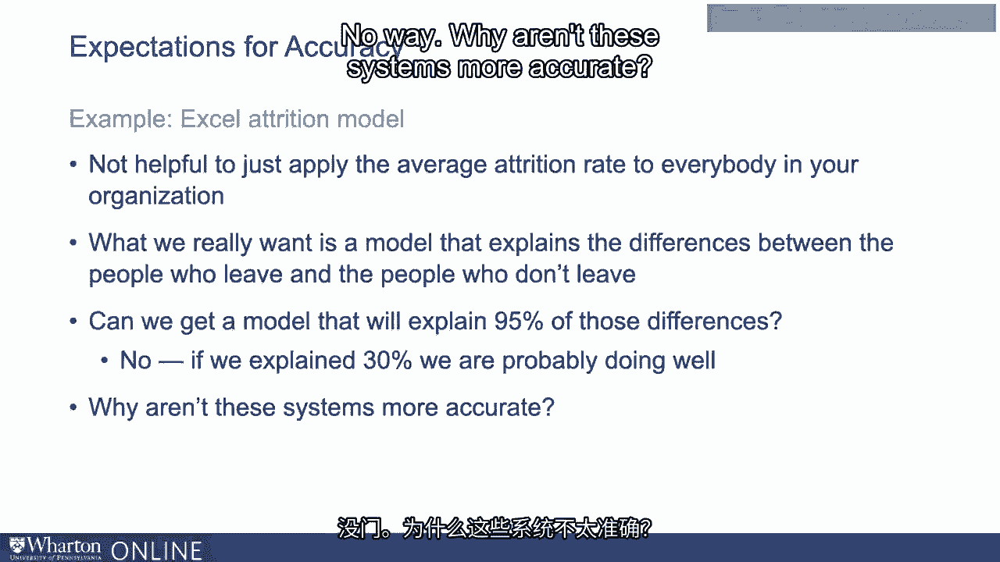

# 课程 P83：数据局限性 🎯

在本节课中，我们将要学习人工智能与机器学习在管理应用中的真实潜力及其面临的重要技术限制。我们将重点探讨模型预测准确性的实际边界，理解数据不准确性和未测量因素如何影响模型性能，并思考这些算法在实际管理场景中能做什么、不能做什么。

---

## 预测准确性的现实边界 📊

上一节我们介绍了AI在管理中的潜力，本节中我们来看看对模型预测准确性的合理期望。当人们谈论机器学习时，常会留下一种印象：只要使用正确的模型，就能近乎完美地预测人类行为。然而，这种印象并不完全正确。

这种印象主要源于两个方面：
1.  对数据表现方式的最终颇具误导性的描述。
2.  人工智能在其他领域（如图像识别）的成功，可能并不直接等同于其在预测人类行为方面的成功。

---

## 具有误导性的准确性指标 ⚠️

当我们描述算法准确性时，有多种方式，其中一些方式可能极具误导性。

以下是一个常见的误导性案例：
你常会听说某个员工流失预测模型的准确率达到了90%或95%。这听起来非常了不起，仿佛拥有了预知能力。但实际情况可能并非如此。

现在，我将展示一个预测模型，它能以至少95%的准确率预测你的组织中谁将在下个月离职。对于大多数组织，这项服务目前免费提供。

以下是你可以使用的预测模型：
1.  创建一个Excel表格。
2.  在第一列列出所有员工姓名。
3.  在第二列，对每个员工的下个月离职预测进行估计。
4.  **在每个预测单元格中填入数字“0”**，即预测所有员工都不会离职。

只要你的组织下个月的员工流失率低于5%（这对大多数组织是常见情况），这个模型的预测准确率就会**至少达到95%**。因为我们正确预测了所有“未离职”的员工（占大多数）。

这个模型有用吗？**没有**。它只是简单地将平均流失率应用到每个人身上，并没有识别出“会离职”和“不会离职”的员工之间的**差异**。

我们真正需要的是一个能够解释个体差异的模型。我们能否建立一个模型，能解释95%的个体差异（即准确区分离职者与留任者）？坦白说，不能。

如果我们能解释30%的个体差异，表现就已经相当不错。招聘预测也是如此，大多数证据表明，招聘测试能解释的未来工作表现差异通常在30%到50%之间，更复杂的算法也难有大幅提升。

因此，我们需要理解，算法在解释“谁会离职”或“谁会表现良好”方面的能力是有限的。我们无法达到95%的个体差异解释率。

---

## 限制准确性的核心因素 🔍

那么，为什么这些预测系统无法达到更高的准确性？主要有两个核心限制因素。

### 1. 数据不准确性问题

首先，数据本身可能不准确。我们记录的数据可能存在错误。

例如，在员工数据中：
*   员工的**薪资**数据可能记录错误。
*   员工的**入职日期**可能录入不准确。
*   用于衡量表现的**绩效评分**可能带有偏见或不一致。
*   甚至员工的**年龄**也可能记录错误。

如果基础数据存在错误，那么无论算法多么精妙，基于这些数据做出的预测也必然存在问题。这可以用一个简单的公式表示：

**有问题的输入数据 → 有问题的模型输出**

### 2. 未测量因素问题

其次，也是更关键的一点，是我们**根本没有测量**许多重要的影响因素。

以员工流失为例，我们通常记录薪资、职级、任期等数据。但许多真正驱动离职决策的因素并未被记录：
*   员工的**配偶是否找到了新工作**，需要搬家。
*   员工是否与**上司关系不和**。
*   员工是否收到了**更有吸引力的外部工作机会**。
*   员工的**通勤时间是否变得难以忍受**。

这些因素通常不会被系统性地记录在HR数据库中。然而，它们往往是决定员工去留的关键。我们的模型无法使用从未被测量过的数据。

这种情况可以概括为：

**模型预测能力 ≤ 已测量数据的预测能力**

如果关键影响因素未被测量，那么模型的预测天花板从一开始就被限制了。

---

## 总结与启示 💡

本节课中，我们一起学习了人工智能在管理预测中的应用与局限。

我们认识到：
1.  对模型准确性的期望应保持现实，个体差异的解释率能达到30%-50%已属良好。
2.  **数据质量是根本**，不准确的输入会导致有问题的输出。
3.  **未测量因素是主要瓶颈**，模型无法预测未被记录的关键驱动因素。

因此，在应用AI模型辅助管理决策时，我们必须理解其能力边界。这些工具是强大的辅助，能帮助我们发现模式、评估风险，但它们并非能完美预测人类复杂行为的“水晶球”。有效的管理依然需要结合数据洞察与人类判断。