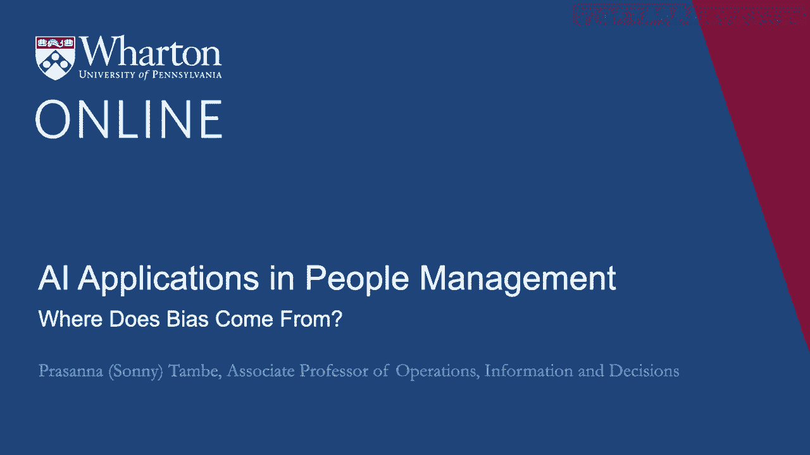
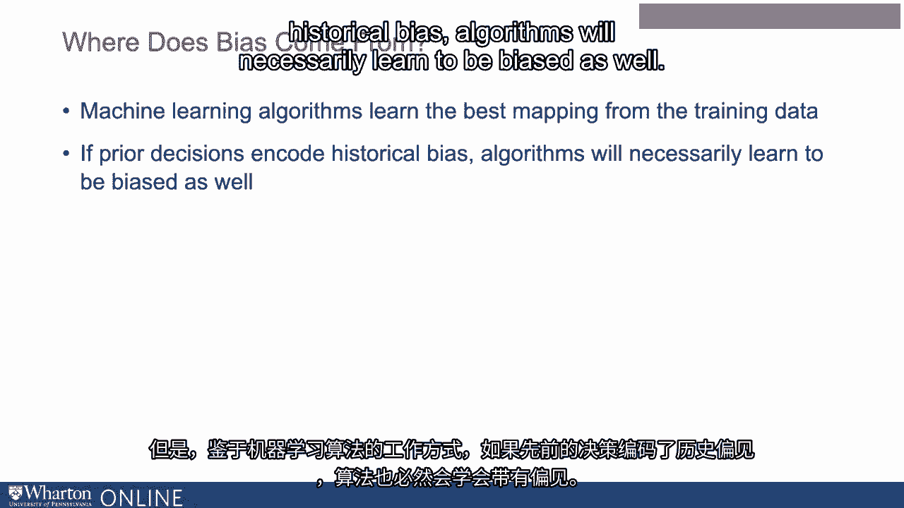
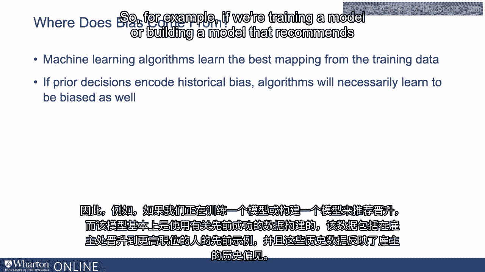
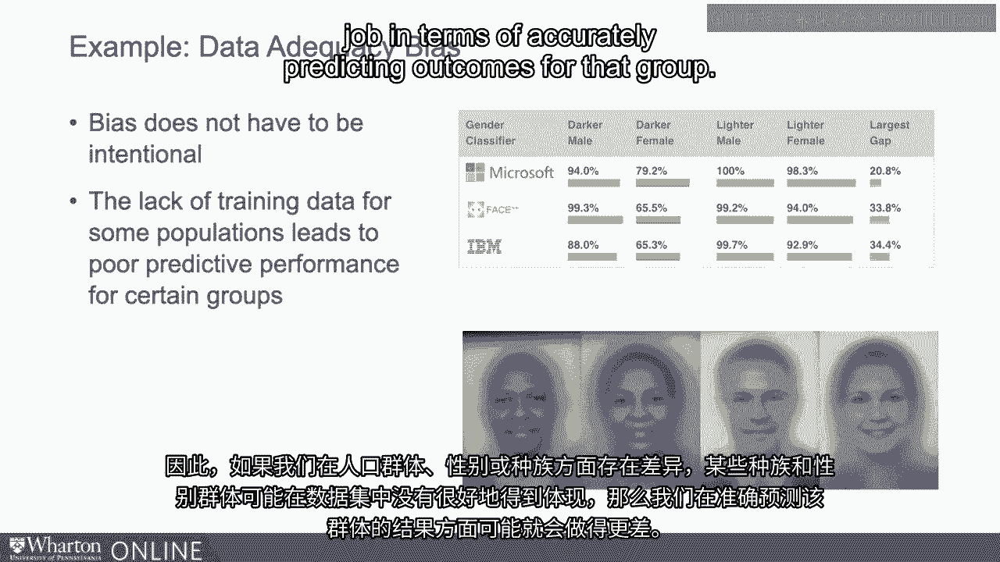
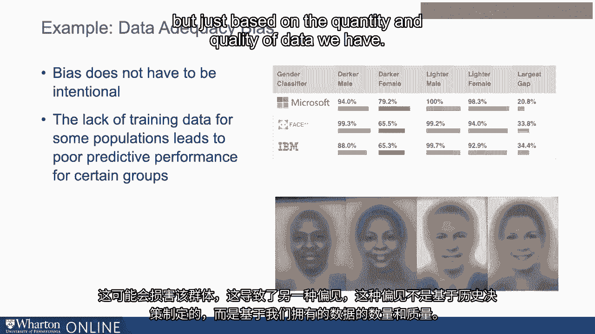
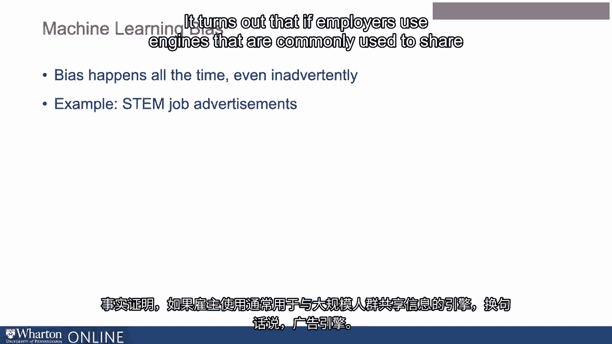

# 课程 P87：人工智能中的偏见问题 🔍

在本节课中，我们将探讨在人力资源等系统中应用人工智能时，一个至关重要且广受关注的问题：**偏见**。我们将了解偏见是如何产生的，以及它可能带来的挑战。

---

## 偏见问题的根源

上一节我们提到了人工智能应用带来的挑战，本节中我们来看看其中最大的问题之一：**偏见**。机器学习算法的核心是学习从输入数据到输出结果的映射。这意味着，如果训练数据本身包含了人类的历史偏见，算法就会学习并模仿这些偏见。

**核心概念**可以表示为：
`算法输出 = f(训练数据)`
如果训练数据存在偏见，那么 `f` 函数（即算法模型）的输出也会带有偏见。

## 历史偏见：数据的“记忆”

机器学习算法通过分析历史数据中的模式来工作。如果这些历史数据反映了过去存在偏见的人类决策（例如在招聘或晋升中），那么算法就会将这些偏见作为“正确模式”来学习。

例如，在构建一个用于**推荐晋升**的模型时：

模型会学习过去“成功晋升”员工的案例。如果历史上的晋升决策本身就对某些群体（如特定性别或种族）存在不公平，那么模型就会学会歧视这些群体。因此，当前机器学习领域的一个重要焦点就是识别并消除这种由数据带来的历史偏见。

## 数据充分性偏见：数据量的不平等

偏见并非只源于数据内容，数据**数量**的差异也会导致偏见，这被称为“数据充分性偏见”。

考虑一个使用视频或音频面试数据来预测候选人适配性的系统。这类系统通常在数据越多时表现越好。然而，我们拥有的数据集往往对某些群体（如特定性别或种族）的数据量远多于其他群体。

以下是数据充分性偏见的影响：
*   如果某个群体在数据集中的代表性不足，模型在该群体上的预测准确性就会更差。
*   这会导致对该群体不利的结果，形成另一种形式的不公平。

## 算法优化导致的意外偏见

偏见甚至可能在人们毫无恶意的情况下意外产生。一个著名的例子是STEM（科学、技术、工程、数学）领域的职位广告。

雇主可能使用Facebook或Google等广告引擎来推送招聘信息，希望让更多潜在候选人看到。这些引擎的算法旨在**优化信息投放**，以最大化点击或转化。

然而，算法的优化过程可能导致招聘广告被不成比例地展示给男性，而非女性。这不是因为雇主或平台公司有意歧视，而是因为算法根据历史互动数据学习到“男性更可能点击STEM广告”的模式，从而进行了倾斜投放。

这说明了偏见问题的普遍性和复杂性：即使没有主观恶意，算法的运作方式也可能在劳动力市场等场景中，对某些群体产生系统性不利影响。

---

## 总结

本节课我们一起学习了人工智能中偏见的来源。我们了解到，偏见主要可以通过三种方式进入系统：
1.  **历史偏见**：算法从带有偏见的历史数据中学习了不公平的模式。
2.  **数据充分性偏见**：由于不同群体在训练数据中的数量不均衡，导致模型对某些群体的预测性能更差。
3.  **算法优化偏见**：即使数据本身无问题，算法在优化过程中也可能无意间放大或产生对某些群体的不公平结果。

理解这些偏见的根源是解决它们的第一步。在接下来的课程中，我们将探讨如何管理和缓解这些偏见问题。