# 课程P9：机器学习概述 🧠

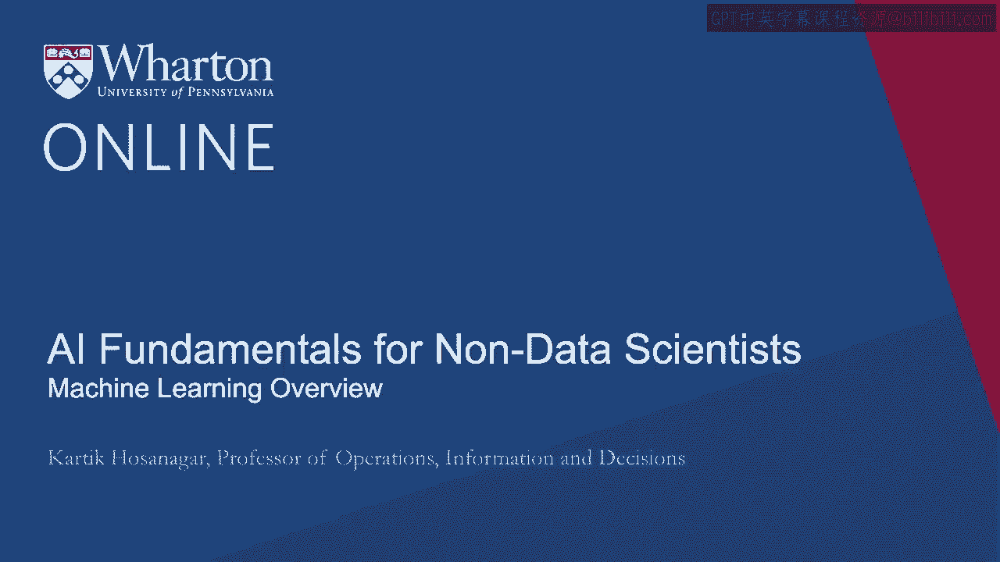

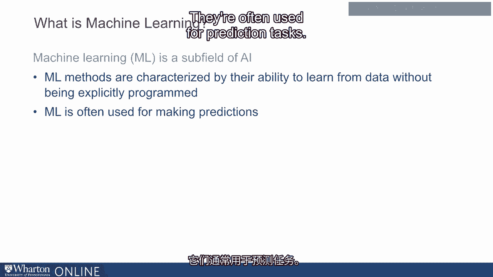

在本节课中，我们将学习机器学习的基本概念及其主要类型。机器学习是人工智能的核心分支，它使计算机能够从数据中学习并做出预测或决策，而无需进行明确的编程。

---

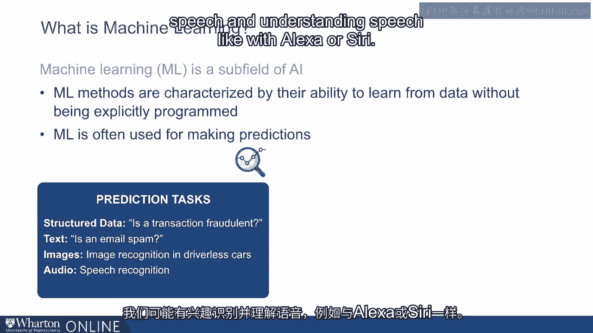

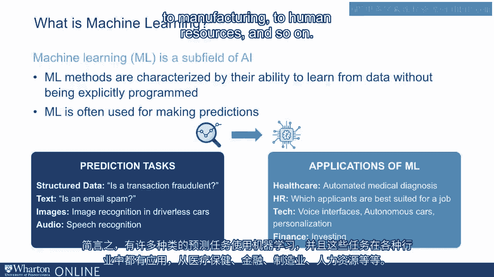

## 什么是机器学习？

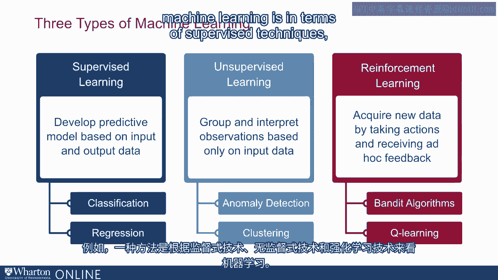

机器学习是人工智能的一个子领域。它主要关注如何让计算机从数据中学习，而不需要明确编程。机器学习技术通常用于预测任务。

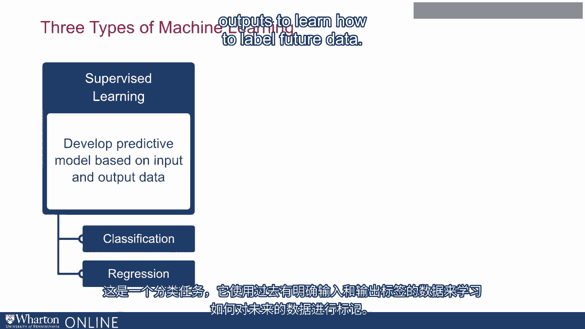

例如，我们可能有关于过去信用卡交易的数据，并希望预测一笔新交易是否是欺诈性的。或者，我们可能希望基于过去的数据判断一封电子邮件是否是垃圾邮件。在自动驾驶领域，机器学习可用于分析图像，判断汽车前方的物体是另一辆车、一个人还是一棵树。语音识别系统，如Alexa或Siri，也依赖于机器学习技术。

简而言之，机器学习在众多预测任务中都有应用，其技术已广泛应用于医疗保健、金融、制造业和人力资源等行业。

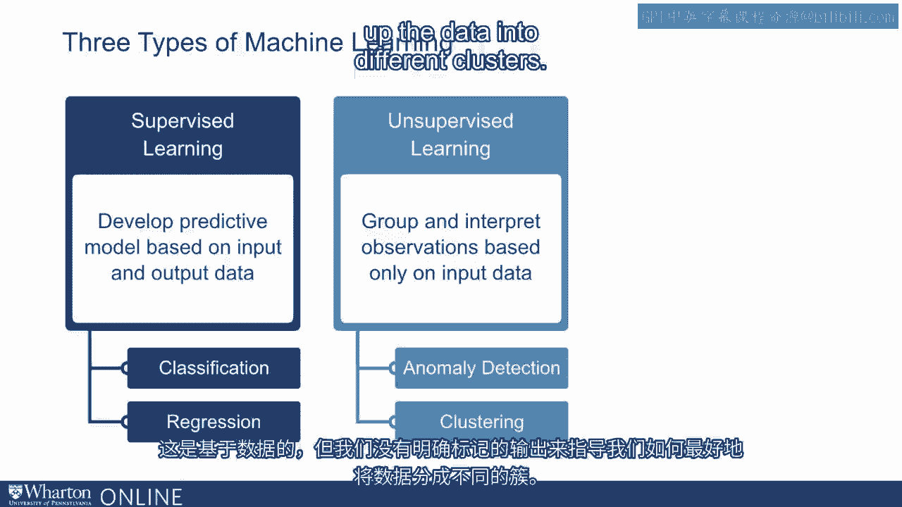

---

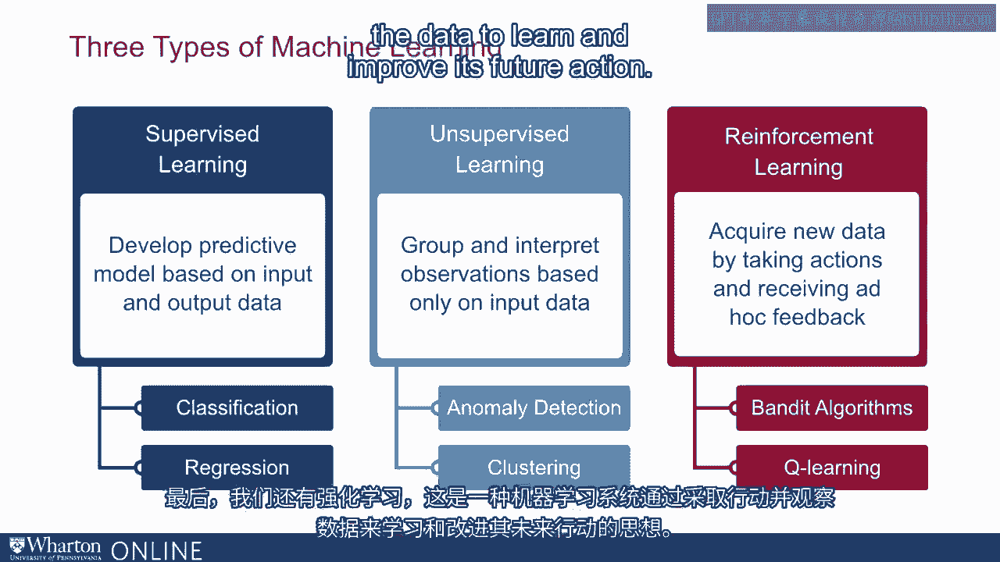

## 机器学习的类型

理解机器学习并非单一技术至关重要。实际上，它包含一系列技术，主要可以分为三大类：**监督学习**、**无监督学习**和**强化学习**。

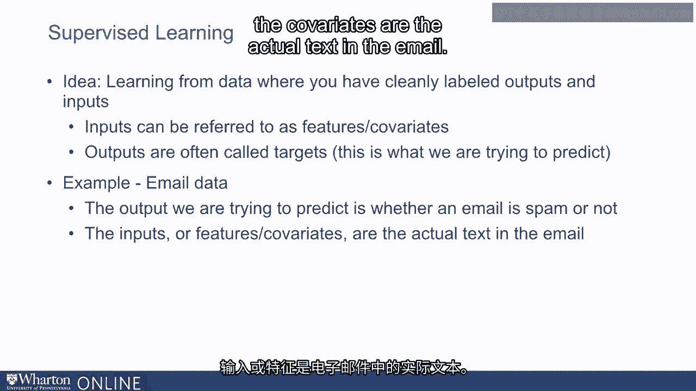

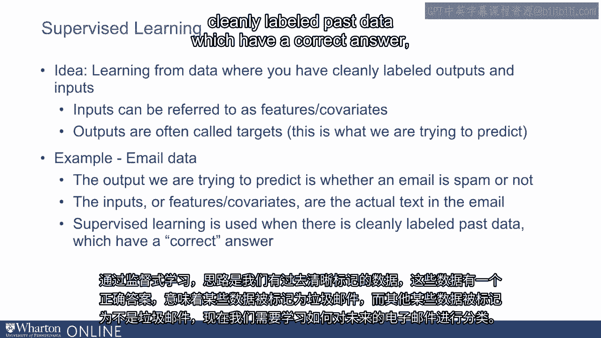

上一节我们介绍了机器学习的基本定义和应用，本节中我们来看看这三种主要类型。

### 1. 监督学习 👁️

监督学习的概念是基于过去带有明确标签的数据来构建预测模型。这些数据包含明确的输入（特征）和输出（目标）。

**公式表示**：给定一个训练数据集 `{(x₁, y₁), (x₂, y₂), ..., (xₙ, yₙ)}`，目标是学习一个函数 `f: X → Y`，使得 `f(x)` 能够对新的输入 `x` 预测其输出 `y`。

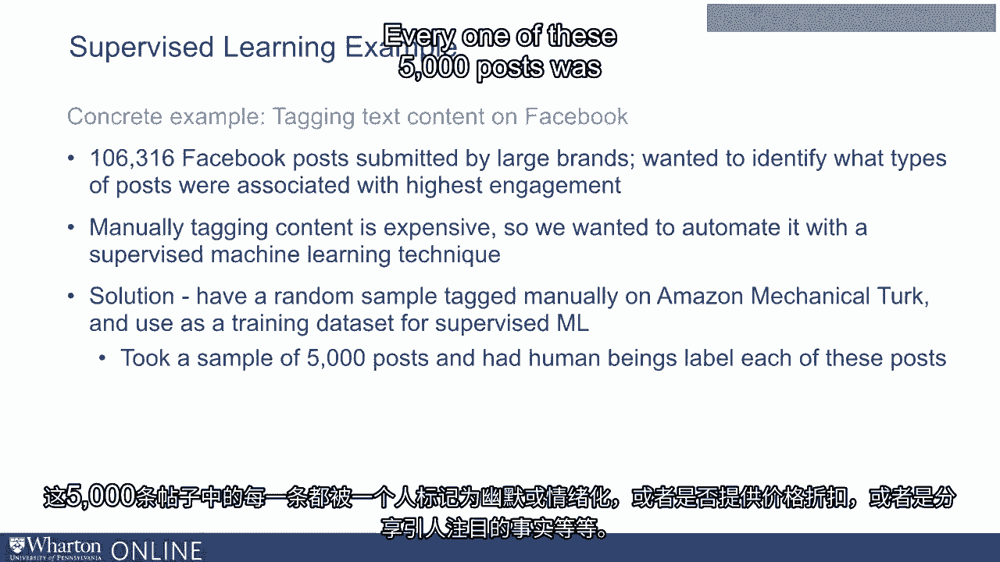

例如，在垃圾邮件分类中，输入 `x` 是电子邮件的文本内容，输出 `y` 是“垃圾邮件”或“非垃圾邮件”的标签。模型通过学习大量已标记的邮件数据，来学会如何对未来的邮件进行分类。

以下是监督学习的一个实际研究案例：
*   在一项关于社交媒体帖子的研究中，研究人员收集了超过10万条品牌发布的Facebook帖子。
*   目标是自动识别帖子类型（如幽默型、情感型、促销型）。
*   首先，人工标记了5000条帖子作为训练数据集，为每条帖子打上类型标签。
*   然后，监督学习算法学习哪些词汇能够预测帖子类型。
*   训练好的模型随后用于自动分类其余近10万条未标记的帖子，准确率超过90%。

**关键点**：监督学习的核心在于拥有一个高质量的、带有明确标签的训练数据集。

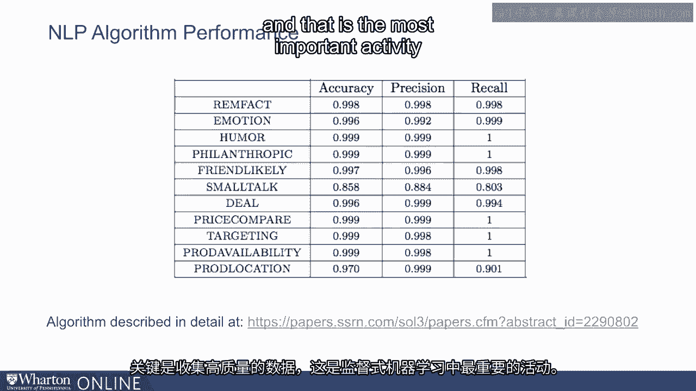

### 2. 无监督学习 🔍

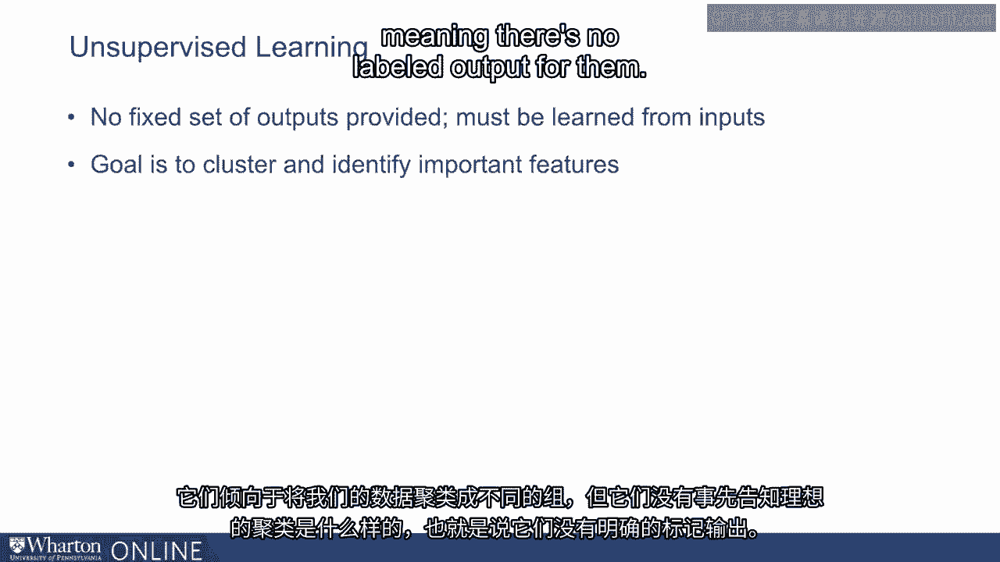

与监督学习不同，无监督学习技术接收大量输入数据，但没有明确的输出标签。这些技术的目标是在数据内部自行发现模式或结构。

上一节我们了解了如何利用带标签的数据进行学习，本节中我们来看看当没有标签时，机器如何从数据中学习。

以下是几种常见的无监督学习技术：
*   **聚类**：将数据点分组，使得同一组内的数据点彼此相似，而不同组的数据点相互不同。算法并未被告知理想的分组方式。
*   **异常检测**：识别数据集中与其他数据点显著不同的异常值。
*   **主题建模（如LDA）**：用于从文档集合中识别潜在主题。例如，分析大量新闻文章，算法会自动发现如“政治”、“体育”等主题，而无需事先被告知文章类别。

**LDA示例**：LDA（潜在狄利克雷分配）模型假设每个文档由少数几个主题混合而成，每个主题由一组经常共现的词汇定义。通过分析文档中的用词，模型可以推断出文档所涵盖的主题。

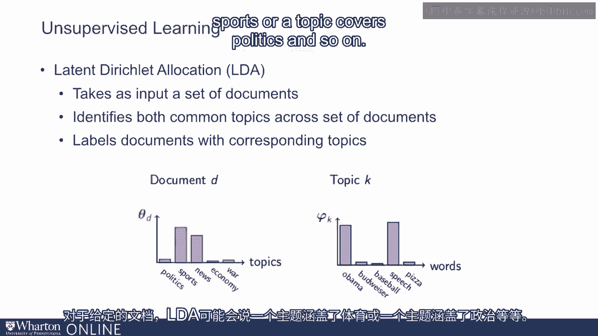

### 3. 强化学习 🎮

强化学习采用了一种不同的学习范式。算法通过与环境的交互来学习：它采取行动，观察结果（奖励或惩罚），并根据这些反馈来调整未来的策略，以最大化累积奖励。

上一节我们讨论了从静态数据中寻找模式的方法，本节中我们来看看通过与动态环境交互进行学习的强化学习。

强化学习通常不需要一个大型的初始训练数据集。一个著名的例子是AlphaGo和它的进阶版AlphaZero。AlphaZero没有使用任何人类棋谱进行训练，而是通过数百万次的自我对弈来学习围棋的最佳策略。

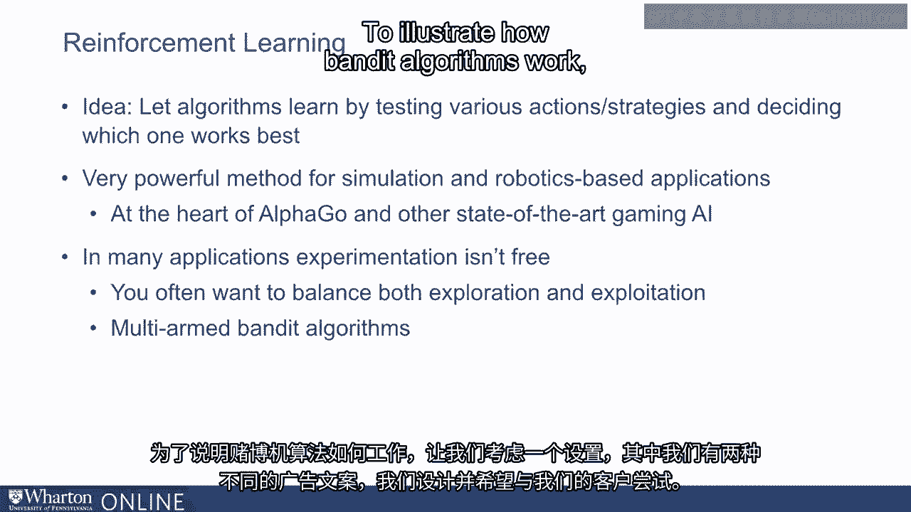

为了说明强化学习的核心思想——平衡“探索”（尝试新事物）与“利用”（使用已知最佳策略）——我们来看一个“多臂老虎机”问题的简化案例。

**案例：广告优化**
假设我们有两个广告文案（A和B），不知道哪个点击率更高。
*   **传统A/B测试**：随机将广告A和B各展示给一半用户一段时间（如一天），然后选择点击率高的那个。在学习阶段，平均点击率是两者的均值（例如7.5%），并非最优。
*   **强化学习（如老虎机算法）**：算法开始时均衡地展示两个广告，但同时持续观察点击反馈。当它发现广告B表现更好时，会逐渐增加展示广告B的频率，但仍会以较低概率展示广告A，以持续探索和修正认知。最终，其整体点击率会远高于A/B测试的平均水平，并无限接近最佳广告的点击率（10%）。

**核心思想**：强化学习算法通过**行动 -> 观察 -> 更新策略**的循环，在不断试错中优化其长期性能。

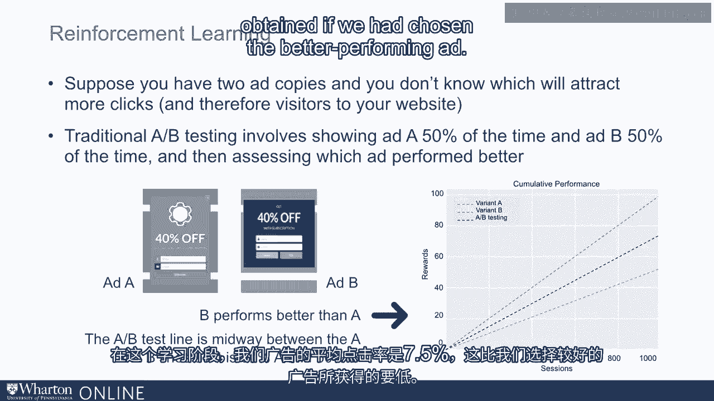

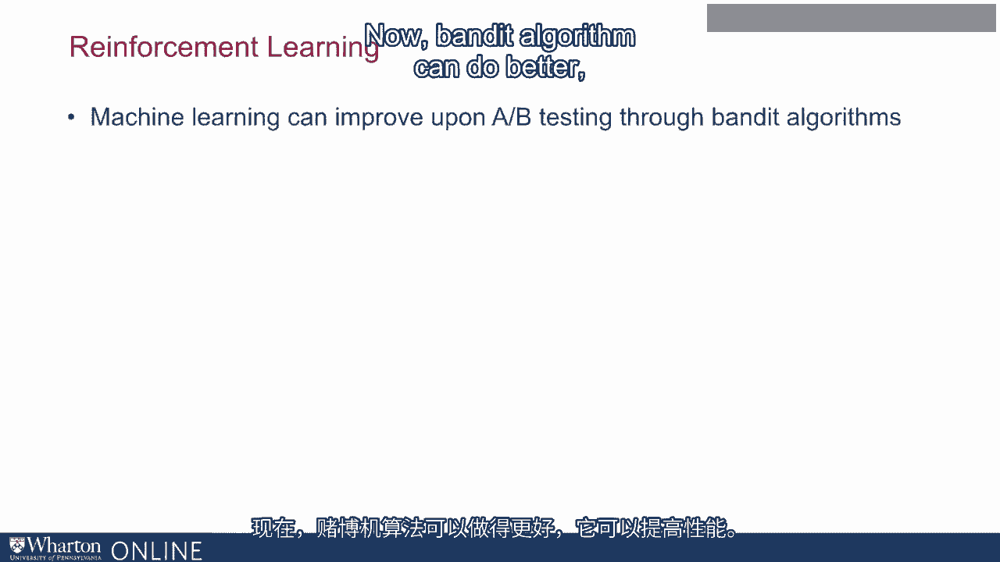

---

## 总结

在本节课中，我们一起学习了机器学习的基本概念和三种主要类型：
1.  **监督学习**：从带有明确输入和输出标签的数据中学习预测模型。
2.  **无监督学习**：从无标签的数据中自行发现内在模式，如聚类或主题。
3.  **强化学习**：通过与环境交互，根据行动产生的奖励或惩罚来学习最优策略。

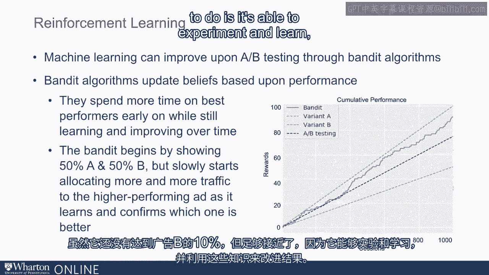

每种类型适用于不同的场景和问题，共同构成了丰富多彩的机器学习世界，为解决复杂的现实问题提供了强大的工具。