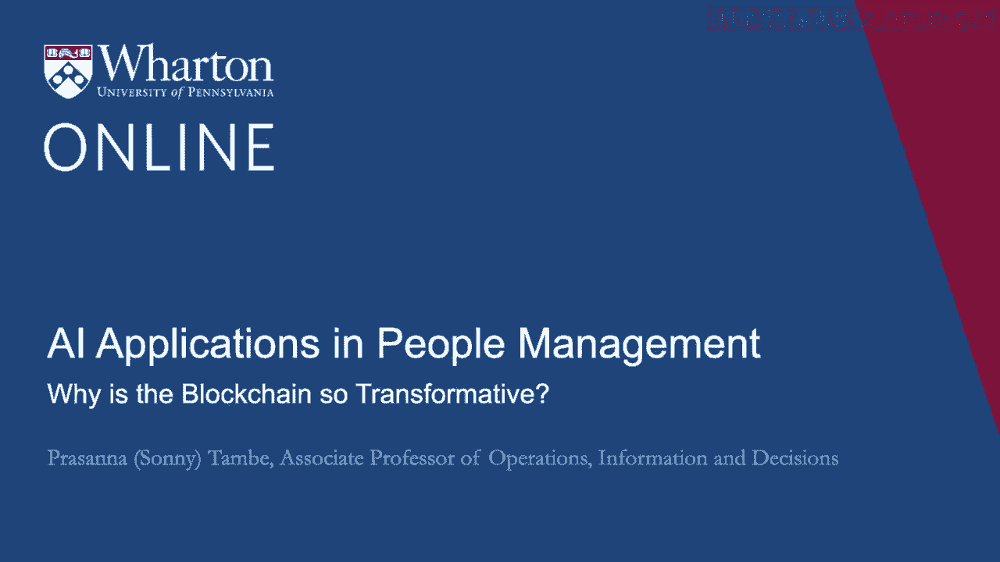
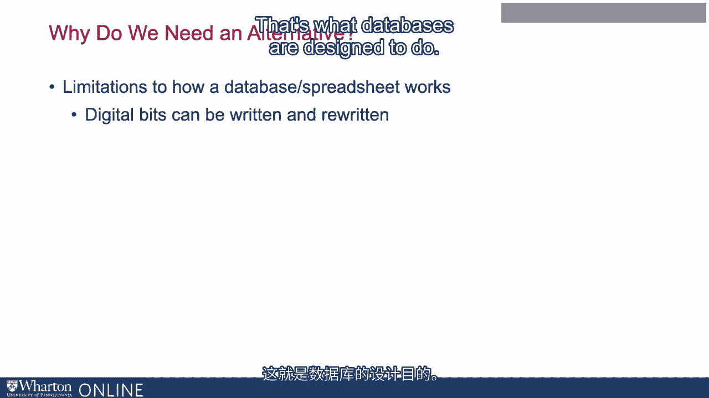
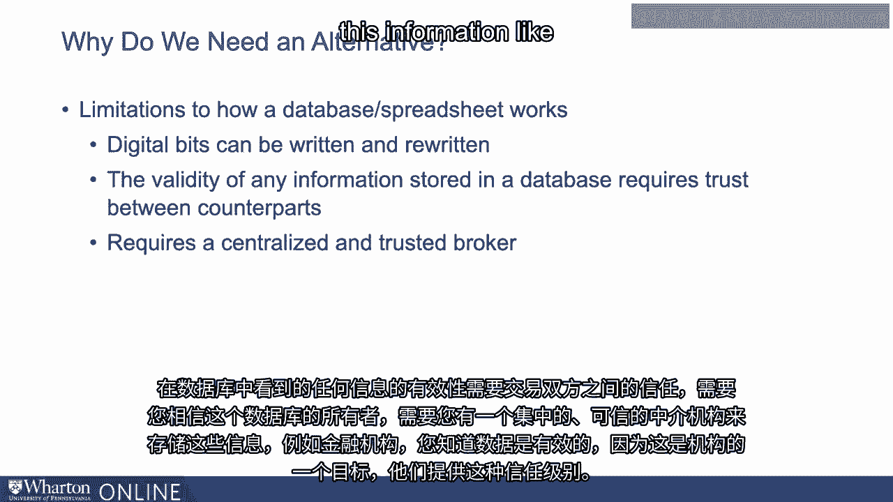
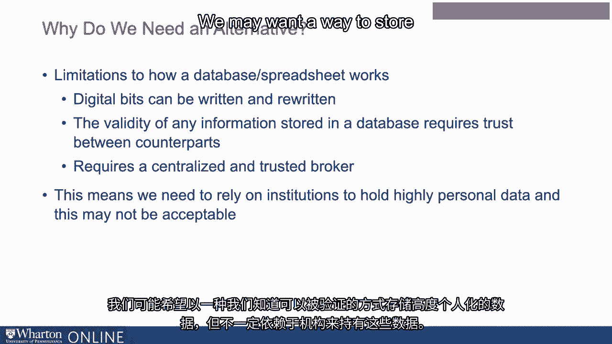
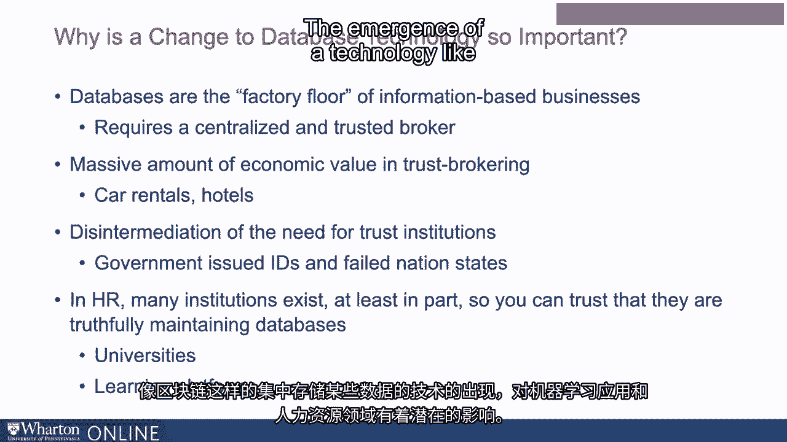

# 课程 P96：区块链为何如此颠覆性？🤔

在本节课中，我们将探讨区块链技术为何被认为具有潜在的革命性。我们将从它试图解决的核心问题出发，分析其与传统数据库的区别，并理解它如何通过算法实现信任，从而可能改变众多行业和机构的运作方式。

---

## 区块链试图解决什么问题？🔍

上一节我们提出了区块链的颠覆性问题，本节中我们来看看它究竟想解决什么。我们拥有成熟的数据存储技术，数据库已存在很长时间，并且确实是现代信息化经济中最重要的技术之一。那么，我们为什么需要一个替代方案？

数据库的工作方式存在各种限制。区块链开始解决的关键限制之一，是关于数字位的特性。数据库中的数据可以被写入和重写。当然，当我说“限制”时，这本身也是一个特性，因为数据库就是为此目的而设计的。

---

## 数据库的信任依赖问题 🤝

数据库的一个特征或功能是，这些数字位可以被写入，并且可以重写，它们可以被更改。你可以追溯并更改数据库中的信息。你在数据库中看到的任何信息的有效性，都需要交易方之间的信任。这要求你信任数据库的拥有者，它要求你有一个集中式的可信中介来存储这些信息。

例如，金融机构。你知道数据是有效的，原因之一就是机构所服务的目的之一是提供这种信任级别。这意味着我们需要依赖这些机构来持有高度个人化的数据。在某些情况下，这可能是不可接受的。我们可能希望以某种方式存储高度个人化的数据，确保能够验证其真实性。

---

## 区块链：用算法实现信任 ⛓️

但这并不一定需要依赖机构来持有这些数据。这是我们在社会上关于数据隐私讨论的中心议题，对个人和经济中的各种利益相关者意义重大。

区块链是一种软件协议，它以算法方式实现信任。它基本上试图解决上述问题。它以算法方式实现信任，因此你不需要一个集中式机构或中介介入并说：“你可以相信这些信息，因为我说你可以信任它。” 你不需要那种级别的机构来扮演那个特定的角色。

区块链可以在算法层面实现那种信任。这意味着个人可以使用区块链来存储个人数据，公司可以利用区块链进行人力资源分析，整个过程不涉及任何中央第三方，而数据仍然可以被信任。我们知道数据可以被信任，因为它在区块链中，这是基于区块链的设计方式决定的。

---

## 为何这种改变如此重要？💡

这实际上可能是一个重大的变革。从某种意义上说，我们谈论的只是数据技术或数据存储方式的变化。为什么这如此重要？再次强调，数据库在许多方面是大多数信息型企业的生产车间。数据存储方式的改变对组织可能产生非常大的影响，波及各种经济机构。

例如，作为信任中介的机构拥有巨大的经济价值。想想汽车租赁公司或酒店，很多时候，他们的核心角色之一就是成为一个你可以信任的机构，在考虑租车或寻找住宿时，你可以信任的对象。能够绕过在信任中扮演中心角色的一些机构，可以带来非常大的影响。

以下是过去与这类区块链应用相关的一个例子：

*   **政府签发的身份证件**：政府基本上表示“这是我们国家的公民，你可以信任我们作为政府所支持的”。这有时会带来许多问题，例如针对失败国家的公民，他们在全球范围内使用身份证明非常困难。拥有一种能够让我们信任彼此提供的数据的技术，而无需依赖基于集中机构的做法，可能产生重大影响。

---

## 在人力资源领域的潜在应用 👥

在人力资源方面，存在许多机构，它们至少部分原因是为了让你可以信任他们确实在真实维护数据。

以下是几个例子：

*   **大学提供凭证**：他们提供学位，并提供学位的验证。
*   **学习平台**：提供有关技能和证书等信息。

许多这样的机构部分存在是为了让你信任你对潜在公司员工的了解。

像区块链这样的技术，作为集中存储某些数据的地方的出现，对人力资源中的机器学习应用访问数据的方式有影响，而无需遇到我们可能担心的其他问题（如果存在一个集中提供这些数据的经纪人的话）。

这里潜在的最大好处是，我们越来越多地获取细致数据。例如，考虑可能详细记录员工个人生产力的数据，也许是日常任务或某人如何处理代码的一些细致数据。检查开源代码库，非常细致的数据可能会提供关于人们表现的丰富信息。

这种数据是我们可能不愿意交给第三方的，我们可能不信任第三方处理这种数据，但对人力资源来说可能有用。所以区块链是一个潜在的中介，可以用于保存这些数据，仍然用于机器学习应用，以一种仍然保护隐私和数据所有权权益的方式。

---

## 总结 📚

本节课中，我们一起学习了区块链技术为何具有颠覆性。我们了解到，区块链的核心在于通过**算法（如共识机制）** 而非**中心化机构**来解决数据存储中的信任问题。它使得数据不可篡改且可验证，从而可能重塑金融、身份认证、人力资源等多个依赖中心化信任的领域。这种从“信任机构”到“信任代码”的转变，是区块链带来潜在革命性影响的关键所在。