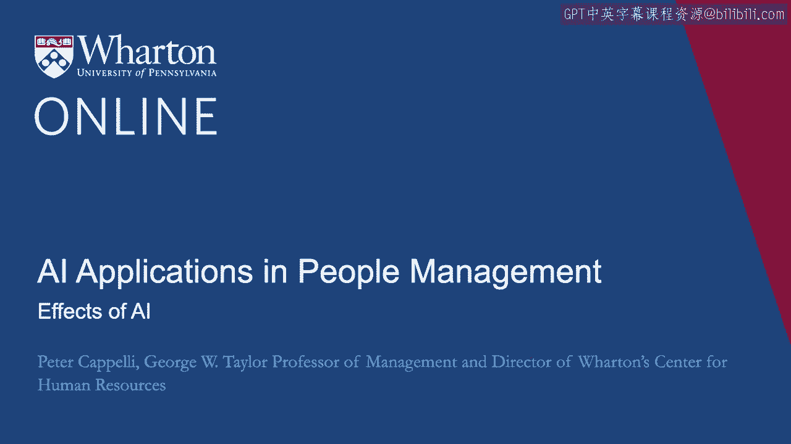
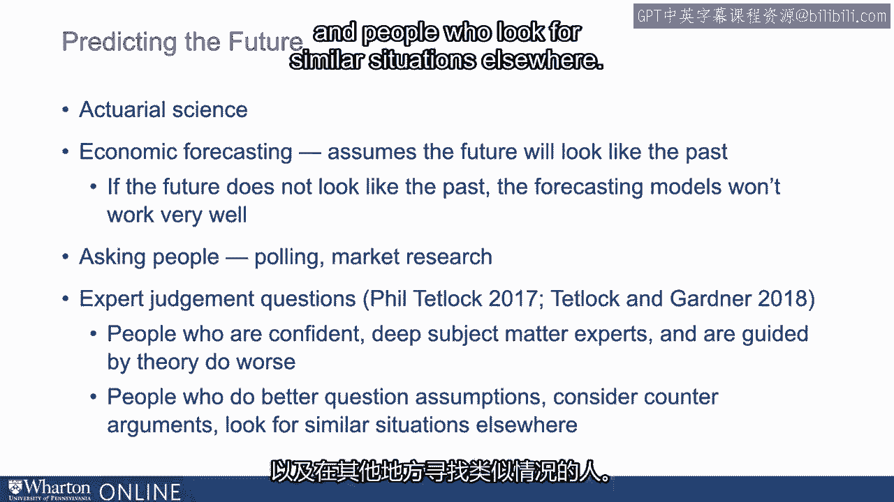
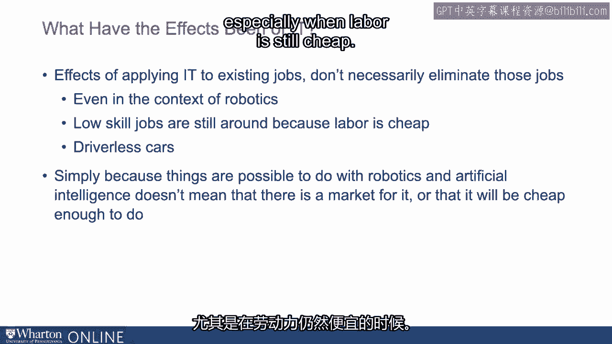
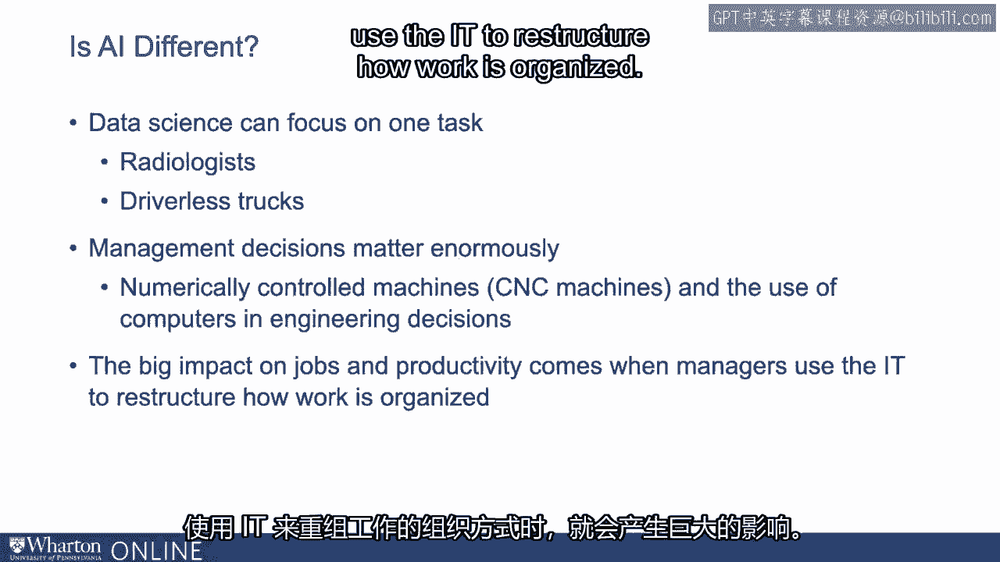

# 课程 P99：人工智能的社会影响 🧠

在本节课中，我们将探讨人工智能对社会，特别是对就业领域的影响。我们将分析关于“AI将取代大量工作”的常见预测，并学习如何理性地评估这些预测。课程将结合历史案例和关键概念，帮助你理解技术变革与就业市场之间的复杂关系。

---

## 预测的挑战与评估方法

上一节我们介绍了课程主题，本节中我们来看看如何评估关于未来的预测。预测未来是困难的，但某些领域我们做得相对较好。

例如，在精算学或经济预测中，我们基于“未来与过去相似”的假设建立模型。其核心逻辑可以概括为：

**模型预测 = 基于历史数据的函数(当前变量)**

然而，当未来与过去截然不同，或者缺乏足够历史数据时（如新技术引入、政治变革），这类模型就会失效。此时，我们依赖专家判断。

我们的同事菲尔·塔特洛克的研究指出，擅长做预测的专家通常具备以下特质：

以下是优秀预测者的关键特质：
*   他们**质疑假设**，并考虑反对意见。
*   他们会在**其他领域寻找类似情况**进行类比。
*   他们能够**清晰地阐述**其判断所基于的假设。

因此，当你看到关于AI影响的预测时，应该审视预测者是否具备这些特质。如果他们的论证缺乏对反对意见的考量，其可靠性就值得怀疑。

---

## 为何耸人听闻的预测层出不穷

在评估了预测方法后，我们需要理解一个社会现象：为何那些极端、引人注目的预测总是更受欢迎。

当代社会，注意力是稀缺资源。能够吸引关注，往往就能获得资金和支持。因此，很少有报告会预测“未来一切照旧”或“无需担心”，因为这样的内容无法引起兴趣，即使它可能是正确的。

以下是几个历史上曾流行但未成真的预测案例：
*   **劳动力短缺预言（2000年代初）**：基于对人口数据的误读，许多组织预测将出现严重劳动力短缺，但这并未发生。
*   **“千禧一代”独特论**：尽管研究显示代际差异的证据很弱，但关于千禧一代与众不同的故事因其“趣味性”而长期流传。
*   **无人驾驶卡车浪潮（几年前）**：曾预测将迅速取代卡车司机，但此后进展缓慢，相关讨论也大幅减少。

这些案例提醒我们，对流行但缺乏坚实证据的预测应保持警惕。

---

## 历史视角：信息技术对工作的真实影响

了解了预测的陷阱后，让我们退一步，从历史中寻找洞见。我们可以通过审视信息技术（IT）对工作的影响，来类比思考AI。

整体而言，IT的引入并未减少经济中的工作总量。工作数量持续增长。在具体职业层面，变化确实存在，例如打字员岗位的消失。但请注意，**导致打字员消失的直接原因并非文字处理软件，而是管理层决定让所有职员自己打字**。这是一个关键点：**技术本身不决定就业变化，管理决策如何利用技术重组工作才是关键**。

此外，IT的许多应用是为了增加新功能，而非取代人力。例如，电商的“推荐购买”功能创造了新的价值，而非消除某个岗位。

即使在机器人领域，情况也类似。机器人通常接管的是某项**任务**，而非整个**工作**。员工的工作内容因此被重塑，而非简单地被淘汰。一个经典案例是1980年代通用汽车与丰田的对比：通用投入巨资进行工厂自动化，而丰田采用“精益生产”模式，重用旧设备和美国工人，最终在效率和质量上胜出。这证明**人力与组织的适应性常常能胜过单纯的自动化**。

最后，经济因素至关重要。即使技术可行，如果劳动力成本相对低廉，企业也可能没有动力进行昂贵的自动化改造。**市场需求和成本效益是决定技术普及速度的核心因素**。

---

## 人工智能真的“这次不一样”吗？

回顾了历史经验，现在让我们直面核心问题：人工智能是否真的与众不同，会带来前所未有的就业冲击？

每当听到“这次不一样”的论断时，我们都应保持质疑。这是进行良好预测的基本原则。

以医学影像分析为例，有研究表明AI算法在筛查特定疾病（如乳腺癌）时可能比放射科医生表现稍好。但这远不能得出“放射科医生将被淘汰”的结论。

以下是需要综合考虑的几个层面：
1.  **人机协作**：研究发现，**放射科医生 + AI算法** 的组合，其诊断效果优于任何一方单独工作。
2.  **工作复杂性**：放射科医生的工作远不止读片，还包括诊断、制定治疗方案、实施介入治疗等。AI可能自动化其部分任务，但无法替代全部。
3.  **任务与工作的区别**：正如卡车司机的工作包括驾驶、卸货、交接等，AI或机器人可能接管驾驶任务，但其他环节仍需人力完成。

因此，AI的影响路径很可能与历史上的信息技术类似：**它将成为管理者用来重组工作和业务流程的工具**。真正的生产力飞跃和就业结构变化，将来自于组织和管理层如何利用AI创新工作模式，而非AI简单地“取代”人力。

---

## 总结

本节课中，我们一起学习了如何理性看待人工智能对社会就业的影响。

我们首先认识到评估未来预测需要方法，应关注预测者是否考虑了反对意见和类似历史案例。接着，我们分析了耸人听闻的预测之所以流行的社会动因。然后，我们从信息技术和自动化的历史中看到，技术更常做的是**重塑工作而非消除工作**，管理决策和经济考量在其中扮演核心角色。最后，我们审视了“AI与众不同”的论点，指出其影响很可能延续历史模式，即通过赋能管理者重组业务流程来发挥作用。

核心结论是：对AI取代工作的担忧常常被夸大。真正的变革将体现在**工作内容的重构**和**人机协作模式**的进化上，而非工作岗位的单纯消失。保持批判性思维，依据历史和证据进行判断，是应对技术变革讨论的最佳方式。