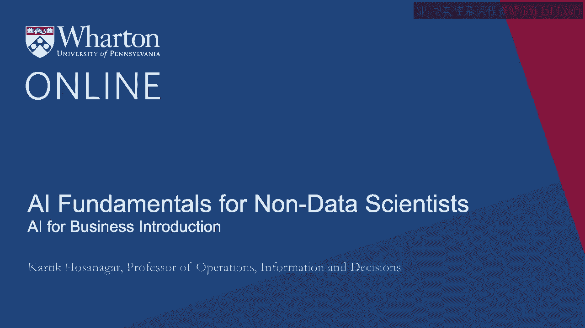
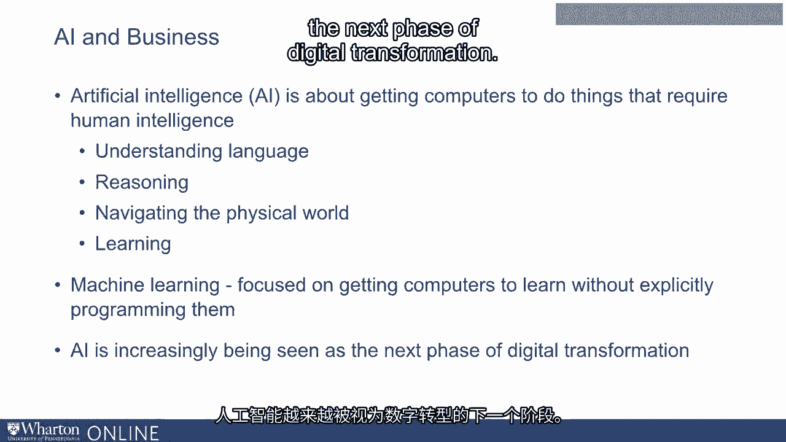
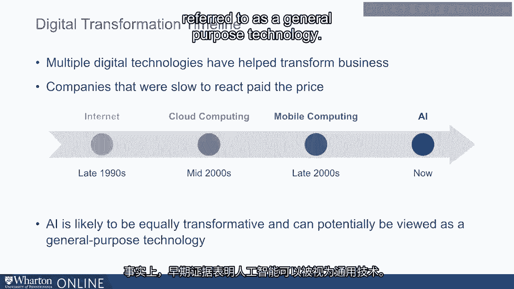
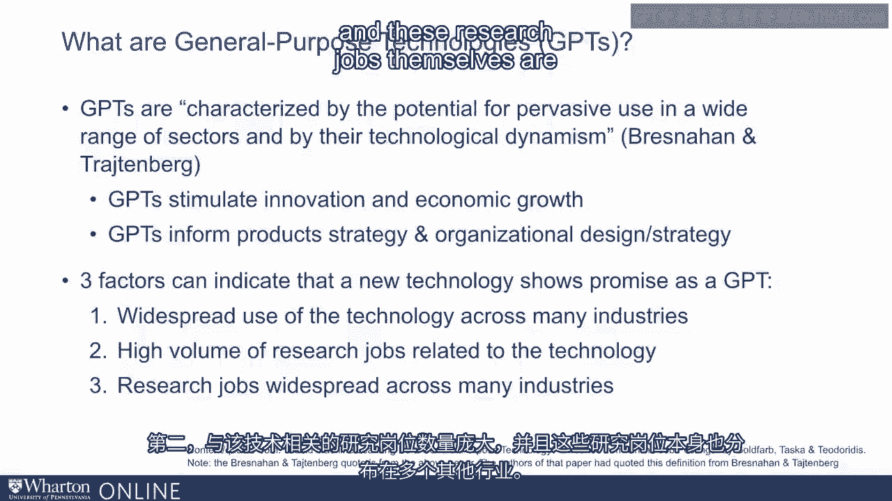
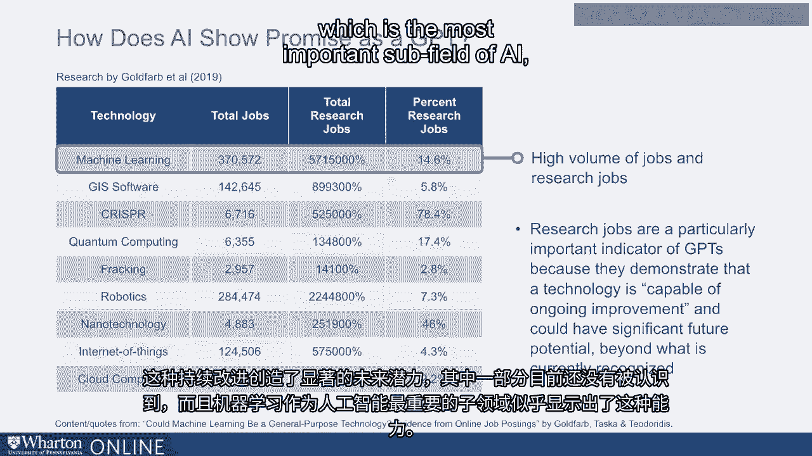
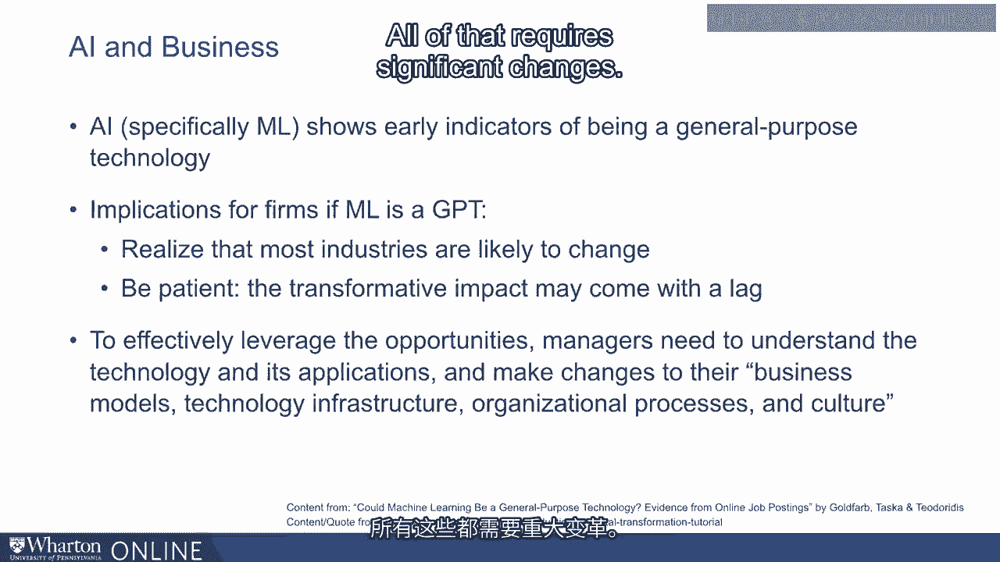

# 1：面向业务的AI简介 🧠

在本节课中，我们将从管理者的视角，学习人工智能在商业中的应用。我们将探讨几个AI商业案例，并介绍一个帮助管理者从AI投资中获取收益的战略框架。

---

## 讲师介绍

我是卡尔蒂克·哈萨纳加，在沃顿商学院从事技术与数字经济研究。我的研究重点包括互联网商务、数字媒体、数字营销以及基于数据的决策。

我曾是面向小企业的营销平台Yodl的联合创始人。多年来，我与众多初创企业和大公司合作，特别关注人工智能和数据科学在商业中的应用。

我还著有《人类的机器智能指南》一书，该书探讨了在企业内外利用人工智能进行商业决策的影响。

---

## 什么是人工智能？

人工智能旨在让计算机完成需要人类智能的各种任务，例如理解语言、推理物理世界和学习。

机器学习是人工智能的一个子领域，其核心是让计算机在没有明确编程的情况下进行学习。

**核心概念公式**：
`人工智能 (AI) ⊇ 机器学习 (ML)`

人工智能正在不断发展，并被视为数字化转型的下一个关键阶段。

---

## 数字化转型的历史脉络

多年来，各种数字技术推动了商业转型。数字化转型是指组织利用数字技术创造新机遇的理念。

*   **20世纪90年代末**：互联网是推动转型的核心技术。一些公司开设了在线部门。尽管在互联网泡沫期间，部分公司关闭了这些部门，但那些坚持下来的公司最终获得了长期巨大收益。
*   **21世纪00年代中期**：云计算带来了类似变化。早期尝试面临数据迁移、安全和合规等挑战，导致一些公司退出。然而，坚持投资云计算的公司获得了长期的商业敏捷性优势。
*   **21世纪00年代末**：移动计算催生了变革。早期投资移动技术的公司成功创造了移动优先的产品，并帮助企业转型进入移动世界。

如今，人工智能似乎具有同等的变革潜力。早期证据表明，人工智能可以被视为一种“通用技术”。

---

## 人工智能作为通用技术

通用技术是指在多个不同行业有广泛应用潜力，并能激励创新、推动经济增长的技术。在组织层面，它们还能为产品战略和整体设计提供信息。

判断一项技术是否为通用技术，主要有三个指标：
1.  该技术在多个行业中广泛应用。
2.  存在大量与该技术相关的研究职位。
3.  这些研究职位本身也分布在多个行业中。

在Goldfarb等人的一项研究中，研究人员通过分析数百万份职位招聘信息，评估了机器学习（AI的重要子领域）作为通用技术的潜力。

**研究发现**：
*   机器学习相关的职位数量庞大，且与机器人技术、云计算等其他技术职位有重叠。
*   机器学习职位广泛分布于教育服务、专业服务、制造业、金融服务等多个行业。
*   许多行业（如制造业、专业服务、信息技术、金融、教育）都需要与机器学习相关的研究职位，这表明该技术具有持续改进和未来创新的潜力。

简而言之，统计数据表明，机器学习乃至整体人工智能很可能成为一种通用技术。

---

## 对管理者的启示

人工智能作为通用技术，对管理者有重要启示：

1.  **广泛影响**：AI的影响将波及众多行业。即使你所在的不是科技行业，也无法免受其变革性影响。
2.  **需要耐心**：许多AI职位是研究性质的，这表明技术本身在不断发展。其变革性影响可能不会立竿见影，管理者需要对技术投资保持耐心。
3.  **全面准备**：为了有效利用AI带来的机遇，管理者需要理解技术及其应用，并对商业模式、技术基础设施、组织流程和文化进行重大调整以适应变化。

本课程的目的，正是帮助你为迎接这些挑战和机遇做好准备。

---

## 总结

本节课中，我们一起学习了人工智能的基本概念，回顾了数字化转型的历史，并理解了AI作为一种“通用技术”的潜力和特征。我们还探讨了这些趋势对管理者意味着什么，为后续深入具体的商业应用和战略框架打下了基础。