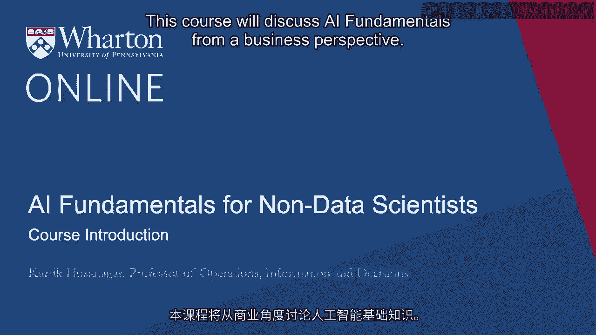
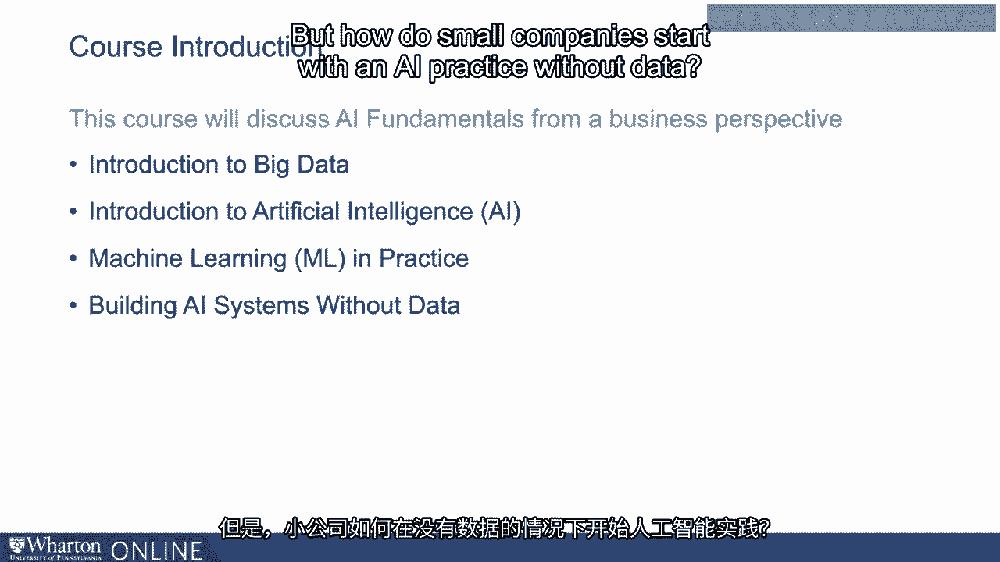

# 2：人工智能商业基础入门 🧠

在本课程中，我们将从商业视角出发，探讨人工智能的基础知识。我们将依次了解大数据、人工智能与机器学习的基本概念、实践应用，以及数据在构建AI系统中的关键作用。

## 第一部分：大数据简介 📊

上一节我们概述了课程内容，本节中我们来看看大数据的核心概念。

我们将从介绍大数据开始。具体而言，大数据指的是规模巨大、类型多样且处理速度要求高的数据集合。

以下是关于大数据的几个关键问题：
*   什么是大数据？
*   如何使用大数据？
*   大数据能帮助你回答哪些类型的商业问题？

## 第二部分：人工智能与机器学习 🤖

了解了大数据的基础后，我们接下来将进入人工智能领域。

我们将讨论什么是人工智能，以及什么是机器学习，并阐明两者之间的关系。

机器学习是人工智能的一个核心子领域，其核心思想是让计算机从数据中学习规律，而无需进行明确的编程。机器学习方法主要分为以下几类：
*   **监督学习**：模型从带有标签的数据中学习。例如，根据历史邮件数据学习识别垃圾邮件。其目标通常是找到一个函数 `f`，使得 `f(x) ≈ y`，其中 `x` 是输入特征，`y` 是已知标签。
*   **无监督学习**：模型从无标签的数据中发现内在结构。例如，对客户进行分群。
*   **强化学习**：模型通过与环境互动并获得奖励反馈来学习最佳策略。

## 第三部分：机器学习的实践应用 🛠️

理解了机器学习的基本类型后，我们来看看它在实际中是如何应用的。

接下来，我的同事Sunny Thambbe教授将探讨机器学习在实践中的应用。他将介绍机器学习可视化，以及如**AutoML**等最新发展。AutoML旨在自动化机器学习的工作流程，使得非工程师和非数据科学家也能通过简易的界面，利用人工智能来解决商业问题。

## 第四部分：数据在AI系统中的作用 💎

在看到了机器学习的强大应用后，我们必须认识到，这一切都离不开数据的支撑。

最后，我将讨论数据在构建人工智能系统中的根本作用。具体来说，现代人工智能建立在**大规模训练数据集**之上。这意味着公司若想在人工智能实践中取得成功，就必须能够获取大量数据。

但一个现实的问题是：小公司如何在缺乏数据的情况下启动人工智能实践？或者更广泛地说，企业如何在数据不足的情况下推行人工智能？

我们将在本课程的最后一个模块中，探讨如何在缺乏数据的情况下构建人工智能系统。

---

**总结**：本节课中，我们一起学习了人工智能的商业基础。我们从大数据的概念与用途出发，进而了解了人工智能与机器学习的关系及主要方法。接着，我们探讨了机器学习（包括AutoML）的实际应用，并最终认识到高质量、大规模的数据对于构建有效AI系统的至关重要性，同时也引出了在数据有限时如何启动AI项目的问题。