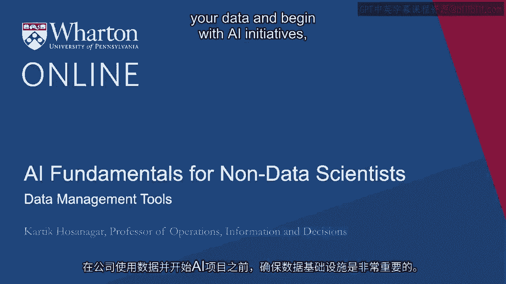
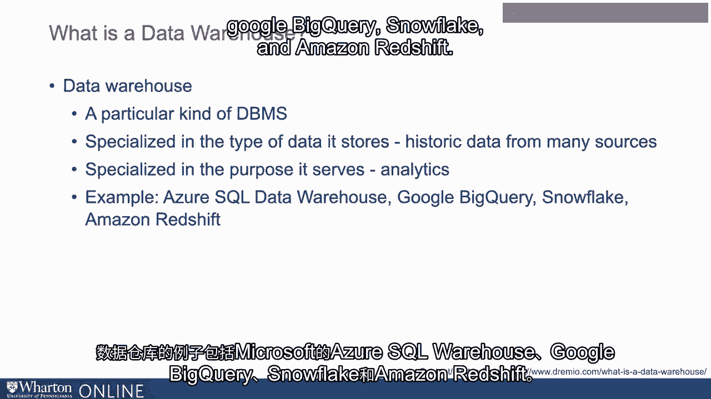
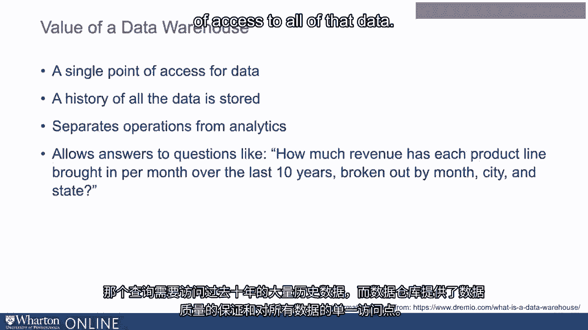
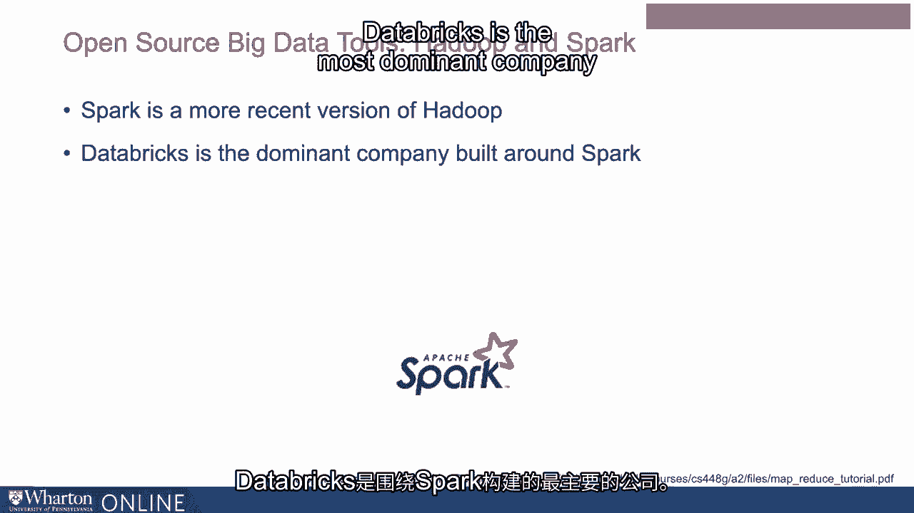

# 5：数据管理工具 🗃️

在本节课中，我们将学习企业在启动AI项目前必须建立的数据基础设施。我们将重点介绍数据仓库和大数据工具的核心概念、工作原理及其价值。

---

## 数据仓库：企业的数据中枢 🏛️

上一节我们提到了数据基础设施的重要性，本节中我们来看看数据仓库。很多人可能熟悉数据库的概念。数据库是一个结构化的数据集合。例如，Excel电子表格就可以被视为一种数据库。

在实际操作中，我们通常需要更专业的工具来管理数据。数据库管理系统（DBMS）是允许用户更好地访问和管理数据库的系统。Excel提供了一些简单功能，而来自微软、Oracle等公司的更先进数据库系统能帮助企业更好地管理数据。有时，我们也简单地称DBMS为数据库。

数据仓库是一种特定类型的DBMS，它在两个方面具有专业性：
1.  它在存储的数据类型上是专业化的，通常是来自企业多个来源的历史数据。
2.  它在服务目的上是专业化的，即服务于分析。

普通数据库可能服务于操作。例如，当银行客户登录网站查看账户信息时，他们是在与一个操作数据库交互，该数据库能快速响应查询（如当前余额）。相比之下，分析需要访问公司可能拥有的所有或大部分数据，其目的通常不是追求极致的速度，而是能够提供更全面、全局的数据视图。数据仓库就服务于这个目的，它不一定是最快的数据库，但专门用于分析功能。

以下是常见的数据仓库产品示例：
*   微软 Azure SQL 数据仓库
*   Google BigQuery
*   Snowflake
*   Amazon Redshift

---

## 数据仓库的工作原理 ⚙️

了解了数据仓库是什么之后，我们来看看它是如何工作的。在大多数公司，操作数据通常分散存储在许多不同的地方。例如，客户数据可能存储在CRM系统中，合作伙伴和供应链信息可能存储在ERP系统中，而客户账单信息可能存储在另一个独立的数据库中。

如果我们想要一个公司所有数据的统一视图，首先需要将所有数据提取到数据仓库中。ETL工具对此非常有用。ETL代表**提取（Extract）、转换（Transform）、加载（Load）**。

以下是ETL过程的简要说明：
1.  **提取**：从不同的独立数据库（如CRM系统、账单系统）中提取数据。
2.  **转换**：按需对数据进行清洗、整合和格式化。
3.  **加载**：将转换后的数据加载到数据仓库中。

流行的ETL工具包括Informatica、Stitch（现属Talon公司）等提供的工具。数据仓库汇集了来自所有不同来源的数据后，就可以在其上构建报告和数据可视化工具。例如，Tableau这样的商业智能工具就位于数据仓库之上。当分析师输入查询时，这些系统可以访问数据仓库并提取必要的信息。

---

## 数据仓库的核心价值 💎

上一节我们介绍了数据仓库如何工作，本节中我们来总结它的核心价值。数据仓库的主要价值在于它作为公司所有数据的**单一访问点**和**中心枢纽**，并且存储所有数据的**历史记录**。

数据仓库帮助将**操作**与**分析**分离。操作数据库追求速度以快速响应用户请求；而分析查询则需要更全面的访问、历史数据以及数据质量保障。例如，如果分析师想查询“过去10年各产品线按月、按城市和州的收入情况”，这样的查询需要访问大量历史数据。数据仓库提供了数据质量保障和关于所有这些数据的单一访问点。

---

## 大数据工具：Hadoop与Spark 🚀

作为数据基础设施的一部分，除了数据仓库，我们还应该了解Hadoop和Spark这样的大数据工具。这类工具有两个主要目的：**存储**和**处理**。

存储大数据面临独特挑战。少量数据可以存储在单台计算机上，但像过去10年数亿客户的数据这样的海量数据，则无法存储在单台计算机上。像Hadoop这样的大数据工具的作用之一，就是以**分布式**方式将数据存储在多台计算机（或称节点）上。

接下来，这些系统也会**处理**这些数据。这种处理通常涉及**分布式处理**，即在多个节点间并行进行数据处理和计算，这有助于显著提高速度。

*   **Hadoop**：一个由Apache基金会（提供开源软件的非营利组织）提供的开源工具。其最受欢迎的发行版由Cloudera等公司提供。
*   **Spark**：一个更新的、可视为Hadoop更强大的替代品，它解决了Hadoop过去面临的一些问题。Databricks是围绕Spark构建的主导公司。

---

## 总结 📚

本节课我们一起学习了企业AI项目的基础——数据管理工具。我们首先介绍了**数据仓库**作为一种专门用于分析的数据库管理系统，理解了它的**ETL工作原理**（提取、转换、加载）和作为企业数据**单一真相源**的核心价值。接着，我们探讨了用于海量数据存储与处理的**大数据工具**，如Hadoop和Spark，它们通过分布式架构解决了单机无法处理的问题。掌握这些工具是构建稳健数据基础设施、进而成功开展AI项目的重要前提。