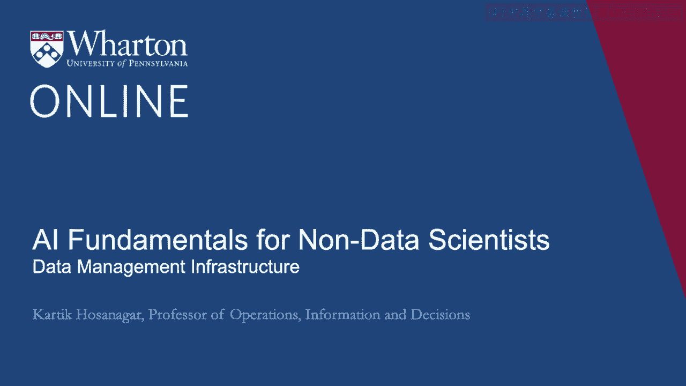

# 6：数据管理基础设施 🗄️

在本节课中，我们将要学习数据管理基础设施的核心概念、演变历程以及企业如何构建和利用它来支持业务决策与人工智能转型。

---

## 概述

数据基础设施是企业进行大规模数据分析和AI驱动业务转型的基石。它涉及数据的存储、处理、转换和查询等一系列系统与工具。理解不同类型数据库的作用以及基础设施的演变，对于构建高效的数据平台至关重要。

---

## 数据库的类型：事务型与分析型

上一节我们概述了数据基础设施的重要性，本节中我们来看看企业中最常见的两种数据库类型。

大多数公司最终需要两种主要类型的数据库。

*   **事务型数据库**：这是一个记录关键业务信息、支持日常运营的系统。它需要非常快速，但往往成本较高。
    *   **示例**：银行使用事务型数据库来实时记录和更新客户的账户余额。

*   **分析型数据库**：这是一个用于处理大规模、长时间跨度历史数据的系统。它擅长回答复杂的商业智能问题。
    *   **示例**：银行将历史交易数据转移到分析型数据库中，以便查询“过去五年中有四年余额增长超过10%的客户名单”。

**核心区别**：事务型数据库处理“当下”的业务操作（如 `UPDATE balance SET amount = amount - 100 WHERE account_id = 123`），而分析型数据库分析“过去”以洞察未来。

---

## 数据基础设施的演变

了解了基本数据库类型后，我们来看看支撑这些数据库的基础设施是如何随着数据量的爆炸式增长而演变的。

最初，企业需要购买昂贵的专用硬件和软件来搭建分析数据库（数据仓库）。随着数据来源（如移动应用、网站、供应链）的激增，这种方案变得成本高昂且性能不足。

于是，第一次重大演变发生了：

1.  **Hadoop的兴起**：为了解决海量数据处理问题，出现了基于廉价硬件集群的分布式系统，如 **Hadoop**。它提供了一种更具成本效益的方式来存储和处理庞大数据集。
2.  **数据湖的概念**：“数据湖”成为一个术语，指代存储原始、海量数据的存储库。企业使用 **Hadoop** 或其后继者 **Spark** 这样的计算引擎，从湖中提取、转换数据。
    *   **核心概念**：`数据湖 -> (Spark/Hadoop 处理) -> 数据仓库/数据集市`
3.  **数据集市的形成**：处理后的数据常被导入更小、更专注的**数据集市**或传统数据仓库中，以供业务用户快速查询。

**Spark** 是更现代的分布式处理框架，它比 Hadoop MapReduce 速度更快，功能更丰富，常用于数据湖上的计算任务。

---

## 现代解决方案：云数据仓库

上一节我们介绍了基于数据湖的架构，本节中我们来看看当前的主流趋势——云数据仓库如何简化了这一过程。

人们发现，管理分散在数据湖和多个数据集市中的数据非常困难，且常常需要专门的工程团队编写代码。大约十年前，**云数据仓库** 应运而生。

云数据仓库（如 Snowflake, Amazon Redshift, Google BigQuery）重新构想了传统数据仓库。它们结合了 Hadoop 体系的可扩展性（运行在租用的廉价云硬件上）和传统数据仓库的易用性。

**其关键优势包括**：
*   使用标准的 **SQL** 语言进行交互。
*   能够与 **Tableau**、**Looker** 等主流商业智能工具无缝集成。
*   无需管理底层硬件，按需伸缩。

---

## 理想数据平台的组成部分

现在我们已经了解了核心存储与计算系统，一个完整的数据平台还需要哪些关键部件呢？

一个理想的数据平台需要具备以下三个核心组成部分：

以下是构建一个完整数据工作流所需的工具链：

1.  **数据摄取工具**：负责将来自各种来源的数据导入数据平台。
2.  **数据转换与处理工具**：用于将原始数据清洗、聚合、转换为有用的信息。这既包括简单的汇总（如按月度聚合用户行为），也包括复杂的机器学习模型训练与预测。
3.  **查询与可视化引擎**：例如 **Tableau** 或 **Looker**，允许分析团队基于处理后的数据构建仪表盘和报告，回答商业问题。

使用云数据仓库的一个主要好处是，它能让你轻松接入这个标准化的工具生态系统，而无需为特定技术栈（如Hadoop）定制所有工具。

---

## 给管理者的建议：如何开始

在投入大量资源建设基础设施之前，管理者必须明确目标。本节将提供关键的启动建议。

建立数据基础设施是一项重大投资，不应盲目进行。在开始之前，管理者应思考以下问题：

以下是启动数据基础设施项目前必须厘清的三个关键点：

*   **以问题为导向，而非以技术为导向**：不要为了建平台而建平台。首先思考你希望解决哪些具体的商业问题。
*   **识别高价值问题**：关注那些当前需要人工花费数天时间在Excel中处理的分析任务。这些往往是数据基础设施能带来最大效率提升的“合适候选者”。
*   **聚焦关键数据**：并非所有数据都有用。只收集那些对回答核心商业问题、驱动业务高效运营真正重要的数据。

---

## 总结

本节课中，我们一起学习了数据管理基础设施的完整图景。我们从**事务型**和**分析型**数据库的区别出发，回顾了基础设施从昂贵专有系统到**Hadoop**/**Spark**数据湖架构，再到现代**云数据仓库**的演变历程。我们拆解了一个理想数据平台所需的**摄取、转换、查询**三大部件，并最终强调了以**业务问题为核心**的构建思路。记住，强大的数据基础设施是释放数据价值、实现AI与业务智能化的先决条件。