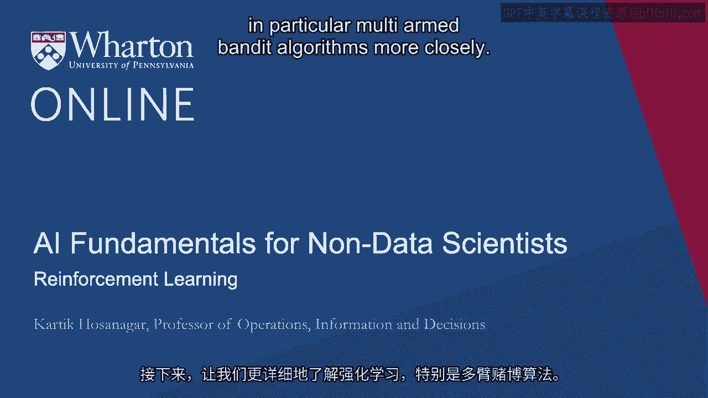
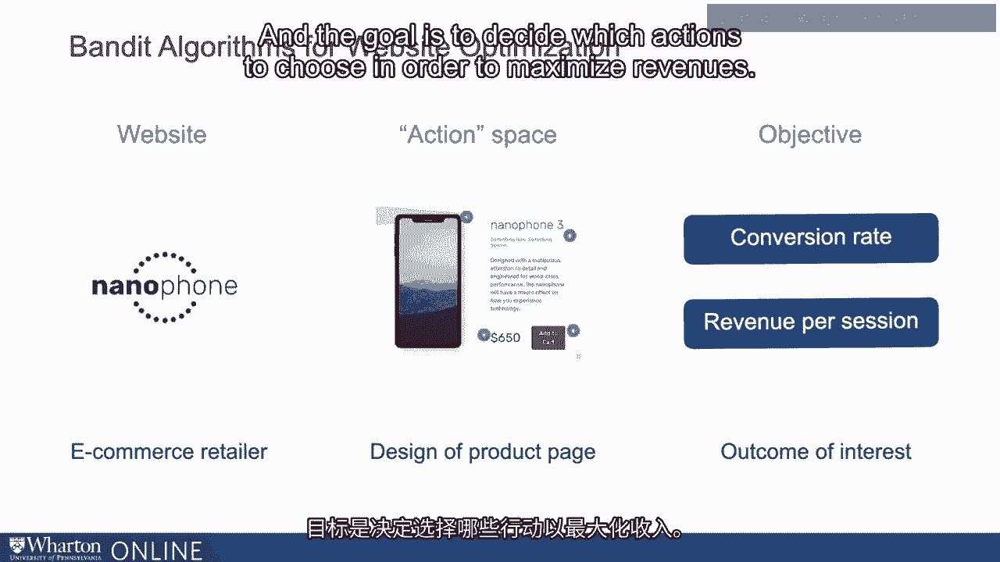
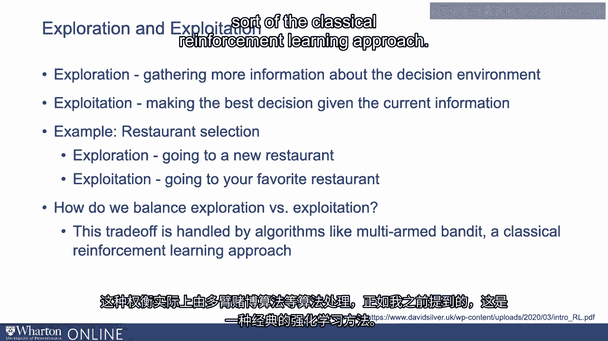
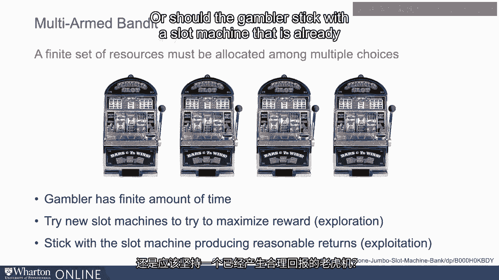
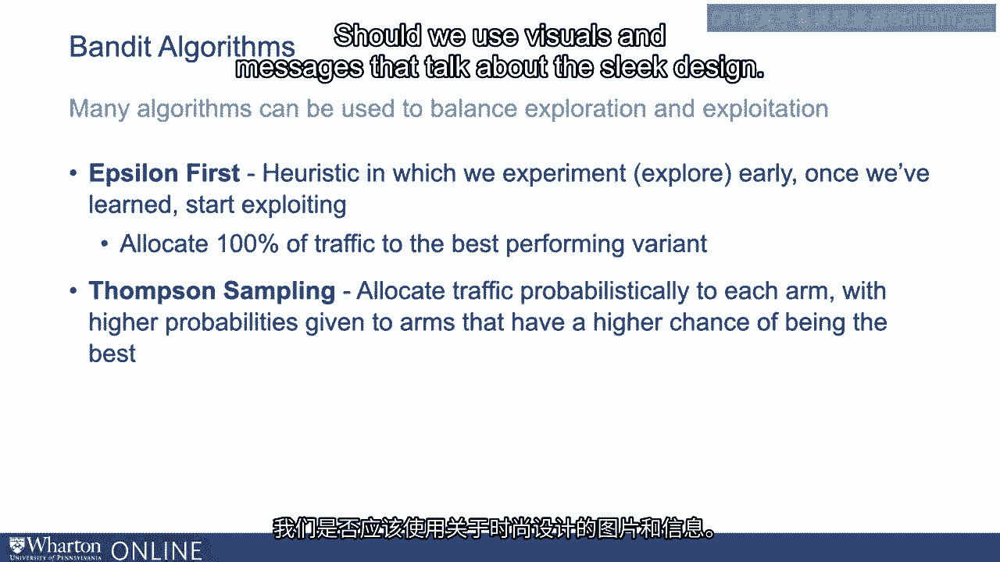
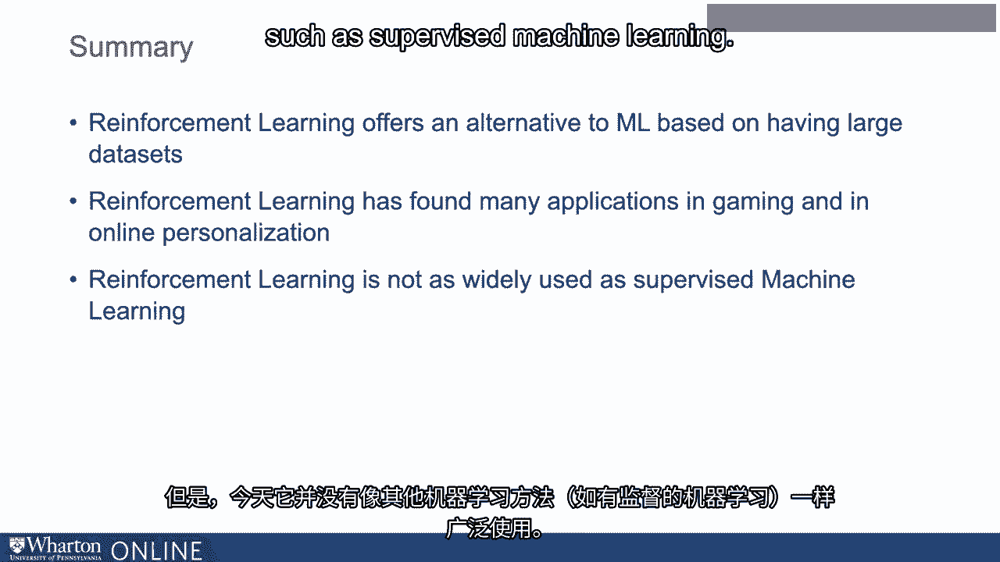

# 10：强化学习与多臂老虎机算法 🎰



在本节课中，我们将学习强化学习的一个核心概念——探索与利用的权衡，并重点介绍多臂老虎机算法。我们将了解该算法如何帮助我们在信息不完全的情况下做出最优决策，例如在个性化推荐或营销策略选择等商业场景中。

---

## 强化学习与决策问题

上一节我们介绍了机器学习的不同范式。本节中，我们来看看强化学习，特别是多臂老虎机算法。这些算法在处理连续数据输入并需要从数据中学习以改善决策时，是一个强大的工具。

考虑以下商业场景：
*   一个新闻媒体网站需要为其用户决定，在成千上万条新闻中展示哪一条在主页顶部。
*   一个名为“Nanophone”的手机电商零售商，当消费者登录网站时，需要做出多种个性化决策。



以下是Nanophone可能需要做出的具体决策列表：
1.  决定向消费者展示10种不同手机图片中的哪一种。
2.  决定向消费者强调哪些产品特性（例如，是关注电池续航还是时尚设计）。
3.  决定向消费者提供哪一种折扣（例如，零折扣、五折或十折）。
4.  在多个“行动号召”按钮中选择使用哪一个。

在这些场景中，行动空间（即可供选择的选项集合）很大。**目标**是选择能最大化收入（或其他关键指标）的行动。

---

## 核心挑战：探索与利用的权衡

这个决策问题的核心在于平衡“探索”与“利用”。

*   **探索**：指收集更多关于决策环境的信息。例如，尝试一个全新的营销信息或网页布局，看看会发生什么。
    *   **公式化表示**：尝试行动 `a_t` 以获取其回报 `R(a_t)` 的未知信息。
*   **利用**：指基于当前已知信息做出最佳决策。例如，坚持使用目前数据表现最好的那个营销信息。



我们在日常生活中也经常面临这种权衡。例如，选择餐厅时，是去一家从未尝试过的新餐厅（探索），还是去你熟知且喜欢的老餐厅（利用）。


对于商业决策而言，核心问题就是：**我们如何平衡探索与利用？** 何时应该尝试全新的方案？何时应该沿用已验证有效的方案？多臂老虎机算法正是为了解决这类权衡问题。

---

## 多臂老虎机问题



多臂老虎机问题描述的是：在拥有固定或有限资源（如时间、尝试次数）的情况下，如何在多个选择之间进行分配。

想象一个赌徒在赌场面对一排老虎机（即“臂”）。赌徒只有有限的时间，只能拉动老虎机杠杆有限次（例如100次）。他必须随时决定：是尝试一台全新的老虎机，还是继续拉动当前看来回报不错的老虎机。**目标**是最大化有限次数内的总收益。

---

## 平衡探索与利用的算法



有许多算法可用于解决多臂老虎机问题，平衡探索与利用。以下是两种常见策略：

**1. Epsilon-优先策略**
这是一种启发式方法。其核心思想是：在早期阶段进行大量探索，收集数据；在后期阶段则转向利用，基于所学知识做出最优决策。
*   **代码逻辑描述**：
    ```python
    if 时间点 < 预设的探索阈值T:
        行动 = 随机从所有可选行动中选择  # 探索阶段
    else:
        行动 = 选择历史平均回报最高的行动  # 利用阶段
    ```
    在Nanophone的例子中，网站可能在最初几周（探索阶段）尝试多种不同的营销信息和图片。之后，便将100%的流量分配给在前几周表现最佳的方案（利用阶段）。

**2. 汤普森采样**
该算法最初会将流量平均分配给所有可能的选项。随着数据不断积累，它会动态调整，使表现更好的选项被选中的概率逐渐增加。
*   **算法直觉**：每个选项都有一个预估的回报概率分布。每次决策时，算法从每个选项的分布中采样一个值，然后选择采样值最高的那个选项。获得真实反馈后，再更新该选项的概率分布。
    对于Nanophone，这意味着最初所有营销方案（如强调电池、设计或应用商店）获得展示的概率相同。如果“强调应用商店”的方案持续产生更好的转化结果，那么它被选中的概率就会稳步提升。

---

## 总结与比较

本节课中，我们一起学习了强化学习中的多臂老虎机问题及其算法。



*   **监督学习**依赖于大型静态数据集进行训练。
*   **强化学习**则依赖更少的初始训练数据，更多地通过在动态环境中实验来学习哪些策略更有效，并增加其使用频率。


强化学习在游戏AI和在线个性化等领域有成功应用。然而，在当前的商业环境中，它的应用广泛性仍不及监督机器学习。鉴于监督学习在商业中的普遍性，我们将在接下来的课程中深入探讨监督机器学习方法。