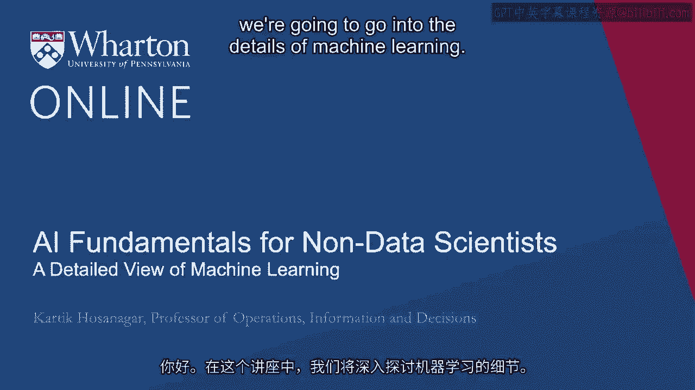
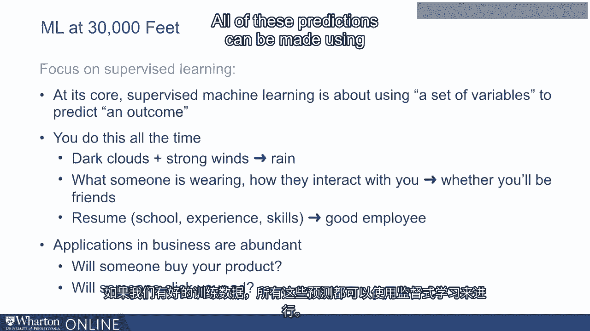
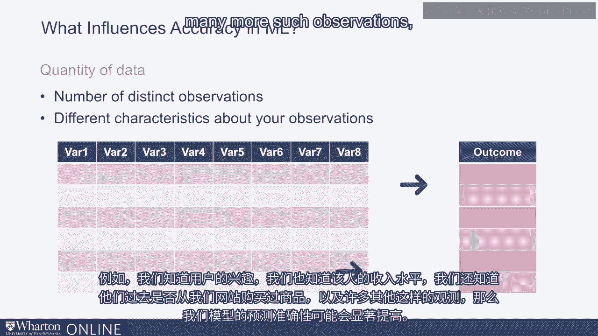
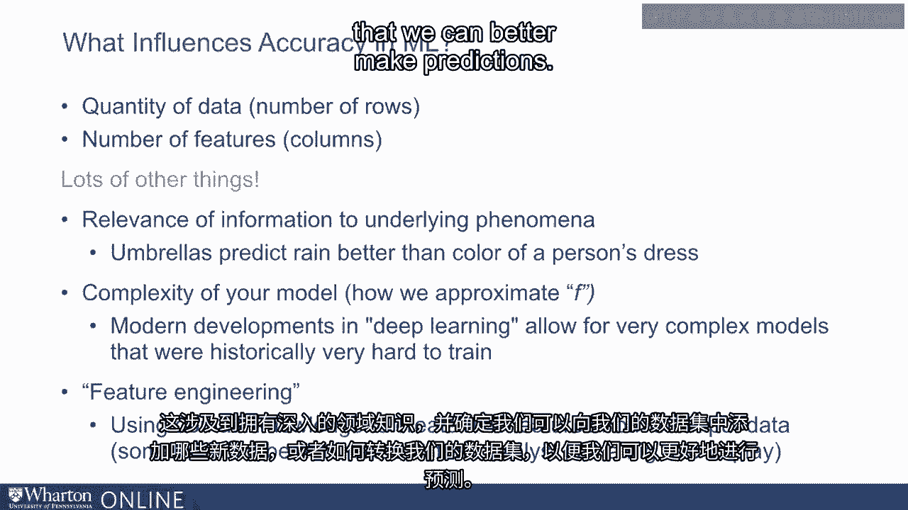

# 11：机器学习详细视图 🧠

在本节课中，我们将深入探讨机器学习的核心概念，特别是监督学习。我们将了解机器学习模型如何工作，以及哪些关键因素决定了其预测的准确性。课程内容将力求简单明了，适合初学者理解。

---

## 概述

机器学习，尤其是监督学习，是当前人工智能商业应用中的主流。本节课将提供一个高层次的视角，解释监督学习的基本原理，并重点分析影响模型预测准确性的核心驱动因素。

---

## 什么是监督学习？

上一节我们概述了课程目标，本节中我们来看看监督学习的具体定义。

监督机器学习处理一组包含输入变量（特征）的数据，目标是预测某个特定的结果变量。这类似于我们日常生活中的预测行为。

以下是几个现实世界的例子：
*   观察乌云和强风，预测可能会下雨。
*   根据一个人的衣着和互动方式，推测是否能成为好朋友。
*   在职场中，依据教育背景、工作经验和技能，预测一个人是否会成功。

这些预测在商业中有着广泛的应用，例如预测客户是否会购买产品、是否会点击广告等。只要有良好的训练数据，所有这些预测都可以通过监督学习来实现。

---

## 一个预测示例

理解了监督学习的定义后，本节我们通过一个具体例子来加深理解。

假设我们拥有用户访问网站的数据。我们试图预测该用户最终是否会购买产品。

我们拥有的数据（即输入特征）可能包括：
*   用户过去浏览的页面数量。
*   根据IP地址获得的邮政编码。
*   用户访问网站所使用的设备类型。
*   设备所使用的操作系统。

我们试图预测的结果（即输出变量）是：该用户**会购买**或**不会购买**。

在机器学习中，我们通常用字母 **X** 表示输入变量（特征），用字母 **Y** 表示我们想要预测的输出变量（结果）。

因此，整个预测问题可以归结为：给定输入 **X**，我们试图预测 **Y**。也就是说，我们需要找到一个函数 **F**，使得 **Y ≈ F(X)**。监督机器学习的核心任务，就是找到一个能高精度近似这个函数 **F** 的模型，从而在给定输入 **X** 时，尽可能准确地预测 **Y**。

---

## 预测准确性的驱动因素

我们已经了解了监督学习的目标是做出准确预测。那么，是什么决定了模型的预测准确性呢？本节我们将探讨几个关键因素。

预测准确性衡量的是预测值与真实情况的接近程度。例如，模型做了100次预测，其中93次正确，那么准确率就是93%。我们希望这个准确率尽可能高。

以下是影响模型预测准确性的几个主要驱动因素：

### 1. 数据的数量（行数）
数据量指的是我们拥有多少条独立的观测数据。例如，如果只有100个历史用户的数据，我们很难对未来用户做出准确预测。相反，如果拥有100万用户的数据，更多的观测样本通常会显著提升模型的准确性。

### 2. 数据的丰富度（列数/特征数）
这指的是我们对每条观测（每个用户）了解多少信息。在之前的例子中，我们只知道用户的浏览页面数、操作系统和位置。如果我们能获得更多特征，如用户的兴趣、收入水平、历史购物记录等，模型的预测能力可能会大幅增强。

**简单来说，驱动模型准确性的两个基础因素是：数据点的数量（行数）和特征的数量（列数）。**

### 3. 数据的相关性
并非所有数据都有用。数据的相关性至关重要。例如，预测今天是否会下雨时，“今天带伞的人数”这个特征可能比“人们衣服的颜色”更有用。拥有更多相关数据能有效提升模型性能。

### 4. 模型的复杂性
如果我们限制自己使用非常简单的模型，它可能无法捕捉数据中复杂的潜在关系。一些更现代的机器学习方法（如后续课程会讲到的深度学习）能够建立更灵活、更复杂的输入与输出之间的关系，从而提高预测准确性。

### 5. 特征工程
这是指数据分析师利用其领域知识，从现有数据中创造新的、更有预测力的特征。这需要深厚的专业知识，以识别可以添加到数据集中的新数据，或如何转换现有数据以更好地进行预测。

---

## 总结

本节课我们一起学习了机器学习的详细视图，重点聚焦于监督学习。

我们了解到，监督学习的核心是找到一个函数 **F**，来近似描述从输入特征 **X** 到输出结果 **Y** 的映射关系。模型的成功取决于多个因素，包括数据的数量与质量（行和列）、特征的相关性、模型的复杂度以及特征工程的能力。一切始于拥有高质量且足量的数据。

在下次讲座中，我们将讨论一些具体的机器学习算法，以便让你更深入地理解这些算法究竟是如何工作的。