# 12：具体的机器学习方法深度潜水 🧠

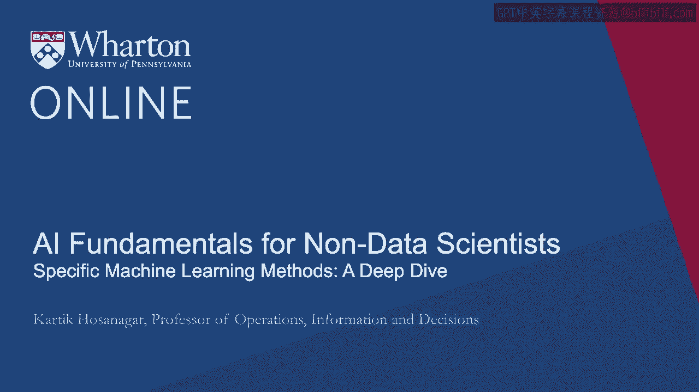

在本节课中，我们将深入探讨几种核心的机器学习模型，了解它们的基本工作原理。我们将从逻辑回归开始，逐步介绍决策树、随机森林和神经网络。这些模型是数据科学家工具箱中的重要工具，理解它们将帮助你更好地与数据团队协作。

请注意，本次课程内容可能比其他课程更具技术性。如果你没有数据分析背景，可能觉得有些部分难以理解。这没关系，即使只获得对这些模型的高层次定性理解，在与数据科学家交流时也会非常有帮助。当然，如果你能理解细节，将更有益处。

---

## 逻辑回归：二元分类的基础

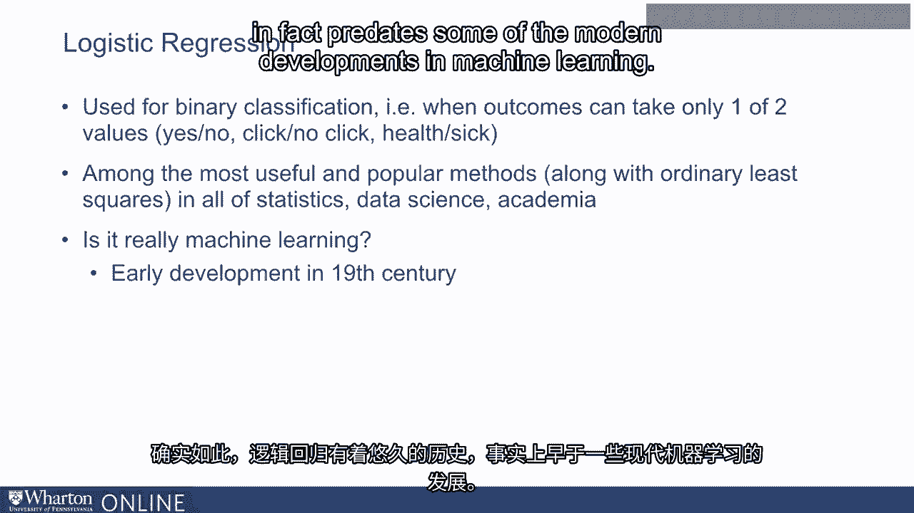

上一节我们概述了机器学习的目标是找到一个函数 `f(x)` 来预测结果 `y`。本节中，我们来看看逻辑回归，这是最简单且最流行的分类模型之一。

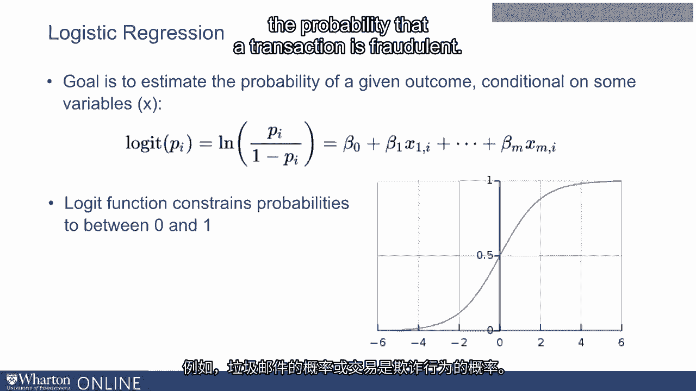

逻辑回归适用于结果变量 `y` 只能取少数几个值（尤其是两个值）的分类问题。例如，预测一封电子邮件是否为垃圾邮件，或一个用户是否会点击广告。虽然它起源于19世纪，并长期用于统计学，但它无疑是现代数据科学中一项至关重要的技术。

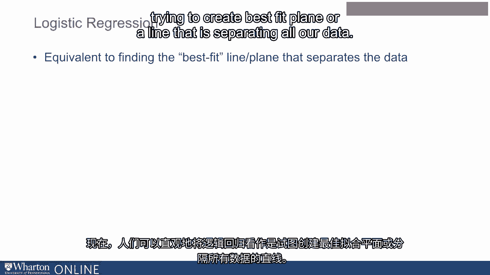

逻辑回归的核心是预测某个事件发生的概率。给定一组输入变量 `x1, x2, x3...`，它试图计算事件（如“是垃圾邮件”）的概率 `P`。

其核心公式是 **logit 函数**：

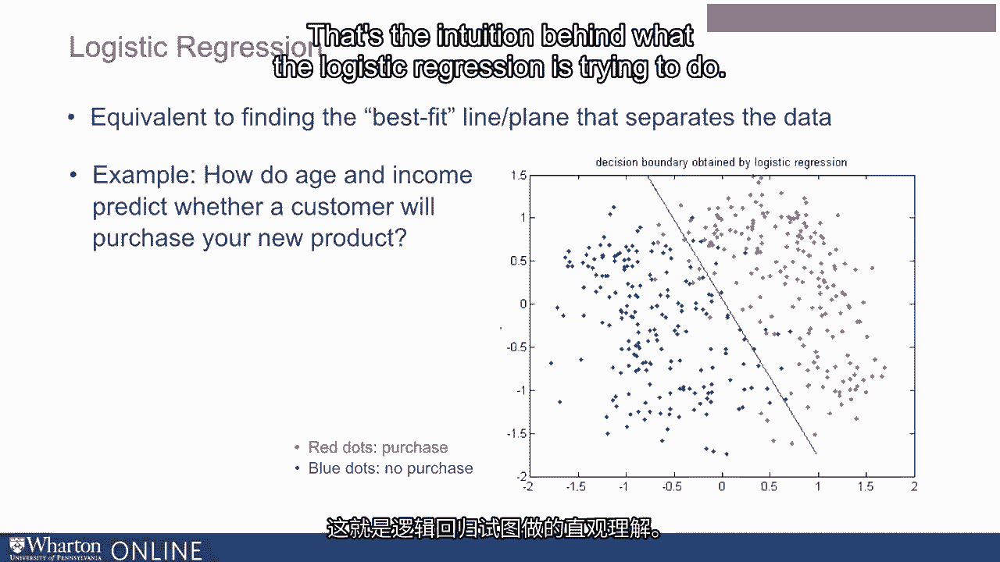

```
log( P / (1 - P) ) = β0 + β1*x1 + β2*x2 + ...
```

这个公式表示，事件发生概率的“对数几率”是输入变量的线性组合。模型会学习系数 `β`，以最好地拟合数据。

可以直观地将逻辑回归视为在数据空间中寻找一条**最佳分界线**（在二维中是直线，在高维中是平面），将不同类别的数据点分开。

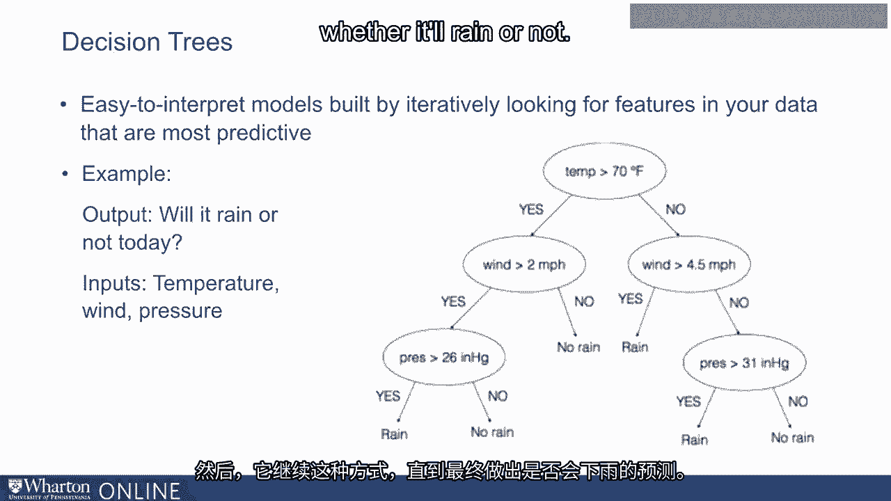

---

## 决策树：基于规则的直观模型

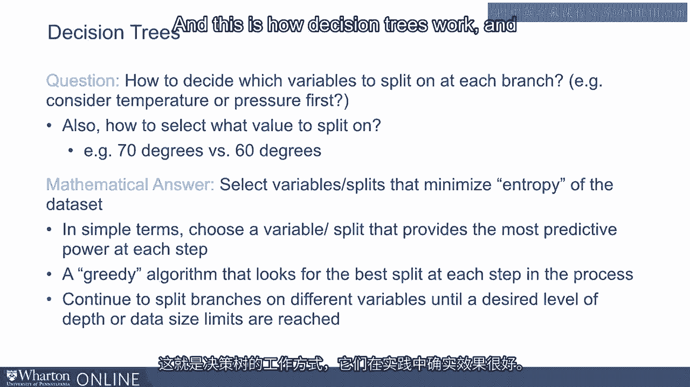

了解了基于线性划分的逻辑回归后，我们来看看另一种思路不同的模型——决策树。这是一种非常直观、易于解释的模型。

决策树通过一系列“是/否”问题，将数据逐步划分到不同的分支中，最终做出预测。它模仿了人类的决策过程。

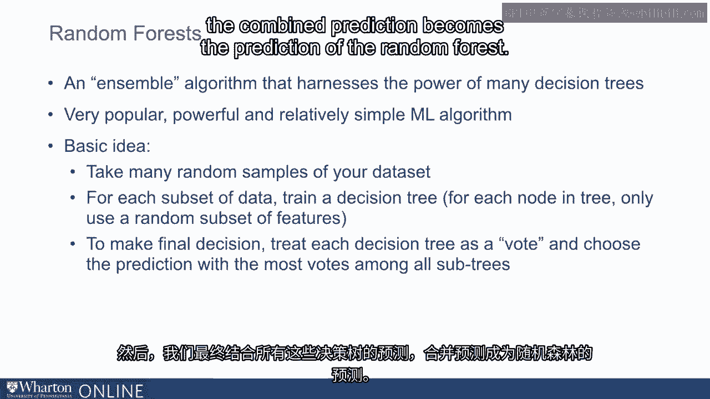

以下是决策树的工作原理：

1.  **选择最佳分裂点**：算法会遍历所有输入变量和所有可能的分裂值（例如，温度是否 > 70°F），寻找一个能最有效地区分不同结果的分裂点。衡量有效性的标准通常是**最小化数据的不纯度或熵**。
2.  **递归分裂**：在每一个新产生的数据子集上，重复步骤1，继续选择最佳变量和分裂值进行划分。
3.  **生成叶节点**：当满足某个停止条件（如节点中数据量过少，或纯度足够高）时，停止分裂。该节点成为一个“叶节点”，并给出最终的预测结果（例如，该分支下的样本有80%的可能性会下雨）。

决策树的优势在于其**可解释性**。你可以清晰地看到模型做出预测所依据的规则路径。

---

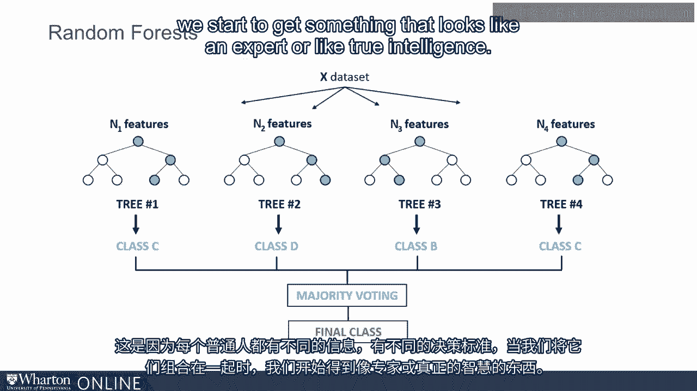

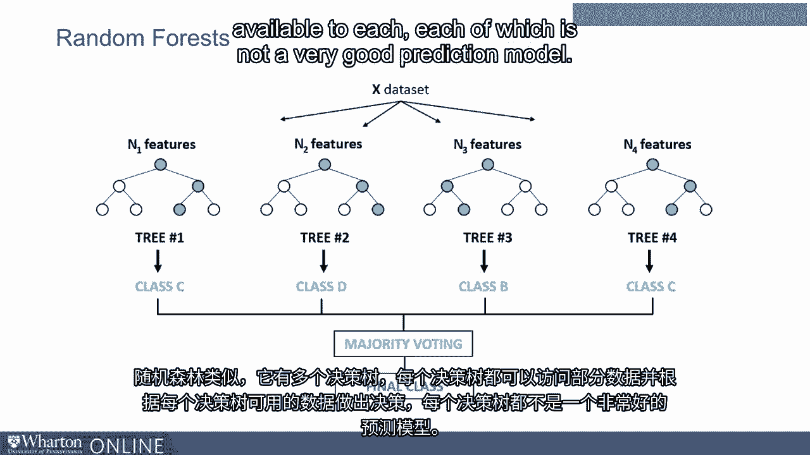

## 随机森林：集成智慧的威力

单一的决策树可能不稳定或容易过拟合。为了解决这个问题，我们可以使用**集成方法**，即结合多个模型的预测。随机森林就是其中最著名的方法之一。

随机森林的基本思想是“三个臭皮匠，顶个诸葛亮”。它通过以下步骤构建：

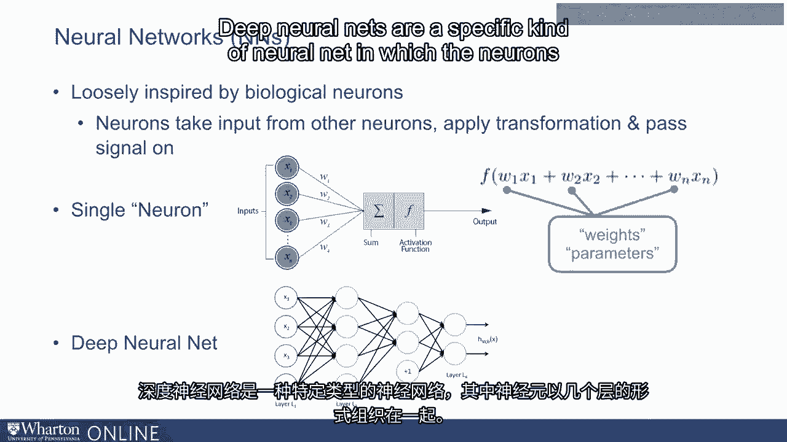

1.  **自助采样**：从原始数据集中有放回地随机抽取多个样本子集（Bootstrap采样）。
2.  **构建多棵树**：为每一个样本子集训练一棵决策树。在构建每棵树时，通常还会随机选取一部分特征作为候选分裂变量，这增加了树之间的差异性。
3.  **聚合结果**：对于一个新的预测样本，让森林中的每一棵树都给出自己的预测。对于分类问题，最终结果通常采用**投票法**（多数票胜出）；对于回归问题，则采用**平均法**。

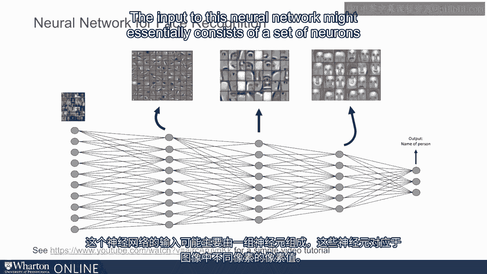

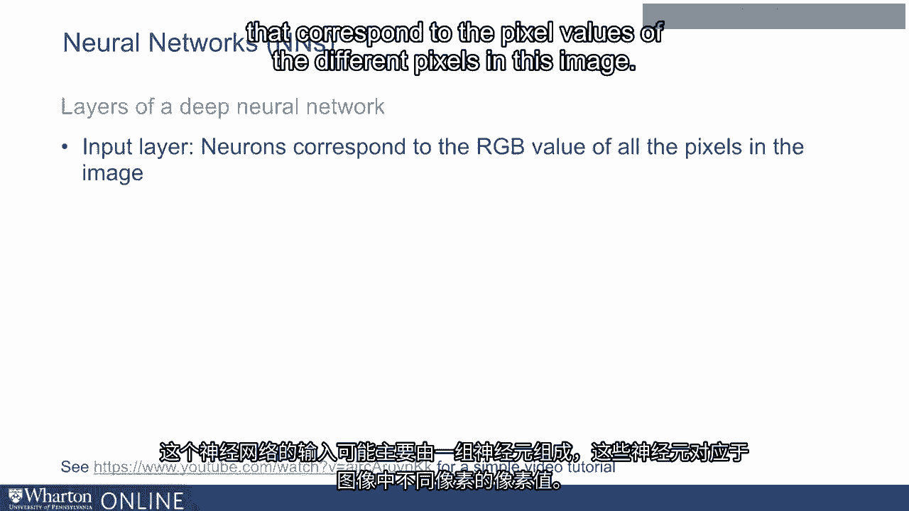

虽然森林中的每一棵单树可能只基于部分数据和部分特征，预测能力不强，但将它们的结果结合起来后，往往能产生比单一决策树（即使在全部数据上训练）更强大、更稳定的预测性能。这体现了“群体智慧”的力量。

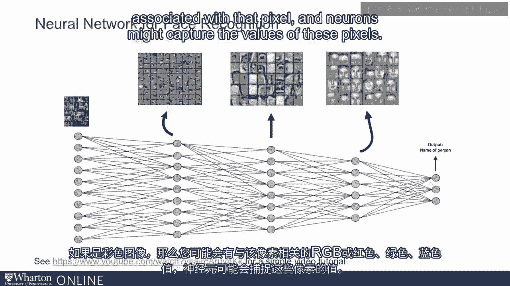

---

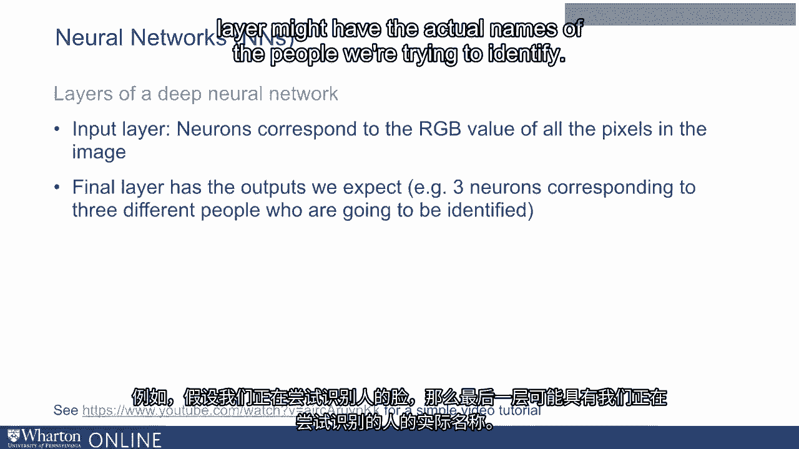

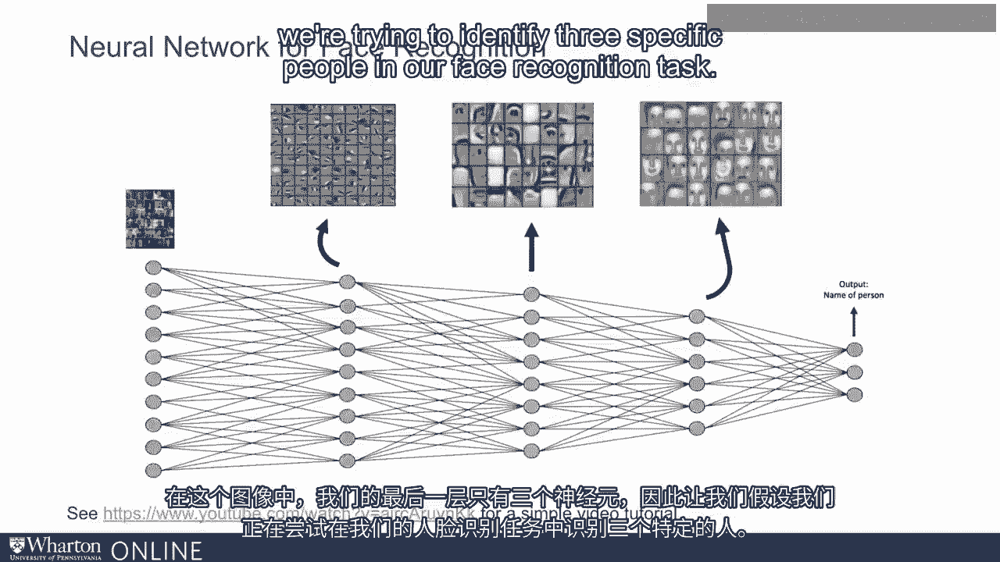

## 神经网络：模仿大脑的复杂模型

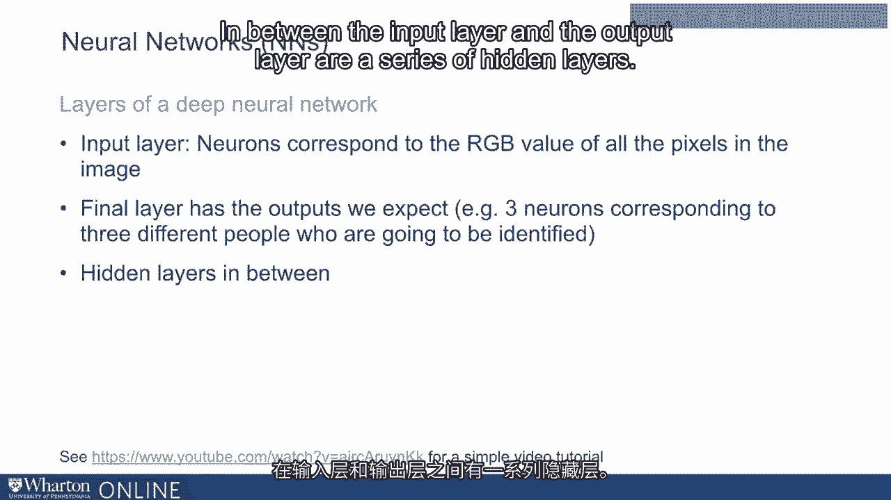

最后，我们探讨一种更复杂、更强大的模型——神经网络，特别是**深度神经网络**。它在处理图像、语音、文本等非结构化数据时表现尤为出色。

神经网络的设计灵感来源于生物大脑中的神经元。一个基本的**人工神经元**接收多个输入信号 `(x1, x2, ..., xn)`，每个信号乘以一个对应的权重 `(w1, w2, ..., wn)`，然后求和并加上一个偏置项 `b`，最后通过一个**激活函数** `f` 产生输出。

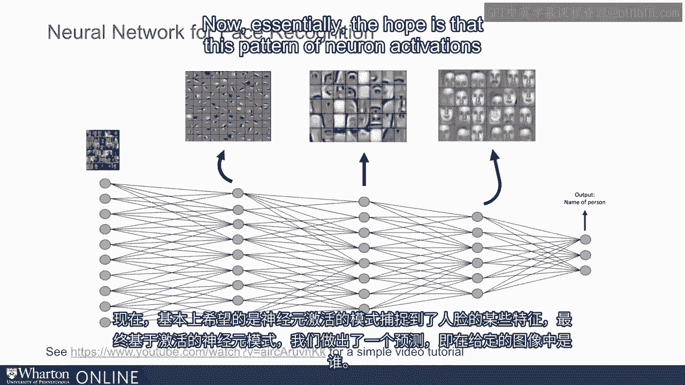

单个神经元的计算可以表示为：
```
输出 = f( w1*x1 + w2*x2 + ... + wn*xn + b )
```

神经网络由大量这样的神经元相互连接而成。**深度神经网络**特指那些包含多个**隐藏层**的网络。

以人脸识别为例：
*   **输入层**：神经元对应图像中每个像素的数值（如RGB值）。
*   **隐藏层**：通过训练，不同层的神经元可能会自动学习到图像的不同特征。例如，第一层可能学习到边缘，第二层学习到眼睛、鼻子等部件，更深层则学习到更复杂的组合模式。
*   **输出层**：神经元对应可能的预测结果（如不同人的名字）。

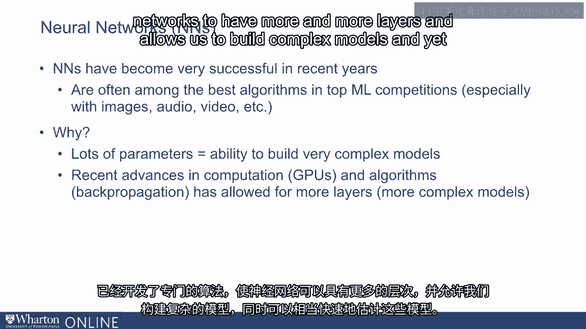

神经网络通过调整网络中数以百万计的权重和偏置参数来学习，其强大的拟合能力使其在许多任务上达到了顶尖水平。然而，这种复杂性也带来了**“黑箱”问题**——我们很难解释神经网络内部究竟是如何做出某个特定决策的，这对其在需要高可信度的场景中的应用提出了挑战。

---

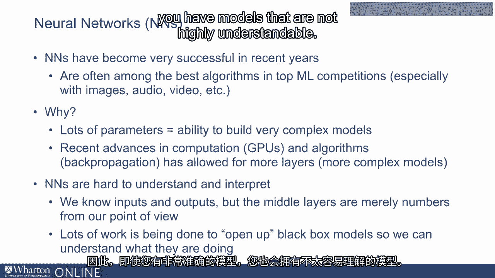

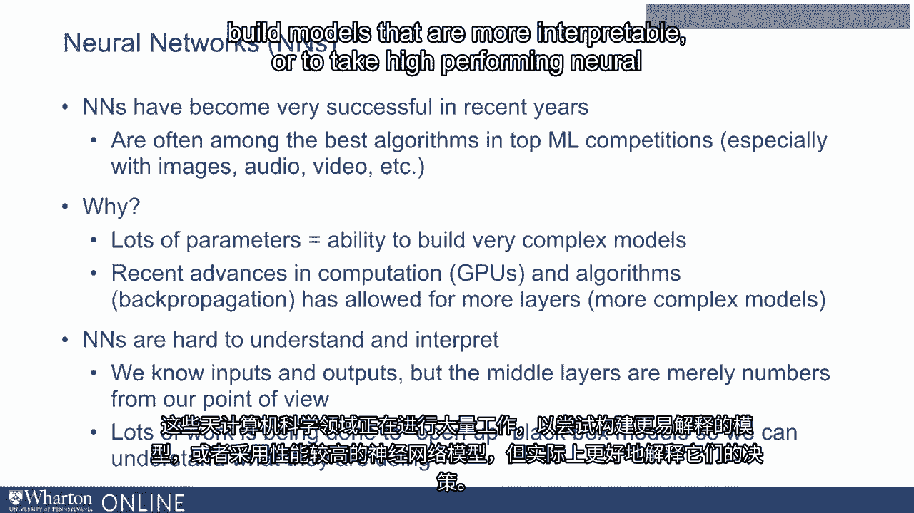

## 总结

本节课我们一起学习了四种重要的机器学习模型：
1.  **逻辑回归**：通过线性函数和logit变换进行概率预测，是二元分类的基石。
2.  **决策树**：使用树形结构和一系列规则进行预测，具有极佳的可解释性。
3.  **随机森林**：集成多个决策树，通过投票或平均来提升预测的准确性和稳定性。
4.  **神经网络**：模仿生物神经元结构，通过多层非线性变换学习复杂模式，尤其在非结构化数据上威力强大，但可解释性较差。

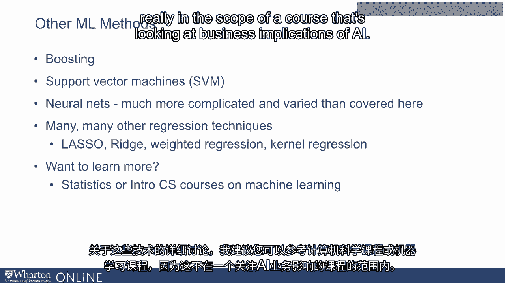

这些技术远未涵盖机器学习的全部领域（例如还有支持向量机、梯度提升等），但它们为你理解机器学习如何工作提供了坚实的基础。记住，没有一种模型在所有情况下都是最好的，选择哪种模型取决于具体的问题、数据以及对可解释性的要求。