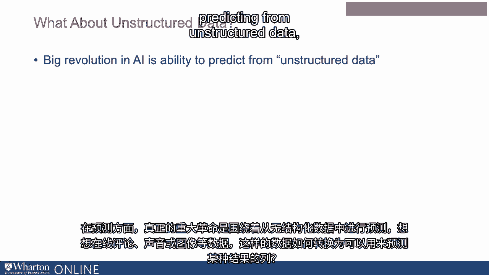
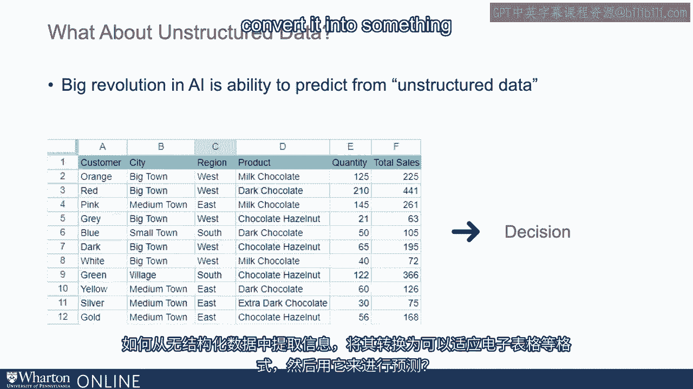
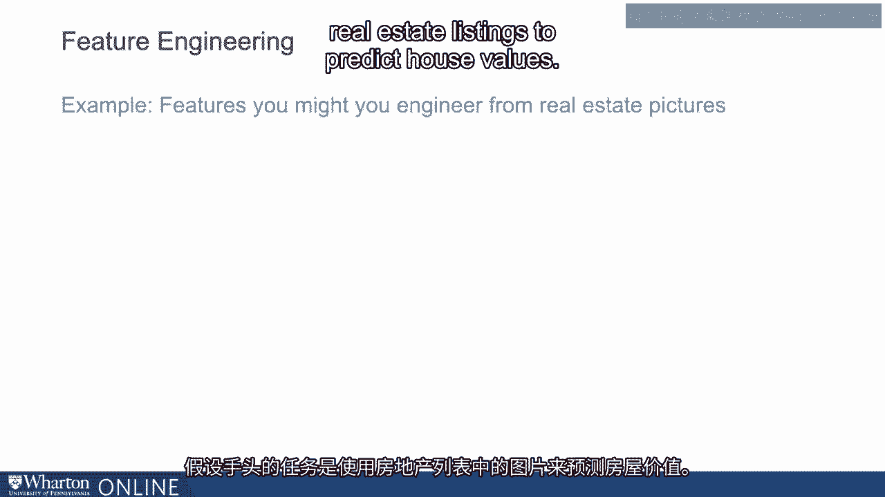
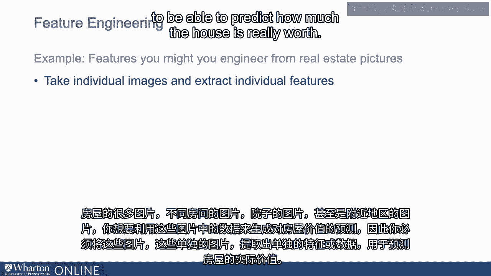
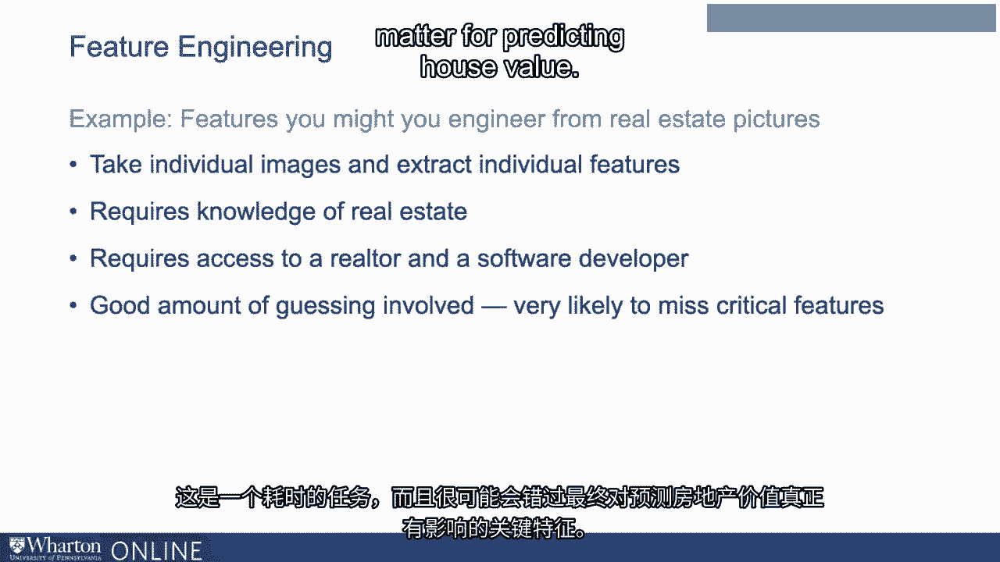

# 14：特征工程与深度学习简介 🧠

在本节课中，我们将学习什么是特征工程，以及深度学习如何解决传统特征工程方法中的一些挑战。我们将从结构化数据与非结构化数据的区别开始，逐步深入到特征工程的具体过程及其难点，最后引出深度学习的基本概念。

---

## 结构化数据与机器学习

上一节我们提到了机器学习算法的目标。给定一组变量，机器学习算法的目标是学习从这些输入变量到算法要预测的输出之间的映射关系。

想象你有一列或几列变量，你正试图用这些变量来预测某种输出。

---

## 非结构化数据的挑战

但是，非结构化数据呢？预测领域的重大革命确实在于从非结构化数据中进行预测。

例如，在线评论、声音或图片。这些数据是如何被转换成可以用于预测某种结果的列的呢？你如何从这些非结构化数据中提取信息，将其转换为例如可以放入电子表格的格式，然后用它来进行预测？

---

## 什么是特征工程？

当数据不是结构化的，比如是在线评论时，你需要经过一个称为**特征工程**的过程。特征必须从数据中构建。这意味着你需要从非结构化数据中提取信息，你基本上是从那些非结构化数据中创建或编码出单个特征。

这是一个耗时且通常相当具有挑战性的过程，通常还需要相当多的领域专业知识。这在许多方面都是机器学习中最困难的部分之一，而这正是数据科学家通常会花费大量时间的地方。这需要在艺术和科学之间取得平衡。

---

## 特征工程实例：预测房屋价值

让我给你举个例子。假设当前的任务是使用房地产列表中的图片来预测房屋价值。

因此，你有很多房子的图片，包括房子的不同房间、院子，也许甚至是该地区的情况。你想利用那张图片中的数据生成对房屋价值的某种预测。

因此，你需要做的是获取这些图像，这些单独的图像，并提取出可能用于预测房屋实际价值的单个特征或变量。

---

### 特征工程所需的专业知识

如果我们提取这些图像并提取你可能关心的特征，当考虑房地产价值时，这将需要多种不同类型的知识。

这不仅仅是软件开发任务，因为你还需要了解房地产经纪人知道哪些重要的事情。你在寻找什么？在房间和布局方面你在寻找什么？在地块和地块风格方面，这些都需要一定的知识组合。

所以，如果你考虑这种情况下的特征工程，它需要房地产经纪人的知识，同时也需要软件开发人员的技能。他们可以合作尝试从图像中提取这些信息。他们可以一起坐下来，讨论写点什么来提取这些图像中可能对预测房屋价值很重要的相关方面。

---

### 特征工程的局限性

但这涉及到相当多的猜测。这是一个耗时的任务。你很可能会错过那些最终对预测房屋价值至关重要的关键特征。

---

## 深度学习的引入

我们接下来要谈的**深度学习**，解决了许多这些问题。

深度学习通过让模型自动从原始数据（如图像、文本）中学习特征表示，减少了对人工特征工程的依赖。模型可以自行发现对预测任务重要的模式和特征。

---

## 总结

本节课中，我们一起学习了特征工程的概念及其在将非结构化数据转换为可用于预测的结构化特征过程中的核心作用。我们通过预测房屋价值的例子，看到了特征工程需要结合领域知识与技术能力，且过程耗时并可能遗漏关键信息。最后，我们了解到深度学习作为一种方法，能够自动学习特征，从而有效应对传统特征工程面临的诸多挑战。