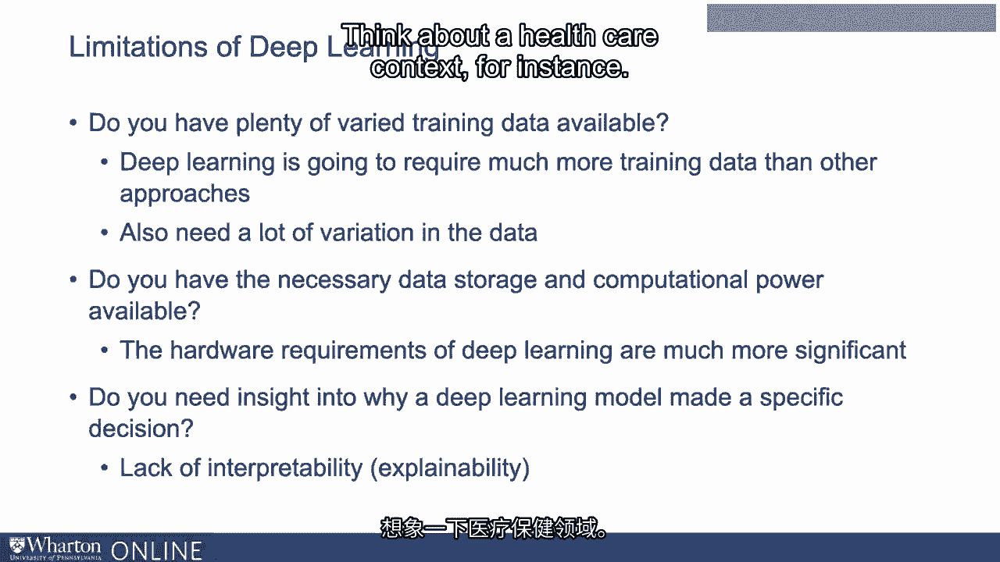

# 17：深度学习的局限性 🧠

在本节课中，我们将探讨深度学习技术虽然强大，但在实际应用中存在的几个关键局限性。理解这些局限性有助于我们判断何时适合使用深度学习，何时应选择其他方法。

---

## 概述

深度学习能够自动学习特征，避免了传统机器学习中繁琐的特征工程步骤，并在许多领域带来了显著的准确性提升。然而，这引出一个问题：我们为什么不总是使用深度学习？它是否存在缺点？接下来，我们将分析三个最重要的局限性。

---

## 1. 对数据规模的依赖 📊

深度学习模型通常需要大量的训练数据才能表现良好。与其他机器学习方法相比，深度学习对数据规模和多样性的要求更高。

以下是深度学习对数据需求高的具体表现：

*   **数据量需求大**：模型需要海量数据来学习有效的特征表示，避免过拟合。
*   **数据多样性要求高**：数据需要覆盖尽可能多的场景和变化，以确保模型的泛化能力。

上一节我们介绍了深度学习对数据量的高要求，这直接引出了下一个相关的挑战。

## 2. 高昂的计算与存储成本 ⚙️

需要处理更多数据，意味着对计算资源和存储空间的需求也大幅增加。

以下是主要的相关成本：

*   **计算能力**：训练深度学习模型（尤其是大型神经网络）需要强大的GPU或TPU进行并行计算，耗时且昂贵。
*   **存储空间**：存储用于训练的海量数据集本身就需要可观的硬件资源。

因此，深度学习的硬件和运维成本远高于许多传统机器学习方法。除了资源消耗，深度学习模型在决策逻辑上也存在一个根本性的挑战。

## 3. 模型的可解释性差 🕵️♂️

第三个关键局限在于模型的可解释性，即我们理解模型为何做出特定决策的难度。在许多关键应用中，了解预测背后的原因至关重要。

在某些情况下，理解决策原因变得尤为重要。例如，在医疗保健领域：

如果模型对患者病情做出判断，向医生或患者解释该判断的依据非常重要。如果医生无法理解算法推荐某种治疗方案的原因，他可能不愿意采纳该建议。同理，在客户信贷审批等场景中，向申请人解释拒贷理由也是必要的。

相比之下，其他更简单的机器学习模型（如决策树或线性回归）的决策过程通常更容易追溯和理解。而深度学习模型像一个“黑箱”，其从输入数据到最终决策的内部逻辑非常复杂，难以清晰阐释。在这种对可解释性要求高的上下文中，深度学习可能并非最佳选择。

---

## 总结

本节课我们一起学习了深度学习的三个主要局限性：
1.  **对大规模、多样化数据的依赖**。
2.  **高昂的计算和存储资源成本**。
3.  **模型决策过程缺乏可解释性**。

认识到这些局限性，能帮助我们在项目初期更好地进行技术选型，权衡深度学习的强大能力与其带来的实际挑战，从而做出更合适的决策。