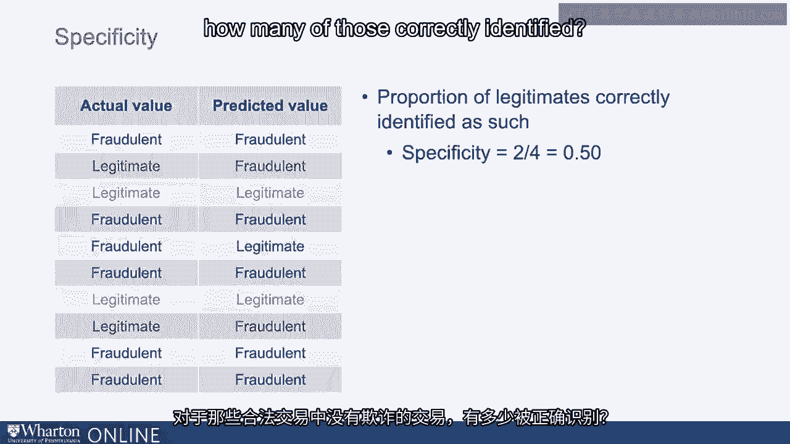
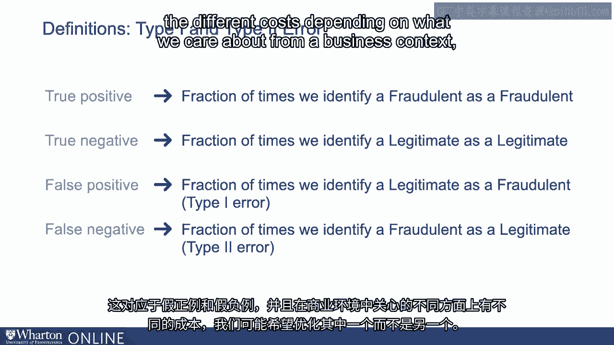
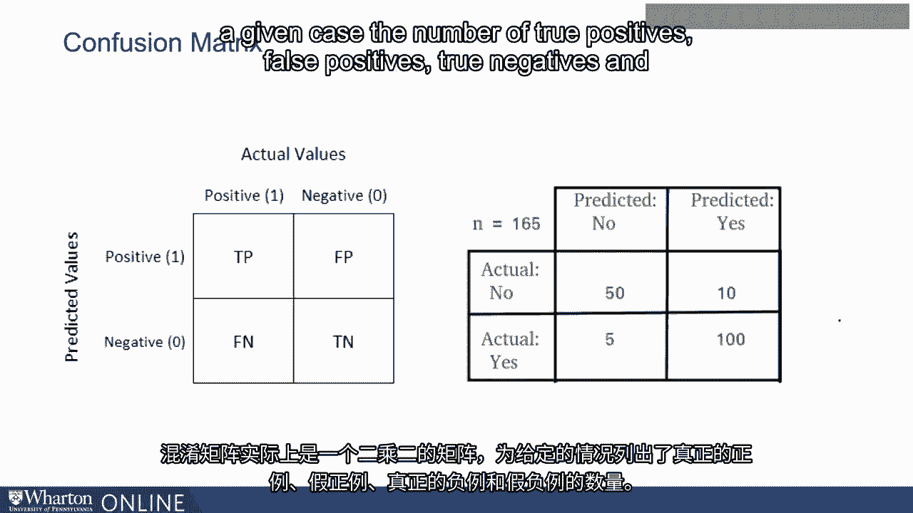
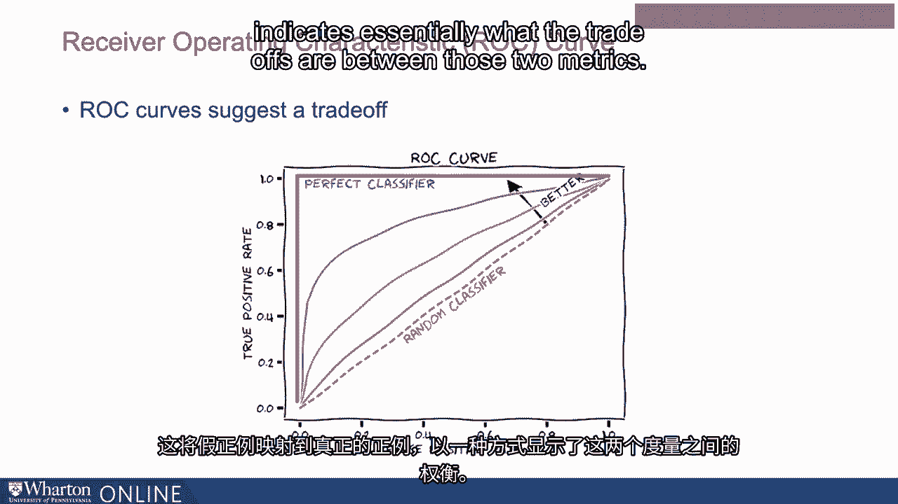

# 19：常见损失函数 📊


在本节课中，我们将学习机器学习中几种常见的损失函数与评估指标。这些指标用于衡量模型预测结果与真实情况之间的差异，帮助我们理解和优化模型性能。

---

## 1️⃣ 准确率与分类错误

上一节我们介绍了损失函数的基本概念，本节中我们来看看最直观的评估指标：准确率。

准确率衡量的是模型预测正确的比例。以一个欺诈交易检测为例，我们有一列真实标签（欺诈/合法），另一列是模型的预测标签。准确率就是这两列标签匹配的次数占总次数的比例。

其公式可以表示为：
```
准确率 = (预测正确的样本数) / (总样本数)
```

分类错误是准确率的逆，即预测错误的比例：
```
分类错误 = 1 - 准确率
```

---

## 2️⃣ 精度、敏感度与特异性

除了准确率，还有其他指标从不同角度评估模型性能。以下是几个关键概念：

**精度** 关注的是模型预测为正类的样本中，真正为正类的比例。例如，在所有被模型预测为“欺诈”的交易中，实际为欺诈的比例。



**敏感度**（或称召回率）关注的是所有实际为正类的样本中，被模型正确预测出来的比例。例如，在所有实际欺诈的交易中，模型成功识别出的比例。

**特异性** 关注的是所有实际为负类的样本中，被模型正确预测为负类的比例。例如，在所有合法交易中，模型正确识别为合法的比例。

这些指标分别强调了预测结果的不同方面，在实际应用中需要根据具体需求进行权衡。

---

## 3️⃣ 真正例、真负例、假阳性与假阴性

为了更精确地讨论模型表现，我们引入以下术语：

- **真正例**：实际为正类，且被模型正确预测为正类。
- **真负例**：实际为负类，且被模型正确预测为负类。
- **假阳性**：实际为负类，但被模型错误预测为正类。
- **假阴性**：实际为正类，但被模型错误预测为负类。

假阳性和假阴性代表了两种不同类型的错误，通常对应不同的业务成本。例如，在欺诈检测中，假阴性（漏掉欺诈交易）可能导致资金损失；而假阳性（误判合法交易）则可能导致客户不满。

---

## 4️⃣ 混淆矩阵与ROC曲线



有多种方式可以可视化上述指标，以便向不同利益相关者传达模型性能。

**混淆矩阵** 是一个二维表格，清晰地列出了真正例、假阳性、真负例和假阴性的数量。



**ROC曲线**（接收者操作特征曲线）则通过绘制真正例率与假阳性率之间的关系，来展示模型在不同阈值下的性能权衡。

---



## 总结

本节课中我们一起学习了机器学习中常见的损失函数与评估指标，包括准确率、精度、敏感度、特异性等。我们还了解了真正例、假阳性等关键概念，以及混淆矩阵和ROC曲线这两种性能可视化工具。理解这些指标有助于我们根据具体业务需求，选择合适的评估标准来优化模型。


在下一个视频中，我们将讨论在什么情况下某些损失函数可能比其他函数更可取。