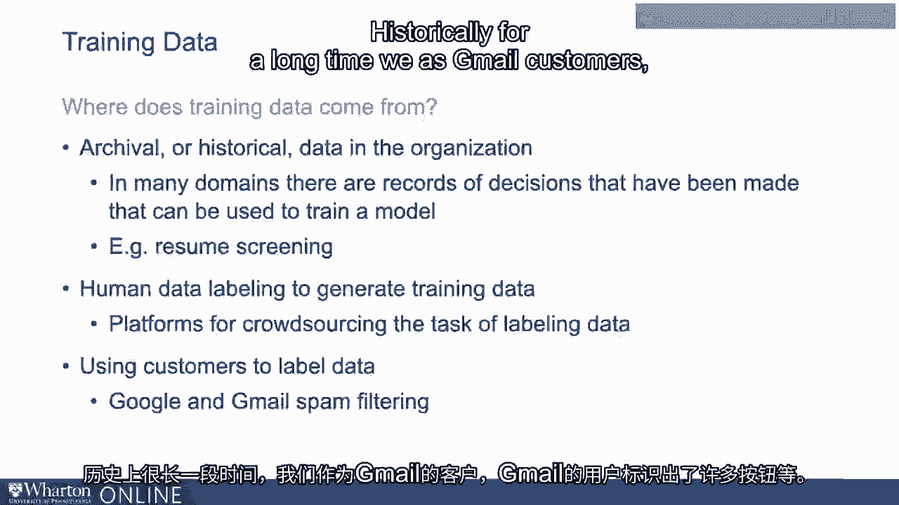
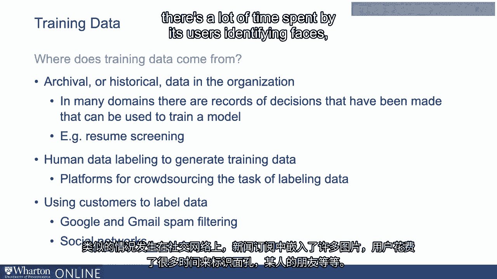

# 21：机器学习训练数据获取指南 📚

在本节课中，我们将要学习机器学习项目中的一个核心环节：如何获取训练数据。训练数据是算法学习输入与正确输出之间映射关系的基础，其来源多种多样。我们将系统地介绍几种常见的获取途径。

## 概述

任何机器学习、深度学习及其应用的关键是训练。模型需要训练数据，因此训练数据是机器学习过程的核心。训练数据是算法用于学习最佳映射关系的数据，包括输入和正确的预测或输出。核心问题是：训练数据从哪里来？

当你构建一个机器学习算法时，你需要获取大量包含输入数据和对应正确决策或预测的数据集。在实践中，训练数据可以来自多个地方。

## 来源一：组织内的档案或历史数据 🗃️

最常见的训练数据来源可能是组织中已经存在的档案或历史数据。在许多业务领域，历史决策记录可用于训练一个模型。

以下是几个具体的应用场景：
*   **简历筛选**：任何收到大量就业申请的组织都会有一个数据库，其中可能包含已提交的简历数据、面试数据、以及最终的招聘决策和员工后续表现。
*   **其他领域**：在财务、会计和运营方面也有类似的应用。这些领域通常都有记录着历史输入和实际决策（如招聘、补货、资产交易）的数据库。

如果这类现成的历史数据不可用，我们就需要考虑其他方法来生成训练数据。

## 来源二：通过众包人工生成数据 👥

有时需要人工来生成训练数据。例如，当你构建一个新的应用程序时，可能需要为你的输入数据添加标注，以便将其用作训练数据。

一个典型的例子是图像分类。假设你有很多图像，并试图识别其中哪些包含花朵。你可以利用专门的众包平台来处理这项任务。

以下是利用众包平台的基本流程：
1.  将成千上万的图像数据上传到平台。
2.  平台上的工作人员会查看这些图像，并进行视觉检查。
3.  他们根据图像是否包含花朵来标记数据。
4.  平台最终返回给你的数据，将是原始图像数据与新增的标签列（指示是否有花）的结合体。

通过这种方式，可以将数据标注工作众包出去，从而高效地获得标注好的训练数据。

## 来源三：利用用户互动生成数据 🤝

第三种常见的方式是直接利用平台用户的行为来生成标注数据。许多知名平台都巧妙地利用用户输入来创建训练标签。

以下是两个经典案例：
*   **Gmail 垃圾邮件过滤**：Gmail 在识别垃圾邮件方面表现出色。其学习方式很大程度上依赖于历史用户行为。长期以来，Gmail 用户通过点击“标记为垃圾邮件”按钮，为系统提供了大量邮件信息以及用户对其是否为垃圾邮件的判断。
*   **社交网络人脸识别**：在社交网络中，用户在识别照片中的面孔、标记好友等方面花费了大量时间。这些互动数据可以被用来构建算法，以自动识别不同的人。

在这些例子中，平台用户通过与产品互动，手动为平台创建了可供使用的训练数据集，平台随后利用这些数据来实施和优化其机器学习算法。

## 总结

本节课我们一起学习了获取机器学习训练数据的三种主要途径。我们首先介绍了利用组织内部现成的**档案或历史数据**，这是最常见且成本较低的方式。接着，我们探讨了当历史数据不足时，如何通过**众包平台**人工生成标注数据。最后，我们了解了如何巧妙设计产品，让**用户互动**本身成为高质量训练数据的来源。理解这些数据获取方法，是成功启动机器学习项目的重要第一步。