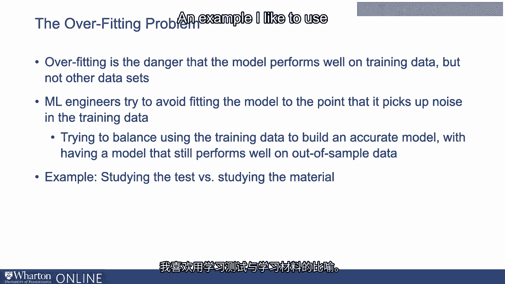
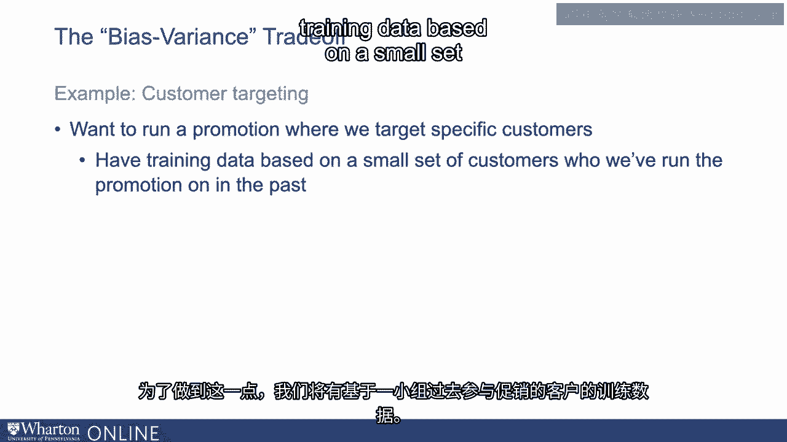
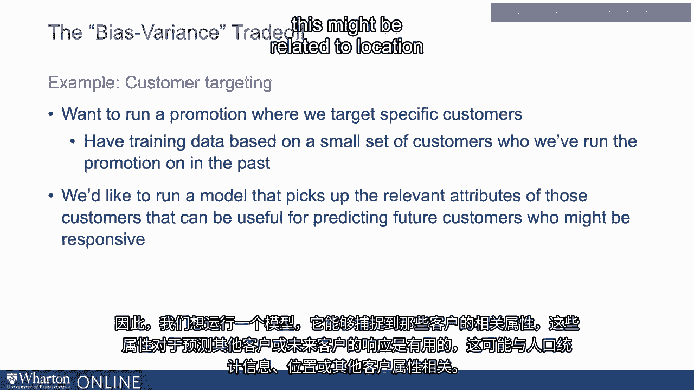
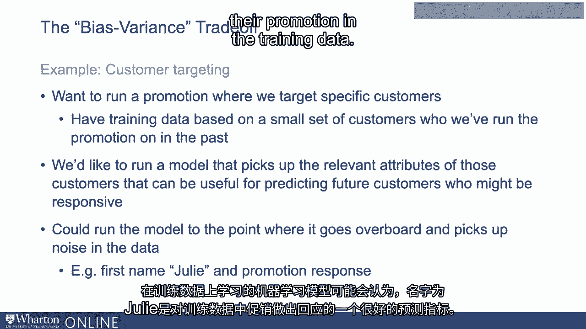

# 22：过拟合问题 🎯

在本节课中，我们将要学习机器学习中的一个核心挑战——过拟合。我们将探讨它的定义、产生原因、带来的问题，并通过一个生动的例子来帮助你理解。理解过拟合是构建有效、泛化能力强的模型的关键一步。

---

## 概述

正如我们所谈到的，算法学习输入数据与输出之间映射的关键在于训练数据。这是算法用来学习输入特征和它应该做出的预测之间关系的数据集。

因此，训练数据是构建算法的关键，但我们真正关心的其实是模型在所谓的“未见数据”上的表现。整个目的在于预测我们尚不知道结果的情况。

## 什么是过拟合？🤔

上一节我们介绍了训练数据的目的，本节中我们来看看过拟合问题。过拟合是一个重要的机器学习挑战。其危险在于，模型在训练数据上表现良好，但当我们将其应用于未见数据或投入生产时，性能会显著下降。

所以，机器学习工程师常常需要处理这个问题。他们试图避免模型拟合到捕捉训练数据中基本噪声的地步。他们不断与过拟合问题作斗争，试图在使用训练数据构建准确模型与保持模型在未见数据上良好表现之间找到平衡。

## 一个生动的类比：学习与应试 📚

我喜欢用的一个例子是“学习测试”与“学习材料”的对比。

想象一下，你正在为考试复习，你有很多做过的样本测试（历史数据）。你可以通过两种方式准备：

以下是两种学习策略：
1.  **理解概念**：你使用旧测试和其他资料来深入理解材料。这样，你获得的知识能够很好地转移到任何新测试中。
2.  **死记硬背**：你反复复习旧测试，以至于能准确记住那些问题的答案。这意味着如果给你完全相同的测试，你会表现得极好。但如果给你一个新测试，那些死记硬背的知识就不会很好地转移。

这与机器学习中的过拟合问题类似。模型不应在独特的层面上过度学习训练数据的细节，以至于这些细节无法转移到其他数据集。

## 实例分析：客户目标营销 🛒

让我们谈谈一个关于客户目标营销的具体例子。假设我们想进行一次促销，针对那些可能购买特定商品的客户。

为此，我们将基于一小组过去参与过促销的客户数据作为训练数据。我们希望利用这些训练数据来了解，未来哪些类型的客户（更大的人群）应该获得那次促销。

所以我们想做的是运行一个模型，挑选出可能对预测客户反应有用的相关属性（如人口统计、位置等）。

或者，我们可以想象模型运行过度，它学习了这个小数据集中客户响应的某些特定方面。例如，简单来说，在训练数据集中，可能所有名为“朱莉”的客户刚好都对那次促销做出了反应。

因此，机器学习模型在训练数据集上学习后，可能会得出一个结论：名字为“朱莉”是预测促销响应的好特征。

但这可能只是训练数据中某个单一客户或一小组客户的巧合特征，并不是适用于更大客户数据集的真实规律。

关键是你需要平衡模型，让它能够挑选训练数据中实际重要的相关信号，并忽略那些不会转移到新数据集的噪音。

## 总结与过渡

本节课中，我们一起学习了过拟合的核心概念。我们了解到，过拟合是指模型在训练数据上表现太好，以至于学习了数据中的噪声和无关细节，从而导致在新数据上表现不佳。处理过拟合是机器学习过程中最重要的挑战之一。

在下一个视频中，我们将讨论**测试数据**在评估模型性能和避免过拟合问题中的关键作用。