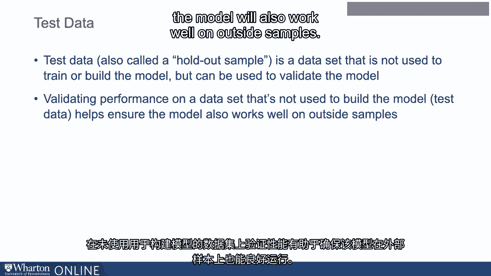
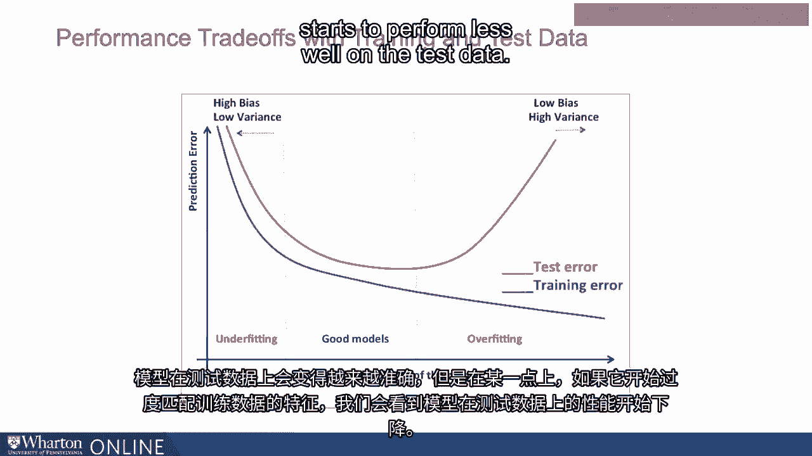
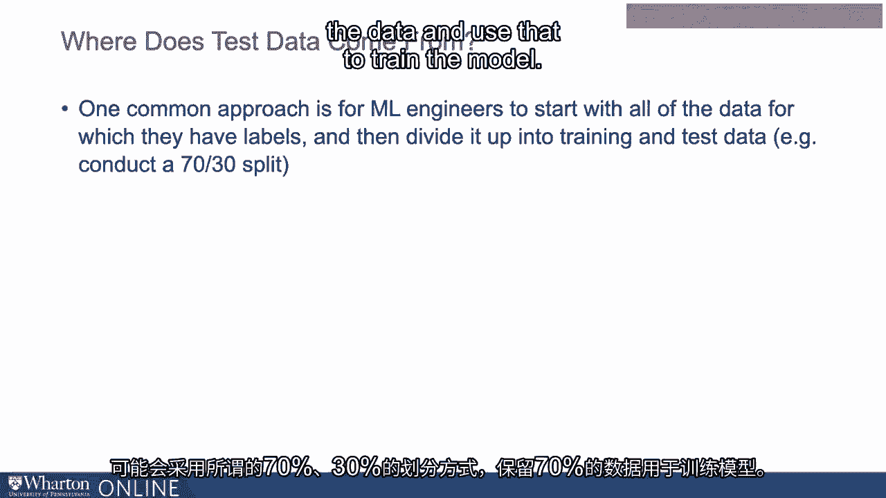
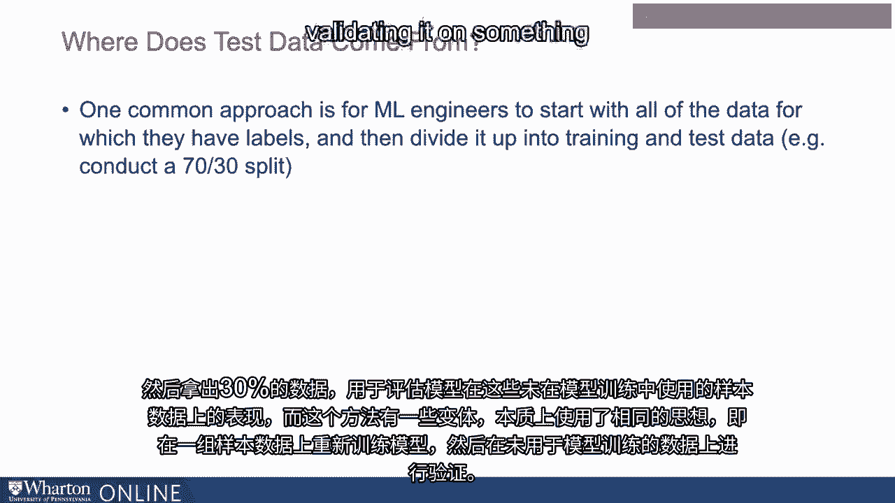
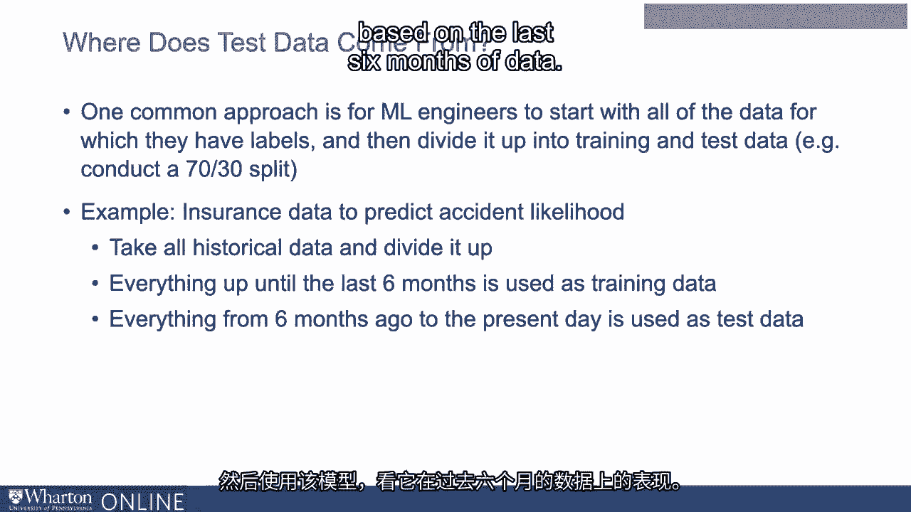

# 23：测试数据 🧪

在本节课中，我们将要学习机器学习中的一个重要概念——测试数据。我们将了解它的定义、作用、来源以及如何利用它来防止模型过拟合，从而确保模型具有良好的泛化能力。

---

## 理解过拟合与测试数据

上一节我们介绍了过拟合问题，理解这个概念很重要。测试数据是工程师用来避免过拟合的工具之一。

测试数据，也称为保留样本，是一个不用于训练或构建模型的数据集。我们用它来验证模型。在未用于构建模型的数据集上验证性能，有助于确保该模型在外部样本上也能很好地工作。

---

## 训练集与测试集

因此，可以考虑拥有两个数据集：训练数据集和测试数据集。我们可以在训练数据上构建模型，模型会在训练数据上越来越准确。它也可能在测试数据上变得越来越准确。

然而在某个时刻，如果模型开始对训练数据中的特定特征拟合得太好，我们就会开始看到偏差，模型在测试数据上的表现会不如之前。

同时拥有这两个数据集有助于我们管理这个过拟合问题。这个问题帮助我们确保模型正在接受的训练，也适用于外部样本。

---

## 测试数据的来源

那么测试数据来自哪里？我们需要一个未用于构建模型的数据集，以便机器学习算法没有从中学习，但我们仍然需要数据中可用的正确答案。我们还需要在测试数据中有这些标签。

以下是机器学习工程师常用的方法：
*   从所有数据开始：他们有一个带有标签的大型数据集。
*   进行数据划分：将这个大数据集简单地分为训练数据和测试数据。

所以你可能会进行所谓的70/30划分，其中保留70%的数据用于训练模型，然后保留30%的数据用于评估，以了解模型在这些外部样本数据上的表现。

这种方法有很多变种，但基本思路相同：你在训练数据（一个数据集）上训练模型，然后在未用于训练模型的数据上验证它。

---

## 实际应用示例

例如，如果你尝试使用保险数据来预测事故发生的可能性（基于客户属性、驾驶特性等），你可以将所有历史事故数据与客户属性和特性一起考虑。

以下是具体操作步骤：
*   划分数据：将最后六个月之前的所有数据用作训练数据。
*   保留测试集：将从六个月前到现在的所有数据用作测试数据。
*   训练与验证：从六个月之前的所有数据中训练模型，然后使用该模型查看它在过去六个月的数据上表现如何。

过去六个月的数据不会用于建立模型，但可以用来验证它在未实际用于建立模型的数据上的表现。在你确信模型在测试数据上表现良好后，就可以将其推广到部署中，以预测未来基于不同客户属性和特征的事故。

---

## 总结

本节课中，我们一起学习了测试数据。我们了解到，测试数据是一个独立的数据集，用于在模型训练后评估其泛化能力，是防止过拟合的关键工具。通过将原始数据划分为训练集和测试集，我们可以更好地监控模型性能，确保其在实际应用中的有效性。