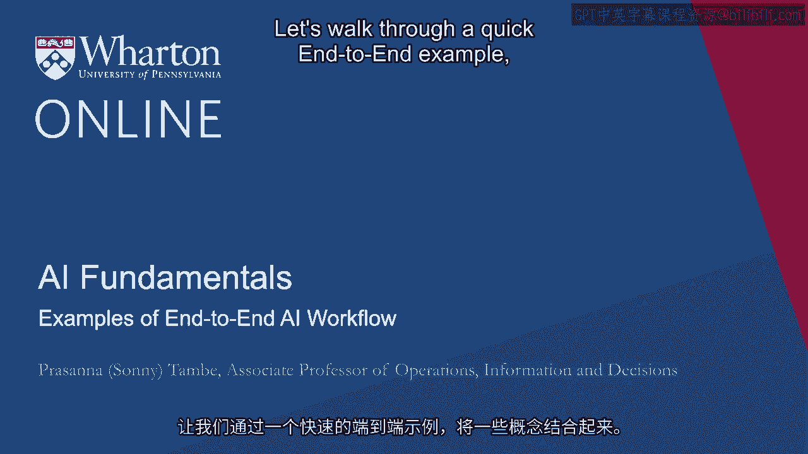
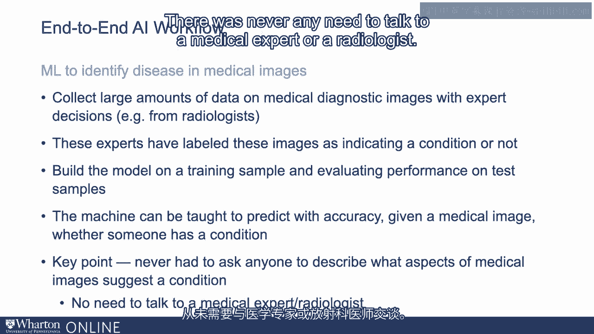
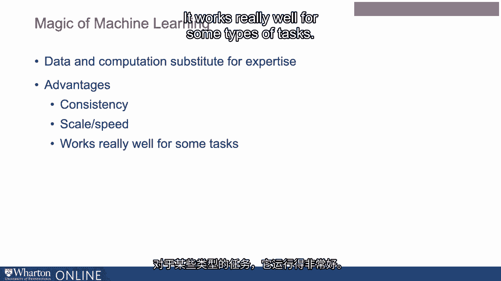

# 24：端到端机器学习工作流程示例 🏥

在本节课中，我们将通过一个具体的医学图像诊断案例，学习如何将机器学习的核心概念串联起来，构建一个完整的端到端工作流程。我们将看到如何从原始数据开始，最终部署一个能够辅助诊断的算法。

---

让我们快速浏览一个端到端示例，将之前学过的概念结合在一起。

我们讨论一个具体案例：使用机器学习，特别是深度学习，来识别医学图像中的特定病症。

第一步是收集大量医学诊断数据。这些数据应包含医学图像以及专家基于这些图像所做的决策。例如，可以设想一个包含大量X光片和相应放射科诊断报告的数据库。因此，前往医院获取这样的数据库是一个良好的起点。这个数据库可能包含数年积累的医学图像和对应的诊断决策，这些决策最终由放射科医生做出，用于判断患者是否需要接受特定治疗。

第二步是注意到，这些专家（即放射科医生）已经对图像进行了标注，指明了患者是否患有某种病症。因此，我们拥有一个结构化的数据库，非常适合进行预测任务：我们既有大量的图像数据，也有大量已做出的诊断决策。

现在，我们可以利用这些数据来构建并评估一个算法。具体做法是获取数据，并将其划分为训练集和测试集。

以下是核心步骤：
1.  **数据划分**：将数据集分为训练样本和测试样本。
2.  **模型训练**：在训练集中，我们将图像数据输入深度学习模型（如神经网络），并将放射科医生提供的诊断标签作为监督信号。模型将通过自我调整参数，学习做出与专家决策最吻合的预测。
3.  **模型评估**：我们使用测试集来验证训练好的算法。这确保了算法不仅在训练数据上表现良好，在未见过的样本外数据上也能保持有效性。

通过以上步骤，我们可以训练机器根据医学图像，以相对较高的准确度预测某人是否患有某种病症。整个过程仅需几个关键步骤：从医院获取结构正确的数据库（包含图像和专家标签），划分数据，用训练数据训练模型，并用测试数据验证其泛化能力。

当模型表现良好时，我们就可以部署这个算法。让它处理新的医学图像，并做出相对准确的预测或诊断建议。

这里的一个关键点是，在整个过程中，我们从未要求任何人坐下来详细描述医学图像的哪些特征暗示了某种病症。我们并不需要那种显性的医学专业知识。专业知识隐含在数据库的标签中，但我们不需要专家解释“某种病症在X光片上具体表现为何种形态，应如何识别”。实际上，我们无需与医疗专家进行深入的规则交流。

这正是机器学习的魔力所在：**数据和计算最终可以替代多种不同类型的显性专业知识**。

以这种方式操作有很多优点，其中之一就是**一致性**。与人类决策相比，算法决策能提供高度一致的输出。无论是一天忙碌结束时还是清晨开始时，算法的判断标准都不会改变。这带来了稳定性。

显然，这也涉及到**规模和速度**的优势。一个训练好的算法能够快速、准确地处理大量决策任务，其能力可以轻松扩展。

这在许多类型的任务中表现得非常出色。

如果一个任务能够按照我们讨论的方式被结构化——即拥有**输入数据**（如图像）和对应的**输出标签**（如诊断）——那么，借助现今强大的深度学习工具，我们可以处理这些带标签的原始非结构化数据，让机器学习算法完成剩下的模式识别工作。

实际上，对于许多问题，构建这样的数据驱动解决方案，可能比与领域专家深入交谈、总结并形式化他们的专业知识规则更为高效。

---

**本节课总结**

在本节课中，我们一起学习了一个完整的端到端机器学习工作流程示例。我们从**数据收集**（医学图像与专家标签）开始，经历了**数据准备与划分**、**模型训练**（使用深度学习网络），再到**模型评估与验证**，最后展望了**模型部署**的优势，如一致性、速度和可扩展性。这个案例清晰地展示了如何利用数据和计算，让机器从示例中学习，从而完成复杂的专业任务。