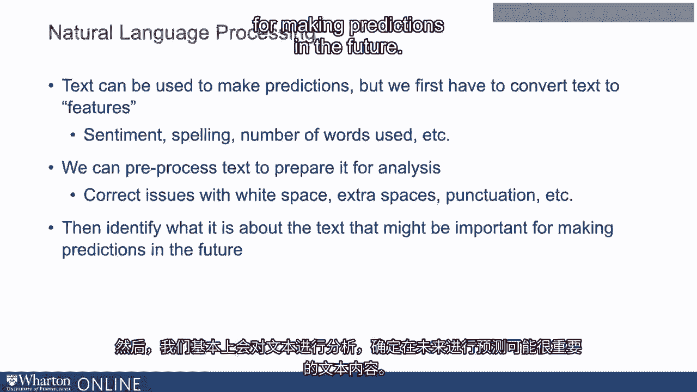
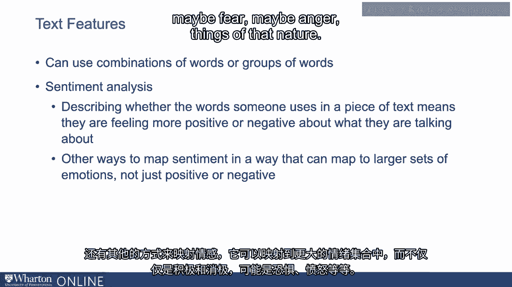
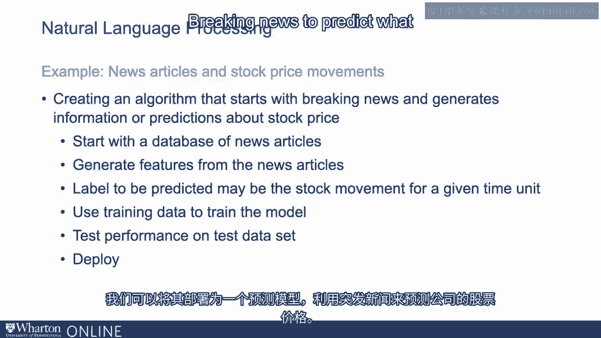
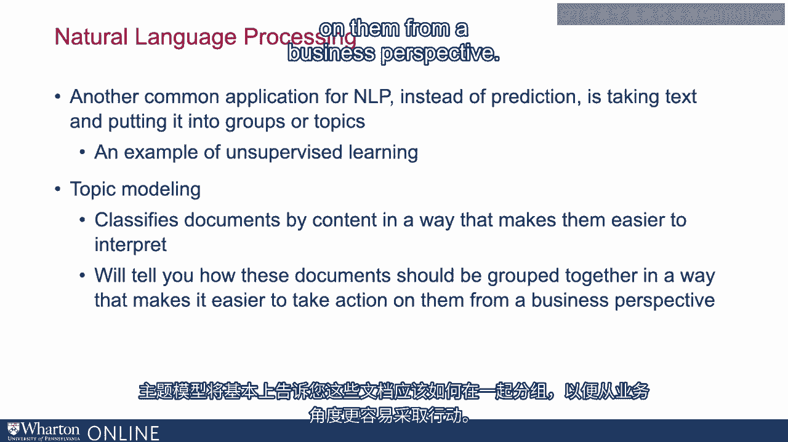

# 25：自然语言处理入门 🗣️➡️🤖

在本节课中，我们将要学习自然语言处理的基本概念及其在商业和数据分析中的应用。我们将了解如何将文本数据转化为可用于预测或分类的特征，并探讨一些实际应用场景。

## 概述

随着文本成为越来越有价值的无结构数据形式，对自然语言处理的关注也日益增多。文本数据可以提供关于市场和商业决策的有价值信号。例如，在线评论可以揭示产品信息和客户反馈，而在线讨论则可能预示金融市场的活动。因此，处理和分析文本数据具有重要的预测价值。

## 从文本到特征

为了利用文本数据进行预测，我们首先需要将文本转换为机器可理解的特征。这意味着我们需要识别文本中对预测或决策至关重要的内容。

将文本转换为特征时，有许多候选项，包括情感、拼写、文本长度以及其中使用的词汇等。

### 文本预处理

我们的做法是首先对文本进行预处理，为后续分析做好准备。预处理可能涉及修正各种问题，例如多余的空格、标点符号错位等。

以下是预处理可能包含的步骤：
*   修正空格和标点问题。
*   将文本转换为统一的格式（如小写）。
*   移除无关字符或停用词。

### 构建文本特征

预处理之后，我们需要识别文本中可能对未来预测重要的内容。文本特征最简单的例子就是单个词汇。

例如，我们可能会统计不同文本中出现的特定单词，并用它来预测结果。对于在线评论，我们可能关注具有特定含义的词，以预测产品销售情况或评论是否有帮助。

选择哪些词以及如何呈现它们，取决于我们的目标。这些词可以是表达情感的词（正面或负面），也可以是关于产品特定方面的词（例如，对于相机评论，可能是“存储”、“镜头”、“电池”等）。

不仅仅是单个单词，我们也可以使用更复杂的特征，例如词的组合（两个或三个单词组成的词组），或者构建整体的情感度量。

## 情感分析

情感分析是从文本中提取或创建特征的最常见示例之一。它旨在描述文本作者所使用的语言所表达的情感倾向。

从在线评论到社交媒体帖子，情感分析可以判断作者对某事物是持积极还是消极态度。情感映射也可以扩展到更复杂的情感集合，如恐惧、愤怒等。

一旦我们从文本中提取了这些特征（如情感倾向、词汇类型、评论长度、拼写或语法质量），它们就能帮助我们预测结果。例如，情感特征可以用来预测购买行为。

## 深度学习与自然语言处理

深度学习为我们处理文本提供了更大的灵活性。它可以更丰富、更有意义地结合文本内容，而不仅仅局限于我们手动编码的有限特征集。

虽然深度学习在方法上更先进，但其概念上的运作方式与传统方法类似：提取语言信息，创建特征，然后用于预测。

## 应用实例：新闻与股价预测

让我们看一个具体的例子：利用突发新闻预测股票价格变动。

想象我们构建一个算法，输入是突发新闻，输出是对股票价格的预测。我们有一个新闻文章数据库，可以从文章中生成特征，如情感倾向、出现的特定词汇（如公司名、国家名、领导人名等）。

假设我们关注特定公司的新闻。我们提取指示对公司积极或消极情绪的特征（例如，提及新产品发布、创新或专利）。我们要预测的标签是该公司在新闻发布后特定时间内的股价变动。

我们利用这些数据（新闻特征和对应的股价变动）来训练一个模型。模型将学习新闻中使用的语言如何影响或预测股价变动。通过训练和测试，我们可以得到一个预测模型，用于根据新的突发新闻来预测公司股价的变化。

## 主题建模

自然语言处理另一个常见的应用是主题建模，这是一种无监督学习方法。其目的不是预测特定标签，而是将大量文本自动分组或分类到不同的主题中。

主题建模是一种处理文档并按内容对其进行分类的方法，使其更易于理解和处理。

例如，如果你有一个包含数百万条消息或电子邮件的大型数据库，你可以使用主题建模将其自动分类为5到10个不同的主题（如商业、科技、娱乐等）。这样，人们就能更容易地根据主题来导航信息、做出决策或采取行动。

以新闻为例，我们可以将每天涌入的成千上万篇文章自动分类到“商业”、“科技”、“科学”、“娱乐”等类别中，极大地方便了消费者查找感兴趣的内容。

## 总结

本节课中，我们一起学习了自然语言处理的核心概念。我们了解到文本数据需要被转化为特征才能用于分析，并探讨了文本预处理、特征构建（如词频、情感分析）的基本步骤。我们还介绍了深度学习为文本处理带来的灵活性，并通过新闻预测股价的例子说明了预测性应用，通过主题建模的例子说明了文本分类应用。自然语言处理是将无结构文本数据转化为可操作见解的强大工具。