# 26：生成对抗网络与变分自编码器 🧠

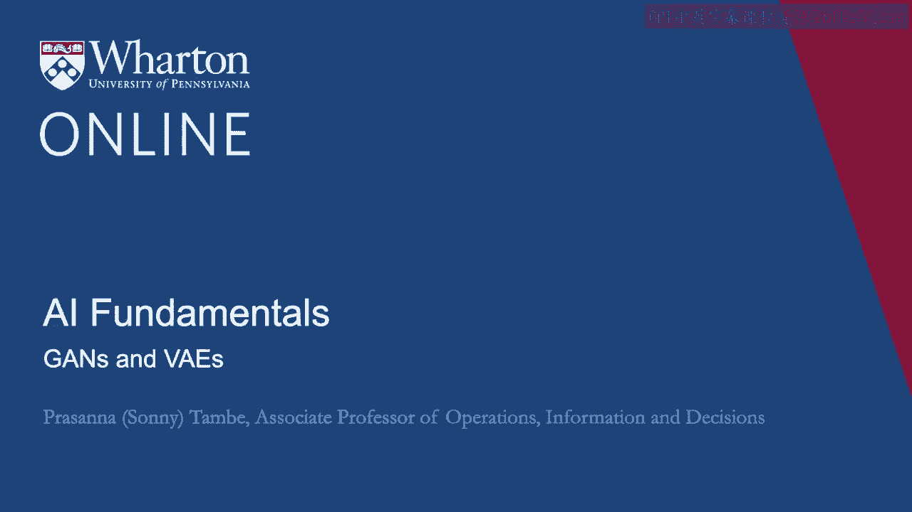

在本节课中，我们将要学习机器学习中一个令人兴奋的领域——生成模型。我们将重点介绍两种重要的生成模型：生成对抗网络和变分自编码器，了解它们的基本原理、工作方式以及实际应用。

---

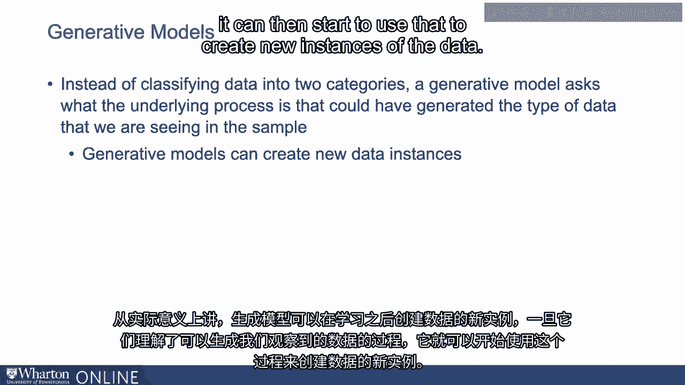

机器学习中最令人兴奋的领域之一就是生成模型。

生成模型变得越来越重要，应用也越来越广泛。我们之前主要讨论的模型基本上是区分两个类别的。它们标记某些东西为真或假，或一或零。这称为判别模型。

生成模型的作用略有不同。与其将数据分类为两个类别，生成模型问的是“数据是如何产生的”。其基本目标是能够生成我们所看到的数据类型。这意味着生成模型可以创建新的数据实例。一旦它们学习并理解了能够生成我们观察到的数据的过程，就可以开始利用这些信息创建新的数据实例。

这变得非常有趣，因为它开始在机器学习和我们所认为的传统人类创造力领域之间模糊界限。

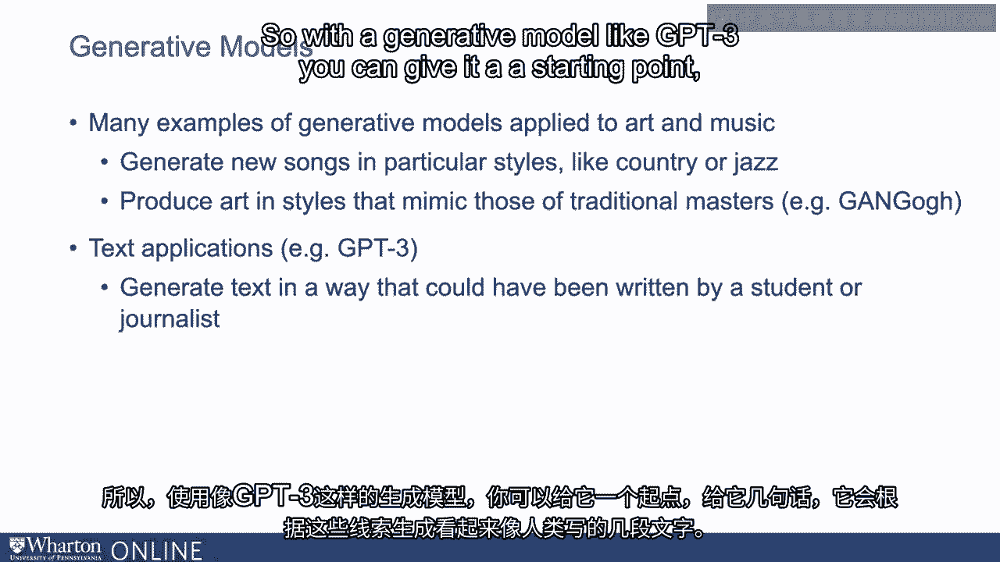

## 生成模型的应用实例 🎨

以下是生成模型在多个领域的具体应用示例：

*   **艺术与音乐**：有生成模型用于生成模仿特定风格（如乡村或爵士乐）的新歌曲。这些模型能产生乐器编制、歌词，甚至模仿人声。也有生成模型可用于生成模仿特定大师（例如梵高）风格的艺术作品。
*   **文本生成**：最著名的生成模型或许是文本应用，特别是GPT-3和GPT-2。这类生成模型能够生成看起来像是人类写的文本，例如学生的论文或记者的文章。使用像GPT-3这样的模型，你给它一个起始点或几句话，它基本上会生成沿着这些思路的文本，填充出几个看起来由人类撰写的段落。

虽然媒体对GPT-3的许多有趣演示进行了报道，但人们也在考虑其商业应用。现在有一些企业在尝试开发针对这类技术的产品，例如使用它来创建完整的电子邮件或简化邮件回复流程。

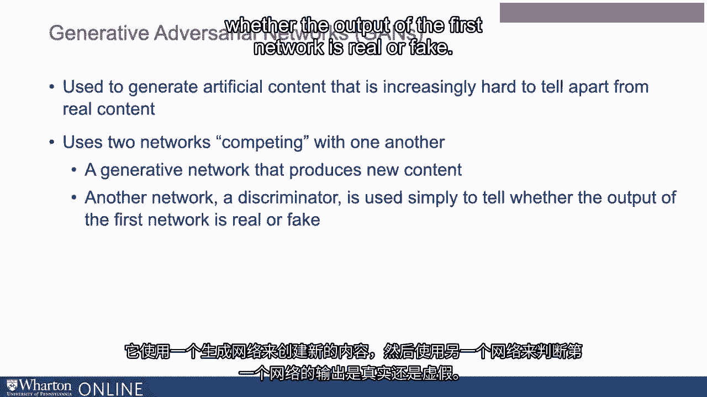

## 生成对抗网络 ⚔️

现在，这种称为生成对抗网络的变体在生成模型中特别重要。这是一种用于生成越来越难以与真实内容区分的人工内容的技术。

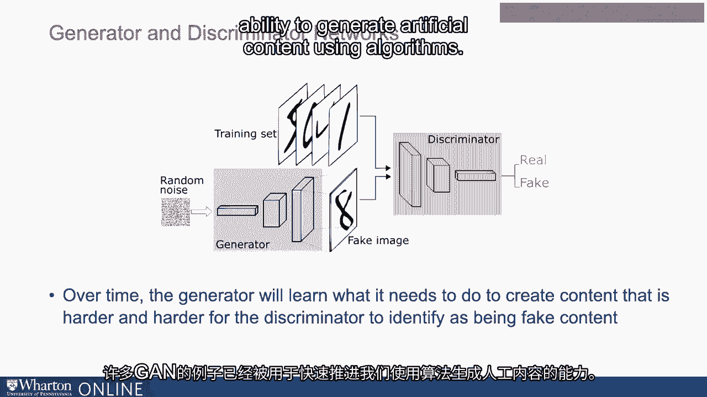

生成对抗网络的工作方式是使用两个网络相互竞争。它使用一个**生成网络**创建新内容，然后使用另一个**判别网络**来判断第一个网络的输出是真实的还是虚假的。

因此，一个生成器不断输出新的人工内容，而判别器则观察输出的内容并判断其是真还是假。随着时间的推移，生成器会学习如何创建内容，使得判别器识别虚假内容变得越来越困难。通过这个过程，生成器发展出越来越多在真实性方面难以区分的内容。

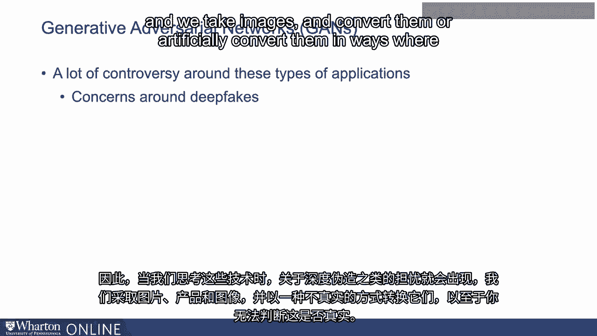

有很多例子表明，GANs已被用于迅速推进我们使用算法生成人工内容的能力。例如，GANs已被用于大规模生成人工面孔，使得机器或人类很难看着图片并判断其是否是一个真实人类面孔的图片。

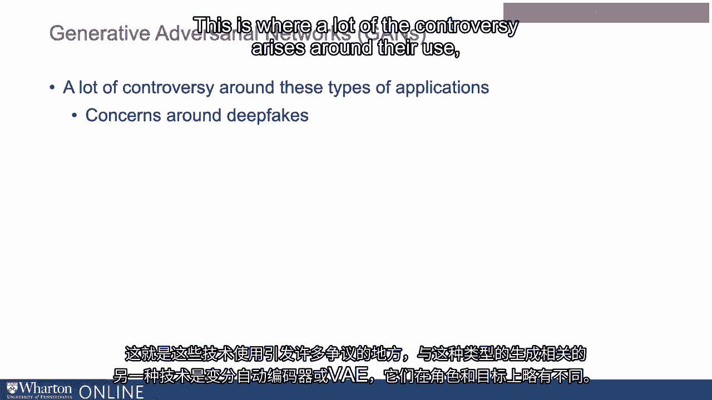

然而，这些类型的应用同样存在很多争议。当我们思考这些技术时，这些是一些担忧的来源，比如“深度伪造”现象的出现。当我们对图像进行人工处理，并以你无法判断其真实性的方式进行转换时，就会产生很多围绕其使用的争议。

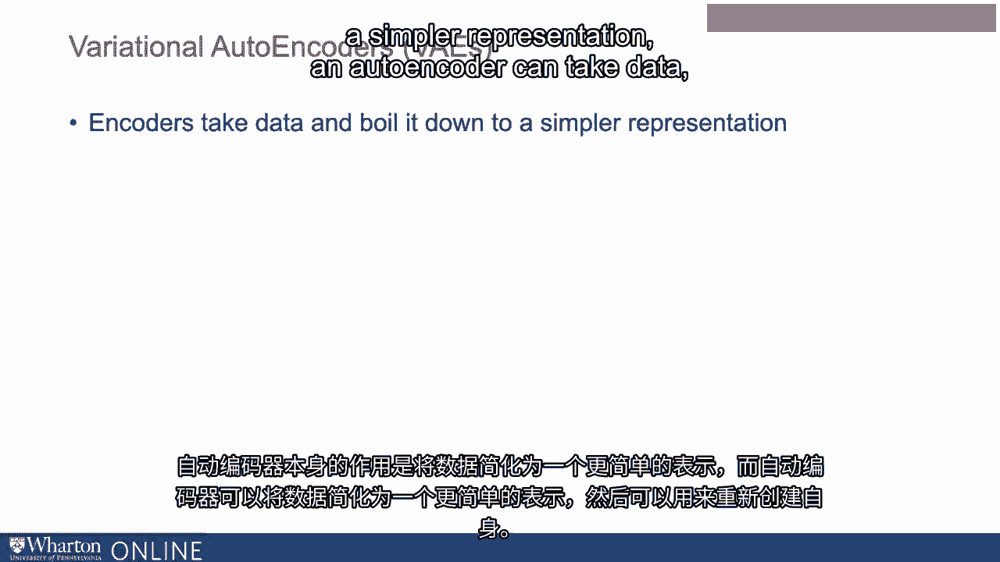

## 变分自编码器 🔄

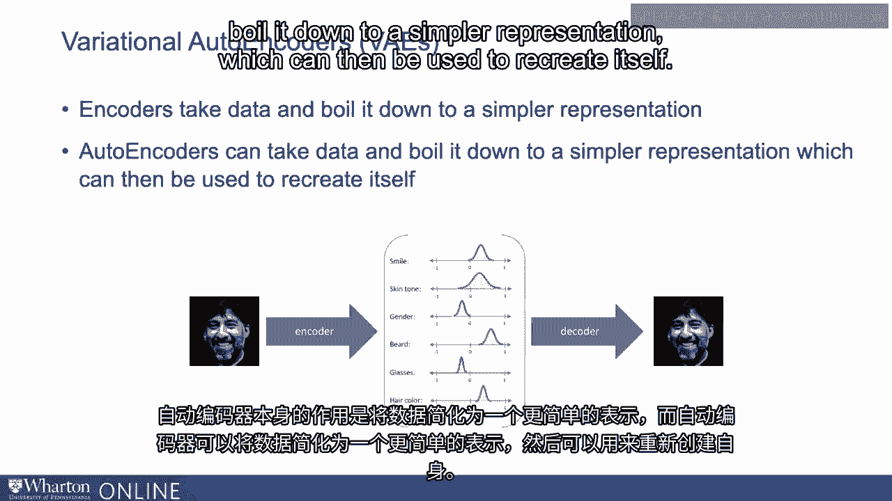

上一节我们介绍了生成对抗网络，本节中我们来看看另一种相关的生成技术：变分自编码器。它们有稍微不同的角色和目标。

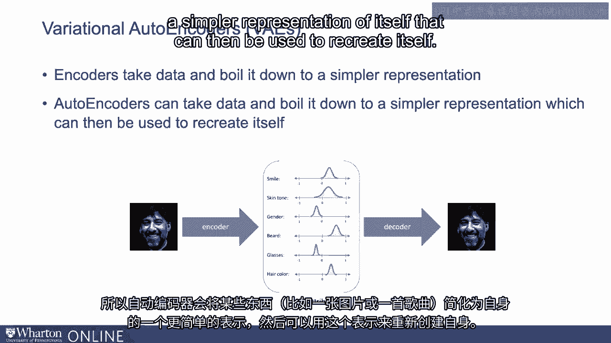

自编码器本身所做的是提取数据，将其简化为更简单的表示（即编码），然后用于重建自身（即解码）。自编码器会处理像图像或歌曲这样的东西，将其简化为自身的更简单表示，然后可以用来重建自身。

变分自编码器特别有趣，因为它可以稍微变换一些数据的属性或方面。所以我们可以获取一张图片，将其分解成各个部分，也许在某些方面进行调整（例如改变头发颜色），然后重新创建图像。这将允许一种称为**控制生成**的技术出现。

我们不仅是在生成人工内容，而且是在生成我们可以控制其不同属性的人工内容。这引入了许多新颖的用例。

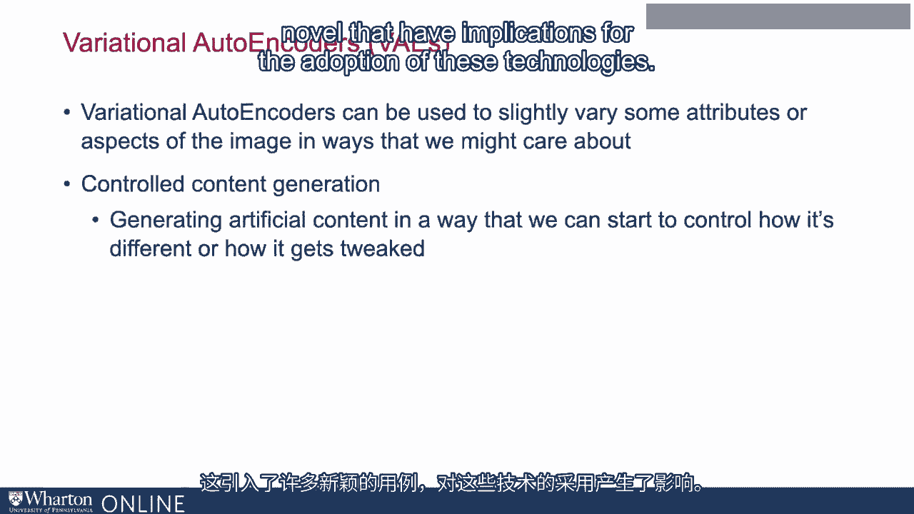

以下是变分自编码器的应用潜力：

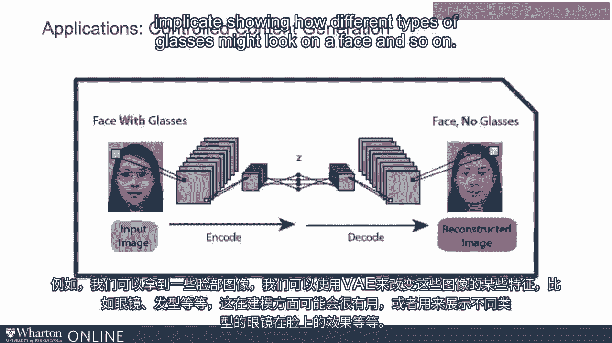

*   以面孔为例，我们可以使用VAEs以特定方式改变面孔，这在建模事物或简化不同类型方面可能是有用的，例如模拟眼镜在面孔上的样子。
*   受控内容生成在图像编辑、属性变换等方面有很多应用，对于以更多或更少的方式处理那些图片的特定属性是有用的。

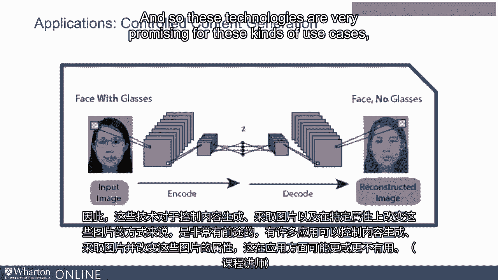

---

本节课中我们一起学习了生成模型的核心概念，重点探讨了生成对抗网络和变分自编码器。GANs通过生成器和判别器的对抗训练来创造逼真内容，而VAEs则通过编码-解码框架实现对生成内容的可控变换。这两种技术正在推动人工智能在创意和内容生成领域的前沿发展，同时也带来了新的伦理挑战。理解它们的工作原理是探索现代AI应用的重要一步。