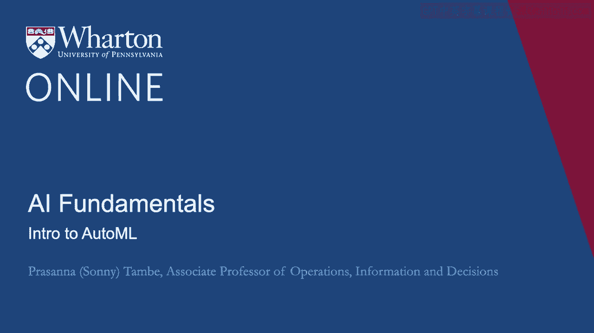
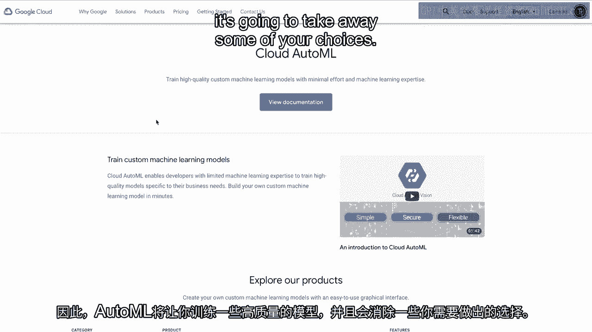
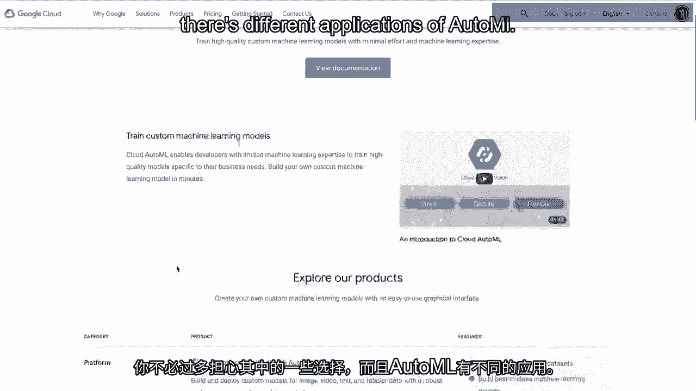
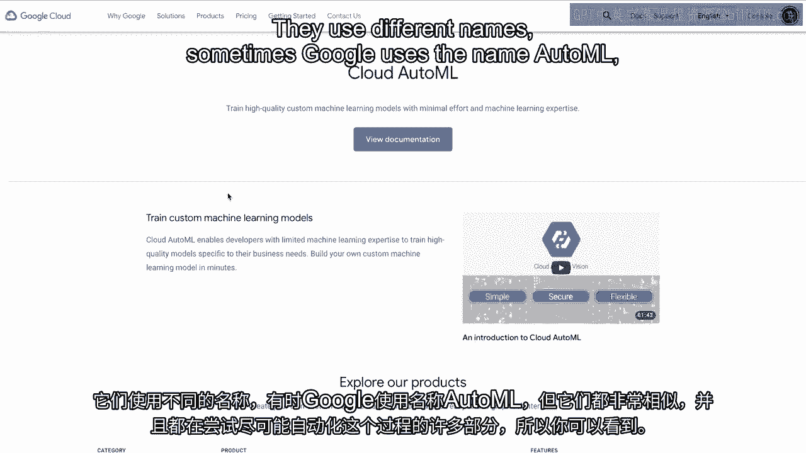
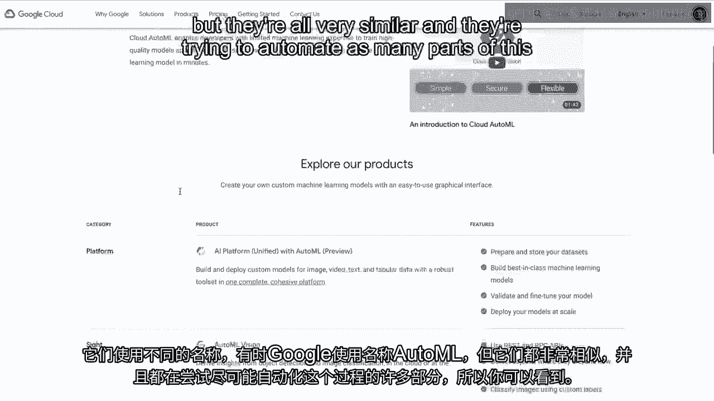
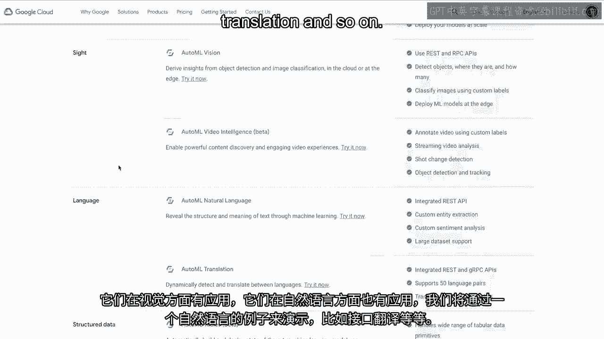

# 27：自动机器学习简介 🤖



在本节课中，我们将要学习自动机器学习（AutoML）的基本概念。我们将了解AutoML的目标、它能解决的问题，以及它在实际应用中的一些例子。

---

## 什么是AutoML？

AutoML是“自动化机器学习”的缩写。AutoML的目标是自动化机器学习过程中的尽可能多的环节，从而简化整个流程。

当我们思考传统的机器学习过程时，通常会涉及多个阶段。首先是数据获取与准备阶段，接着是特征工程，包括特征提取和特征选择等步骤。完成这些前期工作后，我们才进入模型选择阶段，并需要考虑参数调整等问题。

构建一个机器学习模型涉及如此多的阶段，而AutoML的理念就是尽可能地自动化这些部分。

---

## AutoML的目标与市场

AutoML的目标，从某种意义上说，也是当前市场的目标。许多公司已经开始提供AutoML解决方案。

其核心目的是让机器学习技术变得更易于获取和使用，降低使用门槛。无论使用者是否具备专业的机器学习知识，都能借助AutoML来应用机器学习。

例如，观察Google的云端AutoML解决方案，其首页的第一行就明确表示：“你可以用最少的努力和机器学习专业知识，训练出高质量的定制机器学习模型。”

---



## AutoML如何工作？

这些AutoML模型本质上所做的是，用大量的计算过程来替代人工决策。这样，用户就不必过于担心在机器学习工作流中做出的某些特定选择。



因此，AutoML允许你训练出一些高质量的模型，同时削弱了对用户专业选择能力的依赖。你无需过度担忧某些技术细节的选择。

以下是AutoML工作流程的一个简化表示：
```python
# 传统机器学习流程
数据准备 -> 特征工程 -> 模型选择 -> 超参数调优 -> 模型评估

# AutoML流程
输入数据 -> AutoML系统 -> 输出优化后的模型
```



---

## AutoML的应用领域



AutoML有不同的应用方向。至少，在Google的产品体系中是如此。此外，还有许多其他公司也提供与AutoML相关的解决方案，它们有时会使用不同的名称，但核心理念都非常相似，即致力于自动化机器学习过程的多个环节。

你可以看到，AutoML在计算机视觉领域有应用，在自然语言处理领域也有应用。我们将通过自然语言界面、翻译等示例来具体了解。



这些应用都将处理一些非结构化数据，并允许你利用这些数据来进行预测。

---


## 总结

本节课中，我们一起学习了自动机器学习（AutoML）的基础知识。我们了解到AutoML旨在自动化机器学习的多个阶段，从而降低技术门槛，让更多人能够应用机器学习技术。我们还探讨了AutoML的目标、工作原理以及它在视觉和自然语言处理等领域的广泛应用。