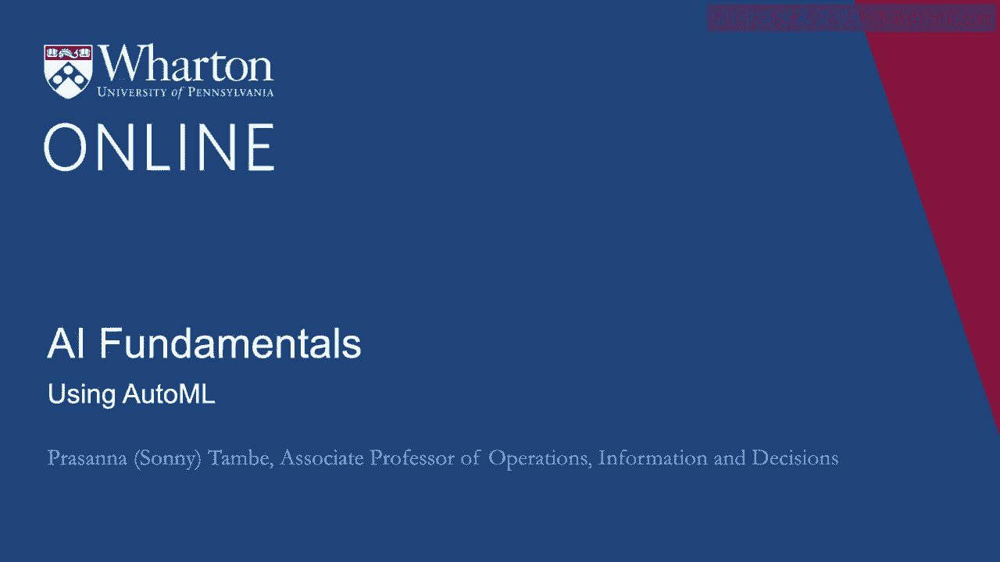
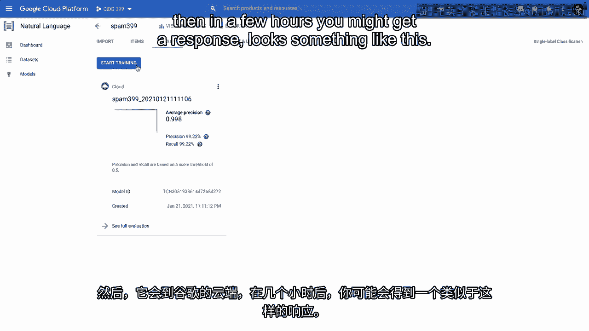
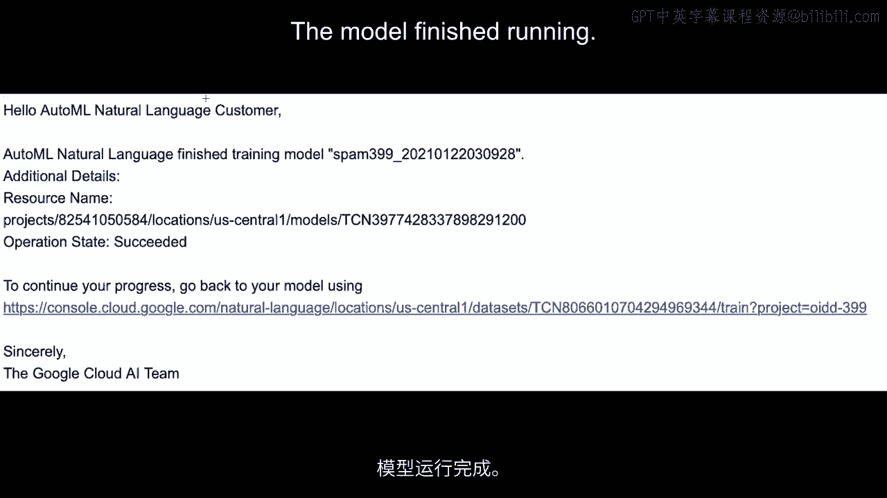
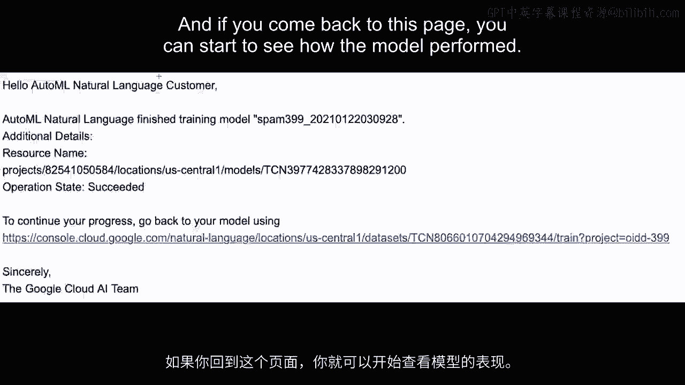
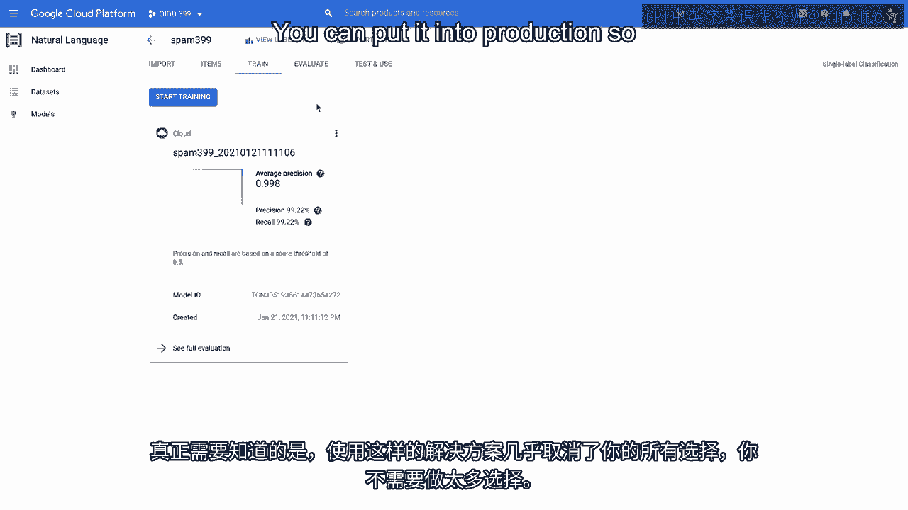

# 28：使用自动机器学习 🚀

在本节课中，我们将通过一个识别垃圾邮件的示例，了解自动机器学习（AutoML）的完整工作流程，并观察有多少步骤被自动化了。

## 概述

我们将使用机器学习算法来识别文本消息（如电子邮件或短信）是否为垃圾邮件。这类算法可以自动将垃圾邮件归类到特定文件夹中。假设我们有一个文本消息文件，目标是建立一个能够自动区分垃圾邮件与非垃圾邮件的算法。

## 工作流程详解

### 1. 准备训练数据

首先，我们需要一个训练数据集。这个数据集应包含大量文本消息，并在其中一列明确标注每条消息是否为垃圾邮件。数据是启动任何机器学习项目的基础。

以下是一个数据示例的示意结构：

| 文本消息 | 是否为垃圾邮件 |
| :--- | :--- |
| “恭喜您获得大奖！” | 是 |
| “今晚一起吃饭吗？” | 否 |

### 2. 使用 AutoML 平台

自动机器学习的核心理念是让数据准备之后的过程变得尽可能简单。我们将使用谷歌的 AutoML 自然语言平台。

以下是使用该平台的关键步骤：
*   **导入数据**：将准备好的数据集上传到平台。
*   **开始训练**：平台界面上通常有一个明确的“开始训练”按钮。点击后，系统将接管后续所有复杂工作。

### 3. 模型训练与评估

点击“开始训练”后，计算任务会被提交到谷歌云端。平台会利用强大的计算资源，自动尝试多种模型和参数，以找到针对您数据的最优预测模型。这个过程可能需要数小时。

训练完成后，您会收到通知。此时，您可以查看模型的性能报告。

报告通常会包含以下核心评估指标：
*   **精度**：模型预测为垃圾邮件的消息中，真正是垃圾邮件的比例。公式为：`精度 = 真正例 / (真正例 + 假正例)`
*   **召回率**：所有真实的垃圾邮件中，被模型正确识别出来的比例。公式为：`召回率 = 真正例 / (真正例 + 假反例)`

### 4. 模型部署与使用

在评估模型性能并感到满意后，您可以将模型部署到生产环境。部署后的模型可以接收新的文本消息，并自动判断其是否为垃圾邮件，从而实现自动化分类。

## 总结

本节课我们一起学习了自动机器学习（AutoML）的基本工作流程。关键要点在于，像谷歌 AutoML 这样的解决方案极大地简化了机器学习过程。其明确目标是让没有专业背景的人也能应用机器学习技术。

一旦准备好数据，您只需“开始训练”，然后等待系统自动完成模型构建和优化。最后，对生成的模型进行评估并部署使用即可。需要注意的是，使用此类云端服务会产生相应的计算资源费用。