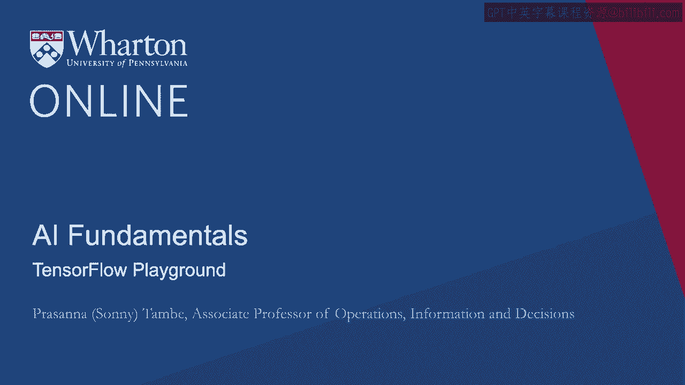
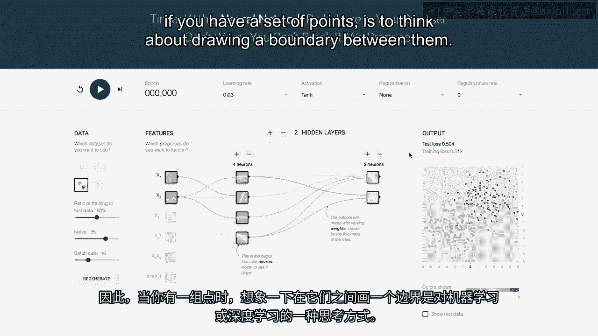
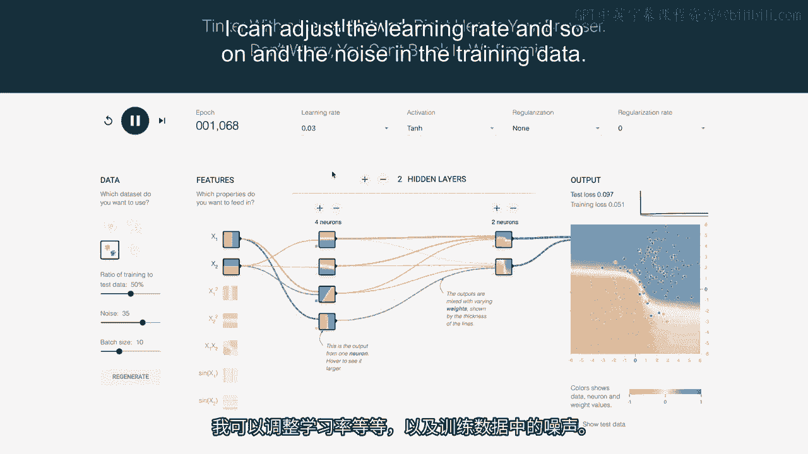

# 30：TensorFlow 游乐场入门指南 🎮



在本节课中，我们将学习如何使用 TensorFlow 游乐场这一交互式工具，来直观地理解深度学习网络的工作原理。我们将探索其界面、核心参数以及如何通过调整这些参数来观察神经网络的学习过程。

---

随着机器学习被越来越多的人和企业所采用，出现了许多工具来帮助人们更好地理解机器学习的工作原理，以及在不同选择之间如何进行权衡。

TensorFlow 游乐场就是这样一个示例工具。它由谷歌开发，旨在封装深度学习的核心逻辑，并以简单透明的方式，帮助用户理解其软件中不同部分和元素是如何组合在一起的。

因此，TensorFlow 游乐场是众多在线工具之一，专门用于理解不同类型的深度学习或机器学习是如何工作的。

## 🧠 理解深度学习网络的选择

上一节我们介绍了TensorFlow游乐场的背景，本节中我们来看看它的核心功能：展示你在深度学习网络中可以进行哪些选择。

我们讨论的是深度学习。我们已经知道如何将数据输入网络。这里运行的神经网络，其目标是学习如何进行预测。虽然它不需要很多领域专业知识，但存在许多**超参数**需要调整和优化，以使网络能够高效学习。

学习工程师必须理解如何以最佳方式调整这些参数，以使得预测尽可能准确。TensorFlow游乐场就是一个让你可以“玩弄”这类参数、理解它们的作用以及神经网络如何组合的界面。

## 🏗️ 神经网络的构成与调整

我们讨论了神经网络是由一些隐藏层组成的深度学习网络。在游乐场中，你可以调整或减少网络层的数量。

以下是一个深度学习引擎的基本构成，它接收多个数据点并进行分类，其核心任务是在数据点之间绘制一个作为分类器的决策边界：

```python
# 一个简化的神经网络分类过程概念
输入数据点 -> 隐藏层（处理特征）-> 输出层（生成预测/分类）
```

因此，理解机器学习或深度学习的一种方式是：如果你有一组点，核心任务就是在它们之间找到一个最佳的划分边界。




其核心思想是：给定这样一组点，我可以在哪里画出最佳的边界？如果我说边界一侧的所有点都属于类别A，另一侧的所有点都属于类别B，那么我希望这个划分尽可能准确。哪里是划定那个边界的最佳方法？

## 🔬 探索不同数据与参数

TensorFlow游乐场让你可以从多种不同的点分布开始，观察网络在不同数据假设和不同参数设置下的表现。

例如，在这个场景中运行网络，你可以改变参数。网络会尝试画一条线来分割这些点（即训练数据集）。它可能会学习到沿着对角线某处进行分割，比如说，对角线右上方的所有点属于一个类别（例如蓝色），左下方的点属于另一个类别（例如橙色）。

这样，当未来获得一个位于右上角空间的新点时，它就会被分类为蓝色。运行网络后，它可能会在对角线位置创建一条决策边界。

主要需要了解的是，这个工具本质上是在向你展示或说明深度学习引擎是如何“思考”和工作的。它会展示每一层不同节点的输出，以及这些输出如何组合以进行下一步计算。

因此，这又是一个用于理解深度学习引擎如何构建，以及不同参数如何影响其性能的工具。

## ⚙️ 调整核心参数

以下是你可以调整的一些核心参数，看看它们如何影响深度学习网络的学习效果和预测能力：

*   **激活函数**：决定神经元是否被激活的数学函数，例如 `ReLU` 或 `Sigmoid`。
*   **学习率**：控制模型在每次更新参数时的步长大小。
*   **正则化/噪声**：向训练数据添加噪声或使用正则化技术，以防止模型过拟合。
*   **训练数据**：选择不同的数据集分布来测试模型的泛化能力。




通过进行这些调整，你可以直观地看到它们对深度学习网络学习过程和最终预测结果的影响。


---

本节课中，我们一起学习了TensorFlow游乐场这个交互式工具。我们了解了它如何通过可视化方式展示深度学习网络的构成、学习过程以及决策边界的形成。重点探索了如何通过调整**激活函数**、**学习率**等关键超参数，来观察并理解它们对神经网络性能的影响。这是一个非常适合初学者直观感受深度学习原理的实践平台。